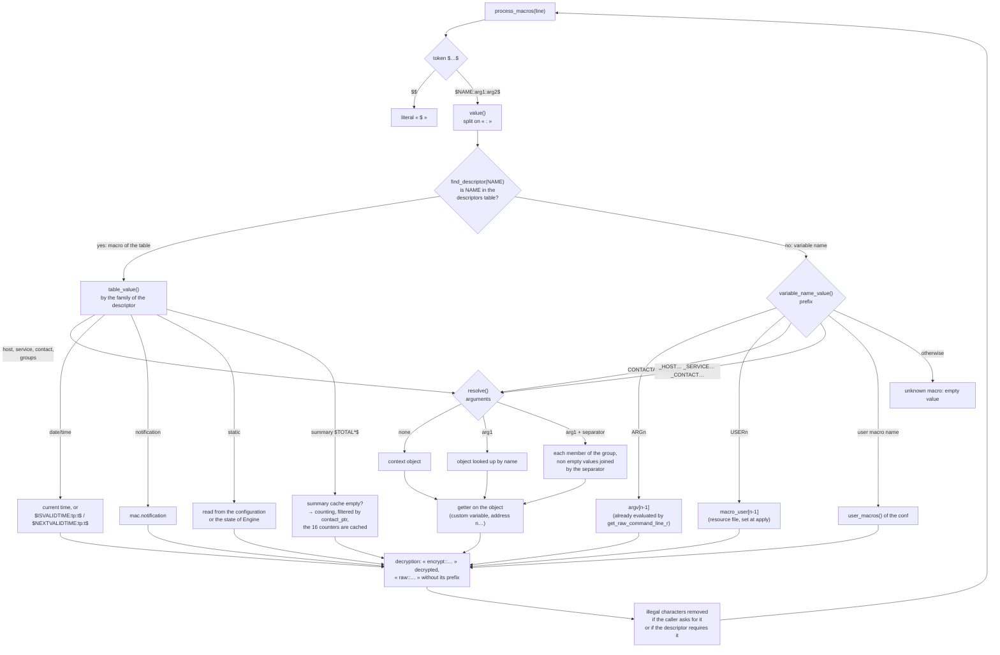

# Engine macros — context, evaluation and code layout

<!-- TOC -->
* [Engine macros — context, evaluation and code layout](#engine-macros--context-evaluation-and-code-layout)
  * [1. The `macro_context` context](#1-the-macro_context-context)
  * [2. Context setup by the caller](#2-context-setup-by-the-caller)
  * [3. Evaluating a macro](#3-evaluating-a-macro)
    * [Syntax, case by case](#syntax-case-by-case)
  * [4. Values, caches and recomputations](#4-values-caches-and-recomputations)
    * [The scope of a contact for the `$TOTAL*$` macros](#the-scope-of-a-contact-for-the-total-macros)
    * ["Unhandled" problems and broker mode](#unhandled-problems-and-broker-mode)
  * [5. Code layout](#5-code-layout)
  * [6. Tests](#6-tests)
  * [7. Measures](#7-measures)
    * [7.1 Standard macros, by family](#71-standard-macros-by-family)
    * [7.2 Other forms, costly macros and full paths](#72-other-forms-costly-macros-and-full-paths)
    * [7.3 Reading](#73-reading)
<!-- TOC -->

This document describes how Engine replaces macros (`$HOSTNAME$`,
`$SERVICESTATE$`, `$CONTACTEMAIL$`, `$ARG1$`, `$_HOSTFOO$`…) in the command
lines of checks, notifications and event handlers. The code lives in
`engine/macros/`.

## 1. The `macro_context` context

An evaluation always happens in a **context**, `macro_context`
(`macros/macro_context.hh`). Each caller declares its own, as a local
variable: there is no global context, and nothing carries over from one
evaluation to the next. The context holds:

- `argv`: the values of `$ARG1$`…`$ARG32$` of the current command;
- the **context objects** `host_ptr`, `service_ptr`, `contact_ptr`,
  `hostgroup_ptr`, `servicegroup_ptr`, `contactgroup_ptr`: the objects the
  macros without argument are about;
- `notification`: the values of the current notification
  (`notification_values`), only set while a notification is sent:
  - `resource`, the host or service it is about;
  - `type`, `id`, `number`, `is_escalated`;
  - `recipients`, `author`, `author_name`, `author_alias`, `comment`;
- two **caches**: `summary` for the 16 `$TOTAL*$` macros, and
  `host_services` for the 5 `$TOTALHOSTSERVICES*$` macros of the context
  host.

The `set_host()`, `set_service()` and `set_contact()` methods set an object
and what follows from it:

| Method | Effect |
|---|---|
| `set_host(hst)` | `host_ptr` = the host; `hostgroup_ptr` = its first host group; `contact_ptr` and `contactgroup_ptr` = its first contact and its first contact group, if it has some; clears the `host_services` cache |
| `set_service(svc)` | `service_ptr` = the service; `servicegroup_ptr` = its first service group; `contact_ptr` and `contactgroup_ptr` = its first contact and its first contact group, if it has some |
| `set_contact(cntct)` | `contact_ptr` = the contact; `contactgroup_ptr` = its first group; clears the `summary` cache, since the `$TOTAL*$` macros depend on the contact |

The "first" group or contact is read from a hash table: it is any of them.

## 2. Context setup by the caller

| Caller | Context set |
|---|---|
| host check (`checker.cc`, `host::get_check_command_line()`) | `set_host` |
| service check (`service::get_check_command_line()`) | `set_host` + `set_service` |
| event handlers, OCSP and OCHP (`sehandlers.cc`, `service.cc`) | `set_host`, plus `set_service` for a service |
| notification (`run_notification_commands()`, `notification_execution.cc`) | `set_host` of the resource, plus `set_service` for a service, then `notification`, then `set_contact` for **each** contact |
| connector (`applier/connector.cc`) | nothing: only the macros without object are useful |

Then `get_raw_command_line_r()` (`utils.cc`) splits the `check_foo!arg1!arg2`
command on `!`, **evaluates the macros of each argument** and stores the
result in `argv`. The command line itself is evaluated afterwards, by
`macros::process_macros()` (directly, or through `command::process_cmd()`),
and that is where `$ARGn$` is replaced.

The `raw` and `raw_v2` connectors also export all the macros of the table to
the environment of the command (`NAGIOS_HOSTNAME`…), with the custom
variables of the host, the service and the contact. With
`use_large_installation_tweaks`, the `$TOTAL*$` macros are only exported when
they are already cached.

## 3. Evaluating a macro

`macros::process_macros()` (`macros/process.cc`) walks the line: `$$` gives a
`$`, a last `$` or a `$` without its closing `$` is dropped, and each `$…$` is
given to `macros::value()` (`macros/resolve.cc`). The name is split
on `:` into at most three parts, `NAME:arg1:arg2`:

- without argument, the macro is about the **context** object;
- with `arg1` only, it is an **on-demand** macro on the named object
  (`$HOSTSTATE:srv1$`, `$SERVICESTATE:srv1:ping$`);
- with `arg1` and `arg2`, it is a **concatenation over a group**, `arg2`
  being the separator (`$HOSTSTATE:hg_web:,$`). For services, `arg1:arg2` is
  first looked up as a host/service pair, then as a service group and a
  separator.

The macros with an id (`MACRO_HOSTNAME`…) are described by a **descriptors
table** (`macros/descriptors.cc`). `find_descriptor()` looks the macro name
up in it: if it is there, `table_value()` computes the value from the
descriptor; otherwise, `variable_name_value()` handles the macros whose
name is not fixed, so that they cannot be in the table (`$ARGn$`, `$USERn$`,
`$CONTACTADDRESSn$`, custom variables, user macros). A descriptor gives the name of the macro,
its **family**, whether its value must be cleaned, and the function computing
this value on an object (the *getter*). The family tells what the macro is
about, hence how to find the object.



**Cleaning** removes the ASCII control characters and the
`illegal_output_chars` of the configuration. The caller asks for it with
`STRIP_ILLEGAL_MACRO_CHARS` (notifications, event handlers, OCSP/OCHP), and
some macros always require it: the outputs and perfdata of the checks, the
author and the comment of the notifications.

### Syntax, case by case

The configuration forbids empty names, so an empty argument never designates
a named object: it means "the context object", or it is an error. An error
gives an empty value, and its cause is logged at `debug` level on the
`macros` logger.

In the tables, `X` stands for the name of the macro (`HOSTNAME`,
`CONTACTEMAIL`…). For example, `$HOSTNAME:hg_web:,$` gives the name of each
host of the `hg_web` group, separated by commas.

**Host and contact macros** (`$HOSTNAME$`, `$CONTACTEMAIL$`, `$_HOSTFOO$`,
`$_CONTACTFOO$`, `$CONTACTADDRESSn$`…)

| Form | Meaning |
|---|---|
| `$X$`, `$X::$` | the context object |
| `$X:name$` | the object `name` |
| `$X:group:sep$` | the members of the host or contact group `group`, values separated by `sep` |
| `$X::sep$` | error: the group name is missing |

**Service macros** (`$SERVICESTATE$`, `$_SERVICEFOO$`…)

| Form | Meaning |
|---|---|
| `$X$`, `$X::$` | the context service |
| `$X::desc$` | the service `desc` of the context host |
| `$X:host:desc$` | the service `desc` of the host `host` |
| `$X:group:sep$` | if no service `(group, sep)` exists: the members of the service group `group`, values separated by `sep` |
| `$X:host$` | error: a service description or a separator is expected |

**Group macros** (`$HOSTGROUPALIAS$`, `$SERVICEGROUPMEMBERS$`,
`$CONTACTGROUPALIAS$`…)

| Form | Meaning |
|---|---|
| `$X$` | the context group: the first group of the host, service or contact |
| `$X:group$` | the group `group`; `arg2` is ignored |

**Macros without object** (date and time, static, `$TOTAL*$`, notification,
`$ARGn$`, `$USERn$`): the arguments are ignored, except for
`$ISVALIDTIME:period[:t]$` and `$NEXTVALIDTIME:period[:t]$`, where `t` is a
timestamp (the current time by default).

In a group form, the members come in no particular order, and the empty
values are skipped.

## 4. Values, caches and recomputations

| Family | Where the value comes from | Lifetime |
|---|---|---|
| static (`$ADMINEMAIL$`, `$POLLERNAME$`…) | read from the configuration or the state of Engine, at each call | no caching |
| `$USERn$` | `macro_user[]`, filled by `applier::macros` from the resource file | until the next apply |
| user macros | `user_macros()` of the configuration | same |
| `$ARGn$` | `argv`, evaluated by `get_raw_command_line_r()` | one command |
| notification (`$NOTIFICATIONTYPE$`…) | `notification`, filled by `run_notification_commands()` | one notification |
| host, service, contact, groups | getter on the object, **at each call** | no caching |
| `$HOST/SERVICENOTIFICATIONID$`, `$HOST/SERVICENOTIFICATIONNUMBER$` | the current notification if it is about this object, the object otherwise | — |
| `$TOTALHOSTSERVICES*$` | the services of the host; cached in `host_services` for the context host | until the next `set_host`; on another host (`$TOTALHOSTSERVICES:h2$`), computed at each call |
| summary `$TOTAL*$` (16 macros) | the hosts and services of the context contact, or of the whole poller without contact; cached in `summary` | until the next `set_contact`, so computed again for each contact of a notification |
| date/time | computed at each call | none |
| `$_HOST…$`, `$_SERVICE…$`, `$_CONTACT…$` | custom variables of the object, at each call | none |

The `*NOTIFICATIONID` and `*NOTIFICATIONNUMBER` macros read the current
notification because in broker mode, Broker decides the notification and
gives its id and its number: the poller does not know them. While a service
notification is sent, `$HOSTNOTIFICATIONNUMBER$` stays the one of the host.

### The scope of a contact for the `$TOTAL*$` macros

With a contact in the context, the `$TOTAL*$` macros only count the hosts
and services it is a contact for, directly or through a contact group. Each
contact keeps the list of these objects (`contact::get_notified_objects()`)
and computes it again only when `notifier::contacts_version` has changed.
This version is incremented each time the contacts of the resources may
change:

- a resource is wired (`notifier::resolve_pointers()`);
- a resource leaves `host::hosts` or `service::services`, or is destroyed;
- the members of a contact group change, or a contact is removed;
- the configuration state is cleared.

The contact thus never reads a stale pointer. With 220,000 objects, the
`$TOTAL*$` macros of a contact go from about 9 ms to 15 µs.

### "Unhandled" problems and broker mode

The `$TOTAL*UNHANDLED$` macros count a problem as unhandled unless the
resource is in downtime (`scheduled_downtime_depth > 0`), acknowledged, or
its active checks are disabled. The problem of a service whose host is DOWN
or UNREACHABLE is considered handled.

They read the **local** state of Engine. With `notification_mode = broker`,
downtimes and acknowledgements are managed by Broker and are not yet sent
down to the poller: these macros **overcount** the unhandled problems there.
This is a known bug, to be fixed.

## 5. Code layout

The `engine/macros/` module has its own `CMakeLists.txt`.

| File | Content |
|---|---|
| `macro_context.{hh,cc}` | `macro_context`, `notification_values`, `set_host()`, `set_service()`, `set_contact()` |
| `defines.hh` | the `MACRO_*` ids, `MAX_COMMAND_ARGUMENTS`, `MAX_USER_MACROS`, `MACRO_ENV_VAR_PREFIX`, `STRIP_ILLEGAL_MACRO_CHARS`, the size of the caches |
| `descriptors.{hh,cc}` | the table of the macros with an id: `descriptor`, `find_descriptor()`, `all_descriptors()`, the getters and the formatting of the values |
| `resolve.{hh,cc}` | `value()`, `table_value()`: arguments, context, named or group object, other macros, decryption, cleaning |
| `summary.{hh,cc}` | `generate_summary_macros()`: the counting of the `$TOTAL*$` macros |
| `process.{hh,cc}` | `process_macros()`, `strip_illegal_macro_chars()` |

The module is an `OBJECT` library, `engine_macros`, whose objects go into
`cce_core`. The macros read the objects of the core (hosts, services,
contacts, configuration), and the core calls the macros: a static library
would need a link cycle, which CMake refuses when `cce_core` is shared.

`macro_context` and `notification_values` are in `com::centreon::engine`,
the functions of the module in `com::centreon::engine::macros`. The
constants of `defines.hh` are preprocessor macros.

To **add a macro with an id**: give it an id in `defines.hh` (and increase
`MACRO_X_COUNT`), then add its descriptor to the table, sorted by id (a
`static_assert` checks it). The golden file must then be regenerated (see
the next section).

## 6. Tests

The `MacroGolden.AllMacros` test (`engine/tests/macros/golden.cc`) compares
the evaluation of all the macros to a reference file,
`engine/tests/macros/golden.txt` (about 7,000 lines):

- each macro of the table, and the families outside the table, in 13 forms
  (`$X$`, `$X:h2$`, `$X:h2:s$`, `$X::s$`, `$X:hg:#$`…), in 3 contexts: no
  object, the notification of a host to a contact, the notification of a
  service to a contact;
- the cleaning of the characters, the timeperiods, and full check command
  lines.

The members of a group come in no particular order: the outputs of the group
forms and of the `*MEMBERS` macros are sorted before comparison.

To regenerate the reference, from `build/`:

```bash
MACROS_GOLDEN_UPDATE=1 tests/ut_engine --gtest_filter='MacroGolden.*'
```

A change of `golden.txt` must always be justified in the commit message: it
is a behavior change users can see.

The other macros tests are in `engine/tests/macros/pbmacro*.cc` (`Macro.*`).

## 7. Measures

The figures come from `macros_bench` (`engine/benchmark/macros.cc`):

- `RelWithDebInfo` build (`-O2`), development machine (22 cores, 4.5 GHz),
  process pinned to one core;
- poller with 1,000 hosts, 10,000 services and 100 contacts;
- value kept: median CPU time over 3 repetitions.

```bash
taskset -c 2 build/engine/benchmark/macros_bench --benchmark_repetitions=3 \
    --benchmark_report_aggregates_only=true
```

Two series are given:

- **before**: the code before the rework (commit `6fb3d8b20a`);
- **after**: the reworked code (commit `bc95675116`).

This is not an ABBA comparison, since the binary of before no longer exists:
a 5 to 6 % gap is not significant. To compare a new implementation, run the
same command on the same machine, alternating the two binaries.

### 7.1 Standard macros, by family

Each macro is evaluated alone (`$NAME$`), with a full context (host,
service, contact and notification set).

Before (the families were then those of the old handlers):

| Family | Macros | Min | Median | Max |
|---|---:|---:|---:|---:|
| host | 41 | 76 ns | 158 ns | 271 ns |
| service | 44 | 60 ns | 174 ns | 403 ns |
| contact | 5 | 68 ns | 76 ns | 150 ns |
| groups (hosts, services, contacts) | 18 | 71 ns | 128 ns | 271 ns |
| notification | 8 | 68 ns | 120 ns | 146 ns |
| static | 14 | 51 ns | 102 ns | 191 ns |
| date/time | 7 | 62 ns | 175 ns | 265 ns |
| summary `$TOTAL*$` (cached) | 16 | 93 ns | 104 ns | 190 ns |

After (families of the descriptors table):

| Family | Macros | Min | Median | Max |
|---|---:|---:|---:|---:|
| host | 47 | 38 ns | 47 ns | 122 ns |
| service | 40 | 38 ns | 48 ns | 215 ns |
| contact | 7 | 45 ns | 46 ns | 58 ns |
| groups (hosts, services, contacts) | 12 | 42 ns | 44 ns | 226 ns |
| notification | 8 | 38 ns | 47 ns | 102 ns |
| static | 16 | 36 ns | 47 ns | 77 ns |
| date/time | 7 | 48 ns | 164 ns | 274 ns |
| summary `$TOTAL*$` (cached) | 16 | 40 ns | 45 ns | 48 ns |

### 7.2 Other forms, costly macros and full paths

- `BM_Group/<macro>/<N>`: concatenation over a group of N members.
- `BM_SummaryComputed/0|1`: the 16 `$TOTAL*$` macros computed again (cache
  cleared), without then with contact filtering.
- `BM_Cleaning/0|1`: `$SERVICEOUTPUT$ $SERVICEPERFDATA$` without then with
  the cleaning of the characters.
- `BM_ServiceCheckCommand`, `BM_HostCheckCommand`: context, arguments and
  command line, as for a check.
- `BM_NotificationLine`: the default Centreon mail line, evaluated for one
  contact.

| Bench | Before | After |
|---|---:|---:|
| `BM_Other/ARG1` | 203 ns | 48 ns |
| `BM_Other/USER1` | 156 ns | 64 ns |
| `BM_Other/user_macro` | 175 ns | 68 ns |
| `BM_Other/custom_host` | 148 ns | 51 ns |
| `BM_Other/custom_service` | 161 ns | 51 ns |
| `BM_Other/custom_contact` | 162 ns | 54 ns |
| `BM_Other/CONTACTADDRESS1` | 159 ns | 53 ns |
| `BM_Other/unknown` | 149 ns | 50 ns |
| `BM_Other/dollar_escape` | 13 ns | 12 ns |
| `BM_Other/no_macro` | 31 ns | 53 ns |
| `BM_OnDemand/HOSTSTATE` | 85 ns | 63 ns |
| `BM_OnDemand/SERVICESTATE` | 85 ns | 80 ns |
| `BM_OnDemand/SERVICESTATE_current_host` | 84 ns | 71 ns |
| `BM_OnDemand/CONTACTEMAIL` | 85 ns | 64 ns |
| `BM_OnDemand/custom_host` | 140 ns | 65 ns |
| `BM_Group/HOSTNAME/10` | 1.05 µs | 230 ns |
| `BM_Group/HOSTNAME/100` | 9.31 µs | 1.58 µs |
| `BM_Group/HOSTNAME/1000` | 100 µs | 17.5 µs |
| `BM_Group/custom_host/10` | 271 ns | 288 ns |
| `BM_Group/custom_host/100` | 1.41 µs | 1.98 µs |
| `BM_Group/custom_host/1000` | 13 µs | 20.3 µs |
| `BM_Group/SERVICESTATE/10` | 312 ns | 245 ns |
| `BM_Group/SERVICESTATE/100` | 2.14 µs | 1.44 µs |
| `BM_Group/SERVICESTATE/1000` | 25 µs | 14.6 µs |
| `BM_Group/CONTACTEMAIL/10` | 303 ns | 295 ns |
| `BM_Group/CONTACTEMAIL/100` | 1.78 µs | 1.64 µs |
| `BM_SummaryComputed/0` | 292 µs | 179 µs |
| `BM_SummaryComputed/1` | 145 µs | 865 ns |
| `BM_HostTotalsComputed` | 317 ns | 76 ns |
| `BM_Cleaning/0` | 657 ns | 546 ns |
| `BM_Cleaning/1` | 660 ns | 529 ns |
| `BM_ServiceCheckCommand` | 1.71 µs | 442 ns |
| `BM_HostCheckCommand` | 1.56 µs | 450 ns |
| `BM_NotificationLine` | 2.98 µs | 1.82 µs |

Notes:

- before the rework, `BM_OnDemand/custom_host` and `BM_Group/custom_host/*`
  measured an error path: these macros returned an empty string (bug fixed
  since). The two series cannot be compared;
- `BM_Other/no_macro` is slower: `process_macros()` now returns a new string,
  whereas the bench reused its buffer. The real callers already started from
  a new string;
- `BM_SummaryComputed/1` only walks the objects of the contact, whose list is
  cached.

<details>
<summary>Detail of the 153 standard macros (<code>BM_MacroX/&lt;id&gt;/&lt;NAME&gt;</code>)</summary>

| Bench | Before | After |
|---|---:|---:|
| `0/HOSTNAME` | 131 ns | 40 ns |
| `1/HOSTALIAS` | 132 ns | 40 ns |
| `2/HOSTADDRESS` | 135 ns | 41 ns |
| `3/SERVICEDESC` | 134 ns | 41 ns |
| `4/SERVICESTATE` | 60 ns | 40 ns |
| `5/SERVICESTATEID` | 137 ns | 38 ns |
| `6/SERVICEATTEMPT` | 139 ns | 38 ns |
| `7/LONGDATETIME` | 265 ns | 274 ns |
| `8/SHORTDATETIME` | 243 ns | 251 ns |
| `9/DATE` | 179 ns | 164 ns |
| `10/TIME` | 175 ns | 170 ns |
| `11/TIMET` | 62 ns | 48 ns |
| `12/LASTHOSTCHECK` | 142 ns | 42 ns |
| `13/LASTSERVICECHECK` | 139 ns | 52 ns |
| `14/LASTHOSTSTATECHANGE` | 142 ns | 41 ns |
| `15/LASTSERVICESTATECHANGE` | 141 ns | 41 ns |
| `16/HOSTOUTPUT` | 154 ns | 38 ns |
| `17/SERVICEOUTPUT` | 403 ns | 207 ns |
| `18/HOSTPERFDATA` | 127 ns | 39 ns |
| `19/SERVICEPERFDATA` | 311 ns | 215 ns |
| `20/CONTACTNAME` | 68 ns | 45 ns |
| `21/CONTACTALIAS` | 71 ns | 46 ns |
| `22/CONTACTEMAIL` | 76 ns | 45 ns |
| `23/CONTACTPAGER` | 77 ns | 53 ns |
| `24/ADMINEMAIL` | 71 ns | 77 ns |
| `25/ADMINPAGER` | 51 ns | 39 ns |
| `26/HOSTSTATE` | 76 ns | 57 ns |
| `27/HOSTSTATEID` | 156 ns | 54 ns |
| `28/HOSTATTEMPT` | 158 ns | 51 ns |
| `29/NOTIFICATIONTYPE` | 69 ns | 53 ns |
| `30/NOTIFICATIONNUMBER` | 68 ns | 48 ns |
| `31/HOSTEXECUTIONTIME` | 229 ns | 118 ns |
| `32/SERVICEEXECUTIONTIME` | 227 ns | 113 ns |
| `33/HOSTLATENCY` | 235 ns | 111 ns |
| `34/SERVICELATENCY` | 232 ns | 108 ns |
| `35/HOSTDURATION` | 271 ns | 104 ns |
| `36/SERVICEDURATION` | 256 ns | 113 ns |
| `37/HOSTDURATIONSEC` | 83 ns | 57 ns |
| `38/SERVICEDURATIONSEC` | 87 ns | 65 ns |
| `39/HOSTDOWNTIME` | 172 ns | 59 ns |
| `40/SERVICEDOWNTIME` | 162 ns | 53 ns |
| `41/HOSTSTATETYPE` | 80 ns | 49 ns |
| `42/SERVICESTATETYPE` | 79 ns | 48 ns |
| `43/HOSTPERCENTCHANGE` | 234 ns | 122 ns |
| `44/SERVICEPERCENTCHANGE` | 233 ns | 122 ns |
| `45/HOSTGROUPNAME` | 89 ns | 58 ns |
| `46/HOSTGROUPALIAS` | 91 ns | 51 ns |
| `47/SERVICEGROUPNAME` | 87 ns | 57 ns |
| `48/SERVICEGROUPALIAS` | 71 ns | 61 ns |
| `53/LASTSERVICEOK` | 173 ns | 52 ns |
| `54/LASTSERVICEWARNING` | 172 ns | 51 ns |
| `55/LASTSERVICEUNKNOWN` | 174 ns | 50 ns |
| `56/LASTSERVICECRITICAL` | 170 ns | 48 ns |
| `57/LASTHOSTUP` | 178 ns | 47 ns |
| `58/LASTHOSTDOWN` | 181 ns | 48 ns |
| `59/LASTHOSTUNREACHABLE` | 172 ns | 48 ns |
| `60/SERVICECHECKCOMMAND` | 209 ns | 75 ns |
| `61/HOSTCHECKCOMMAND` | 214 ns | 76 ns |
| `62/MAINCONFIGFILE` | 80 ns | 45 ns |
| `63/STATUSDATAFILE` | 107 ns | 66 ns |
| `64/HOSTDISPLAYNAME` | 175 ns | 53 ns |
| `65/SERVICEDISPLAYNAME` | 179 ns | 55 ns |
| `66/RETENTIONDATAFILE` | 101 ns | 68 ns |
| `68/TEMPFILE` | 96 ns | 70 ns |
| `69/LOGFILE` | 72 ns | 48 ns |
| `70/RESOURCEFILE` | 91 ns | 46 ns |
| `71/COMMANDFILE` | 104 ns | 67 ns |
| `72/HOSTPERFDATAFILE` | 81 ns | 43 ns |
| `73/SERVICEPERFDATAFILE` | 82 ns | 42 ns |
| `74/HOSTACTIONURL` | 94 ns | 48 ns |
| `75/HOSTNOTESURL` | 103 ns | 50 ns |
| `76/HOSTNOTES` | 93 ns | 43 ns |
| `77/SERVICEACTIONURL` | 175 ns | 43 ns |
| `78/SERVICENOTESURL` | 203 ns | 44 ns |
| `79/SERVICENOTES` | 243 ns | 43 ns |
| `80/TOTALHOSTSUP` | 190 ns | 45 ns |
| `81/TOTALHOSTSDOWN` | 112 ns | 40 ns |
| `82/TOTALHOSTSUNREACHABLE` | 93 ns | 42 ns |
| `83/TOTALHOSTSDOWNUNHANDLED` | 93 ns | 42 ns |
| `84/TOTALHOSTSUNREACHABLEUNHANDLED` | 94 ns | 41 ns |
| `85/TOTALHOSTPROBLEMS` | 105 ns | 45 ns |
| `86/TOTALHOSTPROBLEMSUNHANDLED` | 95 ns | 44 ns |
| `87/TOTALSERVICESOK` | 107 ns | 48 ns |
| `88/TOTALSERVICESWARNING` | 105 ns | 46 ns |
| `89/TOTALSERVICESCRITICAL` | 102 ns | 46 ns |
| `90/TOTALSERVICESUNKNOWN` | 108 ns | 48 ns |
| `91/TOTALSERVICESWARNINGUNHANDLED` | 101 ns | 46 ns |
| `92/TOTALSERVICESCRITICALUNHANDLED` | 104 ns | 46 ns |
| `93/TOTALSERVICESUNKNOWNUNHANDLED` | 104 ns | 44 ns |
| `94/TOTALSERVICEPROBLEMS` | 112 ns | 46 ns |
| `95/TOTALSERVICEPROBLEMSUNHANDLED` | 112 ns | 46 ns |
| `96/PROCESSSTARTTIME` | 104 ns | 36 ns |
| `97/HOSTCHECKTYPE` | 123 ns | 44 ns |
| `98/SERVICECHECKTYPE` | 124 ns | 44 ns |
| `99/LONGHOSTOUTPUT` | 181 ns | 39 ns |
| `100/LONGSERVICEOUTPUT` | 335 ns | 139 ns |
| `101/TEMPPATH` | 111 ns | 40 ns |
| `102/HOSTNOTIFICATIONNUMBER` | 204 ns | 44 ns |
| `103/SERVICENOTIFICATIONNUMBER` | 194 ns | 45 ns |
| `104/HOSTNOTIFICATIONID` | 207 ns | 43 ns |
| `105/SERVICENOTIFICATIONID` | 205 ns | 43 ns |
| `106/HOSTEVENTID` | 204 ns | 41 ns |
| `107/LASTHOSTEVENTID` | 204 ns | 41 ns |
| `108/SERVICEEVENTID` | 208 ns | 41 ns |
| `109/LASTSERVICEEVENTID` | 207 ns | 41 ns |
| `110/HOSTGROUPNAMES` | 162 ns | 85 ns |
| `111/SERVICEGROUPNAMES` | 155 ns | 89 ns |
| `116/MAXHOSTATTEMPTS` | 208 ns | 42 ns |
| `117/MAXSERVICEATTEMPTS` | 218 ns | 43 ns |
| `118/SERVICEISVOLATILE` | 213 ns | 38 ns |
| `119/TOTALHOSTSERVICES` | 140 ns | 45 ns |
| `120/TOTALHOSTSERVICESOK` | 126 ns | 41 ns |
| `121/TOTALHOSTSERVICESWARNING` | 117 ns | 41 ns |
| `122/TOTALHOSTSERVICESUNKNOWN` | 119 ns | 41 ns |
| `123/TOTALHOSTSERVICESCRITICAL` | 120 ns | 41 ns |
| `124/HOSTGROUPNOTES` | 130 ns | 42 ns |
| `125/HOSTGROUPNOTESURL` | 130 ns | 43 ns |
| `126/HOSTGROUPACTIONURL` | 132 ns | 43 ns |
| `127/SERVICEGROUPNOTES` | 127 ns | 42 ns |
| `128/SERVICEGROUPNOTESURL` | 115 ns | 42 ns |
| `129/SERVICEGROUPACTIONURL` | 110 ns | 42 ns |
| `130/HOSTGROUPMEMBERS` | 271 ns | 145 ns |
| `131/SERVICEGROUPMEMBERS` | 120 ns | 226 ns |
| `132/CONTACTGROUPNAME` | 142 ns | 46 ns |
| `133/CONTACTGROUPALIAS` | 130 ns | 45 ns |
| `134/CONTACTGROUPMEMBERS` | 124 ns | 151 ns |
| `135/CONTACTGROUPNAMES` | 162 ns | 58 ns |
| `136/NOTIFICATIONRECIPIENTS` | 130 ns | 47 ns |
| `137/NOTIFICATIONISESCALATED` | 125 ns | 38 ns |
| `138/NOTIFICATIONAUTHOR` | 146 ns | 64 ns |
| `139/NOTIFICATIONAUTHORNAME` | 116 ns | 39 ns |
| `140/NOTIFICATIONAUTHORALIAS` | 114 ns | 42 ns |
| `141/NOTIFICATIONCOMMENT` | 142 ns | 102 ns |
| `142/EVENTSTARTTIME` | 128 ns | 43 ns |
| `143/HOSTPROBLEMID` | 233 ns | 47 ns |
| `144/LASTHOSTPROBLEMID` | 236 ns | 54 ns |
| `145/SERVICEPROBLEMID` | 230 ns | 52 ns |
| `146/LASTSERVICEPROBLEMID` | 219 ns | 48 ns |
| `147/ISVALIDTIME` | 136 ns | 50 ns |
| `148/NEXTVALIDTIME` | 142 ns | 49 ns |
| `149/LASTHOSTSTATE` | 160 ns | 56 ns |
| `150/LASTHOSTSTATEID` | 232 ns | 48 ns |
| `151/LASTSERVICESTATE` | 157 ns | 50 ns |
| `152/LASTSERVICESTATEID` | 237 ns | 48 ns |
| `153/HOSTPARENTS` | 139 ns | 49 ns |
| `154/HOSTCHILDREN` | 146 ns | 44 ns |
| `155/HOSTID` | 136 ns | 47 ns |
| `156/SERVICEID` | 147 ns | 46 ns |
| `157/HOSTTIMEZONE` | 154 ns | 45 ns |
| `158/SERVICETIMEZONE` | 155 ns | 44 ns |
| `159/CONTACTTIMEZONE` | 150 ns | 51 ns |
| `160/POLLERNAME` | 191 ns | 55 ns |
| `161/POLLERID` | 183 ns | 50 ns |

</details>

### 7.3 Reading

- **A full check costs about 0.45 µs, against 1.7 µs before.** It is anyway
  negligible compared to launching the command (fork/exec): the rework aimed
  at readability, performance is a side effect.
- **A macro costs 40 to 50 ns**; the dates (160 to 270 ns) mostly cost their
  formatting.
- **The `$TOTAL*$` macros filtered by contact cost almost nothing**: only the
  objects of the contact are counted, and their list is cached. Without
  contact, they still walk the whole poller (about 180 µs with 11,000
  objects).
- **The group forms are about 6 times faster**: the value of each member is
  no longer formatted through a `std::stringstream`.
