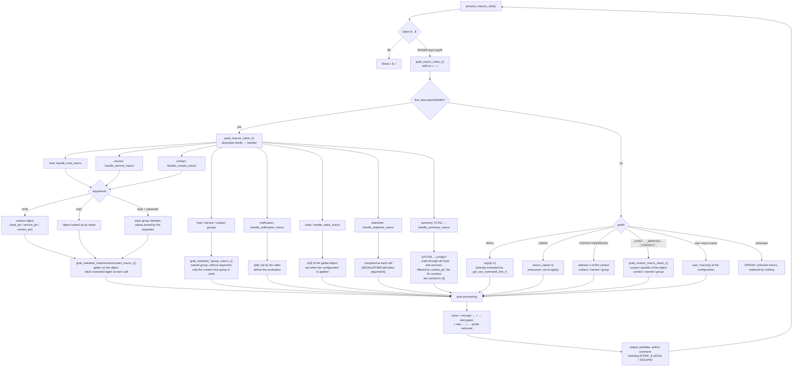

# Engine macros — context setup and evaluation

<!-- TOC -->
* [Engine macros — context setup and evaluation](#engine-macros--context-setup-and-evaluation)
  * [1. A single `nagios_macros` object for the whole Engine](#1-a-single-nagios_macros-object-for-the-whole-engine)
  * [2. Context setup by the caller](#2-context-setup-by-the-caller)
  * [3. Evaluating a macro](#3-evaluating-a-macro)
  * [4. Precomputed values, caches and recomputations](#4-precomputed-values-caches-and-recomputations)
  * [5. Reference measures (before the rework)](#5-reference-measures-before-the-rework)
    * [5.1 Standard macros, by family](#51-standard-macros-by-family)
    * [5.2 Other forms, costly macros and full paths](#52-other-forms-costly-macros-and-full-paths)
    * [5.3 Reading](#53-reading)
<!-- TOC -->

This document describes how Engine replaces macros (`$HOSTNAME$`,
`$SERVICESTATE$`, `$CONTACTEMAIL$`, `$ARG1$`, `$_HOSTFOO$`…) in the command
lines of checks, notifications and event handlers. The code lives in
`engine/src/macros.cc` and `engine/src/macros/`.

## 1. A single `nagios_macros` object for the whole Engine

Every evaluation uses the same object, returned by `get_global_macros()`
(`macros/misc.cc`). It holds (`macros/defines.hh`):

- `x[MACRO_X_COUNT]`: one slot per standard macro, used either as a
  **precomputed** value or as a **cache** depending on the family;
- `argv[]`: the values of `$ARG1$`…`$ARGn$` of the current command;
- the **context pointers** `host_ptr`, `service_ptr`, `contact_ptr`,
  `hostgroup_ptr`, `servicegroup_ptr`, `contactgroup_ptr`: the objects the
  macros without argument apply to.

An evaluation therefore always goes in three steps: the caller **fills the
context**, **evaluates** the command line, then **empties** the context
(`clear_volatile_macros_r()`).

## 2. Context setup by the caller

| Caller | Context filled |
|---|---|
| host check (`checker.cc`, `host.cc`) | `grab_host_macros_r(hst)` |
| service check (`service::get_check_command_line()`) | `grab_host_macros_r` + `grab_service_macros_r` |
| event handler, OCSP/OCHP (`sehandlers.cc`, `service.cc`) | the same, depending on the resource type |
| notification (`notification_execution.cc`) | the resource's `grab_macros_r`, then the notification macros in `x[]`, then for **each contact** `grab_contact_macros_r` + `clear_summary_macros_r` |
| connector (`applier/connector.cc`) | nothing: only global macros are useful |

`grab_host_macros_r()` and `grab_service_macros_r()` compute no value: they
set the context pointers (the resource, its first group, its first contact
and its first contact group) and empty the matching cache slots.

Then `get_raw_command_line_r()` (`utils.cc`) splits the `check_foo!arg1!arg2`
command on `!`, **evaluates the macros of each argument** and stores the
result in `argv[]`. The command line itself is evaluated afterwards by
`process_macros_r()` (directly or through `command::process_cmd()`), and
this is where `$ARGn$` is replaced.

## 3. Evaluating a macro

`process_macros_r()` (`macros/process.cc`) walks through the string: `$$`
gives a `$`, and each `$…$` is passed to `grab_macro_value_r()`
(`macros/grab_value.cc`). The name is split on `:` into at most three parts,
`NAME:arg1:arg2`:

- without argument, the macro applies to the **context** object;
- with `arg1` only, it is an **on-demand** macro on the named object
  (`$HOSTSTATE:srv1$`, `$SERVICESTATE:srv1:ping$`);
- with `arg1` and `arg2`, it is a **concatenation over a group**, `arg2`
  being the separator (`$HOSTSTATE:hg_web:,$`). For services, `arg1:arg2` is
  first looked up as a host/service pair, then as a service group and a
  separator.



## 4. Precomputed values, caches and recomputations

| Family | Where the value comes from | Lifetime |
|---|---|---|
| static (`$ADMINEMAIL$`, `$POLLERNAME$`…) | `x[]` filled by `applier::macros::apply()` | until the next apply; `clear_volatile_macros_r()` spares them |
| `$USERn$`, user macros | `applier::macros::apply()` | the same |
| `$ARGn$` | `argv[]`, evaluated by `get_raw_command_line_r()` | one command |
| notification (`$NOTIFICATIONTYPE$`…) | `x[]` filled by `notification_execution.cc` | one notification |
| host, service, contact, groups | getter on the object, **at each call** | no caching |
| `$TOTALHOSTSERVICES*$` | walk through the host's services, cached in `x[]` | until the next `grab_host_macros_r` |
| summary `$TOTAL*$` (16 macros) | walk through **all** hosts and services of the poller, cached in `x[]` | until the next `clear_summary_macros_r`, so computed again for each contact of a notification |
| date/time | computed at each call | none |
| `$_HOST…$`, `$_SERVICE…$`, `$_CONTACT…$` | custom variables of the object, at each call | none |

The `$TOTAL*UNHANDLED$` summary macros count a problem as unhandled unless
the resource is in downtime (`scheduled_downtime_depth > 0`), acknowledged,
or has its active checks disabled. They therefore read Engine's **local**
state.

Until 2026-10-09, an unhandled UNREACHABLE host was counted in
`$TOTALHOSTSDOWNUNHANDLED$` instead of `$TOTALHOSTSUNREACHABLEUNHANDLED$`
(`handle_summary_macro()`, `grab_value.cc`). This is fixed and covered by the
`Macro.PbTotalHostsUnhandled` test.

## 5. Reference measures (before the rework)

These figures are the baseline for the future implementation. They come from
`macros_bench` (`engine/benchmark/macros.cc`):

- measured code: commit `6fb3d8b20a`, before the fix of the on-demand custom
  macros;
- `RelWithDebInfo` build (`-O2`), development machine (22 cores, 4.5 GHz),
  process pinned on one core;
- poller of 1,000 hosts, 10,000 services and 100 contacts;
- value kept: median CPU time over 3 repetitions (CV of a few %).

```bash
taskset -c 2 build/engine/benchmark/macros_bench --benchmark_repetitions=3 \
    --benchmark_report_aggregates_only=true
```

To compare a new implementation, run the same command on the same machine
with the same poller size, alternating both binaries (ABBA). Two identical
runs can differ by 5 to 6 % on this machine.

### 5.1 Standard macros, by family

Each macro is evaluated alone (`$NAME$`), with a full context (host, service,
contact and notification set).

| Family | Macros | Min | Median | Max |
|---|---:|---:|---:|---:|
| host | 41 | 76 ns | 158 ns | 271 ns |
| service | 44 | 60 ns | 174 ns | 403 ns |
| contact | 5 | 68 ns | 76 ns | 150 ns |
| groups (hosts, services, contacts) | 18 | 71 ns | 128 ns | 271 ns |
| notification | 8 | 68 ns | 120 ns | 146 ns |
| static | 14 | 51 ns | 102 ns | 191 ns |
| date/time | 7 | 62 ns | 175 ns | 265 ns |
| summary `$TOTAL*$` (cached) | 16 | 93 ns | 104 ns | 190 ns |

### 5.2 Other forms, costly macros and full paths

- `BM_Group/<macro>/<N>`: concatenation over a group of N members.
- `BM_SummaryComputed/0|1`: the 16 `$TOTAL*$` computed again (cache
  emptied), without then with filtering by contact.
- `BM_Cleaning/0|1`: `$SERVICEOUTPUT$ $SERVICEPERFDATA$` without then with
  the cleaning of characters.
- `BM_ServiceCheckCommand`, `BM_HostCheckCommand`: context, arguments,
  command line and cleanup, as for a check.
- `BM_NotificationLine`: the default Centreon mail line, evaluated for one
  contact.

| Benchmark | CPU time (median) |
|---|---:|
| `BM_Other/ARG1` | 203 ns |
| `BM_Other/USER1` | 156 ns |
| `BM_Other/user_macro` | 175 ns |
| `BM_Other/custom_host` | 148 ns |
| `BM_Other/custom_service` | 161 ns |
| `BM_Other/custom_contact` | 162 ns |
| `BM_Other/CONTACTADDRESS1` | 159 ns |
| `BM_Other/unknown` | 149 ns |
| `BM_Other/dollar_escape` | 13 ns |
| `BM_Other/no_macro` | 31 ns |
| `BM_OnDemand/HOSTSTATE` | 85 ns |
| `BM_OnDemand/SERVICESTATE` | 85 ns |
| `BM_OnDemand/SERVICESTATE_current_host` | 84 ns |
| `BM_OnDemand/CONTACTEMAIL` | 85 ns |
| `BM_OnDemand/custom_host` | 140 ns |
| `BM_Group/HOSTNAME/10` | 1.05 µs |
| `BM_Group/HOSTNAME/100` | 9.31 µs |
| `BM_Group/HOSTNAME/1000` | 100 µs |
| `BM_Group/custom_host/10` | 271 ns |
| `BM_Group/custom_host/100` | 1.41 µs |
| `BM_Group/custom_host/1000` | 13 µs |
| `BM_Group/SERVICESTATE/10` | 312 ns |
| `BM_Group/SERVICESTATE/100` | 2.14 µs |
| `BM_Group/SERVICESTATE/1000` | 25 µs |
| `BM_Group/CONTACTEMAIL/10` | 303 ns |
| `BM_Group/CONTACTEMAIL/100` | 1.78 µs |
| `BM_SummaryComputed/0` | 292 µs |
| `BM_SummaryComputed/1` | 145 µs |
| `BM_HostTotalsComputed` | 317 ns |
| `BM_Cleaning/0` | 657 ns |
| `BM_Cleaning/1` | 660 ns |
| `BM_ServiceCheckCommand` | 1.71 µs |
| `BM_HostCheckCommand` | 1.56 µs |
| `BM_NotificationLine` | 2.98 µs |

In this baseline, `BM_OnDemand/custom_host` and `BM_Group/custom_host/*`
measure an error path: these macros returned an empty string (bug fixed
since).

<details>
<summary>Details of the 162 standard macros (<code>BM_MacroX/&lt;id&gt;/&lt;NAME&gt;</code>)</summary>

| Benchmark | CPU time (median) |
|---|---:|
| `0/HOSTNAME` | 131 ns |
| `1/HOSTALIAS` | 132 ns |
| `2/HOSTADDRESS` | 135 ns |
| `3/SERVICEDESC` | 134 ns |
| `4/SERVICESTATE` | 60 ns |
| `5/SERVICESTATEID` | 137 ns |
| `6/SERVICEATTEMPT` | 139 ns |
| `7/LONGDATETIME` | 265 ns |
| `8/SHORTDATETIME` | 243 ns |
| `9/DATE` | 179 ns |
| `10/TIME` | 175 ns |
| `11/TIMET` | 62 ns |
| `12/LASTHOSTCHECK` | 142 ns |
| `13/LASTSERVICECHECK` | 139 ns |
| `14/LASTHOSTSTATECHANGE` | 142 ns |
| `15/LASTSERVICESTATECHANGE` | 141 ns |
| `16/HOSTOUTPUT` | 154 ns |
| `17/SERVICEOUTPUT` | 403 ns |
| `18/HOSTPERFDATA` | 127 ns |
| `19/SERVICEPERFDATA` | 311 ns |
| `20/CONTACTNAME` | 68 ns |
| `21/CONTACTALIAS` | 71 ns |
| `22/CONTACTEMAIL` | 76 ns |
| `23/CONTACTPAGER` | 77 ns |
| `24/ADMINEMAIL` | 71 ns |
| `25/ADMINPAGER` | 51 ns |
| `26/HOSTSTATE` | 76 ns |
| `27/HOSTSTATEID` | 156 ns |
| `28/HOSTATTEMPT` | 158 ns |
| `29/NOTIFICATIONTYPE` | 69 ns |
| `30/NOTIFICATIONNUMBER` | 68 ns |
| `31/HOSTEXECUTIONTIME` | 229 ns |
| `32/SERVICEEXECUTIONTIME` | 227 ns |
| `33/HOSTLATENCY` | 235 ns |
| `34/SERVICELATENCY` | 232 ns |
| `35/HOSTDURATION` | 271 ns |
| `36/SERVICEDURATION` | 256 ns |
| `37/HOSTDURATIONSEC` | 83 ns |
| `38/SERVICEDURATIONSEC` | 87 ns |
| `39/HOSTDOWNTIME` | 172 ns |
| `40/SERVICEDOWNTIME` | 162 ns |
| `41/HOSTSTATETYPE` | 80 ns |
| `42/SERVICESTATETYPE` | 79 ns |
| `43/HOSTPERCENTCHANGE` | 234 ns |
| `44/SERVICEPERCENTCHANGE` | 233 ns |
| `45/HOSTGROUPNAME` | 89 ns |
| `46/HOSTGROUPALIAS` | 91 ns |
| `47/SERVICEGROUPNAME` | 87 ns |
| `48/SERVICEGROUPALIAS` | 71 ns |
| `53/LASTSERVICEOK` | 173 ns |
| `54/LASTSERVICEWARNING` | 172 ns |
| `55/LASTSERVICEUNKNOWN` | 174 ns |
| `56/LASTSERVICECRITICAL` | 170 ns |
| `57/LASTHOSTUP` | 178 ns |
| `58/LASTHOSTDOWN` | 181 ns |
| `59/LASTHOSTUNREACHABLE` | 172 ns |
| `60/SERVICECHECKCOMMAND` | 209 ns |
| `61/HOSTCHECKCOMMAND` | 214 ns |
| `62/MAINCONFIGFILE` | 80 ns |
| `63/STATUSDATAFILE` | 107 ns |
| `64/HOSTDISPLAYNAME` | 175 ns |
| `65/SERVICEDISPLAYNAME` | 179 ns |
| `66/RETENTIONDATAFILE` | 101 ns |
| `68/TEMPFILE` | 96 ns |
| `69/LOGFILE` | 72 ns |
| `70/RESOURCEFILE` | 91 ns |
| `71/COMMANDFILE` | 104 ns |
| `72/HOSTPERFDATAFILE` | 81 ns |
| `73/SERVICEPERFDATAFILE` | 82 ns |
| `74/HOSTACTIONURL` | 94 ns |
| `75/HOSTNOTESURL` | 103 ns |
| `76/HOSTNOTES` | 93 ns |
| `77/SERVICEACTIONURL` | 175 ns |
| `78/SERVICENOTESURL` | 203 ns |
| `79/SERVICENOTES` | 243 ns |
| `80/TOTALHOSTSUP` | 190 ns |
| `81/TOTALHOSTSDOWN` | 112 ns |
| `82/TOTALHOSTSUNREACHABLE` | 93 ns |
| `83/TOTALHOSTSDOWNUNHANDLED` | 93 ns |
| `84/TOTALHOSTSUNREACHABLEUNHANDLED` | 94 ns |
| `85/TOTALHOSTPROBLEMS` | 105 ns |
| `86/TOTALHOSTPROBLEMSUNHANDLED` | 95 ns |
| `87/TOTALSERVICESOK` | 107 ns |
| `88/TOTALSERVICESWARNING` | 105 ns |
| `89/TOTALSERVICESCRITICAL` | 102 ns |
| `90/TOTALSERVICESUNKNOWN` | 108 ns |
| `91/TOTALSERVICESWARNINGUNHANDLED` | 101 ns |
| `92/TOTALSERVICESCRITICALUNHANDLED` | 104 ns |
| `93/TOTALSERVICESUNKNOWNUNHANDLED` | 104 ns |
| `94/TOTALSERVICEPROBLEMS` | 112 ns |
| `95/TOTALSERVICEPROBLEMSUNHANDLED` | 112 ns |
| `96/PROCESSSTARTTIME` | 104 ns |
| `97/HOSTCHECKTYPE` | 123 ns |
| `98/SERVICECHECKTYPE` | 124 ns |
| `99/LONGHOSTOUTPUT` | 181 ns |
| `100/LONGSERVICEOUTPUT` | 335 ns |
| `101/TEMPPATH` | 111 ns |
| `102/HOSTNOTIFICATIONNUMBER` | 204 ns |
| `103/SERVICENOTIFICATIONNUMBER` | 194 ns |
| `104/HOSTNOTIFICATIONID` | 207 ns |
| `105/SERVICENOTIFICATIONID` | 205 ns |
| `106/HOSTEVENTID` | 204 ns |
| `107/LASTHOSTEVENTID` | 204 ns |
| `108/SERVICEEVENTID` | 208 ns |
| `109/LASTSERVICEEVENTID` | 207 ns |
| `110/HOSTGROUPNAMES` | 162 ns |
| `111/SERVICEGROUPNAMES` | 155 ns |
| `116/MAXHOSTATTEMPTS` | 208 ns |
| `117/MAXSERVICEATTEMPTS` | 218 ns |
| `118/SERVICEISVOLATILE` | 213 ns |
| `119/TOTALHOSTSERVICES` | 140 ns |
| `120/TOTALHOSTSERVICESOK` | 126 ns |
| `121/TOTALHOSTSERVICESWARNING` | 117 ns |
| `122/TOTALHOSTSERVICESUNKNOWN` | 119 ns |
| `123/TOTALHOSTSERVICESCRITICAL` | 120 ns |
| `124/HOSTGROUPNOTES` | 130 ns |
| `125/HOSTGROUPNOTESURL` | 130 ns |
| `126/HOSTGROUPACTIONURL` | 132 ns |
| `127/SERVICEGROUPNOTES` | 127 ns |
| `128/SERVICEGROUPNOTESURL` | 115 ns |
| `129/SERVICEGROUPACTIONURL` | 110 ns |
| `130/HOSTGROUPMEMBERS` | 271 ns |
| `131/SERVICEGROUPMEMBERS` | 120 ns |
| `132/CONTACTGROUPNAME` | 142 ns |
| `133/CONTACTGROUPALIAS` | 130 ns |
| `134/CONTACTGROUPMEMBERS` | 124 ns |
| `135/CONTACTGROUPNAMES` | 162 ns |
| `136/NOTIFICATIONRECIPIENTS` | 130 ns |
| `137/NOTIFICATIONISESCALATED` | 125 ns |
| `138/NOTIFICATIONAUTHOR` | 146 ns |
| `139/NOTIFICATIONAUTHORNAME` | 116 ns |
| `140/NOTIFICATIONAUTHORALIAS` | 114 ns |
| `141/NOTIFICATIONCOMMENT` | 142 ns |
| `142/EVENTSTARTTIME` | 128 ns |
| `143/HOSTPROBLEMID` | 233 ns |
| `144/LASTHOSTPROBLEMID` | 236 ns |
| `145/SERVICEPROBLEMID` | 230 ns |
| `146/LASTSERVICEPROBLEMID` | 219 ns |
| `147/ISVALIDTIME` | 136 ns |
| `148/NEXTVALIDTIME` | 142 ns |
| `149/LASTHOSTSTATE` | 160 ns |
| `150/LASTHOSTSTATEID` | 232 ns |
| `151/LASTSERVICESTATE` | 157 ns |
| `152/LASTSERVICESTATEID` | 237 ns |
| `153/HOSTPARENTS` | 139 ns |
| `154/HOSTCHILDREN` | 146 ns |
| `155/HOSTID` | 136 ns |
| `156/SERVICEID` | 147 ns |
| `157/HOSTTIMEZONE` | 154 ns |
| `158/SERVICETIMEZONE` | 155 ns |
| `159/CONTACTTIMEZONE` | 150 ns |
| `160/POLLERNAME` | 191 ns |
| `161/POLLERID` | 183 ns |

</details>

### 5.3 Reading

- **A macro costs 50 to 400 ns, a full check about 1.7 µs.** This is
  negligible next to the launch of the command (fork/exec). The rework is
  justified by readability, not by performance.
- **Only the `$TOTAL*$` macros are costly**: about 150 to 290 µs per contact
  at 10,000 services, since they walk through the whole poller. This cost is
  only paid when a command uses them.
- **A macro without argument costs more than on demand** (`$HOSTNAME$` ≈
  130 ns versus `$HOSTSTATE:h1$` ≈ 85 ns): most host and service getters go
  through a `std::stringstream` (`get_member_as_string`, `macros/grab.hh`),
  whose construction weighs about 20 % of the time.
