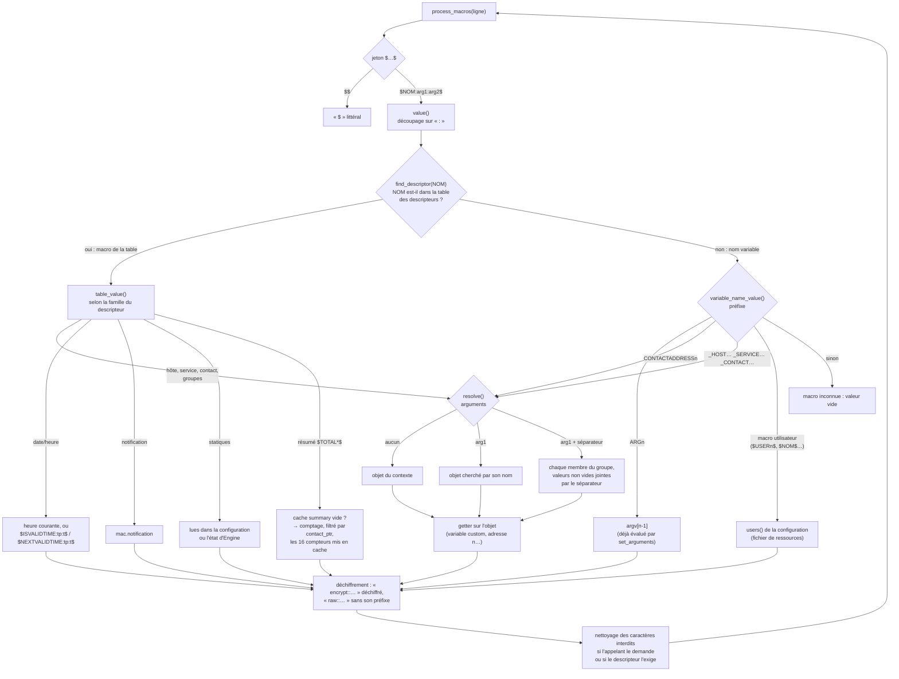

# Macros d'Engine — contexte, évaluation et organisation du code

<!-- TOC -->
* [Macros d'Engine — contexte, évaluation et organisation du code](#macros-dengine--contexte-évaluation-et-organisation-du-code)
  * [1. Le contexte `macro_context`](#1-le-contexte-macro_context)
  * [2. Préparation du contexte par l'appelant](#2-préparation-du-contexte-par-lappelant)
  * [3. Évaluation d'une macro](#3-évaluation-dune-macro)
    * [Syntaxe, cas par cas](#syntaxe-cas-par-cas)
  * [4. Valeurs, caches et recalculs](#4-valeurs-caches-et-recalculs)
    * [Le périmètre d'un contact pour les `$TOTAL*$`](#le-périmètre-dun-contact-pour-les-total)
    * [Problèmes « non traités » et mode broker](#problèmes--non-traités--et-mode-broker)
  * [5. Organisation du code](#5-organisation-du-code)
  * [6. Tests](#6-tests)
  * [7. Mesures](#7-mesures)
    * [7.1 Macros standard, par famille](#71-macros-standard-par-famille)
    * [7.2 Autres formes, macros coûteuses et parcours complets](#72-autres-formes-macros-coûteuses-et-parcours-complets)
    * [7.3 Lecture](#73-lecture)
<!-- TOC -->

Ce document décrit comment Engine remplace les macros (`$HOSTNAME$`,
`$SERVICESTATE$`, `$CONTACTEMAIL$`, `$ARG1$`, `$_HOSTFOO$`…) dans les lignes
de commande des checks, des notifications et des event handlers. Le code est
dans `engine/macros/`.

## 1. Le contexte `macro_context`

Une évaluation se fait toujours dans un **contexte**, `macro_context`
(`macros/macro_context.hh`). Chaque appelant déclare le sien, en variable
locale : il n'existe pas de contexte global, et rien ne passe d'une
évaluation à la suivante. Le contexte contient :

- `argv` : les valeurs de `$ARG1$`…`$ARG32$` de la commande en cours ;
- les **objets du contexte** `host_ptr`, `service_ptr`, `contact_ptr`,
  `hostgroup_ptr`, `servicegroup_ptr`, `contactgroup_ptr` : les objets sur
  lesquels portent les macros sans argument ;
- `notification` : les valeurs de la notification en cours
  (`notification_values`), présentes seulement pendant l'envoi d'une
  notification :
  - `resource`, l'hôte ou le service concerné ;
  - `type`, `id`, `number`, `is_escalated` ;
  - `recipients`, `author`, `author_name`, `author_alias`, `comment` ;
- deux **caches** : `summary` pour les 16 macros `$TOTAL*$`, et
  `host_services` pour les 5 macros `$TOTALHOSTSERVICES*$` de l'hôte du
  contexte.

Les méthodes `set_host()`, `set_service()` et `set_contact()` posent un objet
et ce qui en découle :

| Méthode | Effet |
|---|---|
| `set_host(hst)` | `host_ptr` = l'hôte ; `hostgroup_ptr` = son premier groupe d'hôtes ; `contact_ptr` et `contactgroup_ptr` = son premier contact et son premier groupe de contacts, s'il en a ; vide le cache `host_services` |
| `set_service(svc)` | `service_ptr` = le service ; `servicegroup_ptr` = son premier groupe de services ; `contact_ptr` et `contactgroup_ptr` = son premier contact et son premier groupe de contacts, s'il en a |
| `set_contact(cntct)` | `contact_ptr` = le contact ; `contactgroup_ptr` = son premier groupe ; vide le cache `summary`, car les `$TOTAL*$` dépendent du contact |

Le « premier » groupe ou contact est lu dans une table de hachage : c'est un
élément quelconque.

## 2. Préparation du contexte par l'appelant

| Appelant | Contexte rempli |
|---|---|
| check d'hôte (`checker.cc`, `host::get_check_command_line()`) | `set_host` |
| check de service (`service::get_check_command_line()`) | `set_host` + `set_service` |
| event handlers, OCSP et OCHP (`sehandlers.cc`, `service.cc`) | `set_host`, plus `set_service` pour un service |
| notification (`run_notification_commands()`, `notification_execution.cc`) | `set_host` de la ressource, plus `set_service` pour un service, puis `notification`, puis `set_contact` pour **chaque** contact |
| connecteur (`applier/connector.cc`) | rien : seules les macros sans objet sont utiles |

Ensuite `set_arguments()` découpe la commande configurée,
`check_foo!arg1!arg2`, sur les `!` (`macros::split_arguments()` : le nom est
sauté, `\` échappe le caractère suivant, 32 arguments au plus), **évalue les
macros de chaque argument** et range le résultat dans `argv`. La ligne de
commande elle-même est évaluée après, par `macros::process_macros()`
(directement, ou via `command::process_cmd()`), et c'est là que `$ARGn$` est
remplacé.

Les commandes de notification d'un contact n'ont pas d'arguments : elles sont
configurées par leur seul nom. Leurs `$ARGn$` sont donc vides.

Les connecteurs `raw` et `raw_v2` exportent aussi toutes les macros de la
table dans l'environnement de la commande (`NAGIOS_HOSTNAME`…), avec les
variables custom de l'hôte, du service et du contact. Avec
`use_large_installation_tweaks`, les `$TOTAL*$` n'y figurent que si elles sont
déjà en cache.

## 3. Évaluation d'une macro

`macros::process_macros()` (`macros/process.cc`) parcourt la ligne : `$$`
donne un `$`, un `$` final ou sans `$` fermant disparaît, et chaque `$…$` est
passé à `macros::value()` (`macros/resolve.cc`). Le nom est
découpé sur `:` en trois parties au plus, `NOM:arg1:arg2` :

- sans argument, la macro porte sur l'objet du **contexte** ;
- avec `arg1` seul, c'est une macro **à la demande** sur l'objet nommé
  (`$HOSTSTATE:srv1$`, `$SERVICESTATE:srv1:ping$`) ;
- avec `arg1` et `arg2`, c'est une **concaténation sur un groupe**, `arg2`
  étant le séparateur (`$HOSTSTATE:hg_web:,$`). Pour les services,
  `arg1:arg2` est d'abord cherché comme un couple hôte/service, puis comme
  un groupe de services et un séparateur.

Les macros qui ont un identifiant (`MACRO_HOSTNAME`…) sont décrites par une
**table de descripteurs** (`macros/descriptors.cc`). `find_descriptor()` y
cherche le nom de la macro : s'il y est, `table_value()` calcule la
valeur à partir du descripteur ; sinon, `variable_name_value()` traite
les macros dont le nom n'est pas fixe et qui ne peuvent donc pas être dans la
table (`$ARGn$`, `$CONTACTADDRESSn$`, variables custom, macros utilisateur
comme `$USERn$`). Un descripteur donne le
nom de la macro, sa **famille**, s'il faut nettoyer sa valeur, et la fonction
qui calcule cette valeur sur un objet (le *getter*). La famille dit sur quoi
porte la macro, donc comment trouver l'objet.



Le **nettoyage** retire les caractères de contrôle ASCII et les
`illegal_output_chars` de la configuration. L'appelant le demande avec
`STRIP_ILLEGAL_MACRO_CHARS` (notifications, event handlers, OCSP/OCHP), et
certaines macros l'exigent toujours : les sorties et perfdata des checks,
l'auteur et le commentaire des notifications.

### Syntaxe, cas par cas

La configuration interdit les noms vides : un argument vide ne désigne donc
jamais un objet nommé. Il veut dire « l'objet du contexte », ou bien c'est
une erreur. Une erreur donne une valeur vide, et sa cause est journalisée en
`debug` sur le logger `macros`.

Dans les tableaux, `X` désigne le nom de la macro (`HOSTNAME`,
`CONTACTEMAIL`…). Par exemple, `$HOSTNAME:hg_web:,$` donne le nom de chaque
hôte du groupe `hg_web`, séparés par des virgules.

**Macros d'hôte et de contact** (`$HOSTNAME$`, `$CONTACTEMAIL$`,
`$_HOSTFOO$`, `$_CONTACTFOO$`, `$CONTACTADDRESSn$`…)

| Forme | Sens |
|---|---|
| `$X$`, `$X::$` | l'objet du contexte |
| `$X:nom$` | l'objet `nom` |
| `$X:groupe:sép$` | les membres du groupe d'hôtes ou de contacts `groupe`, valeurs séparées par `sép` |
| `$X::sép$` | erreur : le nom du groupe manque |

**Macros de service** (`$SERVICESTATE$`, `$_SERVICEFOO$`…)

| Forme | Sens |
|---|---|
| `$X$`, `$X::$` | le service du contexte |
| `$X::desc$` | le service `desc` de l'hôte du contexte |
| `$X:hôte:desc$` | le service `desc` de l'hôte `hôte` |
| `$X:groupe:sép$` | si aucun service `(groupe, sép)` n'existe : les membres du groupe de services `groupe`, valeurs séparées par `sép` |
| `$X:hôte$` | erreur : une description de service ou un séparateur est attendu |

**Macros de groupe** (`$HOSTGROUPALIAS$`, `$SERVICEGROUPMEMBERS$`,
`$CONTACTGROUPALIAS$`…)

| Forme | Sens |
|---|---|
| `$X$` | le groupe du contexte : le premier groupe de l'hôte, du service ou du contact |
| `$X:groupe$` | le groupe `groupe` ; `arg2` est ignoré |

**Macros sans objet** (date et heure, statiques, `$TOTAL*$`, notification) :
les arguments sont ignorés, sauf pour `$ISVALIDTIME:période[:t]$` et
`$NEXTVALIDTIME:période[:t]$`, où `t` est un horodatage (l'heure courante par
défaut).

**`$ARGn$` et macros utilisateur** (`$USERn$`, `$CENTREONPLUGINS$`…) : elles
ne prennent pas d'argument ; avec des arguments, leur valeur est vide.

Dans une forme de groupe, les membres arrivent dans un ordre quelconque, et
les valeurs vides sont sautées.

## 4. Valeurs, caches et recalculs

| Famille | D'où vient la valeur | Durée de vie |
|---|---|---|
| statiques (`$ADMINEMAIL$`, `$POLLERNAME$`…) | lue dans la configuration ou l'état d'Engine, à chaque appel | aucune mise en cache |
| macros utilisateur (`$USERn$`, `$CENTREONPLUGINS$`…) | `users()` de la configuration (fichier de ressources), lu à chaque appel | aucune mise en cache : un rechargement est pris en compte aussitôt |
| `$ARGn$` | `argv`, évalué par `set_arguments()` | une commande |
| notification (`$NOTIFICATIONTYPE$`…) | `notification`, rempli par `run_notification_commands()` | une notification |
| hôte, service, contact, groupes | getter sur l'objet, **à chaque appel** | aucune mise en cache |
| `$HOST/SERVICENOTIFICATIONID$`, `$HOST/SERVICENOTIFICATIONNUMBER$` | la notification en cours si elle porte sur cet objet, l'objet sinon | — |
| `$TOTALHOSTSERVICES*$` | les services de l'hôte ; en cache dans `host_services` pour l'hôte du contexte | jusqu'au prochain `set_host` ; sur un autre hôte (`$TOTALHOSTSERVICES:h2$`), recalculé à chaque appel |
| résumé `$TOTAL*$` (16 macros) | les hôtes et services du contact du contexte, ou de tout le poller sans contact ; en cache dans `summary` | jusqu'au prochain `set_contact`, donc recalculé pour chaque contact d'une notification |
| date/heure | calcul à chaque appel | aucune |
| `$_HOST…$`, `$_SERVICE…$`, `$_CONTACT…$` | variables custom de l'objet, à chaque appel | aucune |

Les macros `*NOTIFICATIONID` et `*NOTIFICATIONNUMBER` lisent la notification
en cours parce qu'en mode broker, c'est Broker qui décide la notification et
qui fournit son identifiant et son numéro : le poller ne les connaît pas.
Pendant la notification d'un service, `$HOSTNOTIFICATIONNUMBER$` reste celui
de l'hôte.

### Le périmètre d'un contact pour les `$TOTAL*$`

Avec un contact dans le contexte, les `$TOTAL*$` ne comptent que les hôtes et
services dont il est contact, directement ou par un groupe de contacts.
Chaque contact garde la liste de ces objets (`contact::get_notified_objects()`)
et ne la recalcule que lorsque `notifier::contacts_version` a changé. Cette
version est incrémentée chaque fois que les contacts des ressources peuvent
changer :

- une ressource est câblée (`notifier::resolve_pointers()`) ;
- une ressource quitte `host::hosts` ou `service::services`, ou est détruite ;
- les membres d'un groupe de contacts changent, ou un contact est supprimé ;
- l'état de la configuration est vidé.

Le contact ne lit donc jamais un pointeur périmé. À 220 000 objets, le calcul
des `$TOTAL*$` pour un contact passe ainsi d'environ 9 ms à 15 µs.

### Problèmes « non traités » et mode broker

Les macros `$TOTAL*UNHANDLED$` comptent un problème comme non traité sauf si
la ressource est en downtime (`scheduled_downtime_depth > 0`), acquittée, ou
si ses checks actifs sont désactivés. Le problème d'un service dont l'hôte
est DOWN ou UNREACHABLE est considéré comme traité.

Elles lisent l'état **local** d'Engine. En `notification_mode = broker`, les
downtimes et les acquittements sont gérés par Broker et ne redescendent pas
encore vers le poller : ces macros y **surcomptent** les problèmes non
traités. C'est un bug connu, à corriger.

## 5. Organisation du code

Le module `engine/macros/` a son propre `CMakeLists.txt`.

| Fichier | Contenu |
|---|---|
| `macro_context.{hh,cc}` | `macro_context`, `notification_values`, `set_host()`, `set_service()`, `set_contact()` |
| `defines.hh` | les identifiants `MACRO_*`, `MAX_COMMAND_ARGUMENTS`, `MAX_USER_MACROS`, `MACRO_ENV_VAR_PREFIX`, `STRIP_ILLEGAL_MACRO_CHARS`, la taille des caches |
| `descriptors.{hh,cc}` | la table des macros à identifiant : `descriptor`, `find_descriptor()`, `all_descriptors()`, les getters et la mise en forme des valeurs |
| `resolve.{hh,cc}` | `value()`, `table_value()` : arguments, objet du contexte, nommé ou groupe, autres macros, déchiffrement, nettoyage |
| `summary.{hh,cc}` | `generate_summary_macros()` : le comptage des `$TOTAL*$` |
| `process.{hh,cc}` | `process_macros()`, `strip_illegal_macro_chars()` |

Le module est une bibliothèque `OBJECT`, `engine_macros`, dont les objets
sont intégrés à `cce_core`. Les macros lisent les objets du cœur (hôtes,
services, contacts, configuration), et le cœur appelle les macros : une
bibliothèque statique demanderait un cycle d'édition de liens, que CMake
refuse quand `cce_core` est partagée.

`macro_context` et `notification_values` sont dans `com::centreon::engine`,
les fonctions du module dans `com::centreon::engine::macros`. Les constantes
de `defines.hh` sont des macros du préprocesseur.

Pour **ajouter une macro à identifiant** : lui donner un identifiant dans
`defines.hh` (et augmenter `MACRO_X_COUNT`), puis ajouter son descripteur dans
la table, triée par identifiant (un `static_assert` le vérifie). Le golden
doit ensuite être régénéré (voir la section suivante).

## 6. Tests

Le test `MacroGolden.AllMacros` (`engine/tests/macros/golden.cc`) compare
l'évaluation de toutes les macros à un fichier de référence,
`engine/tests/macros/golden.txt` (environ 7 000 lignes) :

- chaque macro de la table, et les familles hors table, sous 13 formes
  (`$X$`, `$X:h2$`, `$X:h2:s$`, `$X::s$`, `$X:hg:#$`…), dans 3 contextes :
  aucun objet, la notification d'un hôte à un contact, la notification d'un
  service à un contact ;
- le nettoyage des caractères, les timeperiods, et les lignes de commande
  de check complètes.

Les membres d'un groupe arrivent dans un ordre quelconque : les sorties de
groupe et des macros `*MEMBERS` sont triées avant comparaison.

Pour régénérer la référence, depuis `build/` :

```bash
MACROS_GOLDEN_UPDATE=1 tests/ut_engine --gtest_filter='MacroGolden.*'
```

Une modification de `golden.txt` doit toujours être justifiée dans le message
de commit : c'est un changement de comportement visible des utilisateurs.

Les autres tests des macros sont dans `engine/tests/macros/pbmacro*.cc`
(`Macro.*`).

## 7. Mesures

Les chiffres viennent de `macros_bench` (`engine/benchmark/macros.cc`) :

- build `RelWithDebInfo` (`-O2`), machine de développement (22 cœurs,
  4,5 GHz), processus épinglé sur un cœur ;
- poller de 1 000 hôtes, 10 000 services et 100 contacts ;
- valeur retenue : médiane du temps CPU sur 3 répétitions.

```bash
taskset -c 2 build/engine/benchmark/macros_bench --benchmark_repetitions=3 \
    --benchmark_report_aggregates_only=true
```

Deux séries sont données :

- **avant** : le code d'avant la refonte (commit `6fb3d8b20a`) ;
- **après** : le code refondu (commit `bc95675116`).

Ce n'est pas une comparaison ABBA, car le binaire d'avant n'existe plus : un
écart de 5 à 6 % n'est pas significatif. Pour comparer une nouvelle
implémentation, rejouer la même commande sur la même machine, en alternant
les deux binaires.

### 7.1 Macros standard, par famille

Chaque macro est évaluée seule (`$NOM$`), avec un contexte complet (hôte,
service, contact et notification posés).

Avant (les familles étaient alors celles des anciens handlers) :

| Famille | Macros | Min | Médiane | Max |
|---|---:|---:|---:|---:|
| hôte | 41 | 76 ns | 158 ns | 271 ns |
| service | 44 | 60 ns | 174 ns | 403 ns |
| contact | 5 | 68 ns | 76 ns | 150 ns |
| groupes (hôtes, services, contacts) | 18 | 71 ns | 128 ns | 271 ns |
| notification | 8 | 68 ns | 120 ns | 146 ns |
| statiques | 14 | 51 ns | 102 ns | 191 ns |
| date/heure | 7 | 62 ns | 175 ns | 265 ns |
| résumé `$TOTAL*$` (en cache) | 16 | 93 ns | 104 ns | 190 ns |

Après (familles de la table des descripteurs) :

| Famille | Macros | Min | Médiane | Max |
|---|---:|---:|---:|---:|
| hôte | 47 | 38 ns | 47 ns | 122 ns |
| service | 40 | 38 ns | 48 ns | 215 ns |
| contact | 7 | 45 ns | 46 ns | 58 ns |
| groupes (hôtes, services, contacts) | 12 | 42 ns | 44 ns | 226 ns |
| notification | 8 | 38 ns | 47 ns | 102 ns |
| statiques | 16 | 36 ns | 47 ns | 77 ns |
| date/heure | 7 | 48 ns | 164 ns | 274 ns |
| résumé `$TOTAL*$` (en cache) | 16 | 40 ns | 45 ns | 48 ns |

### 7.2 Autres formes, macros coûteuses et parcours complets

- `BM_Group/<macro>/<N>` : concaténation sur un groupe de N membres.
- `BM_SummaryComputed/0|1` : les 16 `$TOTAL*$` recalculés (cache vidé),
  sans puis avec filtrage par contact.
- `BM_Cleaning/0|1` : `$SERVICEOUTPUT$ $SERVICEPERFDATA$` sans puis avec le
  nettoyage des caractères.
- `BM_ServiceCheckCommand`, `BM_HostCheckCommand` : contexte, arguments et
  ligne de commande, comme pour un check.
- `BM_NotificationLine` : la ligne de mail Centreon par défaut, évaluée pour
  un contact.

| Bench | Avant | Après |
|---|---:|---:|
| `BM_Other/ARG1` | 203 ns | 48 ns |
| `BM_Other/USER1` | 156 ns | 64 ns |
| `BM_Other/user_macro` | 175 ns | 68 ns |
| `BM_Other/custom_host` | 148 ns | 51 ns |
| `BM_Other/custom_service` | 161 ns | 51 ns |
| `BM_Other/custom_contact` | 162 ns | 54 ns |
| `BM_Other/CONTACTADDRESS1` | 159 ns | 53 ns |
| `BM_Other/unknown` | 149 ns | 50 ns |
| `BM_Other/dollar_escape` | 13 ns | 12 ns |
| `BM_Other/no_macro` | 31 ns | 53 ns |
| `BM_OnDemand/HOSTSTATE` | 85 ns | 63 ns |
| `BM_OnDemand/SERVICESTATE` | 85 ns | 80 ns |
| `BM_OnDemand/SERVICESTATE_current_host` | 84 ns | 71 ns |
| `BM_OnDemand/CONTACTEMAIL` | 85 ns | 64 ns |
| `BM_OnDemand/custom_host` | 140 ns | 65 ns |
| `BM_Group/HOSTNAME/10` | 1,05 µs | 230 ns |
| `BM_Group/HOSTNAME/100` | 9,31 µs | 1,58 µs |
| `BM_Group/HOSTNAME/1000` | 100 µs | 17,5 µs |
| `BM_Group/custom_host/10` | 271 ns | 288 ns |
| `BM_Group/custom_host/100` | 1,41 µs | 1,98 µs |
| `BM_Group/custom_host/1000` | 13 µs | 20,3 µs |
| `BM_Group/SERVICESTATE/10` | 312 ns | 245 ns |
| `BM_Group/SERVICESTATE/100` | 2,14 µs | 1,44 µs |
| `BM_Group/SERVICESTATE/1000` | 25 µs | 14,6 µs |
| `BM_Group/CONTACTEMAIL/10` | 303 ns | 295 ns |
| `BM_Group/CONTACTEMAIL/100` | 1,78 µs | 1,64 µs |
| `BM_SummaryComputed/0` | 292 µs | 179 µs |
| `BM_SummaryComputed/1` | 145 µs | 865 ns |
| `BM_HostTotalsComputed` | 317 ns | 76 ns |
| `BM_Cleaning/0` | 657 ns | 546 ns |
| `BM_Cleaning/1` | 660 ns | 529 ns |
| `BM_ServiceCheckCommand` | 1,71 µs | 442 ns |
| `BM_HostCheckCommand` | 1,56 µs | 450 ns |
| `BM_NotificationLine` | 2,98 µs | 1,82 µs |

Remarques :

- avant la refonte, `BM_OnDemand/custom_host` et `BM_Group/custom_host/*`
  mesuraient un chemin en erreur : ces macros renvoyaient une chaîne vide
  (bug corrigé depuis). Les deux séries ne sont pas comparables ;
- `BM_Other/no_macro` est plus lent : `process_macros()` renvoie désormais une
  nouvelle chaîne, alors que le bench réutilisait son tampon. Les vrais
  appelants partaient déjà d'une chaîne neuve ;
- `BM_SummaryComputed/1` ne parcourt plus que les objets du contact, dont la
  liste est en cache.

<details>
<summary>Détail des 153 macros standard (<code>BM_MacroX/&lt;id&gt;/&lt;NOM&gt;</code>)</summary>

| Bench | Avant | Après |
|---|---:|---:|
| `0/HOSTNAME` | 131 ns | 40 ns |
| `1/HOSTALIAS` | 132 ns | 40 ns |
| `2/HOSTADDRESS` | 135 ns | 41 ns |
| `3/SERVICEDESC` | 134 ns | 41 ns |
| `4/SERVICESTATE` | 60 ns | 40 ns |
| `5/SERVICESTATEID` | 137 ns | 38 ns |
| `6/SERVICEATTEMPT` | 139 ns | 38 ns |
| `7/LONGDATETIME` | 265 ns | 274 ns |
| `8/SHORTDATETIME` | 243 ns | 251 ns |
| `9/DATE` | 179 ns | 164 ns |
| `10/TIME` | 175 ns | 170 ns |
| `11/TIMET` | 62 ns | 48 ns |
| `12/LASTHOSTCHECK` | 142 ns | 42 ns |
| `13/LASTSERVICECHECK` | 139 ns | 52 ns |
| `14/LASTHOSTSTATECHANGE` | 142 ns | 41 ns |
| `15/LASTSERVICESTATECHANGE` | 141 ns | 41 ns |
| `16/HOSTOUTPUT` | 154 ns | 38 ns |
| `17/SERVICEOUTPUT` | 403 ns | 207 ns |
| `18/HOSTPERFDATA` | 127 ns | 39 ns |
| `19/SERVICEPERFDATA` | 311 ns | 215 ns |
| `20/CONTACTNAME` | 68 ns | 45 ns |
| `21/CONTACTALIAS` | 71 ns | 46 ns |
| `22/CONTACTEMAIL` | 76 ns | 45 ns |
| `23/CONTACTPAGER` | 77 ns | 53 ns |
| `24/ADMINEMAIL` | 71 ns | 77 ns |
| `25/ADMINPAGER` | 51 ns | 39 ns |
| `26/HOSTSTATE` | 76 ns | 57 ns |
| `27/HOSTSTATEID` | 156 ns | 54 ns |
| `28/HOSTATTEMPT` | 158 ns | 51 ns |
| `29/NOTIFICATIONTYPE` | 69 ns | 53 ns |
| `30/NOTIFICATIONNUMBER` | 68 ns | 48 ns |
| `31/HOSTEXECUTIONTIME` | 229 ns | 118 ns |
| `32/SERVICEEXECUTIONTIME` | 227 ns | 113 ns |
| `33/HOSTLATENCY` | 235 ns | 111 ns |
| `34/SERVICELATENCY` | 232 ns | 108 ns |
| `35/HOSTDURATION` | 271 ns | 104 ns |
| `36/SERVICEDURATION` | 256 ns | 113 ns |
| `37/HOSTDURATIONSEC` | 83 ns | 57 ns |
| `38/SERVICEDURATIONSEC` | 87 ns | 65 ns |
| `39/HOSTDOWNTIME` | 172 ns | 59 ns |
| `40/SERVICEDOWNTIME` | 162 ns | 53 ns |
| `41/HOSTSTATETYPE` | 80 ns | 49 ns |
| `42/SERVICESTATETYPE` | 79 ns | 48 ns |
| `43/HOSTPERCENTCHANGE` | 234 ns | 122 ns |
| `44/SERVICEPERCENTCHANGE` | 233 ns | 122 ns |
| `45/HOSTGROUPNAME` | 89 ns | 58 ns |
| `46/HOSTGROUPALIAS` | 91 ns | 51 ns |
| `47/SERVICEGROUPNAME` | 87 ns | 57 ns |
| `48/SERVICEGROUPALIAS` | 71 ns | 61 ns |
| `53/LASTSERVICEOK` | 173 ns | 52 ns |
| `54/LASTSERVICEWARNING` | 172 ns | 51 ns |
| `55/LASTSERVICEUNKNOWN` | 174 ns | 50 ns |
| `56/LASTSERVICECRITICAL` | 170 ns | 48 ns |
| `57/LASTHOSTUP` | 178 ns | 47 ns |
| `58/LASTHOSTDOWN` | 181 ns | 48 ns |
| `59/LASTHOSTUNREACHABLE` | 172 ns | 48 ns |
| `60/SERVICECHECKCOMMAND` | 209 ns | 75 ns |
| `61/HOSTCHECKCOMMAND` | 214 ns | 76 ns |
| `62/MAINCONFIGFILE` | 80 ns | 45 ns |
| `63/STATUSDATAFILE` | 107 ns | 66 ns |
| `64/HOSTDISPLAYNAME` | 175 ns | 53 ns |
| `65/SERVICEDISPLAYNAME` | 179 ns | 55 ns |
| `66/RETENTIONDATAFILE` | 101 ns | 68 ns |
| `68/TEMPFILE` | 96 ns | 70 ns |
| `69/LOGFILE` | 72 ns | 48 ns |
| `70/RESOURCEFILE` | 91 ns | 46 ns |
| `71/COMMANDFILE` | 104 ns | 67 ns |
| `72/HOSTPERFDATAFILE` | 81 ns | 43 ns |
| `73/SERVICEPERFDATAFILE` | 82 ns | 42 ns |
| `74/HOSTACTIONURL` | 94 ns | 48 ns |
| `75/HOSTNOTESURL` | 103 ns | 50 ns |
| `76/HOSTNOTES` | 93 ns | 43 ns |
| `77/SERVICEACTIONURL` | 175 ns | 43 ns |
| `78/SERVICENOTESURL` | 203 ns | 44 ns |
| `79/SERVICENOTES` | 243 ns | 43 ns |
| `80/TOTALHOSTSUP` | 190 ns | 45 ns |
| `81/TOTALHOSTSDOWN` | 112 ns | 40 ns |
| `82/TOTALHOSTSUNREACHABLE` | 93 ns | 42 ns |
| `83/TOTALHOSTSDOWNUNHANDLED` | 93 ns | 42 ns |
| `84/TOTALHOSTSUNREACHABLEUNHANDLED` | 94 ns | 41 ns |
| `85/TOTALHOSTPROBLEMS` | 105 ns | 45 ns |
| `86/TOTALHOSTPROBLEMSUNHANDLED` | 95 ns | 44 ns |
| `87/TOTALSERVICESOK` | 107 ns | 48 ns |
| `88/TOTALSERVICESWARNING` | 105 ns | 46 ns |
| `89/TOTALSERVICESCRITICAL` | 102 ns | 46 ns |
| `90/TOTALSERVICESUNKNOWN` | 108 ns | 48 ns |
| `91/TOTALSERVICESWARNINGUNHANDLED` | 101 ns | 46 ns |
| `92/TOTALSERVICESCRITICALUNHANDLED` | 104 ns | 46 ns |
| `93/TOTALSERVICESUNKNOWNUNHANDLED` | 104 ns | 44 ns |
| `94/TOTALSERVICEPROBLEMS` | 112 ns | 46 ns |
| `95/TOTALSERVICEPROBLEMSUNHANDLED` | 112 ns | 46 ns |
| `96/PROCESSSTARTTIME` | 104 ns | 36 ns |
| `97/HOSTCHECKTYPE` | 123 ns | 44 ns |
| `98/SERVICECHECKTYPE` | 124 ns | 44 ns |
| `99/LONGHOSTOUTPUT` | 181 ns | 39 ns |
| `100/LONGSERVICEOUTPUT` | 335 ns | 139 ns |
| `101/TEMPPATH` | 111 ns | 40 ns |
| `102/HOSTNOTIFICATIONNUMBER` | 204 ns | 44 ns |
| `103/SERVICENOTIFICATIONNUMBER` | 194 ns | 45 ns |
| `104/HOSTNOTIFICATIONID` | 207 ns | 43 ns |
| `105/SERVICENOTIFICATIONID` | 205 ns | 43 ns |
| `106/HOSTEVENTID` | 204 ns | 41 ns |
| `107/LASTHOSTEVENTID` | 204 ns | 41 ns |
| `108/SERVICEEVENTID` | 208 ns | 41 ns |
| `109/LASTSERVICEEVENTID` | 207 ns | 41 ns |
| `110/HOSTGROUPNAMES` | 162 ns | 85 ns |
| `111/SERVICEGROUPNAMES` | 155 ns | 89 ns |
| `116/MAXHOSTATTEMPTS` | 208 ns | 42 ns |
| `117/MAXSERVICEATTEMPTS` | 218 ns | 43 ns |
| `118/SERVICEISVOLATILE` | 213 ns | 38 ns |
| `119/TOTALHOSTSERVICES` | 140 ns | 45 ns |
| `120/TOTALHOSTSERVICESOK` | 126 ns | 41 ns |
| `121/TOTALHOSTSERVICESWARNING` | 117 ns | 41 ns |
| `122/TOTALHOSTSERVICESUNKNOWN` | 119 ns | 41 ns |
| `123/TOTALHOSTSERVICESCRITICAL` | 120 ns | 41 ns |
| `124/HOSTGROUPNOTES` | 130 ns | 42 ns |
| `125/HOSTGROUPNOTESURL` | 130 ns | 43 ns |
| `126/HOSTGROUPACTIONURL` | 132 ns | 43 ns |
| `127/SERVICEGROUPNOTES` | 127 ns | 42 ns |
| `128/SERVICEGROUPNOTESURL` | 115 ns | 42 ns |
| `129/SERVICEGROUPACTIONURL` | 110 ns | 42 ns |
| `130/HOSTGROUPMEMBERS` | 271 ns | 145 ns |
| `131/SERVICEGROUPMEMBERS` | 120 ns | 226 ns |
| `132/CONTACTGROUPNAME` | 142 ns | 46 ns |
| `133/CONTACTGROUPALIAS` | 130 ns | 45 ns |
| `134/CONTACTGROUPMEMBERS` | 124 ns | 151 ns |
| `135/CONTACTGROUPNAMES` | 162 ns | 58 ns |
| `136/NOTIFICATIONRECIPIENTS` | 130 ns | 47 ns |
| `137/NOTIFICATIONISESCALATED` | 125 ns | 38 ns |
| `138/NOTIFICATIONAUTHOR` | 146 ns | 64 ns |
| `139/NOTIFICATIONAUTHORNAME` | 116 ns | 39 ns |
| `140/NOTIFICATIONAUTHORALIAS` | 114 ns | 42 ns |
| `141/NOTIFICATIONCOMMENT` | 142 ns | 102 ns |
| `142/EVENTSTARTTIME` | 128 ns | 43 ns |
| `143/HOSTPROBLEMID` | 233 ns | 47 ns |
| `144/LASTHOSTPROBLEMID` | 236 ns | 54 ns |
| `145/SERVICEPROBLEMID` | 230 ns | 52 ns |
| `146/LASTSERVICEPROBLEMID` | 219 ns | 48 ns |
| `147/ISVALIDTIME` | 136 ns | 50 ns |
| `148/NEXTVALIDTIME` | 142 ns | 49 ns |
| `149/LASTHOSTSTATE` | 160 ns | 56 ns |
| `150/LASTHOSTSTATEID` | 232 ns | 48 ns |
| `151/LASTSERVICESTATE` | 157 ns | 50 ns |
| `152/LASTSERVICESTATEID` | 237 ns | 48 ns |
| `153/HOSTPARENTS` | 139 ns | 49 ns |
| `154/HOSTCHILDREN` | 146 ns | 44 ns |
| `155/HOSTID` | 136 ns | 47 ns |
| `156/SERVICEID` | 147 ns | 46 ns |
| `157/HOSTTIMEZONE` | 154 ns | 45 ns |
| `158/SERVICETIMEZONE` | 155 ns | 44 ns |
| `159/CONTACTTIMEZONE` | 150 ns | 51 ns |
| `160/POLLERNAME` | 191 ns | 55 ns |
| `161/POLLERID` | 183 ns | 50 ns |

</details>

### 7.3 Lecture

- **Un check complet coûte environ 0,45 µs, contre 1,7 µs avant.** C'est de
  toute façon négligeable devant le lancement de la commande (fork/exec) :
  la refonte visait la lisibilité, la performance en est un effet de bord.
- **Une macro coûte de 40 à 50 ns** ; les dates (de 160 à 270 ns) coûtent
  surtout leur mise en forme.
- **Les `$TOTAL*$` filtrées par contact ne coûtent presque plus rien** : seuls
  les objets du contact sont comptés, et leur liste est en cache. Sans
  contact, elles parcourent encore tout le poller (environ 180 µs à 11 000
  objets).
- **Les formes de groupe sont environ 6 fois plus rapides** : la valeur de
  chaque membre n'est plus mise en forme par un `std::stringstream`.
