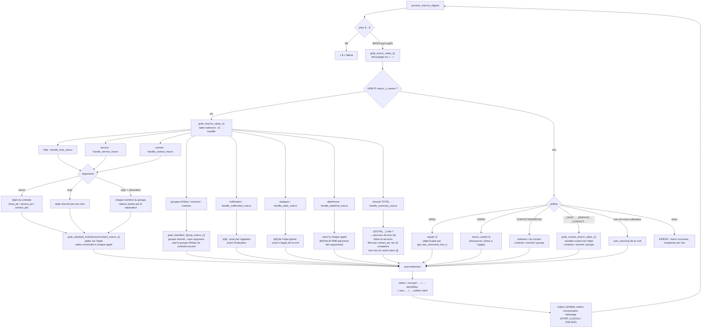

# Macros d'Engine — préparation du contexte et évaluation

<!-- TOC -->
* [Macros d'Engine — préparation du contexte et évaluation](#macros-dengine--préparation-du-contexte-et-évaluation)
  * [1. Un seul objet `nagios_macros` pour tout Engine](#1-un-seul-objet-nagios_macros-pour-tout-engine)
  * [2. Préparation du contexte par l'appelant](#2-préparation-du-contexte-par-lappelant)
  * [3. Évaluation d'une macro](#3-évaluation-dune-macro)
  * [4. Valeurs précalculées, caches et recalculs](#4-valeurs-précalculées-caches-et-recalculs)
  * [5. Mesures de référence (avant refonte)](#5-mesures-de-référence-avant-refonte)
    * [5.1 Macros standard, par famille](#51-macros-standard-par-famille)
    * [5.2 Autres formes, macros coûteuses et parcours complets](#52-autres-formes-macros-coûteuses-et-parcours-complets)
    * [5.3 Lecture](#53-lecture)
<!-- TOC -->

Ce document décrit comment Engine remplace les macros (`$HOSTNAME$`,
`$SERVICESTATE$`, `$CONTACTEMAIL$`, `$ARG1$`, `$_HOSTFOO$`…) dans les lignes
de commande des checks, des notifications et des event handlers. Le code est
dans `engine/src/macros.cc` et `engine/src/macros/`.

## 1. Un seul objet `nagios_macros` pour tout Engine

Toutes les évaluations utilisent le même objet, rendu par
`get_global_macros()` (`macros/misc.cc`). Il contient
(`macros/defines.hh`) :

- `x[MACRO_X_COUNT]` : une case par macro standard, qui sert de valeur
  **précalculée** ou de **cache** selon la famille ;
- `argv[]` : les valeurs de `$ARG1$`…`$ARGn$` de la commande en cours ;
- les **pointeurs de contexte** `host_ptr`, `service_ptr`, `contact_ptr`,
  `hostgroup_ptr`, `servicegroup_ptr`, `contactgroup_ptr` : les objets sur
  lesquels portent les macros sans argument.

Une évaluation se fait donc toujours en trois temps : l'appelant **remplit le
contexte**, **évalue** la ligne de commande, puis **vide** le contexte
(`clear_volatile_macros_r()`).

## 2. Préparation du contexte par l'appelant

| Appelant | Contexte rempli |
|---|---|
| check d'hôte (`checker.cc`, `host.cc`) | `grab_host_macros_r(hst)` |
| check de service (`service::get_check_command_line()`) | `grab_host_macros_r` + `grab_service_macros_r` |
| event handler, OCSP/OCHP (`sehandlers.cc`, `service.cc`) | idem selon le type de ressource |
| notification (`notification_execution.cc`) | `grab_macros_r` de la ressource, puis les macros de notification dans `x[]`, puis pour **chaque contact** `grab_contact_macros_r` + `clear_summary_macros_r` |
| connecteur (`applier/connector.cc`) | rien : seules les macros globales sont utiles |

`grab_host_macros_r()` et `grab_service_macros_r()` ne calculent aucune
valeur : elles positionnent les pointeurs de contexte (la ressource, son
premier groupe, son premier contact et son premier groupe de contacts) et
vident les cases de cache correspondantes.

Ensuite `get_raw_command_line_r()` (`utils.cc`) découpe la commande
`check_foo!arg1!arg2` sur les `!`, **évalue les macros de chaque argument**
et range le résultat dans `argv[]`. La ligne de commande elle-même est
évaluée après, par `process_macros_r()` (directement ou via
`command::process_cmd()`), et c'est là que `$ARGn$` est remplacé.

## 3. Évaluation d'une macro

`process_macros_r()` (`macros/process.cc`) parcourt la chaîne : `$$` donne un
`$`, et chaque `$…$` est passé à `grab_macro_value_r()`
(`macros/grab_value.cc`). Le nom est découpé sur `:` en trois parties au
plus, `NOM:arg1:arg2` :

- sans argument, la macro porte sur l'objet du **contexte** ;
- avec `arg1` seul, c'est une macro **à la demande** sur l'objet nommé
  (`$HOSTSTATE:srv1$`, `$SERVICESTATE:srv1:ping$`) ;
- avec `arg1` et `arg2`, c'est une **concaténation sur un groupe**, `arg2`
  étant le séparateur (`$HOSTSTATE:hg_web:,$`). Pour les services,
  `arg1:arg2` est d'abord cherché comme un couple hôte/service, puis comme
  un groupe de services et un séparateur.



## 4. Valeurs précalculées, caches et recalculs

| Famille | D'où vient la valeur | Durée de vie |
|---|---|---|
| statiques (`$ADMINEMAIL$`, `$POLLERNAME$`…) | `x[]` rempli par `applier::macros::apply()` | jusqu'au prochain apply ; `clear_volatile_macros_r()` les épargne |
| `$USERn$`, macros utilisateur | `applier::macros::apply()` | idem |
| `$ARGn$` | `argv[]`, évalué par `get_raw_command_line_r()` | une commande |
| notification (`$NOTIFICATIONTYPE$`…) | `x[]` rempli par `notification_execution.cc` | une notification |
| hôte, service, contact, groupes | getter sur l'objet, **à chaque appel** | aucune mise en cache |
| `$TOTALHOSTSERVICES*$` | parcours des services de l'hôte, en cache dans `x[]` | jusqu'au prochain `grab_host_macros_r` |
| résumé `$TOTAL*$` (16 macros) | parcours de **tous** les hôtes et services du poller, en cache dans `x[]` | jusqu'au prochain `clear_summary_macros_r`, donc recalculé pour chaque contact d'une notification |
| date/heure | calcul à chaque appel | aucune |
| `$_HOST…$`, `$_SERVICE…$`, `$_CONTACT…$` | variables custom de l'objet, à chaque appel | aucune |

Les macros de résumé `$TOTAL*UNHANDLED$` comptent un problème comme non
traité sauf si la ressource est en downtime (`scheduled_downtime_depth > 0`),
acquittée, ou si ses checks actifs sont désactivés. Elles lisent donc l'état
**local** d'Engine.

Jusqu'au 2026-10-09, un hôte UNREACHABLE non traité était compté dans
`$TOTALHOSTSDOWNUNHANDLED$` au lieu de `$TOTALHOSTSUNREACHABLEUNHANDLED$`
(`handle_summary_macro()`, `grab_value.cc`). C'est corrigé et couvert par le
test `Macro.PbTotalHostsUnhandled`.

## 5. Mesures de référence (avant refonte)

Ces chiffres servent de point de comparaison pour la future implémentation.
Ils viennent de `macros_bench` (`engine/benchmark/macros.cc`) :

- code mesuré : commit `6fb3d8b20a`, avant la correction des macros custom à
  la demande ;
- build `RelWithDebInfo` (`-O2`), machine de développement (22 cœurs,
  4,5 GHz), processus épinglé sur un cœur ;
- poller de 1 000 hôtes, 10 000 services et 100 contacts ;
- valeur retenue : médiane du temps CPU sur 3 répétitions (CV de quelques %).

```bash
taskset -c 2 build/engine/benchmark/macros_bench --benchmark_repetitions=3 \
    --benchmark_report_aggregates_only=true
```

Pour comparer une nouvelle implémentation, rejouer la même commande sur la
même machine et à la même taille de poller, en alternant les deux binaires
(ABBA). Deux runs identiques peuvent différer de 5 à 6 % sur cette machine.

### 5.1 Macros standard, par famille

Chaque macro est évaluée seule (`$NOM$`), avec un contexte complet (hôte,
service, contact et notification posés).

| Famille | Macros | Min | Médiane | Max |
|---|---:|---:|---:|---:|
| hôte | 41 | 76 ns | 158 ns | 271 ns |
| service | 44 | 60 ns | 174 ns | 403 ns |
| contact | 5 | 68 ns | 76 ns | 150 ns |
| groupes (hôtes, services, contacts) | 18 | 71 ns | 128 ns | 271 ns |
| notification | 8 | 68 ns | 120 ns | 146 ns |
| statiques | 14 | 51 ns | 102 ns | 191 ns |
| date/heure | 7 | 62 ns | 175 ns | 265 ns |
| résumé `$TOTAL*$` (en cache) | 16 | 93 ns | 104 ns | 190 ns |

### 5.2 Autres formes, macros coûteuses et parcours complets

- `BM_Group/<macro>/<N>` : concaténation sur un groupe de N membres.
- `BM_SummaryComputed/0|1` : les 16 `$TOTAL*$` recalculés (cache vidé),
  sans puis avec filtrage par contact.
- `BM_Cleaning/0|1` : `$SERVICEOUTPUT$ $SERVICEPERFDATA$` sans puis avec le
  nettoyage des caractères.
- `BM_ServiceCheckCommand`, `BM_HostCheckCommand` : contexte, arguments,
  ligne de commande et remise à zéro, comme pour un check.
- `BM_NotificationLine` : la ligne de mail Centreon par défaut, évaluée pour
  un contact.

| Bench | Temps CPU (médiane) |
|---|---:|
| `BM_Other/ARG1` | 203 ns |
| `BM_Other/USER1` | 156 ns |
| `BM_Other/user_macro` | 175 ns |
| `BM_Other/custom_host` | 148 ns |
| `BM_Other/custom_service` | 161 ns |
| `BM_Other/custom_contact` | 162 ns |
| `BM_Other/CONTACTADDRESS1` | 159 ns |
| `BM_Other/unknown` | 149 ns |
| `BM_Other/dollar_escape` | 13 ns |
| `BM_Other/no_macro` | 31 ns |
| `BM_OnDemand/HOSTSTATE` | 85 ns |
| `BM_OnDemand/SERVICESTATE` | 85 ns |
| `BM_OnDemand/SERVICESTATE_current_host` | 84 ns |
| `BM_OnDemand/CONTACTEMAIL` | 85 ns |
| `BM_OnDemand/custom_host` | 140 ns |
| `BM_Group/HOSTNAME/10` | 1,05 µs |
| `BM_Group/HOSTNAME/100` | 9,31 µs |
| `BM_Group/HOSTNAME/1000` | 100 µs |
| `BM_Group/custom_host/10` | 271 ns |
| `BM_Group/custom_host/100` | 1,41 µs |
| `BM_Group/custom_host/1000` | 13 µs |
| `BM_Group/SERVICESTATE/10` | 312 ns |
| `BM_Group/SERVICESTATE/100` | 2,14 µs |
| `BM_Group/SERVICESTATE/1000` | 25 µs |
| `BM_Group/CONTACTEMAIL/10` | 303 ns |
| `BM_Group/CONTACTEMAIL/100` | 1,78 µs |
| `BM_SummaryComputed/0` | 292 µs |
| `BM_SummaryComputed/1` | 145 µs |
| `BM_HostTotalsComputed` | 317 ns |
| `BM_Cleaning/0` | 657 ns |
| `BM_Cleaning/1` | 660 ns |
| `BM_ServiceCheckCommand` | 1,71 µs |
| `BM_HostCheckCommand` | 1,56 µs |
| `BM_NotificationLine` | 2,98 µs |

Dans cette baseline, `BM_OnDemand/custom_host` et `BM_Group/custom_host/*`
mesurent un chemin en erreur : ces macros renvoyaient une chaîne vide (bug
corrigé depuis).

<details>
<summary>Détail des 162 macros standard (<code>BM_MacroX/&lt;id&gt;/&lt;NOM&gt;</code>)</summary>

| Bench | Temps CPU (médiane) |
|---|---:|
| `0/HOSTNAME` | 131 ns |
| `1/HOSTALIAS` | 132 ns |
| `2/HOSTADDRESS` | 135 ns |
| `3/SERVICEDESC` | 134 ns |
| `4/SERVICESTATE` | 60 ns |
| `5/SERVICESTATEID` | 137 ns |
| `6/SERVICEATTEMPT` | 139 ns |
| `7/LONGDATETIME` | 265 ns |
| `8/SHORTDATETIME` | 243 ns |
| `9/DATE` | 179 ns |
| `10/TIME` | 175 ns |
| `11/TIMET` | 62 ns |
| `12/LASTHOSTCHECK` | 142 ns |
| `13/LASTSERVICECHECK` | 139 ns |
| `14/LASTHOSTSTATECHANGE` | 142 ns |
| `15/LASTSERVICESTATECHANGE` | 141 ns |
| `16/HOSTOUTPUT` | 154 ns |
| `17/SERVICEOUTPUT` | 403 ns |
| `18/HOSTPERFDATA` | 127 ns |
| `19/SERVICEPERFDATA` | 311 ns |
| `20/CONTACTNAME` | 68 ns |
| `21/CONTACTALIAS` | 71 ns |
| `22/CONTACTEMAIL` | 76 ns |
| `23/CONTACTPAGER` | 77 ns |
| `24/ADMINEMAIL` | 71 ns |
| `25/ADMINPAGER` | 51 ns |
| `26/HOSTSTATE` | 76 ns |
| `27/HOSTSTATEID` | 156 ns |
| `28/HOSTATTEMPT` | 158 ns |
| `29/NOTIFICATIONTYPE` | 69 ns |
| `30/NOTIFICATIONNUMBER` | 68 ns |
| `31/HOSTEXECUTIONTIME` | 229 ns |
| `32/SERVICEEXECUTIONTIME` | 227 ns |
| `33/HOSTLATENCY` | 235 ns |
| `34/SERVICELATENCY` | 232 ns |
| `35/HOSTDURATION` | 271 ns |
| `36/SERVICEDURATION` | 256 ns |
| `37/HOSTDURATIONSEC` | 83 ns |
| `38/SERVICEDURATIONSEC` | 87 ns |
| `39/HOSTDOWNTIME` | 172 ns |
| `40/SERVICEDOWNTIME` | 162 ns |
| `41/HOSTSTATETYPE` | 80 ns |
| `42/SERVICESTATETYPE` | 79 ns |
| `43/HOSTPERCENTCHANGE` | 234 ns |
| `44/SERVICEPERCENTCHANGE` | 233 ns |
| `45/HOSTGROUPNAME` | 89 ns |
| `46/HOSTGROUPALIAS` | 91 ns |
| `47/SERVICEGROUPNAME` | 87 ns |
| `48/SERVICEGROUPALIAS` | 71 ns |
| `53/LASTSERVICEOK` | 173 ns |
| `54/LASTSERVICEWARNING` | 172 ns |
| `55/LASTSERVICEUNKNOWN` | 174 ns |
| `56/LASTSERVICECRITICAL` | 170 ns |
| `57/LASTHOSTUP` | 178 ns |
| `58/LASTHOSTDOWN` | 181 ns |
| `59/LASTHOSTUNREACHABLE` | 172 ns |
| `60/SERVICECHECKCOMMAND` | 209 ns |
| `61/HOSTCHECKCOMMAND` | 214 ns |
| `62/MAINCONFIGFILE` | 80 ns |
| `63/STATUSDATAFILE` | 107 ns |
| `64/HOSTDISPLAYNAME` | 175 ns |
| `65/SERVICEDISPLAYNAME` | 179 ns |
| `66/RETENTIONDATAFILE` | 101 ns |
| `68/TEMPFILE` | 96 ns |
| `69/LOGFILE` | 72 ns |
| `70/RESOURCEFILE` | 91 ns |
| `71/COMMANDFILE` | 104 ns |
| `72/HOSTPERFDATAFILE` | 81 ns |
| `73/SERVICEPERFDATAFILE` | 82 ns |
| `74/HOSTACTIONURL` | 94 ns |
| `75/HOSTNOTESURL` | 103 ns |
| `76/HOSTNOTES` | 93 ns |
| `77/SERVICEACTIONURL` | 175 ns |
| `78/SERVICENOTESURL` | 203 ns |
| `79/SERVICENOTES` | 243 ns |
| `80/TOTALHOSTSUP` | 190 ns |
| `81/TOTALHOSTSDOWN` | 112 ns |
| `82/TOTALHOSTSUNREACHABLE` | 93 ns |
| `83/TOTALHOSTSDOWNUNHANDLED` | 93 ns |
| `84/TOTALHOSTSUNREACHABLEUNHANDLED` | 94 ns |
| `85/TOTALHOSTPROBLEMS` | 105 ns |
| `86/TOTALHOSTPROBLEMSUNHANDLED` | 95 ns |
| `87/TOTALSERVICESOK` | 107 ns |
| `88/TOTALSERVICESWARNING` | 105 ns |
| `89/TOTALSERVICESCRITICAL` | 102 ns |
| `90/TOTALSERVICESUNKNOWN` | 108 ns |
| `91/TOTALSERVICESWARNINGUNHANDLED` | 101 ns |
| `92/TOTALSERVICESCRITICALUNHANDLED` | 104 ns |
| `93/TOTALSERVICESUNKNOWNUNHANDLED` | 104 ns |
| `94/TOTALSERVICEPROBLEMS` | 112 ns |
| `95/TOTALSERVICEPROBLEMSUNHANDLED` | 112 ns |
| `96/PROCESSSTARTTIME` | 104 ns |
| `97/HOSTCHECKTYPE` | 123 ns |
| `98/SERVICECHECKTYPE` | 124 ns |
| `99/LONGHOSTOUTPUT` | 181 ns |
| `100/LONGSERVICEOUTPUT` | 335 ns |
| `101/TEMPPATH` | 111 ns |
| `102/HOSTNOTIFICATIONNUMBER` | 204 ns |
| `103/SERVICENOTIFICATIONNUMBER` | 194 ns |
| `104/HOSTNOTIFICATIONID` | 207 ns |
| `105/SERVICENOTIFICATIONID` | 205 ns |
| `106/HOSTEVENTID` | 204 ns |
| `107/LASTHOSTEVENTID` | 204 ns |
| `108/SERVICEEVENTID` | 208 ns |
| `109/LASTSERVICEEVENTID` | 207 ns |
| `110/HOSTGROUPNAMES` | 162 ns |
| `111/SERVICEGROUPNAMES` | 155 ns |
| `116/MAXHOSTATTEMPTS` | 208 ns |
| `117/MAXSERVICEATTEMPTS` | 218 ns |
| `118/SERVICEISVOLATILE` | 213 ns |
| `119/TOTALHOSTSERVICES` | 140 ns |
| `120/TOTALHOSTSERVICESOK` | 126 ns |
| `121/TOTALHOSTSERVICESWARNING` | 117 ns |
| `122/TOTALHOSTSERVICESUNKNOWN` | 119 ns |
| `123/TOTALHOSTSERVICESCRITICAL` | 120 ns |
| `124/HOSTGROUPNOTES` | 130 ns |
| `125/HOSTGROUPNOTESURL` | 130 ns |
| `126/HOSTGROUPACTIONURL` | 132 ns |
| `127/SERVICEGROUPNOTES` | 127 ns |
| `128/SERVICEGROUPNOTESURL` | 115 ns |
| `129/SERVICEGROUPACTIONURL` | 110 ns |
| `130/HOSTGROUPMEMBERS` | 271 ns |
| `131/SERVICEGROUPMEMBERS` | 120 ns |
| `132/CONTACTGROUPNAME` | 142 ns |
| `133/CONTACTGROUPALIAS` | 130 ns |
| `134/CONTACTGROUPMEMBERS` | 124 ns |
| `135/CONTACTGROUPNAMES` | 162 ns |
| `136/NOTIFICATIONRECIPIENTS` | 130 ns |
| `137/NOTIFICATIONISESCALATED` | 125 ns |
| `138/NOTIFICATIONAUTHOR` | 146 ns |
| `139/NOTIFICATIONAUTHORNAME` | 116 ns |
| `140/NOTIFICATIONAUTHORALIAS` | 114 ns |
| `141/NOTIFICATIONCOMMENT` | 142 ns |
| `142/EVENTSTARTTIME` | 128 ns |
| `143/HOSTPROBLEMID` | 233 ns |
| `144/LASTHOSTPROBLEMID` | 236 ns |
| `145/SERVICEPROBLEMID` | 230 ns |
| `146/LASTSERVICEPROBLEMID` | 219 ns |
| `147/ISVALIDTIME` | 136 ns |
| `148/NEXTVALIDTIME` | 142 ns |
| `149/LASTHOSTSTATE` | 160 ns |
| `150/LASTHOSTSTATEID` | 232 ns |
| `151/LASTSERVICESTATE` | 157 ns |
| `152/LASTSERVICESTATEID` | 237 ns |
| `153/HOSTPARENTS` | 139 ns |
| `154/HOSTCHILDREN` | 146 ns |
| `155/HOSTID` | 136 ns |
| `156/SERVICEID` | 147 ns |
| `157/HOSTTIMEZONE` | 154 ns |
| `158/SERVICETIMEZONE` | 155 ns |
| `159/CONTACTTIMEZONE` | 150 ns |
| `160/POLLERNAME` | 191 ns |
| `161/POLLERID` | 183 ns |

</details>

### 5.3 Lecture

- **Une macro coûte de 50 à 400 ns, un check complet environ 1,7 µs.** C'est
  négligeable devant le lancement de la commande (fork/exec). La refonte se
  justifie par la lisibilité, pas par la performance.
- **Seules les `$TOTAL*$` coûtent cher** : environ 150 à 290 µs par contact à
  10 000 services, puisqu'elles parcourent tout le poller. Ce coût n'est payé
  que si une commande les utilise.
- **Une macro sans argument coûte plus cher qu'à la demande**
  (`$HOSTNAME$` ≈ 130 ns contre `$HOSTSTATE:h1$` ≈ 85 ns) : la plupart des
  getters d'hôte et de service passent par un `std::stringstream`
  (`get_member_as_string`, `macros/grab.hh`), dont la construction pèse
  environ 20 % du temps.
