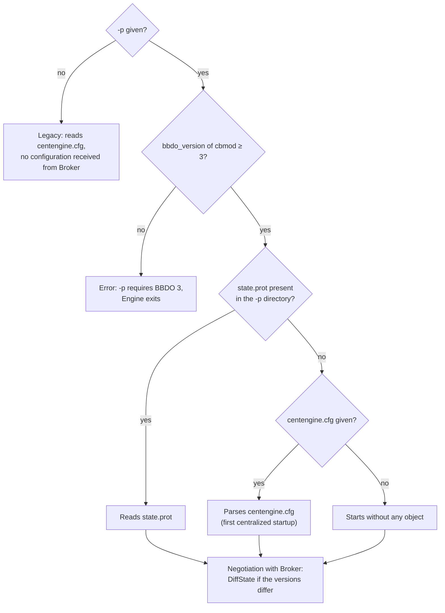
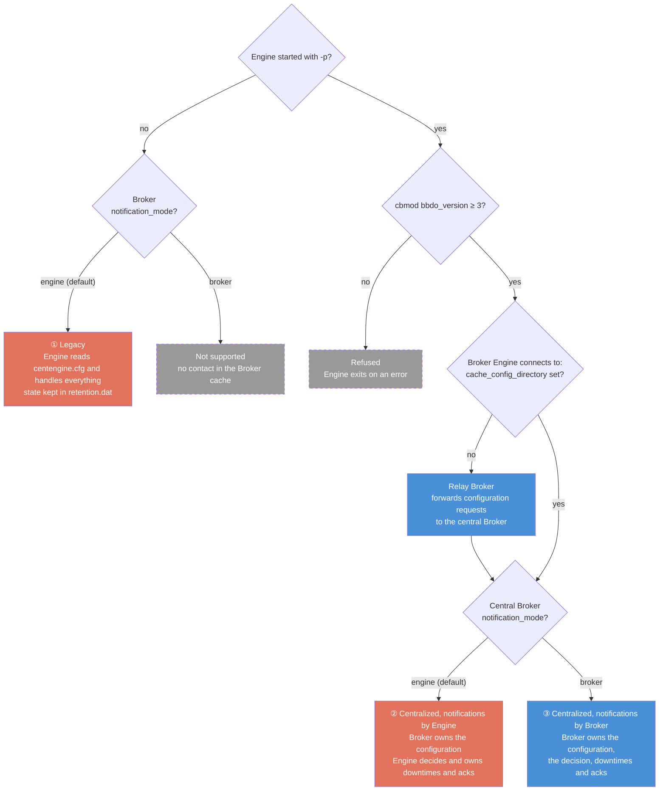
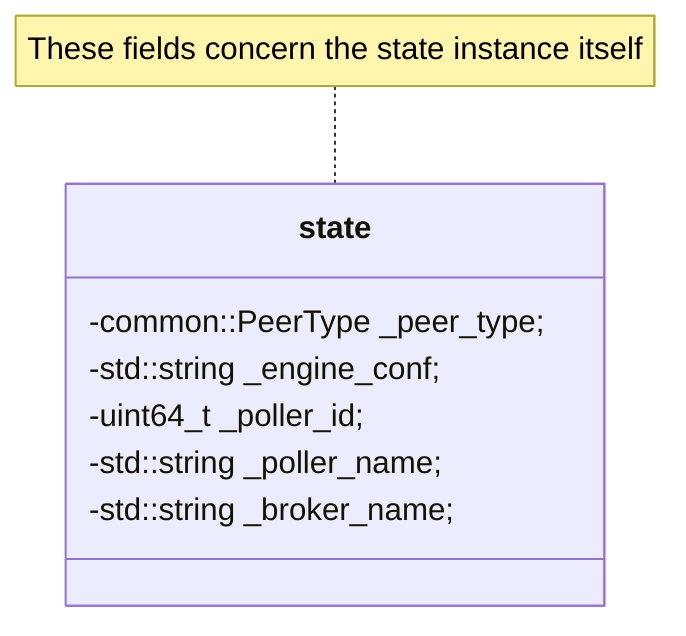
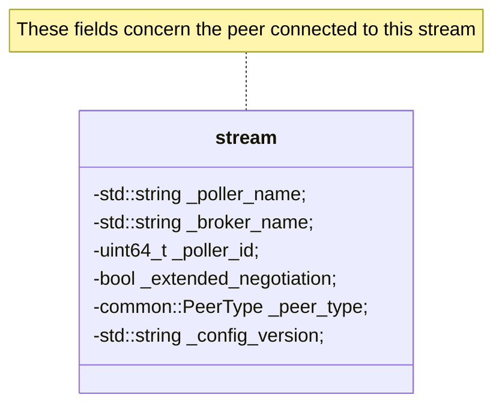

# New negotiation

[Index](README-en.md) · [Next →](02-configuration-delivery-en.md)

<!-- TOC -->
* [cbmod becomes a library](#cbmod-becomes-a-library)
* [Engine startup parameters](#engine-startup-parameters)
* [Broker parameters](#broker-parameters)
  * [The PHP cache directory](#the-php-cache-directory)
  * [The poller configurations directory](#the-poller-configurations-directory)
* [Overview: who handles what, depending on configuration](#overview-who-handles-what-depending-on-configuration)
* [The negotiation](#the-negotiation)
  * [New Broker functionality](#new-broker-functionality)
  * [Engine initiates the connection](#engine-initiates-the-connection)
  * [Broker initiates the connection](#broker-initiates-the-connection)
<!-- TOC -->

This chapter describes the negotiation that opens each connection between `Engine` and `Broker`, and what had to change on the `Engine` side to make it possible.

## cbmod becomes a library

`cbmod` is the part of `Broker` that runs inside the `Engine` process: it opens the connection to `Broker`, carries out the negotiation and turns `Engine` events into BBDO messages.

**Before.** `cbmod` was a NEB module like any other, loaded with `dlopen` from a `broker_module=/usr/lib64/nagios/cbmod.so /etc/centreon-broker/central-module.json` line of `centengine.cfg`. `Engine` and `cbmod` only talked through NEB callbacks: `Engine` published `nebstruct_*` structures, and `cbmod` knew nothing about `Engine` beyond what they contained. For instance, it did not know the `Engine` configuration directory. The channel was also designed one-way, from `Engine` to `cbmod`.

**What motivated the change.** The centralized configuration needs both directions. To negotiate, `cbmod` must know the `Engine` configuration directory and the version of the applied configuration. In return, `Engine` must fetch the `DiffState` messages sent by `Broker` to apply them in its main loop. Carrying all this through NEB callbacks would have required a new event type for each need.

**Today.** `cbmod` is a shared library (`cbmod.so`) linked directly into `centengine`. `Engine` itself creates the `cbmod` object at startup, once its configuration is applied, and gives it the `Broker` configuration file, the `proto-conf` directory and the version of its configuration. From then on, they call each other directly: `Engine` sends its events through `cbmod::write()`, and its main loop fetches from `cbmod` what `Broker` sent (`diff_state()`, notifications to execute, external commands). This return path is used today by the centralized configuration, by notifications decided by `Broker` and by external commands going through `Broker`.

The `Broker` configuration file is given to `Engine` with the `-b` option, or with the `broker_module_cfg_file` key of `centengine.cfg`. The old `broker_module=…/cbmod.so <file>` declaration is still accepted so as not to break existing configurations: `Engine` extracts the configuration file from it (if `broker_module_cfg_file` is empty), refuses to load the module and writes a deprecation warning in its logs.

## Engine startup parameters

**Before.** `Engine` started with a single argument, its configuration file: `centengine /etc/centreon-engine/centengine.cfg`. The `cbmod` configuration file was given in that `centengine.cfg`, on the `broker_module` line.

**Today.** The command line is the following:

`centengine -b /etc/centreon-broker/central-module.json [-p /var/lib/centreon-engine] [/etc/centreon-engine/centengine.cfg]`

* `-b` gives the `Broker` configuration file of `cbmod` (see the previous section);
* `-p` gives the working directory of the centralized configuration, in practice `/var/lib/centreon-engine`, the `HOME` of `Engine`. `Engine` is its only master: it writes `state.prot` there, the serialized copy of the configuration it has just applied, at each application, full or differential. The file name is set by `Engine`, only the directory is configurable;
* the last argument is the historical `centengine.cfg`. It is optional with `-p`.

The `-c` (extended configuration) and `-l` (log file) options are independent of this mechanism.

`-p` enables the centralized configuration, which requires `cbmod` to speak BBDO 3 or higher (see [Overview: who handles what](#overview-who-handles-what-depending-on-configuration)). Without `-p`, `Engine` works as before: it reads its `centengine.cfg` and receives no configuration from `Broker`.

**`-p` with BBDO 2 is refused.** With BBDO 2, the negotiation goes through a `version_response` and not a `Welcome`: `Broker` sends neither `DiffState` nor runtime state snapshot. `Engine`, however, decides on `-p` alone that it is centralized: it would read `state.prot` instead of its `centengine.cfg`, rename its `retention.dat` after reading it once, and only save its downtimes from then on. Each restart would then lose the check state, the acknowledgements and the notification state, with nothing to bring them back. `Engine` therefore checks the `bbdo_version` of the `cbmod` file given by `-b` before reading its retention and before writing `state.prot`: if it is lower than 3, it explains that `-p` requires BBDO 3 or higher and exits with a failure code, leaving `retention.dat` and the `-p` directory untouched. The robot test `ECRPROTOBBDO2` (`tests/engine/config-rejection.robot`) covers this case.

When started with `-p`, `Engine` picks its initial configuration as follows:

1. if `state.prot` exists, it reads it. This is the last configuration received from `Broker`, already validated by it: it is not checked again;
2. otherwise, it parses the `centengine.cfg` given as argument. This is the first startup of a poller switching to the centralized configuration: it starts on its historical configuration, then `Broker` sends it the difference during the negotiation. This is also when it reads its `retention.dat` one last time (see [Prerequisite 5: removing `retention.dat`](09-ha-preparatory-work-en.md#prerequisite-5-removing-retentiondat));
3. if it has neither, `Engine` starts without any object and waits for `Broker` to send its configuration.

In all three cases, the negotiation that follows brings `Engine` up to date: `Broker` compares the version announced by `Engine` with its own and sends it a `DiffState` if they differ.



## Broker parameters

> For the PHP side of these parameters — which ones the web configuration forms must expose, and how external commands move to gRPC — see [PHP evolutions](../php-evolutions-en.md).

The centralized configuration relies on two parameters of the `Broker` configuration file:

* `cache_config_directory`: the PHP cache directory, i.e. the directory where PHP writes the configuration of the pollers;
* `pollers_config_directory`: the directory where `Broker` maintains the configurations of the pollers.

In BBDO 3, `Broker` switches to the centralized configuration as soon as `cache_config_directory` is given. `pollers_config_directory` is then optional: without it, `Broker` uses the `pollers-configuration/` subdirectory of its cache directory. If neither is given, `Broker` is a relay: it forwards the configuration requests of its pollers upstream (see [Remote Servers and centralized configuration](06-remote-servers-en.md#remote-servers-and-centralized-configuration)).

### The PHP cache directory

It contains one subdirectory per poller, named after the poller ID. Each one holds the configuration of the `Engine` installed on that poller, as `.cfg` files. `Broker` parses it, validates it and keeps it in the second directory.

PHP announces a new configuration to `Broker` in one of two ways.

**One `<N>.lck` file per poller.** This is the first mechanism introduced: as soon as PHP has finished updating the directory of poller `<N>`, it touches the associated empty `<N>.lck` file, placed at the same level as the directories. `Broker` watches this file and, as soon as it is notified, takes into account the new configuration written in the directory.

**One `pollers.lck` file for the whole export.** This is the mechanism that should be chosen by default, much more sensible when the user pushes the configurations of several pollers. PHP writes the `<N>` directories of the pollers, then, once done, writes a `pollers.lck` file containing the list of the pushed poller IDs, one per line. `Broker` watches this file: it is notified and takes all the new configurations into account at once.

The benefit of `pollers.lck` over several `<N>.lck` files concerns objects moving from one poller to another. With `pollers.lck`, `Broker` learns about all the changes at once, whereas with several `<N>.lck`, it may temporarily see a resource move as a deletion, or even as a duplicate addition. To avoid this kind of issue, timer mechanisms were introduced, which needlessly complicate the `Broker` code.

There is only one `pollers.lck` for the whole platform: `Broker` reads it at the start of its processing cycle and removes it at the end. PHP must therefore wait for it to disappear before writing a new one, otherwise the removal that closes the current cycle takes the new announcement away with it.

An example of `cache_config_directory`, with both announcement forms:

* cache:
  * 1
    * centengine.cfg
    * services.cfg
    * etc...
  * 1.lck
  * 2
    * centengine.cfg
    * services.cfg
    * etc...
  * 2.lck
  * pollers.lck

### The poller configurations directory

`Broker` keeps the configuration of each poller there, serialized in Protobuf in `<N>.prot`. It is from these files that it computes the differences to send to the `Engine` instances.

An example of `pollers_config_directory`:

* pollers-configuration:
  * 1.prot
  * 2.prot

## Overview: who handles what, depending on configuration

Two settings decide everything. The first one chooses who owns the `Engine` configuration: `Engine` itself (legacy) or `Broker` (centralized configuration). The second one, `notification_mode` in the `Broker` configuration, chooses who owns the notification decision and everything around it: downtimes, acknowledgements, comments and notification toggles. Downtimes are thus not a separate setting: they follow `notification_mode`, as acknowledgements and notifications do.

Three combinations are supported, numbered ①, ② and ③ in the chart and the table below. The fourth one, `notification_mode = broker` in legacy, is accepted by the code but does not work: contacts and escalations only reach the `Broker` cache through the centralized configuration, and `Broker` would have nobody to notify. Finally, `-p` with a `cbmod` in BBDO 2 is refused: `Engine` exits on an error (see [Engine startup parameters](#engine-startup-parameters)).



| | ① Legacy | ② Centralized, `notification_mode = engine` | ③ Centralized, `notification_mode = broker` |
|---|---|---|---|
| **`Engine` command line** | `centengine -b central-module.json centengine.cfg` | `centengine -b central-module.json -p /var/lib/centreon-engine [centengine.cfg]`; the `centengine.cfg` is only used at the first startup | as ② |
| **`Broker` configuration** | nothing new, BBDO 2 or 3 | `bbdo_version` 3 and `cache_config_directory`; `pollers_config_directory` optional | as ②, plus `notification_mode: broker` |
| **`Engine` configuration** | `Engine`, from `centengine.cfg` | `Broker`, from `<N>.prot`, sent as a `DiffState`; `Engine` keeps a copy in `state.prot` | as ② |
| **Notification decision** | `Engine` | `Engine` | `Broker` decides; the poller executes (`pb_notification_execute`) |
| **Downtimes, acknowledgements** | `Engine` | `Engine` | `Broker` |
| **Comments** | created by `Engine`, stored in the database by `Broker` | as ① | created and stored by `Broker` |
| **BAM inherited downtimes** | BAM sends `SCHEDULE_SVC_DOWNTIME` to `Engine` | as ① | scheduled directly in `Broker` |
| **Check state on restart** | `retention.dat` | `RuntimeState` sent by `Broker` at connection; `retention.dat` is only read once, at the switch from legacy, then renamed | as ② |
| **Downtimes on restart** | `retention.dat` | `downtimes.prot`, written by `Engine` next to `state.prot` | `Broker` `.cache` |
| **External commands** | `Engine` command pipe, or `Broker` `ExecuteExternalCommand` in BBDO 3, which routes them to the poller | as ① | through `Broker`: it executes those it owns (downtimes, acknowledgements, comments, notifications) and routes the others |

A few details:

* `Broker` becomes central as soon as `cache_config_directory` is set; without `pollers_config_directory`, it stores the `<N>.prot` files in the `pollers-configuration/` subdirectory of its cache directory. With neither, it is a relay (see [Remote Servers and centralized configuration](06-remote-servers-en.md#remote-servers-and-centralized-configuration)).
* `Engine` learns the notification mode during the negotiation: the `Broker` it connects to fills `broker_handles_notifications` in its `Welcome`. Behind a relay, the relay is the one announcing it: it must carry the same `notification_mode` value as the central.
* Switching from ① to ② is done poller by poller, by adding `-p` to `Engine` (see [Engine startup parameters](#engine-startup-parameters)). Moving from ② to ③ is done at once for all the pollers of the central, since `notification_mode` is a `Broker` parameter (see [Solution: the notification\_mode parameter](07-downtimes-acknowledgements-en.md#solution-the-notification_mode-parameter)).

## The negotiation

We consider that the new capabilities implemented here only work with BBDO3.

The `Welcome` message gets a few additional parameters:

- `broker_name`,
- `extended_negotiation`
- `peer_type`
- `timezone`
- `broker_handles_notifications`

If `cbmod` is configured with the new parameters, it fills these new fields.

The `Welcome` message is now defined as follows:

```
    message Welcome {
      Bbdo version = 1;
      string extensions = 2;
      uint64 poller_id = 3;
      string poller_name = 4;
      /* \Broker\ name is more relevant than poller name because for example on the
       * central, rrd broker, central broker and engine share the same poller name
       * that is 'Central'. */
      string broker_name = 5;
      com.centreon.common.PeerType peer_type = 6;
      bool extended_negotiation = 7;
      /* Engine configuration version sent by Engine so Broker is aware of it. */
      string engine_conf = 8;
      /* Local timezone of the poller machine (IANA name), sent by Engine so Broker
       * can evaluate notification/dependency timeperiods in the poller's timezone
       * when a host/service carries no explicit timezone. Empty for non-Engine
       * peers. */
      string timezone = 9;
      /* Sent by Broker to Engine at negotiation: true when Broker owns the
       * notification decision (notification_mode=broker). Engine then stops
       * deciding notifications on its own (notifier::notify becomes a no-op) and
       * only executes what Broker dispatches via pb_notification_execute. */
      bool broker_handles_notifications = 10;
    }
```

The `version` and `extensions` fields do not change. `poller_id` and `poller_name` still represent the poller ID and name. But on the Central, for example, there are three programs that share these two pieces of information. So to make the identification of the instance sending the message unique, we added `broker_name` (which also makes sense in the case of `Engine`).

`peer_type` is an enumerated type that can take the following values:

- ENGINE
- BROKER
- MAP
- UNKNOWN

`extended_negotiation` is a boolean that indicates whether the program can handle the new negotiation, so for an `Engine`, whether it knows about the Protobuf configuration directory, and for a `Broker`, whether it knows about the PHP cache directory.

Finally, `timezone` holds the poller machine's local timezone (IANA name, for example `Europe/Paris`), as returned by `absl::LocalTimeZone()` on the `Engine` side. It is only filled by an `Engine`. `Broker` keeps it per poller and uses it as the fallback timezone to evaluate notification (and dependency) timeperiods when a host/service carries no explicit `timezone` directive: in that case `Engine` evaluates timeperiods in its machine's local timezone, and `Broker`, which may live in another timezone, must therefore use the poller's timezone rather than its own.

In the other direction, `broker_handles_notifications` is only filled by `Broker`, for `Engine`: it is true when `Broker` owns the notification decision (`notification_mode=broker`). `Engine` then stops deciding on its own and only executes the notifications `Broker` sends it (see [Turning off the decision on Engine](07-downtimes-acknowledgements-en.md#turning-off-the-decision-on-engine)).

Until now, when code was executed in `cbmod` or in `Broker`, we didn't have visibility on the running program, we didn't know if we were in a `Broker` or in an `Engine`. With this evolution, we can know. This is important since we want `Broker` to send the configuration to `Engine`.

At negotiation, `Broker` records its interlocutor in the `peer_registry` of `broker_state`. For an `Engine`, it keeps the `poller_id`, the `poller_name`, the boolean `extended_negotiation`, and two configuration versions: `engine_conf`, the one the poller applies, received in its `Welcome`, and `available_conf`, the one `Broker` has ready for it. A version is a SHA-256 hash of the configuration directory written by PHP, computed by `Broker` when it reads the `.lck` announcement and stored in the `config_version` field of the state sent to `Engine`, which then sends it back in `Welcome.engine_conf`.

And in `configuration::applier::state` we also have this information for our instance.

To summarize, we have the `broker::config::applier::state` class which contains the following fields (partial content):



We also have the `broker::bbdo::stream` class which contains the following fields (partial content):



At the negotiation level, the two important points are knowing whether extended negotiation is supported and in the case of an `Engine` connection, knowing which configuration version it knows. This is not the time to exchange the `Engine` configuration; there is potentially retention to clear before switching to sending it.

How does negotiation work? Two cases arise:

1. `Engine` initiates the connection.
2. `Broker` initiates the connection.

We consider here that `Engine` starts and connects to a `Broker` already running.

### New Broker functionality

`Broker` is configured with two new directories we already discussed:

- `cache_config_directory`
- `pollers-config`

We will focus on these two directories. The first contains subdirectories that are the numbers of pollers connected to this `Broker`. Next to each one, there is a file `XX.lck` where `XX` is the poller number. These `.lck` files are monitored for modifications by `Broker`.

As soon as PHP finishes filling one of these directories with the poller's configuration, i.e., a new subdirectory `<poller_ID>` is created, it creates next to it a file `<poller_ID>.lck`, `Broker` is directly notified.

In reality, `Broker` is not directly notified, as this would cost using a thread for that. So in reality, `Broker` executes a timer (every 5s) in its `config::applier::state` object. Every 5s,

1. It asks `inotify` if there have been modifications in the configuration cache directory. This request translates to a non-blocking file descriptor read. If there is nothing, the function returns immediately with no result. Since the descriptor is non-blocking, an empty event queue shows up as `EAGAIN`: that is the ordinary case — most ticks find nothing — so it is not logged as an error, otherwise every cycle would leave one `error` line behind.

2. In case of a positive response, it retrieves the file names `<poller ID>.lck` to deduce which configurations just arrived.

3. For each file of this form, it reads the configuration, creates a file `new-<poller ID>.prot` in the `pollers-config` directory.

4. Then in case there already existed a file `<poller ID>.prot` in this directory, it also creates a file `<diff-<poller ID.prot>`. If the file doesn't exist, the diff file is created but with the complete configuration.

5. `Broker` maintains the list of its interlocutors, so it also updates the item corresponding to the `Engine` with the correct poller ID to remember that it needs a new configuration.

6. These tasks are all executed by an independent thread; they should have only a limited impact on `Broker`'s operation.

Sending this difference is managed in the `bbdo` stream.

### Engine initiates the connection

`Engine` connects to `Broker` and sends the `Welcome` message. `Broker` is then informed whether the latest `Engine` configuration version is known by its interlocutor. It also knows if it supports the new negotiation. And it responds with a similar message.

Since `Broker` watches the `.lck` announcements written by PHP, it sends a new configuration as soon as it is available, and a configuration already prepared as soon as the poller connects.

An important point: `Broker` does not check the available `Engine` configuration version during negotiation. This is done as a background task. However, it stores in its information about the `Engine` peer its configuration version. Consequently, when a new version arrives, it verifies that the two are indeed different.

```mermaid
sequenceDiagram
    participant E as Engine
    participant BS as Broker SQL
    participant BR as Broker RRD

    rect rgb(0, 50, 0)
    note right of E: BBDO connection
    note right of E: Engine knows its configuration version.
    E ->> BS: bbdo::PbWelcome
    note right of BS: Negotiation initiated by Engine<br/>with its configuration version.

    BS ->> BS: storing Engine's conf version<br/>and broker retrieving<br/>available version (if present).
    note right of BS: Broker knows the old version and<br/>the new version of Engine.
    BS -->> E: bbdo::PbWelcome
    note right of BS: Broker does not send configuration version<br/>in response. It's useless.<br/>The configuration is sent afterwards: the one already prepared,<br/>or the next one announced by a .lck.
    end
```



### Broker initiates the connection

`Broker` connects to `Engine` and sends the `Welcome` message. `Engine` learns at this moment whether `Broker` supports the new negotiation or not. And it responds by sending the current configuration version.

In terms of diagram, we are on a very similar scheme to the previous one except that the questions/answers are reversed.
