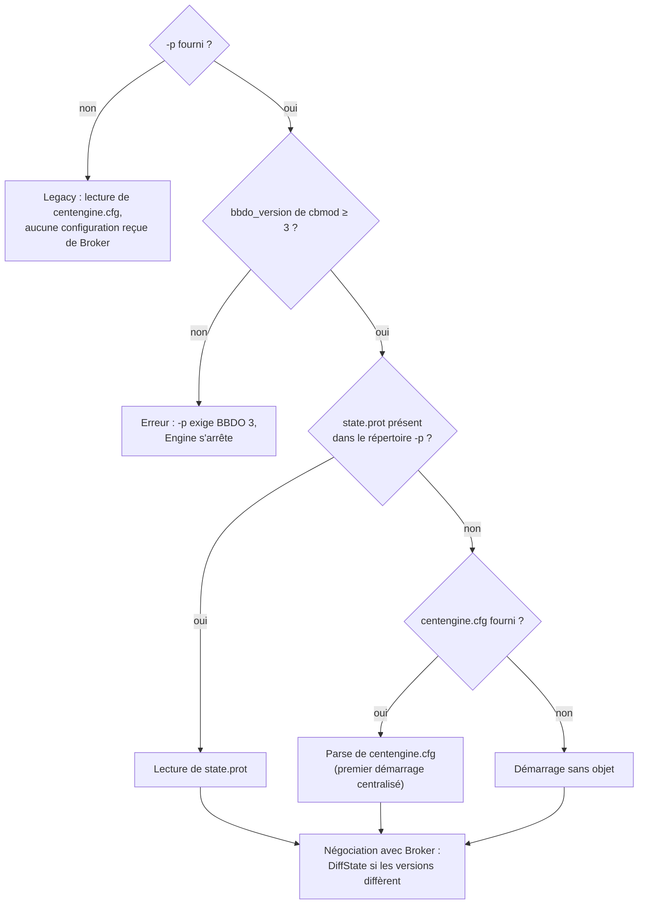
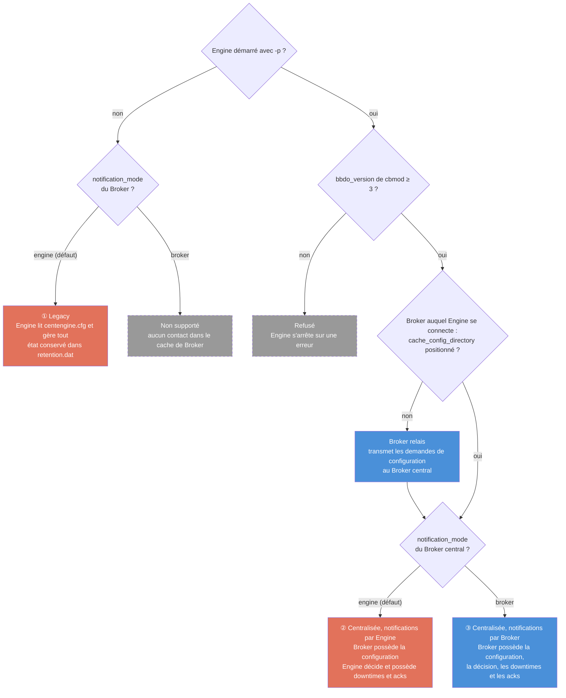
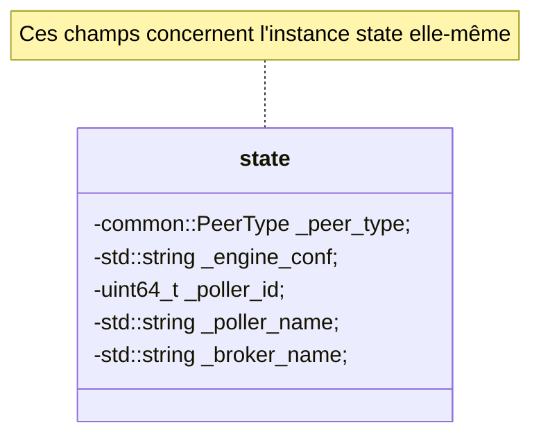
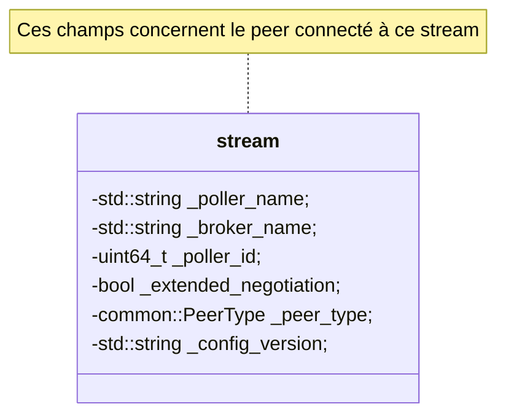

# Nouvelle négociation

[Index](README-fr.md) · [Suivant →](02-configuration-delivery-fr.md)

<!-- TOC -->
* [`cbmod` devient une librairie](#cbmod-devient-une-librairie)
* [Paramètres de démarrage d'Engine](#paramètres-de-démarrage-dengine)
* [Paramètres de Broker](#paramètres-de-broker)
  * [Le répertoire de cache PHP](#le-répertoire-de-cache-php)
  * [Le répertoire des configurations des pollers](#le-répertoire-des-configurations-des-pollers)
* [Vue d'ensemble : qui gère quoi, selon la configuration](#vue-densemble--qui-gère-quoi-selon-la-configuration)
* [La négociation](#la-négociation)
  * [Nouvelle fonctionnalité de Broker](#nouvelle-fonctionnalité-de-broker)
  * [Engine initie la connexion](#engine-initie-la-connexion)
  * [Broker initie la connexion](#broker-initie-la-connexion)
<!-- TOC -->

Ce chapitre décrit la négociation qui ouvre chaque connexion entre `Engine` et `Broker`, et ce qu'il a fallu changer côté `Engine` pour la rendre possible.

## `cbmod` devient une librairie

`cbmod` est la partie de `Broker` qui tourne dans le processus `Engine` : c'est lui qui ouvre la connexion vers `Broker`, mène la négociation et transforme les événements d'`Engine` en messages BBDO.

**Avant.** `cbmod` était un module NEB comme les autres, chargé par `dlopen` à partir d'une ligne `broker_module=/usr/lib64/nagios/cbmod.so /etc/centreon-broker/central-module.json` de `centengine.cfg`. `Engine` et lui ne communiquaient que par les callbacks NEB : `Engine` publiait des structures `nebstruct_*`, et `cbmod` ne savait rien d'`Engine` au-delà de ce qu'elles contenaient. Il ignorait par exemple le répertoire de configuration d'`Engine`. Le canal était aussi pensé à sens unique, d'`Engine` vers `cbmod`.

**Ce qui nous a motivés.** La configuration centralisée a besoin des deux sens. Pour négocier, `cbmod` doit connaître le répertoire de configuration d'`Engine` et la version de la configuration appliquée. En retour, `Engine` doit récupérer les `DiffState` envoyés par `Broker` pour les appliquer dans sa boucle principale. Faire passer tout cela par les callbacks NEB aurait demandé un nouveau type d'événement à chaque besoin.

**Aujourd'hui.** `cbmod` est une librairie partagée (`cbmod.so`) liée directement à `centengine`. `Engine` crée lui-même l'objet `cbmod` au démarrage, une fois sa configuration appliquée, en lui passant le fichier de paramétrage `Broker`, le répertoire `proto-conf` et la version de sa configuration. Ensuite, les deux s'appellent directement : `Engine` transmet ses événements par `cbmod::write()`, et sa boucle principale vient chercher auprès de `cbmod` ce que `Broker` lui a envoyé (`diff_state()`, notifications à exécuter, commandes externes). Cette voie de retour sert aujourd'hui à la configuration centralisée, aux notifications décidées par `Broker` et aux commandes externes passées par `Broker`.

Le fichier de paramétrage `Broker` se donne à `Engine` par l'option `-b`, ou par la clé `broker_module_cfg_file` de `centengine.cfg`. L'ancienne déclaration `broker_module=…/cbmod.so <fichier>` reste acceptée pour ne pas casser les configurations existantes : `Engine` en extrait le fichier de paramétrage (si `broker_module_cfg_file` est vide), refuse de charger le module et écrit un avertissement de dépréciation dans ses logs.

## Paramètres de démarrage d'Engine

**Avant.** `Engine` démarrait avec un seul argument, son fichier de configuration : `centengine /etc/centreon-engine/centengine.cfg`. Le fichier de paramétrage de `cbmod` était indiqué dans ce `centengine.cfg`, sur la ligne `broker_module`.

**Aujourd'hui.** La ligne de commande est la suivante :

`centengine -b /etc/centreon-broker/central-module.json [-p /var/lib/centreon-engine] [/etc/centreon-engine/centengine.cfg]`

* `-b` donne le fichier de paramétrage `Broker` de `cbmod` (voir la section précédente) ;
* `-p` donne le répertoire de travail de la configuration centralisée, en pratique `/var/lib/centreon-engine`, le `HOME` d'`Engine`. `Engine` en est le seul maître : il y écrit `state.prot`, la copie sérialisée de la configuration qu'il vient d'appliquer, à chaque application, complète ou différentielle. Le nom du fichier est fixé par `Engine`, seul le répertoire se paramètre ;
* le dernier argument est le `centengine.cfg` historique. Il est facultatif avec `-p`.

Les options `-c` (configuration étendue) et `-l` (fichier de log) sont indépendantes de ce mécanisme.

`-p` active la configuration centralisée, qui exige que `cbmod` parle BBDO 3 ou plus (voir [Vue d'ensemble : qui gère quoi](#vue-densemble--qui-gère-quoi-selon-la-configuration)). Sans `-p`, `Engine` fonctionne comme avant : il lit son `centengine.cfg` et ne reçoit aucune configuration de `Broker`.

**`-p` avec BBDO 2 est refusé.** En BBDO 2, la négociation passe par un `version_response` et non par un `Welcome` : `Broker` n'envoie ni `DiffState` ni snapshot de l'état d'exécution. `Engine`, lui, se croit centralisé sur la seule présence de `-p` : il lirait `state.prot` au lieu de son `centengine.cfg`, renommerait son `retention.dat` après l'avoir lu une fois, et ne sauverait plus que ses downtimes. Chaque redémarrage perdrait alors l'état de check, les acquittements et l'état des notifications, sans rien pour les ramener. `Engine` vérifie donc la `bbdo_version` du fichier de `cbmod` donné par `-b` avant de lire sa rétention et avant d'écrire `state.prot` : si elle est inférieure à 3, il explique que `-p` exige BBDO 3 ou plus et s'arrête avec un code d'échec, sans toucher à `retention.dat` ni au répertoire `-p`. Le test robot `ECRPROTOBBDO2` (`tests/engine/config-rejection.robot`) couvre ce cas.

Au démarrage avec `-p`, `Engine` choisit sa configuration initiale ainsi :

1. si `state.prot` existe, il le lit. C'est la dernière configuration reçue de `Broker`, déjà validée par lui : elle n'est pas revérifiée ;
2. sinon, il parse le `centengine.cfg` passé en argument. C'est le premier démarrage d'un poller qui passe en configuration centralisée : il démarre sur sa configuration historique, puis `Broker` lui envoie la différence lors de la négociation. C'est aussi à ce moment qu'il lit une dernière fois son `retention.dat` (voir [Prérequis 5 : élimination de `retention.dat`](09-ha-preparatory-work-fr.md#prérequis-5--élimination-de-retentiondat)) ;
3. s'il n'a ni l'un ni l'autre, `Engine` démarre sans aucun objet et attend que `Broker` lui envoie sa configuration.

Dans les trois cas, la négociation qui suit met `Engine` à jour : `Broker` compare la version annoncée par `Engine` à la sienne et lui envoie un `DiffState` si elles diffèrent.



## Paramètres de Broker

> Pour le volet PHP de ces paramètres — lesquels les formulaires de configuration web doivent exposer, et comment les commandes externes passent à gRPC — voir [Évolutions PHP](../php-evolutions-fr.md).

La configuration centralisée repose sur deux paramètres du fichier de configuration de `Broker` :

* `cache_config_directory` : le répertoire de cache PHP, c'est-à-dire le répertoire dans lequel PHP écrit la configuration des pollers ;
* `pollers_config_directory` : le répertoire dans lequel `Broker` maintient les configurations des pollers.

En BBDO 3, `Broker` passe en configuration centralisée dès que `cache_config_directory` est fourni. `pollers_config_directory` est alors facultatif : sans lui, `Broker` utilise le sous-répertoire `pollers-configuration/` de son répertoire de cache. Si aucun des deux n'est fourni, `Broker` est un relais : il transmet les demandes de configuration de ses pollers en amont (voir [Remote Servers et configuration centralisée](06-remote-servers-fr.md#remote-servers-et-configuration-centralisée)).

### Le répertoire de cache PHP

Il contient un sous-répertoire par poller, dont le nom est l'ID du poller. Chacun contient la configuration de l'`Engine` installé sur ce poller, sous la forme de fichiers `.cfg`. `Broker` la parse, la valide et la conserve dans le second répertoire.

PHP annonce une nouvelle configuration à `Broker` de deux façons possibles.

**Un fichier `<N>.lck` par poller.** C'est le premier fonctionnement introduit : dès que PHP a fini de mettre à jour le répertoire du poller `<N>`, il touche le fichier vide `<N>.lck` associé, placé au même niveau que les répertoires. `Broker` surveille ce fichier et, dès qu'il est notifié, prend en considération la nouvelle configuration écrite dans le répertoire.

**Un fichier `pollers.lck` pour tout l'export.** C'est le fonctionnement qui devrait être choisi par défaut, beaucoup plus judicieux quand l'utilisateur pousse les configurations de plusieurs pollers. PHP écrit les répertoires `<N>` des pollers, puis, une fois terminé, écrit un fichier `pollers.lck` contenant la liste des IDs des pollers poussés, un par ligne. `Broker` surveille ce fichier : il est notifié et prend en considération toutes les nouvelles configurations en une fois.

L'intérêt de `pollers.lck` par rapport à plusieurs fichiers `<N>.lck` concerne les déplacements d'objets d'un poller à l'autre. Avec `pollers.lck`, `Broker` est informé de tous les changements en une seule fois, tandis qu'avec plusieurs `<N>.lck`, il peut momentanément considérer un déplacement de ressource comme une suppression, voire comme un ajout en double. Pour éviter ce genre de souci, des systèmes de timer ont été introduits, qui compliquent inutilement le code de `Broker`.

Il n'existe qu'un seul `pollers.lck` pour toute la plateforme : `Broker` le lit au début de son cycle de traitement et le supprime à la fin. PHP doit donc attendre sa disparition avant d'en écrire un nouveau, sinon la suppression qui clôt le cycle en cours emporte la nouvelle annonce.

Un exemple de répertoire `cache_config_directory`, avec les deux formes d'annonce :

* cache:
  * 1
    * centengine.cfg
    * services.cfg
    * etc...
  * 1.lck
  * 2
    * centengine.cfg
    * services.cfg
    * etc...
  * 2.lck
  * pollers.lck

### Le répertoire des configurations des pollers

`Broker` y conserve la configuration de chaque poller, sérialisée en Protobuf dans `<N>.prot`. C'est à partir de ces fichiers qu'il calcule les différences à envoyer aux `Engine`.

Un exemple de répertoire `pollers_config_directory` :

* pollers-configuration:
  * 1.prot
  * 2.prot

## Vue d'ensemble : qui gère quoi, selon la configuration

Deux réglages décident de tout. Le premier choisit qui possède la configuration d'`Engine` : `Engine` lui-même (legacy) ou `Broker` (configuration centralisée). Le second, `notification_mode` dans la configuration de `Broker`, choisit qui possède la décision de notification et tout ce qui l'entoure : les downtimes, les acquittements, les commentaires et les bascules de notification. Les downtimes ne sont donc pas un réglage à part : ils suivent `notification_mode`, comme les acquittements et les notifications.

Trois combinaisons sont supportées, numérotées ①, ② et ③ dans le graphique et le tableau qui suivent. La quatrième, `notification_mode = broker` en legacy, est acceptée par le code mais ne fonctionne pas : les contacts et les escalades n'arrivent dans le cache de `Broker` que par la configuration centralisée, et `Broker` n'aurait personne à notifier. Enfin, `-p` avec un `cbmod` en BBDO 2 est refusé : `Engine` s'arrête sur une erreur (voir [Paramètres de démarrage d'Engine](#paramètres-de-démarrage-dengine)).



| | ① Legacy | ② Centralisée, `notification_mode = engine` | ③ Centralisée, `notification_mode = broker` |
|---|---|---|---|
| **Ligne de commande d'`Engine`** | `centengine -b central-module.json centengine.cfg` | `centengine -b central-module.json -p /var/lib/centreon-engine [centengine.cfg]` ; le `centengine.cfg` ne sert qu'au premier démarrage | comme ② |
| **Configuration de `Broker`** | rien de nouveau, BBDO 2 ou 3 | `bbdo_version` 3 et `cache_config_directory` ; `pollers_config_directory` facultatif | comme ②, plus `notification_mode: broker` |
| **Configuration d'`Engine`** | `Engine`, depuis `centengine.cfg` | `Broker`, depuis `<N>.prot`, envoyée par `DiffState` ; `Engine` en garde une copie dans `state.prot` | comme ② |
| **Décision de notification** | `Engine` | `Engine` | `Broker` décide ; le poller exécute (`pb_notification_execute`) |
| **Downtimes, acquittements** | `Engine` | `Engine` | `Broker` |
| **Commentaires** | créés par `Engine`, stockés en base par `Broker` | comme ① | créés et stockés par `Broker` |
| **Downtimes BAM hérités** | BAM envoie `SCHEDULE_SVC_DOWNTIME` à `Engine` | comme ① | programmés directement dans `Broker` |
| **État de check au redémarrage** | `retention.dat` | `RuntimeState` envoyé par `Broker` à la connexion ; `retention.dat` n'est lu qu'une fois, à la bascule depuis le legacy, puis renommé | comme ② |
| **Downtimes au redémarrage** | `retention.dat` | `downtimes.prot`, écrit par `Engine` à côté de `state.prot` | `.cache` de `Broker` |
| **Commandes externes** | tube d'`Engine`, ou `ExecuteExternalCommand` de `Broker` en BBDO 3, qui les route vers le poller | comme ① | par `Broker` : il exécute lui-même celles qu'il possède (downtimes, acquittements, commentaires, notifications) et route les autres |

Quelques précisions :

* `Broker` passe en central dès que `cache_config_directory` est positionné ; sans `pollers_config_directory`, il range les `<N>.prot` dans le sous-répertoire `pollers-configuration/` de son répertoire de cache. Sans aucun des deux, il est relais (voir [Remote Servers et configuration centralisée](06-remote-servers-fr.md#remote-servers-et-configuration-centralisée)).
* `Engine` apprend le mode de notification à la négociation : le `Broker` auquel il se connecte renseigne `broker_handles_notifications` dans son `Welcome`. Derrière un relais, c'est donc le relais qui l'annonce : il doit porter la même valeur de `notification_mode` que le central.
* La bascule de ① vers ② se fait poller par poller, en ajoutant `-p` à `Engine` (voir [Paramètres de démarrage d'Engine](#paramètres-de-démarrage-dengine)). Le passage de ② à ③ se fait d'un coup pour tous les pollers du central, puisque `notification_mode` est un paramètre de `Broker` (voir [Solution : le paramètre notification\_mode](07-downtimes-acknowledgements-fr.md#solution--le-paramètre-notification_mode)).

## La négociation

Nous considérons que les nouvelles capacités implémentées ici ne
fonctionnent qu’avec BBDO3.

Le message `Welcome` se voit ajouter quelques paramètres :

-   `broker_name`,
-   `extended_negotiation`
-   `peer_type`
-   `timezone`
-   `broker_handles_notifications`

Si `cbmod` est configuré avec les nouveaux paramètres, alors il remplit
ces nouveaux champs.

Le message `Welcome` est maintenant défini comme suit :

```
    message Welcome {
      Bbdo version = 1;
      string extensions = 2;
      uint64 poller_id = 3;
      string poller_name = 4;
      /* \Broker\ name is more relevant than poller name because for example on the
       * central, rrd broker, central broker and engine share the same poller name
       * that is 'Central'. */
      string broker_name = 5;
      com.centreon.common.PeerType peer_type = 6;
      bool extended_negotiation = 7;
      /* Engine configuration version sent by Engine so Broker is aware of it. */
      string engine_conf = 8;
      /* Local timezone of the poller machine (IANA name), sent by Engine so Broker
       * can evaluate notification/dependency timeperiods in the poller's timezone
       * when a host/service carries no explicit timezone. Empty for non-Engine
       * peers. */
      string timezone = 9;
      /* Sent by Broker to Engine at negotiation: true when Broker owns the
       * notification decision (notification_mode=broker). Engine then stops
       * deciding notifications on its own (notifier::notify becomes a no-op) and
       * only executes what Broker dispatches via pb_notification_execute. */
      bool broker_handles_notifications = 10;
    }
```

Les champs `version` et `extensions` ne changent pas. `poller_id` et
`poller_name` représentent toujours l’ID et le nom du poller. Mais sur
le Central, par exemple, il y a trois programmes qui partagent ces deux
informations. Donc pour rendre unique l’identification de l’instance qui
envoie le message, nous avons ajouté le `broker_name` (qui a aussi du
sens dans le cas d’`Engine`).

`peer_type` est un type énuméré qui peut prendre les valeurs suivantes :

-   ENGINE
-   BROKER
-   MAP
-   UNKNOWN

`extended_negotiation` est un booléen qui indique si le programme
est capable de gérer la nouvelle négociation, donc pour un `Engine`,
s’il a connaissance du répertoire de configuration Protobuf, et pour un
`Broker`, s’il a connaissance du répertoire de cache php.

Enfin, `timezone` contient le fuseau horaire local de la machine du poller
(nom IANA, par exemple `Europe/Paris`), tel que renvoyé par
`absl::LocalTimeZone()` côté `Engine`. Il est renseigné uniquement par un
`Engine`. `Broker` le conserve par poller et s’en sert comme fuseau de repli
pour évaluer les timeperiods de notification (et de dépendance) lorsqu’un
host/service ne porte pas de directive `timezone` explicite : dans ce cas
`Engine` évalue les timeperiods dans le fuseau local de sa machine, et
`Broker`, qui peut vivre dans un autre fuseau, doit donc utiliser celui du
poller plutôt que le sien.

Dans l'autre sens, `broker_handles_notifications` n'est renseigné que par `Broker`, à destination d'`Engine` : il vaut vrai quand `Broker` a la main sur la décision de notification (`notification_mode=broker`). `Engine` cesse alors de décider seul et n'exécute plus que les notifications que `Broker` lui envoie (voir [Coupure de la décision côté Engine](07-downtimes-acknowledgements-fr.md#coupure-de-la-décision-côté-engine)).

Jusqu'à présent, quand le code était exécuté dans `cbmod` ou dans `Broker`, on
n’avait pas la visibilité sur le programme en cours d’exécution, on ne
savait pas si on était dans un `Broker` ou dans un `Engine`. Avec cette
évolution, on peut le savoir. C’est important puisqu’on veut que
`Broker` envoie la configuration à `Engine`.

À la négociation, `Broker` enregistre son interlocuteur dans le `peer_registry` de `broker_state`. Pour un `Engine`, il y garde le `poller_id`, le `poller_name`, le booléen `extended_negotiation`, et deux versions de configuration : `engine_conf`, celle qu'applique le poller, reçue dans son `Welcome`, et `available_conf`, celle que `Broker` a prête pour lui. Une version est un hash SHA-256 du répertoire de configuration écrit par PHP, calculé par `Broker` à la lecture de l'annonce `.lck` et placé dans le champ `config_version` de l'état envoyé à `Engine`, qui le renvoie ensuite dans `Welcome.engine_conf`.

Et dans le `configuration::applier::state` on a aussi ces informations
pour notre instance.

Pour résumer, on a la classe `broker::config::applier::state` qui
contient les champs suivants (contenu partiel) :



On a aussi la classe `broker::bbdo::stream` qui contient les champs suivants
(contenu partiel) :


Au niveau de la négociation, les deux points importants sont de savoir
si la négociation étendue est supportée et dans le cas de la connexion
d’un `Engine`, savoir quelle version de la configuration, il connaît. Ce n’est pas
le moment d’échanger la configuration `Engine`, il y a potentiellement de
la rétention à liquider avant de basculer sur son envoi.

Comment fonctionne la négociation ? Deux cas se présentent :

1.  `Engine` initie la connexion.
2.  `Broker` initie la connexion.

On considère ici qu’`Engine` démarre et se connecte à un `Broker` déjà
en fonctionnement.

### Nouvelle fonctionnalité de Broker

`Broker` est configuré avec deux nouveaux répertoires dont on a déjà
parlé et qui sont :

-   `cache_config_directory`
-   `pollers-config`

Nous allons nous attarder sur ces deux répertoires. Le premier contient
des sous-répertoires qui sont les numéros des pollers connectés à ce
`Broker`. À côté de chacun, il existe un fichier `XX.lck` où `XX` est le numéro
d'un poller. Ces fichiers `.lck` sont écoutés sur les modifications par `Broker`.

Dès que le php finit de remplir un de ces répertoires avec la
configuration du poller concerné, c’est-à-dire qu’un nouveau
sous-répertoire `<poller_ID>` est créé, il crée à côté un fichier
`<poller_ID>.lck`, `Broker` en est directement notifié.

En réalité, `Broker` n’est pas directement notifié, cela coûterait
d’utiliser un thread pour cela. Du coup, dans la
réalité `Broker` exécute un timer (toutes les 5s) dans son objet
`config::applier::state`. Toutes les 5s,

1.  il demande à `inotify` s’il y a eu des modifications dans le
    répertoire de cache des configurations. Cette demande se traduit par
    une lecture de descripteur de fichier, non bloquante. S’il n’y a
    rien, la fonction retourne tout de suite avec rien comme résultat.
    Le descripteur étant non bloquant, une file d’événements vide se
    traduit par `EAGAIN` : c’est le cas ordinaire — la plupart des ticks
    ne trouvent rien — et il n’est donc pas journalisé comme une erreur,
    faute de quoi chaque cycle laisserait une ligne `error` derrière lui.

2.  Dans le cas d’une réponse positive, il récupère les noms de fichier
    `<poller ID>.lck` pour déduire quelles configurations viennent
    d’arriver.

3.  Pour chaque fichier de cette forme, il lit la configuration, crée un
    fichier `new-<poller ID>.prot` dans le répertoire `pollers-config`.

4.  Puis dans le cas où il existait déjà un fichier `<poller ID>.prot`
    dans ce répertoire, il crée aussi un fichier
    `<diff-<poller ID.prot>`. Si le fichier n'existe pas, le fichier de diff
    est créé mais avec la configuration complète.

5.  `Broker` entretient la liste de ses interlocuteurs, il met donc
    aussi à jour l’item correspondant à l’`Engine` avec le bon poller ID
    pour se souvenir qu’il a besoin d’une nouvelle configuration.

6.  Ces tâches sont toutes exécutées par un thread indépendant, elles ne
    devraient avoir qu’un impact limité sur le fonctionnement de
    `Broker`.

L’envoi de cette différence est géré dans le stream `bbdo`.

### Engine initie la connexion

`Engine` se connecte à `Broker` et envoie le message `Welcome`.
`Broker` est alors informé si la dernière version de configuration
`Engine` est connu par son interlocuteur. Il sait aussi s’il supporte la
nouvelle négociation. Et il répond par un message similaire.

Comme `Broker` surveille les annonces `.lck` de PHP, il envoie une nouvelle configuration dès qu'elle est disponible, et une configuration déjà prête dès que le poller se connecte.

Un point important, `Broker` ne regarde pas la version de configuration
`Engine` disponible pendant la négociation. C’est quelque chose qui se
fait en tâche de fond. Par contre, il stocke dans ses informations sur
le peer `Engine` sa version de conf. Par conséquent, à l'arrivée d'une
nouvelle version, il vérifie si les deux sont bien différentes.

```mermaid
sequenceDiagram
    participant E as Engine
    participant BS as Broker SQL
    participant BR as Broker RRD

    rect rgb(0, 50, 0)
    note right of E: BBDO connection
    note right of E: Engine knows its configuration version.
    E ->> BS: bbdo::PbWelcome
    note right of BS: Initiation de la négociation par Engine<br/>avec sa version de configuration.

    BS ->> BS: stockage de la version de conf de l'Engine<br/>en question et récupération par broker de<br/>la version disponible (si présente).
    note right of BS: Broker connaît l'ancienne version et<br/>la nouvelle version d'Engine.
    BS -->> E: bbdo::PbWelcome
    note right of BS: Broker n'envoie pas la version de configuration<br/>en réponse. C'est inutile.<br/>La configuration part ensuite : celle déjà prête,<br/>ou la prochaine annoncée par un .lck.
    end
```



### Broker initie la connexion

`Broker` se connecte à `Engine` et envoie le message `Welcome`.
`Engine` apprend à ce moment si `Broker` supporte ou non la nouvelle
négociation. Et il répond en envoyant la version de configuration en
cours.

Au niveau diagramme, on est sur un schéma très similaire au précédent
hormis que les questions/réponses sont inversées.
