# Reading Engine configuration

[← Previous](01-negotiation-en.md) · [Index](README-en.md) · [Next →](03-configuration-validation-en.md)

<!-- TOC -->
* [Configuration management on the Engine side](#configuration-management-on-the-engine-side)
* [Managing configuration sending by Broker to Engine](#managing-configuration-sending-by-broker-to-engine)
  * [The journey of a configuration](#the-journey-of-a-configuration)
  * [The announcement](#the-announcement)
  * [Preparation](#preparation)
  * [Delivery](#delivery)
  * [The configuration round](#the-configuration-round)
    * [An export arriving while a round is open](#an-export-arriving-while-a-round-is-open)
* [Some more technical points](#some-more-technical-points)
  * [Watching the cache directory](#watching-the-cache-directory)
    * [The moving parts](#the-moving-parts)
    * [Which events count](#which-events-count)
    * [The fallback scan](#the-fallback-scan)
    * [Losing the `inotify` watch](#losing-the-inotify-watch)
    * [Starting the watching](#starting-the-watching)
* [Split of broker::config::applier::state](#split-of-brokerconfigapplierstate)
  * [broker_state, cache and downtime_manager lifecycle](#broker_state-cache-and-downtime_manager-lifecycle)
    * [Startup](#startup)
    * [Startup readiness barrier](#startup-readiness-barrier)
    * [Shutdown](#shutdown)
<!-- TOC -->

## Configuration management on the Engine side

`Engine` is started with the new configuration. It reads the serialized Protobuf configuration available in its `HOME`. It then connects to `Broker` and sends the `Welcome` message with the correct configuration version number. We saw that `Broker` just responds by saying whether it supports centralized configuration or not. In a second step, Broker, as a background task, checks if new configurations are available for `Engine`. If one appears, it sends a message with the configuration difference. `cbmod` keeps it on hold and when `Engine` starts a new cycle in its main loop, it applies this configuration.

If there is retention, it is sent as a background task during application of the new configuration. Once retention is finished, `Engine` having applied the configuration, in case of a reload, sends an `InstanceConfiguration` message to `Broker` to tell it that it has received the configuration.

FIXME DBO: Is the `InstanceConfiguration` message still necessary?

But actually, there is a specific message for this, it's the `pb_diff_state_ack` message that is sent by `Engine` to `Broker` to tell it that it has received and applied the new configuration.

## Managing configuration sending by Broker to Engine

This section follows a configuration from the moment PHP writes it to the moment it reaches the database. Watching the cache directory (`inotify`, strands, watch recovery, fallback scan) is described separately, in [Watching the cache directory](#watching-the-cache-directory).

### The journey of a configuration

Four files mark out this journey, and each of them says one thing only:

| File | Directory | What it says | Written by | Goes away |
|---|---|---|---|---|
| `X.lck` or `pollers.lck` | PHP cache | a configuration has arrived, `Broker` has not read it yet | PHP | removed by `Broker` as soon as `new-X.prot` is written |
| `new-X.prot` | `pollers-configuration` | a configuration is ready and waits for poller X to acknowledge it | the `Broker` cycle | renamed to `X.prot` on acknowledgement |
| `diff-X.prot` | `pollers-configuration` | the difference between `X.prot` and `new-X.prot`, or the full configuration when there is no `X.prot` | the `Broker` cycle | removed once integrated into the global diff |
| `X.prot` | `pollers-configuration` | the last configuration acknowledged by poller X | `Broker`, by renaming | replaced by the next renaming |

The steps:

1. **The announcement.** PHP writes the configuration of poller X into the `X/` directory, then creates `X.lck`, or a `pollers.lck` naming every poller of the export.
2. **Preparation.** `Broker` reads and validates the configuration, writes `new-X.prot` then `diff-X.prot`, and removes the announcement.
3. **Delivery.** The BBDO stream of poller X sends it a `DiffState` read from `diff-X.prot`, or from `new-X.prot` when `Engine` cannot apply the difference.
4. **Acknowledgement.** `Engine` applies the configuration and answers with a `pb_diff_state_ack`. `Broker` renames `new-X.prot` to `X.prot` and applies `diff-X.prot` to the cache.
5. **Closing the round.** Once every poller served has acknowledged, `Broker` merges the `diff-*.prot` into a global diff, publishes it to `unified_sql` and the cache, then removes the `diff-*.prot`.

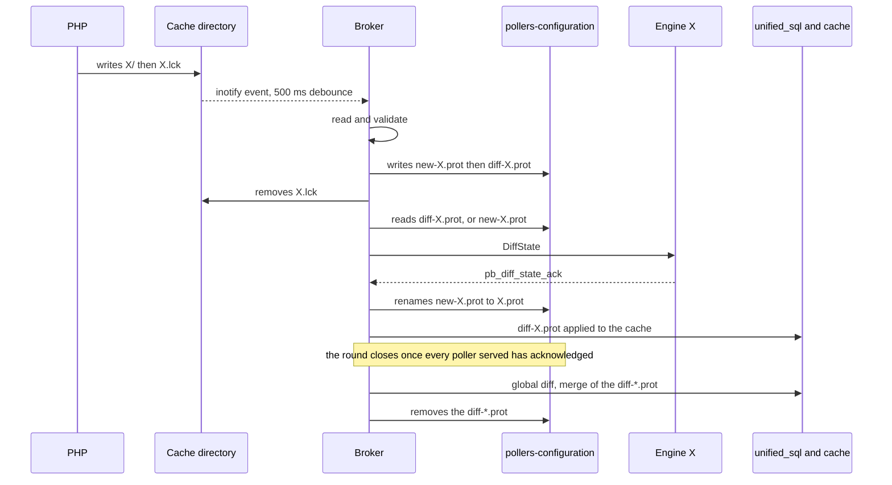

### The announcement

PHP has two ways to announce a push, and `Broker` reads both.

| | `<ID>.lck` | `pollers.lck` |
|---|---|---|
| Content | empty, only the name matters | the pollers of the export, one ID per line |
| Where the export ends | guessed by `Broker` | given by the file |
| Debounce | 500 ms without a new event, capped at 5 s | none |
| Who posts the work | `_post_individual_work()` | `_post_batch_work()` |
| Removal | one by one, as the `new-<ID>.prot` are written | at the end of the cycle |

`pollers.lck` is the target form. With `<ID>.lck` files, `Broker` can only group what arrives close together. But the gap between two `.lck` is the time it takes to generate the next configuration, which exceeds the debounce delay on a large poller: the export then splits into several batches. An object moved from one poller to another is seen as a removal then an addition in two successive rounds, instead of a single modification. The PHP side of the contract is described in [php-evolutions](../php-evolutions-en.md#evolution-3--an-explicit-configuration-batch-pollerslck).

The debounce pushes the deadline back by 500 ms on every new event. A burst of `.lck`, such as a mass deployment, thus becomes a single batch, and the stored configurations are read only once. The 5 s cap prevents a continuous stream of events from postponing the work forever.

An announcement only announces. It goes away as soon as `Broker` has prepared what it announces, whether the poller is connected or not. For PHP, its removal means "`Broker` has taken charge of your configuration", not "it has reached its poller": a stopped poller cannot acknowledge anything, so this is all PHP can usefully wait for. What marks a pending delivery is `new-<ID>.prot`, in `Broker`'s own directory. A `pollers.lck` could not play that part anyway, since the pollers it names do not acknowledge at the same time.

### Preparation

The cycle, `_run_config_cycle()`, receives its batch as a parameter and handles each poller in two halves. A failure does not mean the same thing in each.

**Read and validate** (`_read_poller_conf()`): `hash_directory` computes the configuration version, then `parse`, `expand` and `resolve` load it with the `engine_conf` library, and the [cross-poller validation](03-configuration-validation-en.md#cross-poller-validation-load_foreign_objects) checks it. A validation failure is a property of the content pushed, which will not become valid on its own: the configuration is refused and the announcement consumed. PHP will create a new one with the fixed configuration.

**Store** (`_write_new_conf()`, then `_prepare_diff_for_poller()`): `new-X.prot` is written, then `diff-X.prot`. A failure here is a disk matter and says nothing about the configuration: the announcement is kept, and the next cycle reads the sources again.

| Exit | Announcement | Counted |
|---|---|---|
| `hash_directory` fails | kept | — |
| `build_test_file` fails | kept | — |
| validation error | consumed | `refused` |
| cannot store | kept | — |
| success | consumed | `ready` |

The announcement is only removed once `new-X.prot` is written. At no point is there neither of them: a crash in between always leaves something to start again from.

⚠️ A `parse` failing for an I/O reason would be counted as an invalid configuration. This is acceptable, since `centengine.test` has just been written, but a clean guarantee would need a distinct exception type on the parser side.

**Which difference.** `diff-X.prot` is always computed from `X.prot` when it exists, even if `Engine` runs another version, because it lost its `state.prot` for instance. The database and the cache reflect `X.prot`, and a full configuration would make them add everything and remove nothing. `diff-X.prot` records the version it starts from (`from_version`), and whether `Engine` can apply it is decided when it is sent. Without `X.prot`, `diff-X.prot` holds the full configuration.

A poller already running the prepared version receives nothing. A poller that is not connected has no `diff-X.prot`: its `new-X.prot` waits for it to connect.

Every cycle that did some work ends with a summary line, naming the pollers whose configuration is ready but which are not connected:

```
Configuration cycle: 3 ready, 1 sent, 0 refused, 2 poller(s) not connected: 2, 3
```

### Delivery

On every read, the BBDO stream of poller X checks whether a configuration is owed to it (`poller_needs_update()`). This requires:

* a configuration prepared for it (`available_conf`), different from the one it runs (`engine_conf`), and not handed over yet;
* no other configuration in flight for it, that is to say handed over and not acknowledged yet (`conf_in_flight`).

The second condition comes from `Engine` applying `DiffState`s in the order it receives them, without checking the version they start from. As long as C1 is not acknowledged, `X.prot` still holds C0: a configuration C2 prepared meanwhile is a C0→C2 difference, which `Engine` would apply on top of C1. The wait is not bounded in time: `Engine` always answers, whether the configuration was applied or not (see the failure below), and a poller that dies on the way disconnects, which forgets the configuration in flight.

**Difference or full configuration.** The stream reads `diff-X.prot`. If `Engine` does not run the version the difference starts from (`from_version`), it cannot apply it: the stream then reads `new-X.prot` and sends the full configuration. The choice is made when sending, not when preparing, because `Engine` may have reconnected with another version in between.

On the `Engine` side, the `DiffState` is stored by `cbmod` and applied in the main loop. `Engine` then writes its full state into `state.prot` and answers with a `pb_diff_state_ack` carrying the version applied. When it cannot apply it, it restores its previous configuration and answers too, with a `pb_diff_state_ack` carrying the version it still runs, the rejected version (`failed_version`) and the reason (`error`).

**Acknowledgement** (`on_poller_conf_acknowledged()`). The version acknowledged becomes `engine_conf`, and the configuration in flight is released. If it is the version prepared and handed over:

1. `new-X.prot` is renamed to `X.prot`;
2. `diff-X.prot` is applied to the cache;
3. if it was the last acknowledgement expected, the [round](#the-configuration-round) is closed.

If it is an outdated version, because a newer configuration was prepared meanwhile, nothing is renamed or applied: `new-X.prot` and `diff-X.prot` already hold the next one, which leaves on the next read of the stream.

**Failure** (`on_poller_conf_rejected()`). The version the poller still runs becomes `engine_conf`, and the configuration in flight is released. If the rejected version is the one prepared:

1. `new-X.prot` and `diff-X.prot` are removed: they describe a configuration the poller will not run, and the closing of the round would otherwise carry that diff to the database;
2. the poller leaves the round, which can then close for the others;
3. the rejected version and the reason are kept (`poller_conf::last_rejection()`, `rejection` field of `Peer`), logged as an error and visible through the `GetPollers` RPC. That version is not sent again, it would fail the same way.

The next export starts from `X.prot` again, which the poller does run. A reconnection of the poller, which recreates its entry, also tries the rejected version again: the error may have come from the machine rather than from the configuration.

If the rejected version is outdated, nothing is removed: `new-X.prot` and `diff-X.prot` already hold the next one, which leaves at once.

**Handing over when a poller connects.** When a poller that was away during the batch connects, `add_peer()` looks at what is waiting for it, in this order:

* **an `X.lck` announcement**: it has not been read yet, the poller goes through a full cycle;
* **otherwise a `new-X.prot`**: the configuration is ready, `_prepare_diff_from_new_prot_file()` computes the difference with `X.prot` without reading the sources again;
* **neither**: there is nothing to hand over. If `Broker` has no `X.prot` either, it asks the poller for its configuration (`DiffState{unknown=true}`, see [Implementation](03-configuration-validation-en.md#implementation-1)).

The order follows from the handover: the cycle removes the announcement as soon as it has written `new-X.prot`, so an announcement still present is necessarily about a push later than the `new-X.prot` lying next to it.

### The configuration round

A round gathers the pollers served by one export. Closing it triggers the global diff: `_publish_global_diff()` merges the `diff-*.prot` into a `pb_global_diff_state`, publishes it to `unified_sql` and the cache, then removes the files. The database is therefore only updated once every poller of the export has been served, which lets an object moved from one poller to another be reconciled as a single modification.

Each peer carries its place in the round (`conf_round`): `out` when it is not part of it, `sent` once its configuration has been handed over, `acknowledged` once it has acknowledged it. `try_close_conf_round()` closes the round when every `sent` peer has moved to `acknowledged` and no peer is still owed its configuration (`_peer_owes_conf()`), whether it can leave right away or waits for a previous one to be acknowledged. The test and putting every peer back to `out` happen under the same lock: two simultaneous acknowledgements cannot publish the same round twice.

```
All engine peers acknowledged? 1/3 acknowledged, 0 still waiting to be sent
```

Four rules hold this mechanism together:

* **A round does not close while a poller is still owed its configuration.** The global diff consumes every `diff-*.prot` of the directory, including the one of a poller not served yet. That file would never be written again, and the poller would never receive its configuration.
* **"Owed its configuration" is tested with `available_conf != engine_conf`**, not with a non-empty `available_conf`: that field is never cleared, and every poller would look owed forever.
* **Preparing a version already handed over does not take the poller out of the round.** PHP may announce the same export twice. Putting the poller back to `out` for the same version would lose its acknowledgement: `try_close_conf_round()` would no longer count it, and the round would never close. `_prepare_diff_for_poller()` therefore only touches `conf_round` when the version changes.
* **A poller that is not connected is not part of the round.** Nothing is prepared for it, so it has no `diff-X.prot` to lose. A `1/1 acknowledged` on a platform with two stopped pollers is normal, the cycle summary line naming the missing ones. The same goes for an entry only known from `topology.cache` (see [A poller behind a relay behaves like a direct one](06-remote-servers-en.md#a-poller-behind-a-relay-behaves-like-a-direct-one)).

#### An export arriving while a round is open

An export C2 may arrive while the round of export C1 is not closed: some pollers acknowledged C1, others did not. For a poller that acknowledged, `X.prot` already holds C1, and `diff-X.prot`, the C0→C1 difference, waits for the round to close before entering the global diff. Preparing C2 computes the difference from `X.prot`, that is C1→C2, and overwrites `diff-X.prot`: the database and the cache never receive C1.

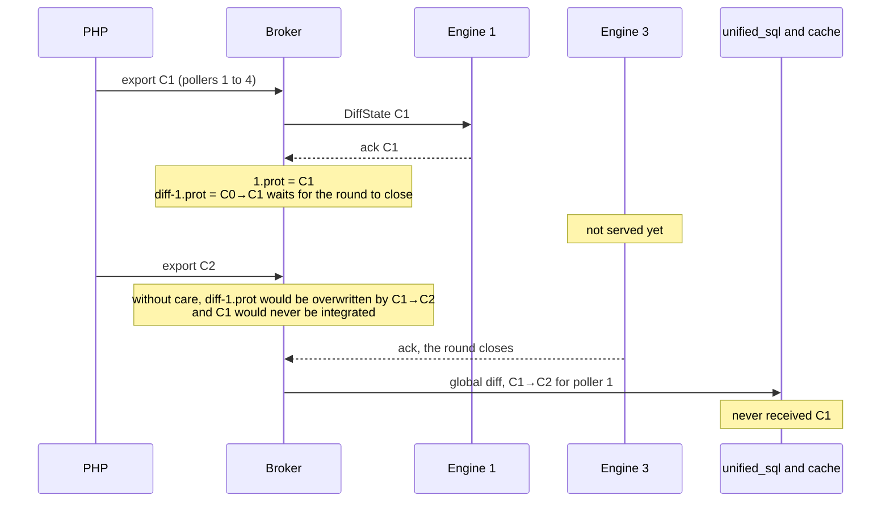

Before storing a new configuration for a poller, the cycle therefore checks whether its `diff-X.prot` waits for integration: the file exists, and `new-X.prot` no longer does since it was renamed on acknowledgement. If so, `_integrate_acknowledged_diffs()` immediately publishes a partial global diff with the `diff-*.prot` of the pollers that acknowledged, and takes them out of the round (`leave_conf_round()`). The round goes on with the others.

This state is read from the files rather than from `conf_round`: a reconnection recreates the poller entry and puts `conf_round` back to `out`, while the files stay.

The pollers that have not acknowledged C1 yet follow the rules of [Delivery](#delivery): nothing is sent to them while C1 is in flight, and their acknowledgement of C1, no longer the prepared version, renames nothing. They then receive C2 in full, since they run C1 while `diff-X.prot` starts from C0.

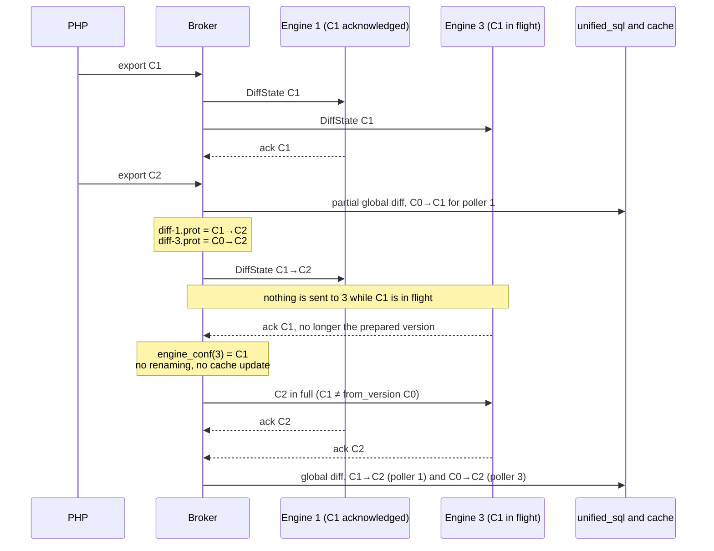

The price is the atomicity of the export: the database receives C1 for the pollers that acknowledged it, then C2 for all of them. An object moved between a poller that acknowledged C1 and one that did not may therefore be missing or duplicated for the duration of a round.

Every operation on a poller's files happens under the same lock, `_conf_handover_m`: storing and preparing by the cycle, acknowledgement, preparing on connection, answering a relay, and removing a poller. This lock covers neither reading nor validating the sources, which remain the costly part of the cycle.

## Some more technical points

When an Engine connects to Broker, the `config::applier::add_peer()` method is called. It works as follows:

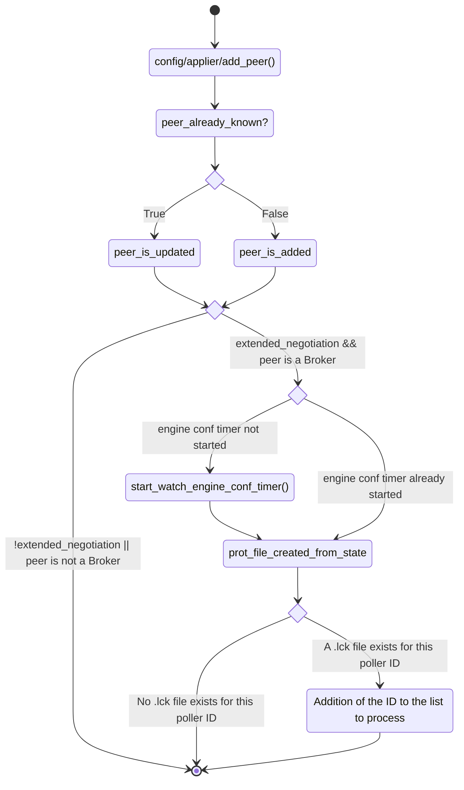

This method memorizes the poller in its peers list. It starts the `Engine` configuration monitoring timer if negotiation is extended and the peer is an `Engine`. And it also checks if a `.lck` file already exists for the poller ID because `inotify` doesn't report files existing before it starts. If such a file is found, the poller ID is added to the list to process on the next timer tick.

Subsequently, `inotify` is what reports an announcement arriving; the list of pollers
to handle is enriched then processed as a background task, after 500 ms of coalescing
for individual announcements or straight away for a `pollers.lck`. A safety net every
5 min covers what events cannot say. Let's focus on this part.

The work is carried out by `config::applier::state::_run_config_cycle()`, posted by
either `_post_individual_work()` or `_post_batch_work()` depending on the shape of the
announcement.

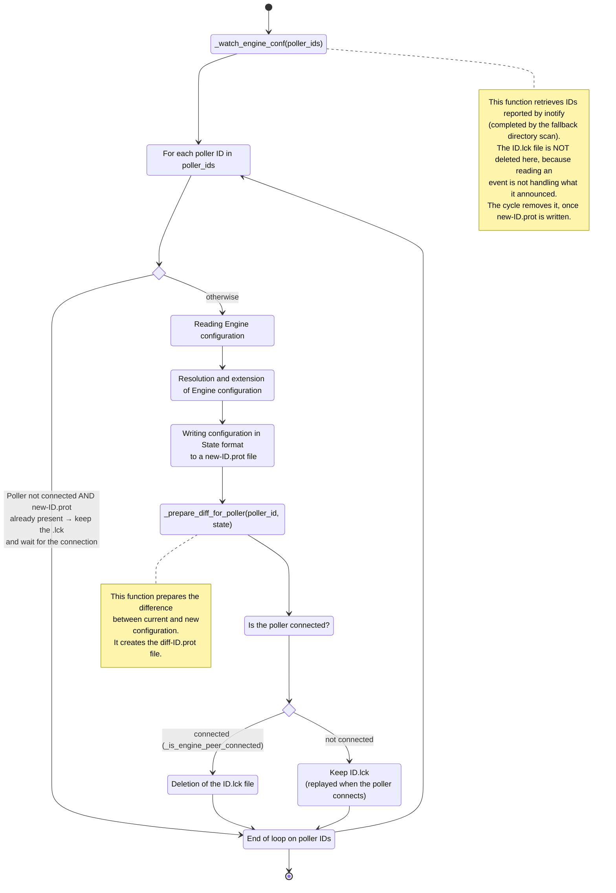

Let's detail a bit the behavior of the `config::applier::state::_prepare_diff_for_poller()` method.

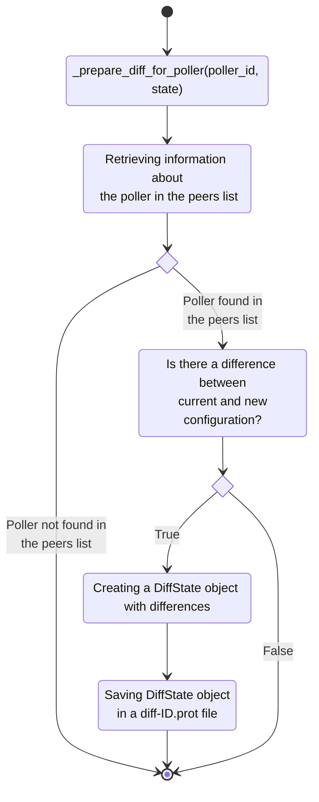

Consequently, on the `state` side, Broker monitors `Engine` configurations and as soon as a new one is available, it calculates the difference and creates the `diff-ID.prot` and `new-ID.prot` files.

Each BBDO stream knows its interlocutor. If `Broker` is connected to `Engine`, a BBDO stream links them and `Broker` knows it is connected to an `Engine`, it knows its poller ID, if it supports centralized configuration, etc.

This stream regularly reads incoming events, this is how `Broker` receives monitoring. Reading is done by a `bbdo::stream::read()` method. It is in this method that certain actions like event acknowledgement are done. And it is also there that Broker detects if a new configuration is available for the connected poller. In case a configuration is available, it is then read and sent to `Engine`.

A simplified algorithm of this method is as follows:

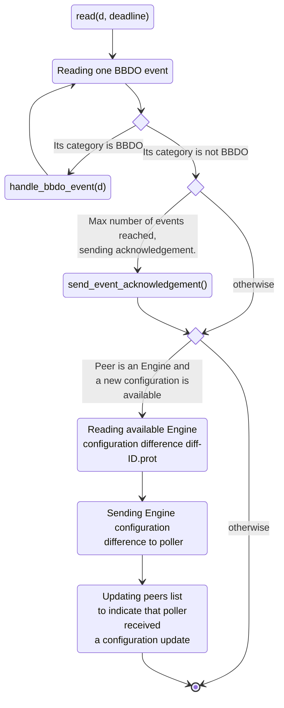

In this same `read()` method, we have a call to the `handle_bbdo_event()` method for events of BBDO category. It is in this method that we find among other things the processing of configuration acknowledgement by `Engine`.

When acknowledgement is received for a poller with ID poller_id, the peers list is updated to indicate that this poller is up to date. The `new-ID.prot` file replaces the `ID.prot` file.

Finally, when all pollers are up to date, a `com::centreon::engine::configuration::indexeed_diff_state` object is built by merging all poller differentials. This object is published by `Broker` to be processed by the `unifie_sql` stream.

The arrangement of these functions gives approximately the following diagram:

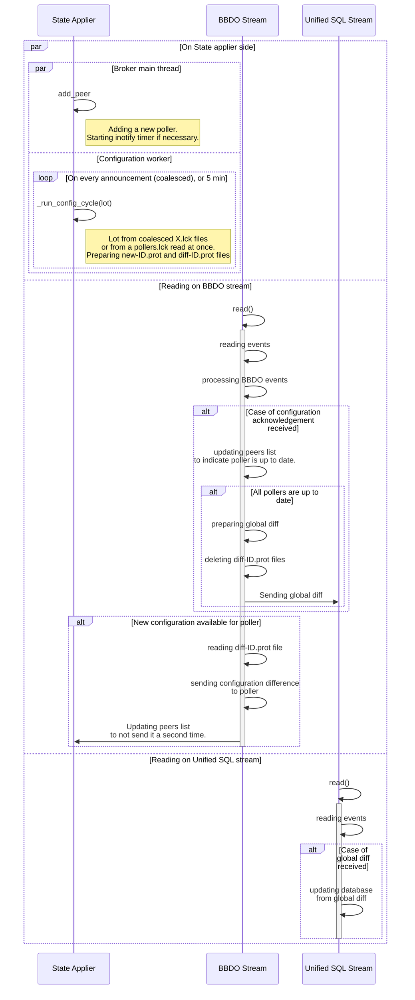

### Watching the cache directory

This part details how `Broker` detects the announcements described in [The announcement](#the-announcement).

Watching is event-driven: an asynchronous wait (`async_wait_readable`) is set on the `inotify` descriptor, and nothing runs as long as the kernel has nothing to say. On wake-up, `Broker` reads the events, re-arms the wait at once, then arms the debounce delay.

#### The moving parts

Four things trigger a cycle: an `inotify` event, the debounce deadline, the safety net deadline, and a poller connecting. They are spread over two strands. `_watch_strand` watches and never works, `_config_strand` reads the configurations: the `inotify` queue thus keeps draining while a 50,000-service configuration is being read.

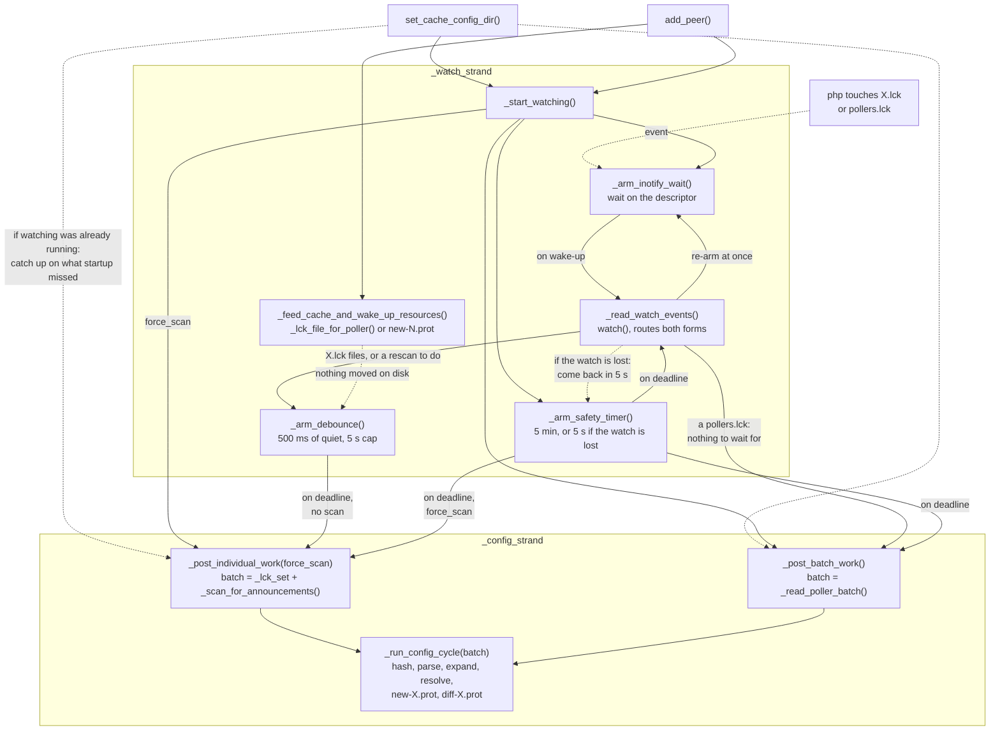

Solid arrows are direct calls. Dotted ones stand for what is not: an event delivered by the kernel, a `post()` deferring work onto a strand, or a path taken only under a condition.

* **The two announcement forms travel along separate paths.** `_read_watch_events()` tells them apart and does nothing else with them: a `pollers.lck` goes straight to `_post_batch_work()`, `<X>.lck` files go through the debounce. Both end up in the same `_run_config_cycle()`, which receives its batch as a parameter: no cycle consumes the batch of the other path, and a batch announcement does not cut short a debounce in progress.
* **`_read_watch_events()` re-arms the wait before anything else.** A burst larger than one buffer leaves the descriptor readable, the next wait completes at once, and the queue drains instead of spreading over several cycles.
* **The debounce is the only normal way to the work for individual announcements.** `_arm_debounce()` pushes the deadline back on every event. Only the last arming triggers `_post_individual_work()`, the previous ones fade out on `operation_aborted`.
* **A poller connecting has to wake itself up.** Nothing changed on disk, so `inotify` has nothing to say: `_feed_cache_and_wake_up_resources()` posts `_arm_debounce()` on its own initiative, otherwise the poller configuration would wait for the safety net.

The shared state comes down to three things: `_lck_set`, the pollers to handle, guarded by a mutex since it is filled from both strands; `_scan_requested_by_watcher`, an atomic written on the watching side and read on the working side; and `_burst_started_at`, which belongs to `_watch_strand` alone and needs no protection.

#### Which events count

An `<ID>.lck` is empty: only its name matters, and any event about it is enough. `pollers.lck` has content, and `IN_CREATE` arrives while the file is still empty. Only two events say that a file is complete, and `Broker` listens to those alone for the batch file:

* `IN_CLOSE_WRITE`, when whoever was writing it closed it, which makes writing it directly safe and therefore allowed by the contract;
* `IN_MOVED_TO`, when it arrived through a rename.

Both must be requested in the mask. Without `IN_MOVED_TO`, the `rename()` the contract allows would stay invisible until the next scan.

The batch file is read from the worker rather than when the event arrives: a batch `inotify` did not report is picked up by the safety net, which posts this path too.

#### The fallback scan

`inotify` is what detects announcements. Scanning the directory is only a safety net, picking up the `.lck` files `inotify` did not report. It runs in five situations:

1. **on the first cycle**, triggered as soon as watching starts, for the `.lck` files already present, pushed while `Broker` was stopped or just before the watcher was in place;
2. **when the cache directory becomes known after that start**, see [Starting the watching](#starting-the-watching);
3. **when the kernel announces it lost events** (`IN_Q_OVERFLOW`), which happens when the `inotify` queue overflows during a mass deployment;
4. **when the watch was lost then restored**, what happened in between being invisible;
5. **on the safety timer deadline**, every 5 minutes, for what nothing above covers, such as a file system where `inotify` does not work. This timer also reads the events again, and it is the only path calling `watch()` again, so the only one able to restore a watch whose recovery had failed.

Everything the scan finds is handled: an announcement still present is, by construction, a push `Broker` has not read, since it never lets one survive the cycle that reads it.

⚠️ A queue overflow or a restored watch names no poller. It therefore belongs to neither path and is reported separately (`watch_report::rescan_requested`). Otherwise, a read reporting only that would post no work, and the scan would wait for the safety timer.

#### Losing the `inotify` watch

An `inotify` watch is bound to an inode, not to a path. If the cache directory is removed, renamed or replaced, the kernel delivers `IN_IGNORED`, `IN_DELETE_SELF` or `IN_MOVE_SELF`, then nothing more is ever reported. `directory_watcher` handles these three events by restoring the watch on its original path and requesting a scan. Three precautions:

* `IN_DELETE_SELF` and `IN_MOVE_SELF` must be requested in the mask, unlike `IN_IGNORED` and `IN_Q_OVERFLOW` which the kernel delivers on its own. Without them, a renamed directory would silently stop being watched, the watch staying alive on the moved inode.
* The old watch is removed before the new one is added. A renamed directory keeps an active watch on the moved inode: not removing it would leak one watch per rename.
* If restoring fails, because the directory does not exist yet, it is retried 5 s later, and the failure is logged only once.

#### Starting the watching

Watching has two triggers, and whichever comes first starts it: `set_cache_config_dir()`, when the `Broker` configuration is applied, and `add_peer()`, when a poller connects. The order is not guaranteed: an already running poller sometimes connects a few tens of milliseconds before the configuration is applied.

When `add_peer()` wins, watching starts without knowing the cache directory:

1. the `inotify` wait cannot be armed, for lack of a descriptor;
2. the first cycle scans nothing, `_cache_config_dir` being empty;
3. `_lck_file_for_poller()` returns 0 for the poller that just connected, whose `.lck` is therefore not looked for.

When `set_cache_config_dir()` finds watching already started, it must therefore arm the wait and request a cycle with a scan. Arming is not enough: `inotify` only reports what happens after arming, and the poller that triggered this early start is precisely the one whose configuration was missed. Arming is idempotent (`_inotify_wait_armed`): two waits on the same descriptor would both fire for a single event.

In `apply()`, the pollers configuration directory is set before `set_cache_config_dir()`, never after. Setting the cache directory starts watching, whose cycle writes `new-<ID>.prot`: without a destination directory, that path would be relative to the `cbd` working directory.

## Split of broker::config::applier::state

This `broker::config::applier::state` object is used by both `cbmod` and `broker`. It manages monitoring of `Engine` configuration files, calculating differences, etc.

Its behavior is a bit different depending on whether it is used by `cbmod` or by `broker`.

Keeping a single object for both forces us to keep attributes used by one and not by the other. The peers list, for example, has quite complicated management to handle both cases. The `_engine_conf` attribute, used only on the `cbmod` side, is also found in `broker` even though it serves no purpose there.

The `com::centreon::broker::config::applier::state` class is therefore split into three:

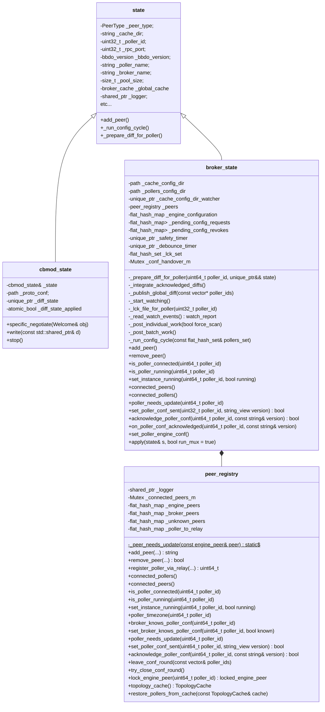

`broker_state` owns no peer map of its own: they all live in `peer_registry`,
with their own mutex. What stays under `broker_state::_connected_peers_m` is
only the forwarding queues — `_pending_config_requests`,
`_pending_config_revokes`, `_pending_diff_states`, `_pending_diff_state_acks`
and `_engine_configuration`.

The split of `state` also implies splitting the `bbdo::stream` class.

There are `bbdo::stream` used by `cbmod` to connect to a `broker`, there are `bbdo::stream` used by `broker` to connect to an `engine`, and there are also `bbdo::stream` used by cache or *unprocessed* files.

To represent all this, it was necessary to split `bbdo::stream` into a base class `bbdo::basic_stream` then a pure virtual class `bbdo::stream` that inherits from `bbdo::basic_stream` and finally two concrete classes `bbdo::broker_stream` and `bbdo::cbmod_stream` that inherit from `bbdo::stream`.

Which gives the following structure:

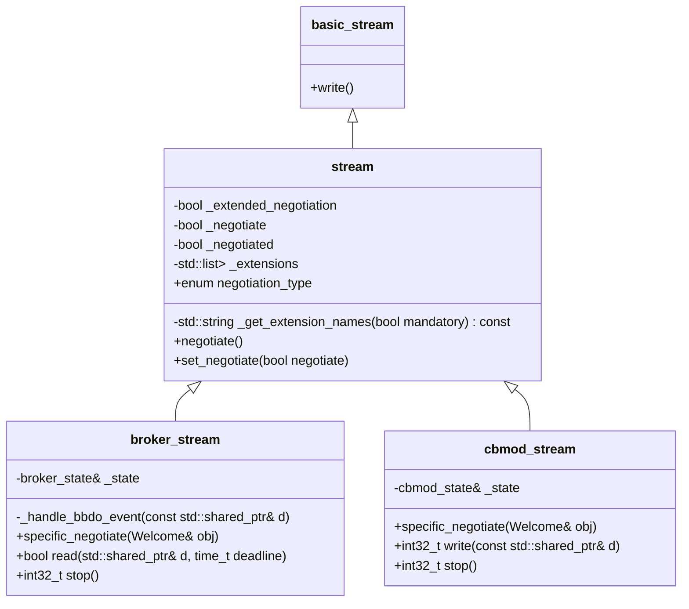

### broker_state, cache and downtime_manager lifecycle

`broker_state` orchestrates two long-lived objects whose order of creation and
destruction matters:

* the **global cache** (`broker_cache`, owned by the base `state` as
  `_global_cache`), which is persisted to `<cache_dir>.cache` and reloaded on the
  next start;
* the **downtime manager** (`com::centreon::common::downtimes::downtime_manager`,
  a singleton), loaded **only** when `notification_mode=broker`. It owns the
  in-process downtimes (gRPC-scheduled and BAM inherited downtimes).

When Broker owns downtimes, the *started* (in-effect) downtimes must survive a
`cbd` restart: they are saved with the cache at shutdown and re-injected into the
manager at the next start. Non-started downtimes may be lost; the
`scheduled_downtime_depth` is re-derived idempotently (a count per resource), it
is not blindly incremented.

#### Startup

The key subtlety: the cache is created **inside** `state::apply()`
(`initialize_cache()`), and `_global_cache` is only assigned once the
`broker_cache` constructor returns. The re-injection path calls back into
`config::applier::state::instance().cache()` (through the downtime callbacks'
`resource_exists()`), so it **must not** run from inside the constructor —
otherwise it would dereference a not-yet-assigned `_global_cache` and abort.
Therefore the constructor only loads the persisted downtimes into a pending list,
and re-injection happens later, when `_global_cache` is in place.

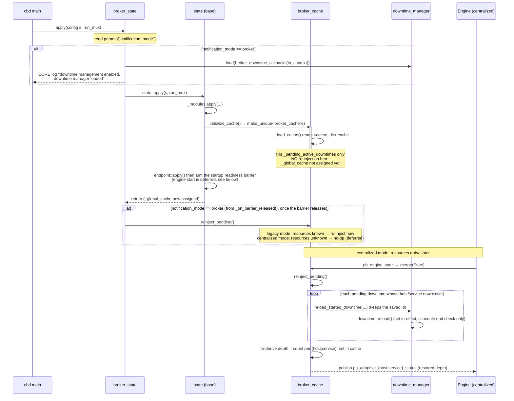

#### Startup readiness barrier

The multiplexing engine is **not** started at the end of `state::apply()` as soon
as the endpoints are created. Doing so races the output streams' own startup: an
output (e.g. the BAM `monitoring_stream`) opens on its `failover` worker thread and
publishes its startup *definitions* (such as the BA virtual service, with
`scheduled_downtime_depth=0`) while, in parallel, the engine is started and the
persisted state is re-injected. A stale definition processed *after* the
re-injected inherited-downtime depth would clobber it (BA depth back to 0).

To make the ordering deterministic, the base `state` installs a **startup
readiness barrier**. It lives in the base class on purpose, so it protects both
`cbd` and `cbmod` — e.g. a Lua output loaded on `cbmod` that restores state is
protected the same way:

* at the end of `apply()`, instead of starting the engine,
  `_enable_multiplexing()` records the set of **output** endpoints just created
  and arms the barrier (in `--check` mode, `run_mux=false`, it does nothing);
* every output stream, once its `failover` has completed its **first** `open()`
  attempt — success *or* failure, so a down database/peer does not block startup —
  calls `state::notify_output_ready(name)` exactly once (one-shot per failover);
* when all expected outputs have registered, `_maybe_release_barrier()` starts the
  multiplexing engine **once**, which flushes the events buffered while it was
  `not_started` (the startup definitions), then invokes the
  `_on_barrier_released()` hook;
* a **timeout** (60 s) releases the barrier anyway, so Broker/Engine is never left
  mute if an output never opens.

Because the engine buffers everything while `not_started`, the startup definitions
are flushed first; the re-injection — published either reactively when the Engine
configuration arrives (centralized mode) or from `_on_barrier_released()` (legacy
broker mode) — is therefore always ordered **after** them, and the restored
`scheduled_downtime_depth` wins.

`_on_barrier_released()` is the only barrier piece that is subclass-specific:
`broker_state` overrides it to call `reinject_pending()`; the base (and
`cbmod_state`) leave it empty.

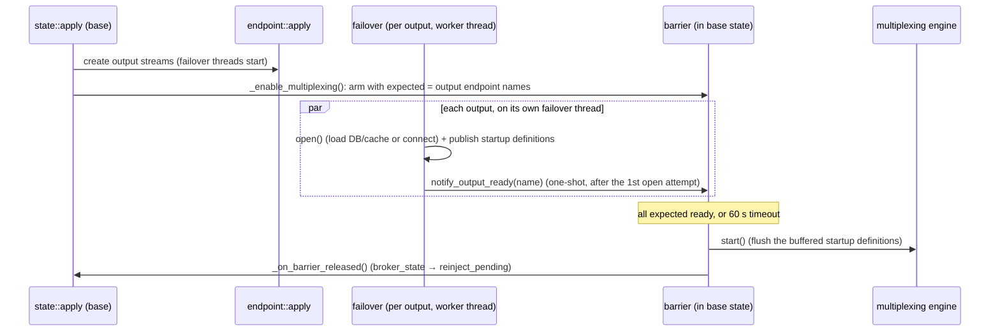

#### Shutdown

`broker_state` is destroyed through `state::unload()` (`delete gl_state`). The
derived destructor `~broker_state` runs **before** the base `~state`, so the
cache is still alive when `~broker_state` hands the started downtimes over to it.
The cache is then persisted by `~broker_cache` (called from `~state`), in **both**
configuration modes — only the heavy sections (hosts, services, groups…) remain
guarded to legacy mode; the active downtimes are always saved.

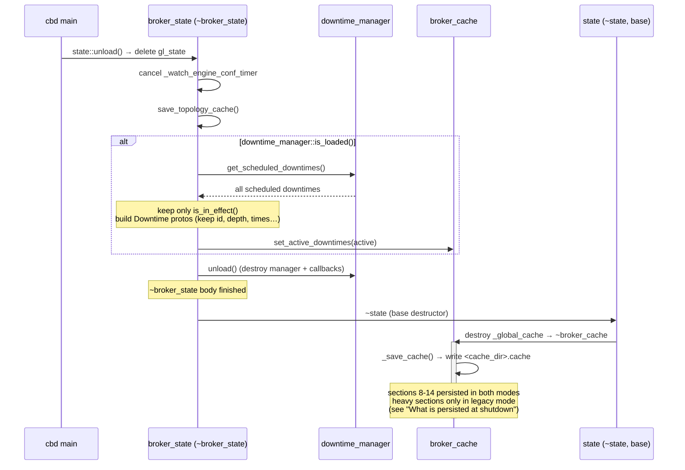
