# Lecture de la configuration Engine

[← Précédent](01-negotiation-fr.md) · [Index](README-fr.md) · [Suivant →](03-configuration-validation-fr.md)

<!-- TOC -->
* [Gestion de la configuration côté Engine](#gestion-de-la-configuration-côté-engine)
* [Gestion de l’envoi de la configuration par Broker à Engine](#gestion-de-lenvoi-de-la-configuration-par-broker-à-engine)
  * [Le parcours d'une configuration](#le-parcours-dune-configuration)
  * [L'annonce](#lannonce)
  * [La préparation](#la-préparation)
  * [La livraison](#la-livraison)
  * [Le tour de configuration](#le-tour-de-configuration)
    * [Un export qui arrive pendant un tour ouvert](#un-export-qui-arrive-pendant-un-tour-ouvert)
* [Quelques points plus techniques](#quelques-points-plus-techniques)
  * [Surveillance du répertoire de cache](#surveillance-du-répertoire-de-cache)
    * [Les rouages](#les-rouages)
    * [Quels événements font foi](#quels-événements-font-foi)
    * [Le scan de secours](#le-scan-de-secours)
    * [Perte du watch `inotify`](#perte-du-watch-inotify)
    * [Démarrage de la surveillance](#démarrage-de-la-surveillance)
* [Split de broker::config::applier::state](#split-de-brokerconfigapplierstate)
  * [Cycle de vie de broker_state, du cache et du downtime_manager](#cycle-de-vie-de-broker_state-du-cache-et-du-downtime_manager)
    * [Démarrage](#démarrage)
    * [Barrière de readiness au démarrage](#barrière-de-readiness-au-démarrage)
    * [Arrêt](#arrêt)
<!-- TOC -->

## Gestion de la configuration côté Engine

`Engine` est démarré avec la nouvelle configuration. Il lit la
configuration sérialisée Protobuf disponible dans son `HOME`. Il se
connecte ensuite à `Broker` et envoie le message `Welcome` avec le bon
numéro de version de sa configuration. On a vu que `Broker` répond juste
en disant s'il supporte ou non la configuration centralisée. Dans un second temps,
Broker, en tâche de fond, vérifie si des nouvelles configurations sont disponibles
pour `Engine`. S'il s'en présente une, il
envoie un message avec la différence de configuration.
`cbmod` le garde en attente et lorsqu’`Engine` recommence un cycle dans
sa boucle principale, il applique cette configuration.

S’il y a de la rétention, elle est envoyée en tâche de fond pendant
l’application de la nouvelle configuration.
Une fois la rétention terminée, `Engine` ayant appliqué la configuration,
dans le cas d'un reload, envoie un message
`InstanceConfiguration` à `Broker` pour lui dire qu’il a bien reçu la
configuration.

FIXME DBO: Le message `InstanceConfiguration` est-il toujours nécessaire ?

Mais en fait, il y a un message spécifique pour cela, c'est le message
`pb_diff_state_ack` qui est envoyé par `Engine` à `Broker` pour lui dire
qu’il a bien reçu et appliqué la nouvelle configuration.

## Gestion de l’envoi de la configuration par Broker à Engine

Cette section suit une configuration depuis son écriture par PHP jusqu'à son arrivée en base de données. La surveillance du répertoire de cache (`inotify`, strands, reprise du watch, scan de secours) est décrite à part, dans [Surveillance du répertoire de cache](#surveillance-du-répertoire-de-cache).

### Le parcours d'une configuration

Quatre fichiers jalonnent ce parcours, et chacun ne dit qu'une chose :

| Fichier | Répertoire | Ce qu'il dit | Écrit par | Disparaît |
|---|---|---|---|---|
| `X.lck` ou `pollers.lck` | cache PHP | une configuration est arrivée, `Broker` ne l'a pas encore lue | PHP | supprimé par `Broker` dès que `new-X.prot` est écrit |
| `new-X.prot` | `pollers-configuration` | une configuration est prête et attend l'acquittement du poller X | le cycle de `Broker` | renommé en `X.prot` à l'acquittement |
| `diff-X.prot` | `pollers-configuration` | la différence entre `X.prot` et `new-X.prot`, ou la configuration complète s'il n'y a pas de `X.prot` | le cycle de `Broker` | supprimé à son intégration dans le diff global |
| `X.prot` | `pollers-configuration` | la dernière configuration acquittée par le poller X | `Broker`, par renommage | remplacé au renommage suivant |

Les étapes :

1. **L'annonce.** PHP écrit la configuration du poller X dans le répertoire `X/`, puis crée `X.lck`, ou un `pollers.lck` qui nomme tous les pollers de l'export.
2. **La préparation.** `Broker` lit et valide la configuration, écrit `new-X.prot` puis `diff-X.prot`, et supprime l'annonce.
3. **La livraison.** Le stream BBDO du poller X lui envoie un `DiffState` lu dans `diff-X.prot`, ou dans `new-X.prot` si `Engine` ne peut pas appliquer la différence.
4. **L'acquittement.** `Engine` applique la configuration et répond par un `pb_diff_state_ack`. `Broker` renomme `new-X.prot` en `X.prot` et applique `diff-X.prot` au cache.
5. **La fermeture du tour.** Quand tous les pollers servis ont acquitté, `Broker` fusionne les `diff-*.prot` en un diff global, le publie vers `unified_sql` et le cache, puis supprime les `diff-*.prot`.

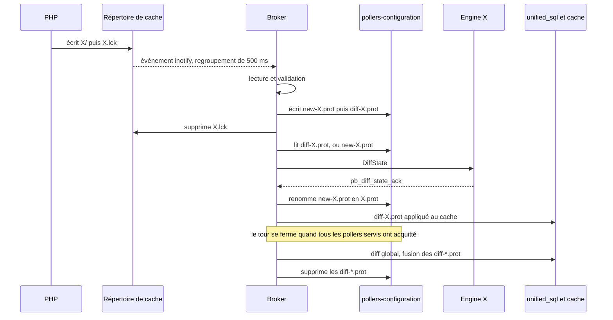

### L'annonce

PHP dispose de deux formes d'annonce, et `Broker` lit les deux.

| | `<ID>.lck` | `pollers.lck` |
|---|---|---|
| Contenu | vide, seul le nom compte | les pollers de l'export, un identifiant par ligne |
| Délimitation de l'export | devinée par `Broker` | donnée par le fichier |
| Regroupement | 500 ms sans nouvel événement, plafond de 5 s | aucun |
| Qui poste le travail | `_post_individual_work()` | `_post_batch_work()` |
| Suppression | une par une, à mesure que les `new-<ID>.prot` sont écrits | en fin de cycle |

`pollers.lck` est la forme cible. Avec des `<ID>.lck`, `Broker` ne peut que regrouper ce qui arrive de façon rapprochée. Or l'intervalle entre deux `.lck` est le temps de génération de la configuration suivante, qui dépasse le délai de regroupement sur un gros poller : l'export se coupe alors en plusieurs lots. Un objet déplacé d'un poller vers un autre est vu comme un retrait puis un ajout dans deux tours successifs, au lieu d'une modification dans un seul. Le contrat côté PHP est décrit dans [php-evolutions](../php-evolutions-fr.md#évolution-3--un-lot-de-configuration-explicite--pollerslck).

Le regroupement repousse l'échéance de 500 ms à chaque nouvel événement. Une rafale de `.lck`, comme un déploiement de masse, donne ainsi un seul lot, et les configurations stockées ne sont relues qu'une fois. Le plafond de 5 s empêche un flux continu d'événements de repousser le traitement indéfiniment.

Une annonce ne fait qu'annoncer. Elle disparaît dès que `Broker` a préparé ce qu'elle annonce, que le poller soit connecté ou non. Pour PHP, sa disparition signifie « `Broker` a pris ta configuration en charge », et non « elle a atteint son poller » : un poller éteint ne pouvant rien acquitter, c'est tout ce que PHP peut utilement attendre. C'est `new-<ID>.prot`, dans le répertoire de `Broker`, qui marque une livraison en attente. Un `pollers.lck` ne pourrait d'ailleurs pas tenir ce rôle, puisque les pollers qu'il nomme n'acquittent pas en même temps.

### La préparation

Le cycle, `_run_config_cycle()`, reçoit son lot en paramètre et traite chaque poller en deux temps. Un échec n'a pas le même sens dans l'un et dans l'autre.

**Lire et valider** (`_read_poller_conf()`) : `hash_directory` calcule la version de la configuration, puis `parse`, `expand` et `resolve` la chargent avec la librairie `engine_conf`, et la [validation inter-pollers](03-configuration-validation-fr.md#la-validation-inter-pollers--load_foreign_objects) la vérifie. Un échec de validation est une propriété du contenu poussé, qui ne redeviendra pas valide seul : la configuration est refusée et l'annonce consommée. PHP en créera une nouvelle avec la configuration corrigée.

**Stocker** (`_store_poller_conf()`, puis `_prepare_diff_for_poller()`) : écriture de `new-X.prot`, puis de `diff-X.prot`. Un échec ici est affaire de disque et ne dit rien de la configuration : l'annonce est gardée, et le cycle suivant relit les sources.

| Sortie | Annonce | Compté |
|---|---|---|
| `hash_directory` échoue | gardée | — |
| `build_test_file` échoue | gardée | — |
| validation en erreur | consommée | `refused` |
| stockage impossible | gardée | — |
| succès | consommée | `ready` |

L'annonce n'est supprimée qu'une fois `new-X.prot` écrit. À aucun instant il n'y a ni l'un ni l'autre : un arrêt brutal entre les deux laisse toujours de quoi recommencer.

⚠️ Un `parse` qui échouerait pour une raison d'entrée-sortie serait compté comme une configuration invalide. C'est tenable, puisque `centengine.test` vient d'être écrit, mais une garantie franche demanderait un type d'exception distinct côté parseur.

**Quelle différence.** `diff-X.prot` est toujours calculé depuis `X.prot` quand il existe, même si `Engine` tourne avec une autre version, parce qu'il a perdu son `state.prot` par exemple. La base et le cache reflètent `X.prot`, et une configuration complète leur ferait tout ajouter sans rien retirer. `diff-X.prot` note la version dont il part (`from_version`), et c'est à l'envoi que l'on décide si `Engine` peut l'appliquer. Sans `X.prot`, `diff-X.prot` contient la configuration complète.

Un poller qui tourne déjà la version préparée ne reçoit rien. Un poller non connecté n'a pas de `diff-X.prot` : son `new-X.prot` l'attend jusqu'à sa connexion.

Chaque cycle qui a travaillé se termine par une ligne de bilan, qui nomme les pollers dont la configuration est prête mais qui ne sont pas connectés :

```
Configuration cycle: 3 ready, 1 sent, 0 refused, 2 poller(s) not connected: 2, 3
```

### La livraison

Le stream BBDO du poller X vérifie à chaque lecture si une configuration lui est due (`poller_needs_update()`). Il faut pour cela :

* qu'une configuration soit préparée pour lui (`available_conf`), différente de celle qu'il fait tourner (`engine_conf`), et pas encore remise ;
* qu'aucune autre configuration ne soit en cours pour lui, c'est-à-dire remise et pas encore acquittée (`conf_in_flight`).

La seconde condition vient de ce qu'`Engine` applique les `DiffState` dans l'ordre où il les reçoit, sans vérifier la version dont ils partent. Tant que C1 n'est pas acquitté, `X.prot` vaut encore C0 : une configuration C2 préparée entre-temps est une différence C0→C2, qu'`Engine` appliquerait par-dessus C1. L'attente n'est pas bornée dans le temps : `Engine` répond toujours, que la configuration ait été appliquée ou non (voir l'échec plus bas), et un poller qui meurt en route se déconnecte, ce qui oublie la configuration en cours.

**Différence ou configuration complète.** Le stream lit `diff-X.prot`. Si `Engine` ne tourne pas avec la version dont part la différence (`from_version`), il ne peut pas l'appliquer : le stream lit alors `new-X.prot` et envoie la configuration complète. Le choix se fait à l'envoi et non à la préparation, parce qu'`Engine` a pu se reconnecter avec une autre version entre-temps.

Côté `Engine`, le `DiffState` est stocké par `cbmod` et appliqué dans la boucle principale. `Engine` écrit alors son état complet dans `state.prot` et répond par un `pb_diff_state_ack` qui porte la version appliquée. S'il n'arrive pas à l'appliquer, il restaure sa configuration précédente et répond aussi, par un `pb_diff_state_ack` qui porte la version qu'il fait toujours tourner, la version refusée (`failed_version`) et la raison (`error`).

**L'acquittement** (`on_poller_conf_acknowledged()`). La version acquittée devient `engine_conf`, et la configuration en cours est libérée. Si c'est la version préparée et remise :

1. `new-X.prot` est renommé en `X.prot` ;
2. `diff-X.prot` est appliqué au cache ;
3. si c'était le dernier acquittement attendu, le [tour](#le-tour-de-configuration) est fermé.

Si c'est une version dépassée, parce qu'une configuration plus récente a été préparée entre-temps, rien n'est renommé ni appliqué : `new-X.prot` et `diff-X.prot` contiennent déjà la suivante, qui part à la lecture suivante du stream.

**L'échec** (`on_poller_conf_rejected()`). La version que le poller fait toujours tourner devient `engine_conf`, et la configuration en cours est libérée. Si la version refusée est la version préparée :

1. `new-X.prot` et `diff-X.prot` sont supprimés : ils décrivent une configuration que le poller ne fera pas tourner, et la fermeture du tour porterait sinon ce diff en base ;
2. le poller sort du tour, qui peut alors se fermer pour les autres ;
3. la version refusée et la raison sont gardées (`rejected_conf`, `rejection_error`), journalisées en erreur et visibles par la RPC `GetPollers`. Cette version n'est plus renvoyée, elle échouerait de la même façon.

Le prochain export repart de `X.prot`, que le poller fait bien tourner. Une reconnexion du poller, qui recrée son entrée, retente aussi la version refusée : l'erreur pouvait venir de la machine plutôt que de la configuration.

Si la version refusée est dépassée, rien n'est supprimé : `new-X.prot` et `diff-X.prot` contiennent déjà la suivante, qui part aussitôt.

**La livraison à la connexion d'un poller.** Quand un poller absent lors du lot se connecte, `add_peer()` regarde ce qui l'attend, dans cet ordre :

* **une annonce `X.lck`** : elle n'a pas encore été lue, le poller passe par un cycle complet ;
* **sinon un `new-X.prot`** : la configuration est prête, `_prepare_diff_from_new_prot_file()` calcule la différence avec `X.prot` sans relire les sources ;
* **ni l'un ni l'autre** : il n'y a rien à livrer. Si `Broker` n'a pas non plus `X.prot`, il demande sa configuration au poller (`DiffState{unknown=true}`, voir [Mise en pratique](03-configuration-validation-fr.md#mise-en-pratique)).

L'ordre découle du passage de témoin : le cycle supprime l'annonce dès qu'il a écrit `new-X.prot`, donc une annonce encore présente porte forcément sur une poussée postérieure au `new-X.prot` posé à côté d'elle.

### Le tour de configuration

Un tour regroupe les pollers servis par un même export. Le fermer déclenche le diff global : `_publish_global_diff()` fusionne les `diff-*.prot` en un `pb_global_diff_state`, le publie vers `unified_sql` et le cache, puis supprime les fichiers. La base n'est donc mise à jour qu'une fois tous les pollers de l'export servis, ce qui permet de réconcilier en une seule modification un objet déplacé d'un poller à un autre.

Chaque pair porte sa place dans le tour (`conf_round`) : `out` s'il n'en fait pas partie, `sent` quand sa configuration lui a été remise, `acknowledged` quand il l'a acquittée. `try_close_conf_round()` ferme le tour quand tous les pairs `sent` sont passés à `acknowledged` et qu'aucun pair n'attend encore sa configuration (`_peer_owes_conf()`), qu'elle puisse partir tout de suite ou qu'elle attende l'acquittement d'une précédente. Le test et la remise de tous les pairs à `out` se font sous le même verrou : deux acquittements simultanés ne peuvent pas publier deux fois le même tour.

```
All engine peers acknowledged? 1/3 acknowledged, 0 still waiting to be sent
```

Quatre règles tiennent ce mécanisme :

* **Un tour ne se ferme pas tant qu'un poller attend sa configuration.** Le diff global consomme tous les `diff-*.prot` du répertoire, y compris celui d'un poller pas encore servi. Ce fichier ne serait jamais réécrit, et le poller ne recevrait jamais sa configuration.
* **« Attend sa configuration » se teste par `available_conf != engine_conf`**, et non par `available_conf` non vide : ce champ n'est jamais vidé, et tous les pollers paraîtraient en attente pour toujours.
* **Préparer une version déjà remise ne sort pas le poller du tour.** PHP peut annoncer deux fois le même export. Remettre le poller à `out` pour la même version perdrait son acquittement : `try_close_conf_round()` ne le compterait plus, et le tour ne se fermerait jamais. `_prepare_diff_for_poller()` ne touche donc à `conf_round` que si la version change.
* **Un poller non connecté n'entre pas dans le tour.** Rien n'est préparé pour lui, il n'a donc aucun `diff-X.prot` à perdre. Un `1/1 acknowledged` sur une plateforme dont deux pollers sont éteints est normal, la ligne de bilan du cycle nommant les absents. Il en va de même d'une entrée connue du seul `topology.cache` (voir [Un poller derrière un relais se comporte comme un poller direct](06-remote-servers-fr.md#un-poller-derrière-un-relais-se-comporte-comme-un-poller-direct)).

#### Un export qui arrive pendant un tour ouvert

Un export C2 peut arriver alors que le tour de l'export C1 n'est pas fermé : certains pollers ont acquitté C1, d'autres non. Pour un poller qui a acquitté, `X.prot` vaut déjà C1, et `diff-X.prot`, la différence C0→C1, attend la fermeture du tour pour entrer dans le diff global. Préparer C2 calcule la différence depuis `X.prot`, soit C1→C2, et écrase `diff-X.prot` : la base et le cache ne reçoivent jamais C1.

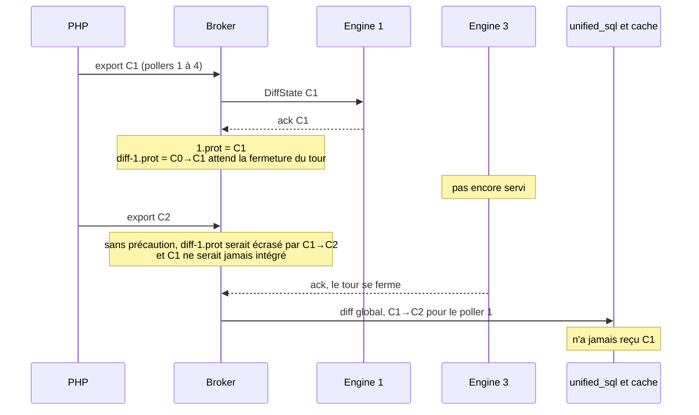

Avant de stocker une nouvelle configuration pour un poller, le cycle regarde donc si son `diff-X.prot` attend l'intégration : le fichier existe, et `new-X.prot` n'existe plus puisqu'il a été renommé à l'acquittement. Si c'est le cas, `_integrate_acknowledged_diffs()` publie aussitôt un diff global partiel avec les `diff-*.prot` des pollers qui ont acquitté, et les sort du tour (`leave_conf_round()`). Le tour continue avec les autres.

Cet état se lit sur les fichiers plutôt que sur `conf_round` : une reconnexion recrée l'entrée du poller et remet `conf_round` à `out`, alors que les fichiers restent.

Les pollers qui n'ont pas encore acquitté C1 suivent les règles de [La livraison](#la-livraison) : rien ne leur est envoyé tant que C1 est en cours, et leur acquittement de C1, qui n'est plus la version préparée, ne renomme rien. Ils reçoivent ensuite C2 en entier, puisqu'ils tournent C1 alors que `diff-X.prot` part de C0.

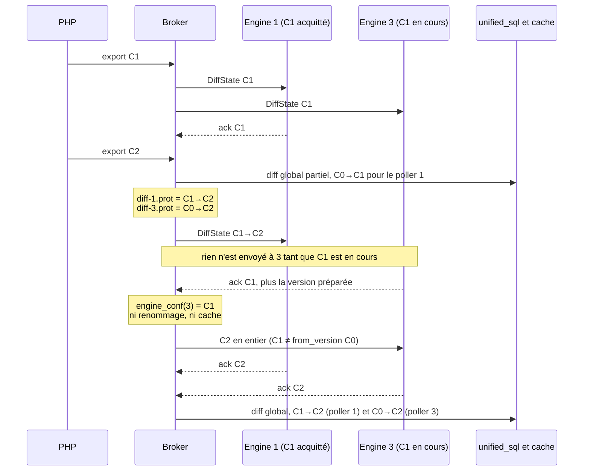

Le prix à payer est l'atomicité de l'export : la base reçoit C1 pour les pollers qui l'ont acquitté, puis C2 pour tous. Un objet déplacé entre un poller qui a acquitté C1 et un poller qui ne l'a pas fait peut donc manquer ou apparaître en double le temps d'un tour.

Toutes les opérations sur les fichiers d'un poller se font sous un même verrou, `_conf_handover_m` : le stockage et la préparation par le cycle, l'acquittement, la préparation à la connexion, la réponse à un relais et le retrait d'un poller. Ce verrou ne couvre ni la lecture ni la validation des sources, qui restent la partie coûteuse du cycle.

## Quelques points plus techniques

Lors de la connexion d'un Engine au Broker, la méthode `config::applier::add_peer()` est appelée. Elle fonctionne
de la façon suivante :

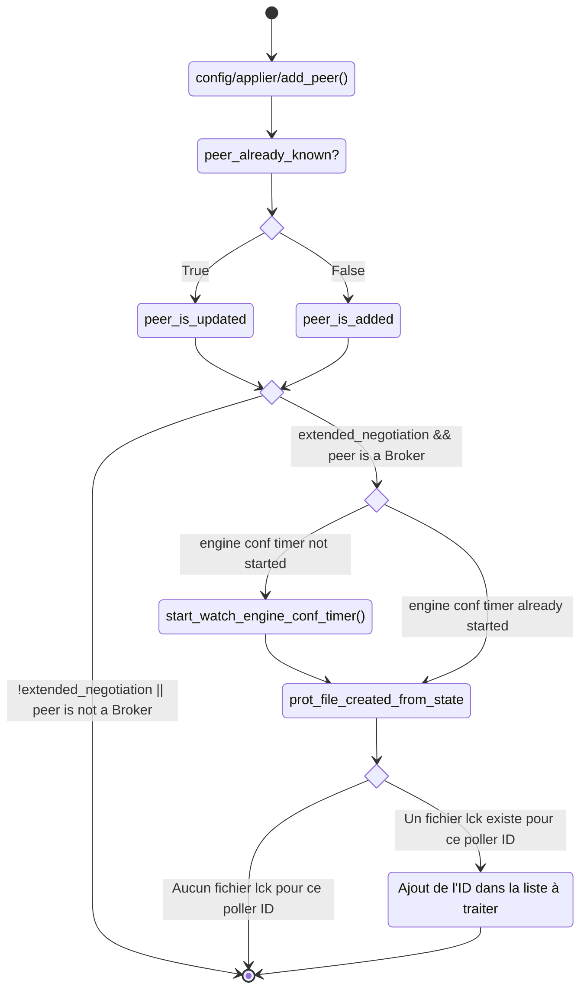

Cette méthode mémorise le poller dans sa liste de peers. Elle démarre le timer de surveillance de la configuration
`Engine` si la négociation est étendue et que le peer est un `Engine`. Et elle vérifie aussi s'il existe déjà un
fichier `.lck` pour le poller ID car `inotify` ne remonte pas les fichiers existant avant son démarrage. Si un tel
fichier est trouvé, l'ID du poller est ajouté à la liste à traiter pour le prochain tick du timer.

Par la suite, c'est `inotify` qui signale l'arrivée d'une annonce ; la liste des
pollers à traiter est enrichie puis traitée en tâche de fond, après un regroupement
de 500 ms pour les annonces individuelles ou immédiatement pour un `pollers.lck`.
Un filet de sécurité à 5 min couvre ce que les événements ne peuvent pas dire.
Intéressons-nous à cette partie.

Le travail est exécuté par `config::applier::state::_run_config_cycle()`, posté par
`_post_individual_work()` ou `_post_batch_work()` selon la forme de l'annonce.

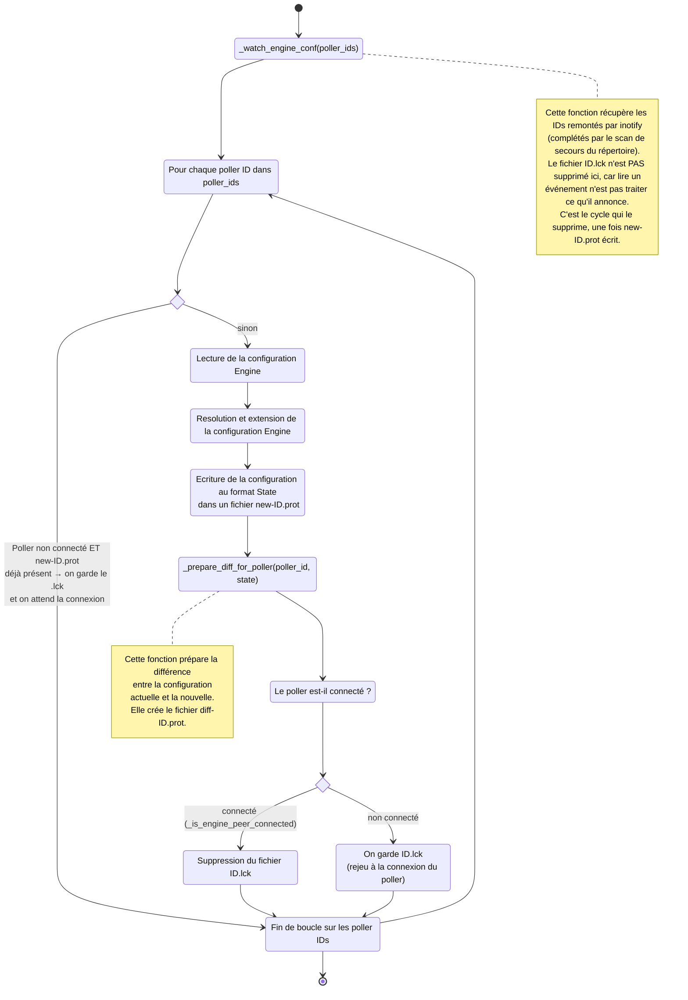

Détaillons un peu le comportement de la méthode `config::applier::state::_prepare_diff_for_poller()`.

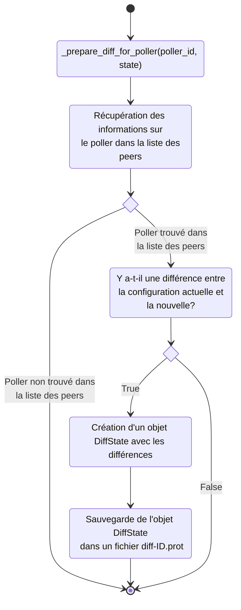

Par conséquent, côté `state`, Broker surveille les configurations `Engine` et dès qu'une nouvelle est disponible,
il calcule la différence et crée les fichiers `diff-ID.prot` et `new-ID.prot`.

Chaque stream BBDO connaît son interlocuteur. Si `Broker` est connecté à `Engine`, un stream BBDO les relie et `Broker`
sait qu'il est connecté à un `Engine`, il connaît son poller ID, s'il supporte la configuration centralisée, etc...

Ce stream lit régulièrement les événements entrants, c'est de cette manière que `Broker` reçoit la supervision.
La lecture est faite par une méthode `bbdo::stream::read()`. C'est dans cette méthode que certaines actions comme
l'acquittement d'événements est faite. Et c'est aussi là que Broker détecte si une nouvelle configuration est disponible
pour le poller connecté. Dans le cas où une configuration est disponible, elle est alors lue et envoyée à `Engine`.

Un algorithme simplifié de cette méthode est le suivant :
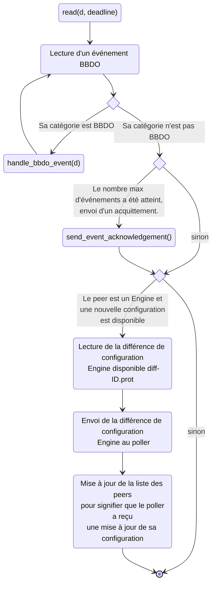

Dans cette même méthode `read()`, on a un appel à la méthode `handle_bbdo_event()` pour les événements de catégorie BBDO.
C'est dans cette méthode qu'on trouve entre autre le traitement de l'acquittement de la configuration par `Engine`.

Lorsque l'acquittement est reçu pour un poller d'ID poller_id, la liste des peers est mise à jour pour signifier que
ce poller est bien à jour. Le fichier `new-ID.prot` remplace le fichier `ID.prot`.

Enfin, lorsque tous les pollers sont à jour, un objet `com::centreon::engine::configuration::indexeed_diff_state`
est construit en mergeant tous les différentiels de pollers. Cet objet est publié par `Broker` pour être
traité par le stream `unifie_sql`.

L'agencement de ces fonctions donne à peu près le diagramme suivant :

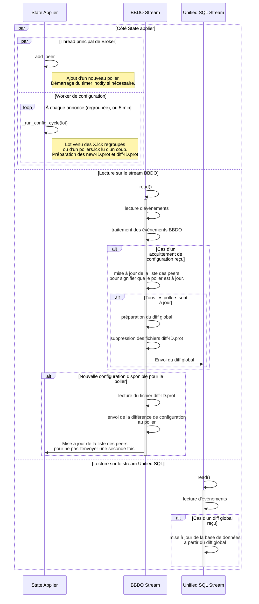

### Surveillance du répertoire de cache

Cette partie détaille comment `Broker` détecte les annonces décrites dans [L'annonce](#lannonce).

La surveillance est événementielle : une attente asynchrone (`async_wait_readable`) est posée sur le descripteur `inotify`, et rien ne s'exécute tant que le noyau n'a rien à dire. Au réveil, `Broker` lit les événements, réarme aussitôt l'attente, puis arme le délai de regroupement.

#### Les rouages

Quatre choses déclenchent un cycle : un événement `inotify`, l'échéance du regroupement, celle du filet de sécurité, et la connexion d'un poller. Elles se répartissent sur deux strands. `_watch_strand` surveille et ne travaille jamais, `_config_strand` lit les configurations : la file `inotify` continue donc de se vider pendant qu'une configuration de 50 000 services est lue.

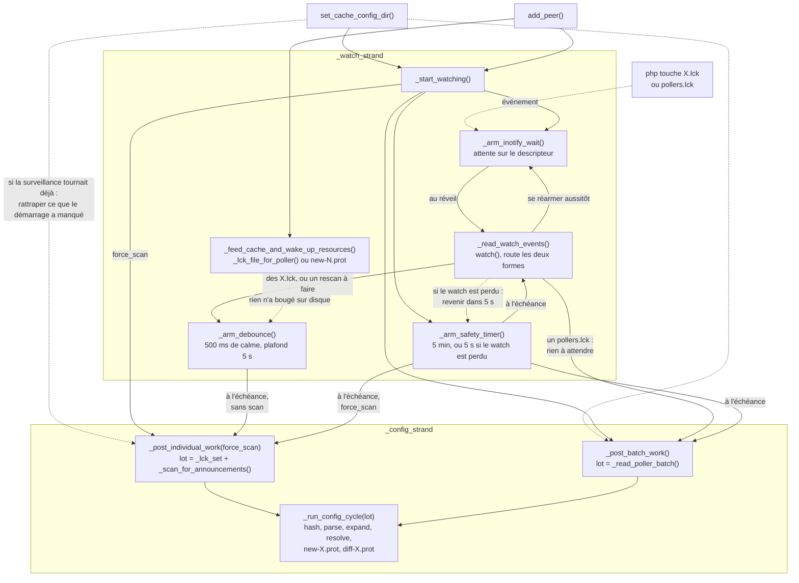

Les flèches pleines sont des appels directs. Les pointillées représentent ce qui n'en est pas un : un événement livré par le noyau, un `post()` qui diffère le travail sur un strand, ou un chemin emprunté sous condition.

* **Les deux formes d'annonce suivent des chemins séparés.** `_read_watch_events()` les distingue et n'en fait rien d'autre : un `pollers.lck` va droit à `_post_batch_work()`, des `<X>.lck` passent par le regroupement. Les deux aboutissent au même `_run_config_cycle()`, qui reçoit son lot en paramètre : aucun cycle ne consomme le lot de l'autre chemin, et une annonce de lot n'interrompt pas un regroupement en cours.
* **`_read_watch_events()` réarme l'attente avant tout le reste.** Une rafale plus grosse qu'un tampon laisse le descripteur lisible, l'attente suivante aboutit aussitôt, et la file se vide au lieu de s'étaler sur plusieurs cycles.
* **Le regroupement est la seule voie normale vers le travail pour les annonces individuelles.** `_arm_debounce()` repousse l'échéance à chaque événement. Seul le dernier armement déclenche `_post_individual_work()`, les précédents s'effacent sur `operation_aborted`.
* **La connexion d'un poller doit se réveiller elle-même.** Rien n'a changé sur le disque, donc `inotify` n'a rien à dire : `_feed_cache_and_wake_up_resources()` poste `_arm_debounce()` de sa propre initiative, sans quoi la configuration du poller attendrait le filet de sécurité.

L'état partagé se réduit à trois choses : `_lck_set`, les pollers à traiter, protégé par un mutex puisqu'il est rempli depuis les deux strands ; `_scan_requested_by_watcher`, un atomique écrit côté surveillance et lu côté travail ; et `_burst_started_at`, qui n'appartient qu'à `_watch_strand` et n'a besoin d'aucune protection.

#### Quels événements font foi

Un `<ID>.lck` est vide : seul son nom compte, et n'importe quel événement le concernant suffit. `pollers.lck` a un contenu, et `IN_CREATE` arrive alors que le fichier est encore vide. Seuls deux événements disent qu'un fichier est fini, et `Broker` n'écoute que ceux-là pour le fichier de lot :

* `IN_CLOSE_WRITE`, quand celui qui l'écrivait l'a refermé, ce qui rend l'écriture directe sûre et donc permise par le contrat ;
* `IN_MOVED_TO`, quand il est arrivé par renommage.

Les deux doivent être demandés dans le masque. Sans `IN_MOVED_TO`, le `rename()` que le contrat autorise resterait invisible jusqu'au scan suivant.

Le fichier de lot est lu depuis le worker plutôt qu'au moment de l'événement : un lot qu'`inotify` n'aurait pas signalé est ramassé par le filet de sécurité, qui poste ce chemin lui aussi.

#### Le scan de secours

C'est `inotify` qui détecte les annonces. Le scan du répertoire n'est qu'un filet de sécurité, qui ramasse les `.lck` qu'`inotify` n'a pas signalés. Il tourne dans cinq situations :

1. **au premier cycle**, déclenché dès le démarrage de la surveillance, pour les `.lck` déjà présents, poussés pendant que `Broker` était arrêté ou juste avant que le watcher soit en place ;
2. **quand le répertoire de cache devient connu après ce démarrage**, voir [Démarrage de la surveillance](#démarrage-de-la-surveillance) ;
3. **quand le noyau annonce avoir perdu des événements** (`IN_Q_OVERFLOW`), ce qui arrive quand la file `inotify` sature lors d'un déploiement de masse ;
4. **quand le watch a été perdu puis rétabli**, ce qui s'est passé entre-temps étant invisible ;
5. **à l'échéance du timer de sécurité**, toutes les 5 minutes, pour ce que rien de ce qui précède ne couvre, comme un système de fichiers où `inotify` ne fonctionne pas. Ce timer relit aussi les événements, et c'est le seul chemin qui rappelle `watch()`, donc le seul qui puisse rétablir un watch dont la reprise avait échoué.

Tout ce que le scan retrouve est traité : une annonce encore présente est, par construction, une poussée que `Broker` n'a pas lue, puisqu'il ne la laisse jamais survivre au cycle qui la lit.

⚠️ Un débordement de la file ou un watch rétabli ne nomme aucun poller. Il n'appartient donc à aucun des deux chemins et est rapporté à part (`watch_report::rescan_requested`). Sans cela, une lecture qui ne rapporte que ça ne posterait aucun travail, et le scan attendrait le timer de sécurité.

#### Perte du watch `inotify`

Un watch `inotify` porte sur un inode, pas sur un chemin. Si le répertoire de cache est supprimé, renommé ou remplacé, le noyau livre `IN_IGNORED`, `IN_DELETE_SELF` ou `IN_MOVE_SELF`, puis plus rien n'est signalé. `directory_watcher` traite ces trois événements en rétablissant le watch sur son chemin d'origine et en demandant un scan. Trois précautions :

* `IN_DELETE_SELF` et `IN_MOVE_SELF` doivent être demandés dans le masque, contrairement à `IN_IGNORED` et `IN_Q_OVERFLOW` que le noyau livre de lui-même. Sans eux, un répertoire renommé cesserait silencieusement d'être surveillé, le watch restant vivant sur l'inode déplacé.
* L'ancien watch est retiré avant l'ajout du nouveau. Un répertoire renommé garde un watch actif sur l'inode déplacé : ne pas le retirer fuirait un watch à chaque renommage.
* Si le rétablissement échoue, parce que le répertoire n'existe pas encore, il est retenté 5 s plus tard, et l'échec n'est journalisé qu'une fois.

#### Démarrage de la surveillance

La surveillance a deux déclencheurs, et c'est le premier arrivé qui la met en route : `set_cache_config_dir()`, quand la configuration de `Broker` est appliquée, et `add_peer()`, quand un poller se connecte. L'ordre n'est pas garanti : un poller déjà lancé se connecte parfois quelques dizaines de millisecondes avant que la configuration soit appliquée.

Quand c'est `add_peer()` qui gagne, la surveillance démarre sans connaître le répertoire de cache :

1. l'attente `inotify` ne peut pas être armée, faute de descripteur ;
2. le premier cycle ne scanne rien, `_cache_config_dir` étant vide ;
3. `_lck_file_for_poller()` renvoie 0 pour le poller qui vient de se connecter, dont le `.lck` n'est donc pas cherché.

Quand `set_cache_config_dir()` trouve la surveillance déjà lancée, elle doit donc armer l'attente et redemander un cycle avec scan. Armer ne suffit pas : `inotify` ne signale que ce qui arrive après l'armement, et le poller qui a déclenché ce démarrage précoce est justement celui dont la configuration a été manquée. L'armement est idempotent (`_inotify_wait_armed`) : deux attentes sur un même descripteur se déclencheraient toutes les deux pour un seul événement.

Dans `apply()`, le répertoire des configurations de pollers est renseigné avant `set_cache_config_dir()`, jamais après. Poser le répertoire de cache démarre la surveillance, dont le cycle écrit `new-<ID>.prot` : sans répertoire de destination, ce chemin serait relatif au répertoire de travail de `cbd`.

## Split de broker::config::applier::state

Cet objet `broker::config::applier::state` est utilisé à la fois par
`cbmod` et par `broker`. Il gère la surveillance des fichiers de
configuration `Engine`, le calcul des différences, etc...

Son comportement est un peu différent selon qu'il est utilisé par
`cbmod` ou par `broker`.

Garder un unique objet pour les deux nous oblige à garder des attributs
utilisés par l'un et pas par l'autre. La liste des peers, par exemple,
a une gestion assez compliquée pour gérer les deux cas. L'attribut `_engine_conf`,
utilisé uniquement côté `cbmod` se retrouve aussi dans `broker` alors qu'il ne
sert à rien.

La classe `com::centreon::broker::config::applier::state` est donc découpée en trois :

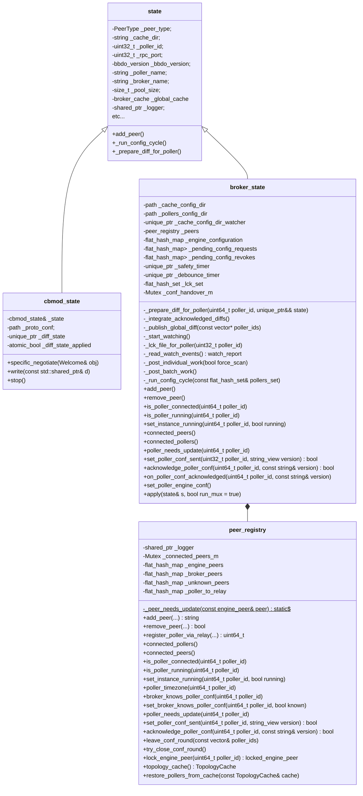

`broker_state` ne possède plus aucune map de pairs : elles vivent toutes dans
`peer_registry`, avec leur propre mutex. Ce qui reste sous
`broker_state::_connected_peers_m`, ce sont uniquement les files de transfert —
`_pending_config_requests`, `_pending_config_revokes`, `_pending_diff_states`,
`_pending_diff_state_acks` et `_engine_configuration`.

Le découpage de `state` implique aussi le découpage de la classe `bbdo::stream`.

Il y a les `bbdo::stream` utilisés par `cbmod` pour se connecter à un `broker`,
il y a les `bbdo::stream` utilisés par `broker` pour se connecter à un `engine`
et il y a aussi les `bbdo::stream` utilisés par des fichiers cache ou *unprocessed*.

pour représenter tout ça, il a fallu découper `bbdo::stream` en une classe de base `bbdo::basic_stream` puis une
classe virtuelle pure `bbdo::stream` qui hérite de `bbdo::basic_stream` et enfin deux classes concrètes
`bbdo::broker_stream` et `bbdo::cbmod_stream` qui héritent de `bbdo::stream`.

Ce qui donne la structure suivante :

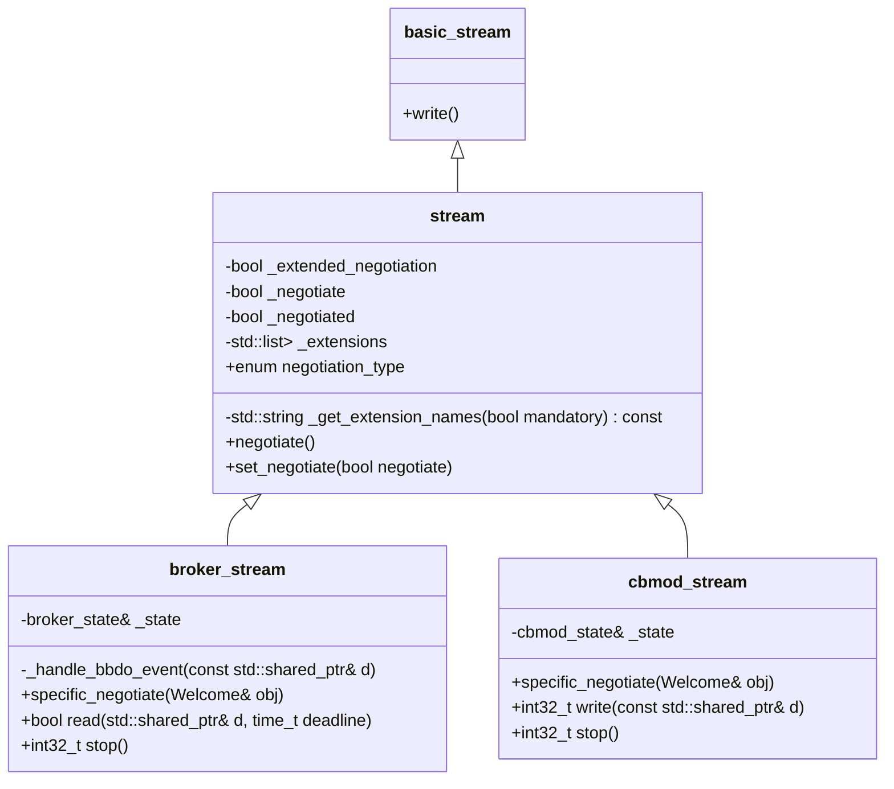

### Cycle de vie de broker_state, du cache et du downtime_manager

`broker_state` orchestre deux objets à longue durée de vie dont l'ordre de
création et de destruction est important :

* le **cache global** (`broker_cache`, possédé par la classe de base `state` via
  `_global_cache`), persisté dans `<cache_dir>.cache` et rechargé au démarrage
  suivant ;
* le **gestionnaire de downtimes**
  (`com::centreon::common::downtimes::downtime_manager`, un singleton), chargé
  **uniquement** lorsque `notification_mode=broker`. Il possède les downtimes
  in-process (planifiés via gRPC et downtimes hérités de BAM).

Quand Broker gère les downtimes, les downtimes *démarrés* (en cours) doivent
survivre à un redémarrage de `cbd` : ils sont sauvegardés avec le cache à l'arrêt
et réinjectés dans le gestionnaire au démarrage suivant. Les downtimes non
démarrés peuvent être perdus ; le `scheduled_downtime_depth` est recalculé de
façon idempotente (un comptage par ressource), il n'est pas incrémenté
aveuglément.

#### Démarrage

La subtilité clé : le cache est créé **à l'intérieur** de `state::apply()`
(`initialize_cache()`), et `_global_cache` n'est affecté qu'une fois le
constructeur de `broker_cache` terminé. Le chemin de réinjection rappelle
`config::applier::state::instance().cache()` (via le `resource_exists()` des
callbacks de downtime), il ne **doit donc pas** s'exécuter depuis le constructeur
— sinon il déréférencerait un `_global_cache` non encore affecté et provoquerait
un `abort`. Le constructeur se contente donc de charger les downtimes persistés
dans une liste en attente, et la réinjection a lieu plus tard, une fois
`_global_cache` en place.

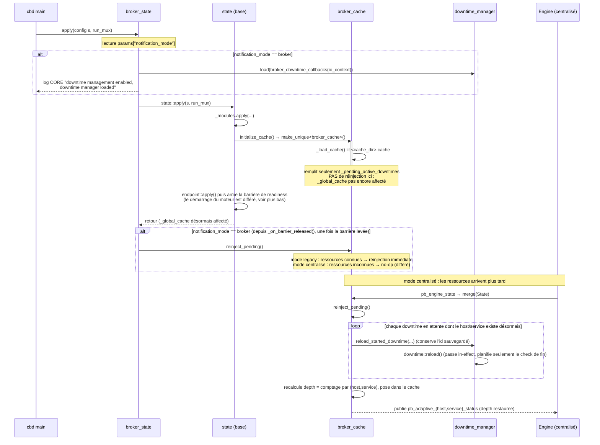

#### Barrière de readiness au démarrage

Le moteur de multiplexing n'est **pas** démarré à la fin de `state::apply()` dès
que les endpoints sont créés. Le faire entre en course avec le démarrage des
streams de sortie : un output (par ex. le `monitoring_stream` BAM) s'ouvre sur son
thread de `failover` et publie ses *définitions* de démarrage (comme le service
virtuel de la BA, avec `scheduled_downtime_depth=0`) tandis que, en parallèle, le
moteur est démarré et l'état persisté réinjecté. Une définition périmée traitée
*après* la profondeur de downtime hérité réinjectée l'écraserait (profondeur de la
BA de retour à 0).

Pour rendre l'ordre déterministe, la base `state` installe une **barrière de
readiness au démarrage**. Elle vit volontairement dans la classe de base, afin de
protéger à la fois `cbd` et `cbmod` — par ex. un output Lua chargé sur `cbmod` qui
restaure un état est protégé de la même manière :

* à la fin d'`apply()`, au lieu de démarrer le moteur, `_enable_multiplexing()`
  recense l'ensemble des endpoints de **sortie** qui viennent d'être créés et arme
  la barrière (en mode `--check`, `run_mux=false`, elle ne fait rien) ;
* chaque stream de sortie, une fois que son `failover` a terminé sa **première**
  tentative d'`open()` — succès *ou* échec, pour qu'une base/un pair down ne bloque
  pas le démarrage — appelle `state::notify_output_ready(name)` exactement une fois
  (one-shot par failover) ;
* quand tous les outputs attendus se sont enregistrés, `_maybe_release_barrier()`
  démarre le moteur de multiplexing **une seule fois**, ce qui flushe les
  événements bufferisés tant qu'il était `not_started` (les définitions de
  démarrage), puis invoque le hook `_on_barrier_released()` ;
* un **timeout** (60 s) lève la barrière de toute façon, pour que Broker/Engine ne
  reste jamais muet si un output ne s'ouvre jamais.

Comme le moteur bufferise tout tant qu'il est `not_started`, les définitions de
démarrage sont flushées en premier ; la réinjection — publiée soit réactivement
quand la configuration Engine arrive (mode centralisé), soit depuis
`_on_barrier_released()` (mode broker legacy) — est donc toujours ordonnée
**après** elles, et la `scheduled_downtime_depth` restaurée l'emporte.

`_on_barrier_released()` est la seule partie de la barrière spécifique à une
sous-classe : `broker_state` la surcharge pour appeler
`reinject_pending()` ; la base (et `cbmod_state`) la laissent vide.

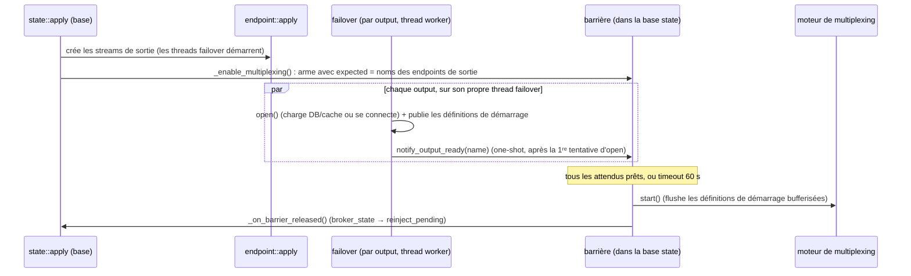

#### Arrêt

`broker_state` est détruit via `state::unload()` (`delete gl_state`). Le
destructeur dérivé `~broker_state` s'exécute **avant** la base `~state`, donc le
cache est encore vivant quand `~broker_state` lui transmet les downtimes
démarrés. Le cache est ensuite persisté par `~broker_cache` (appelé depuis
`~state`), dans les **deux** modes de configuration — seules les sections lourdes
(hosts, services, groupes…) restent réservées au mode legacy ; les downtimes
actifs sont toujours sauvegardés.

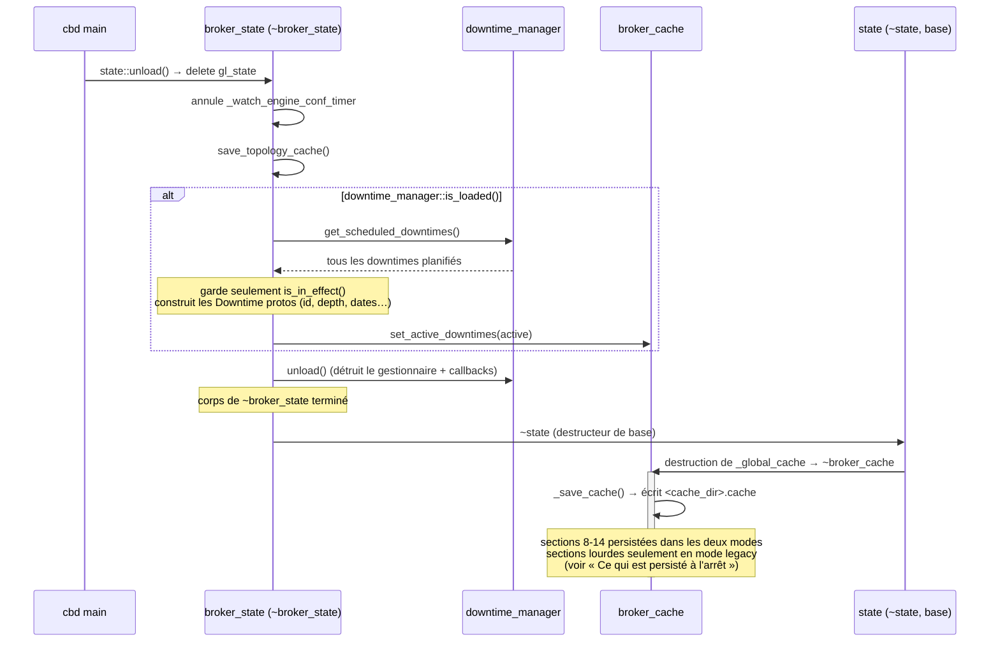
