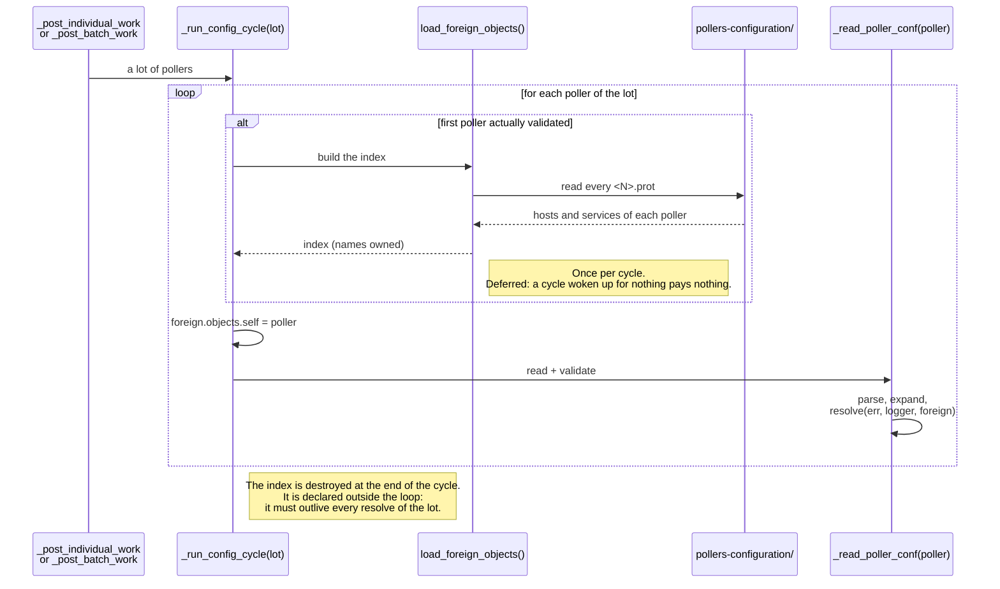
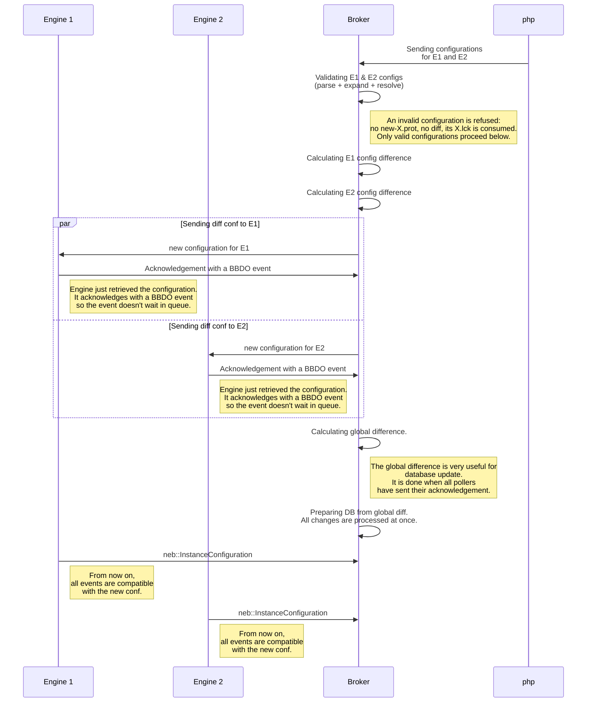
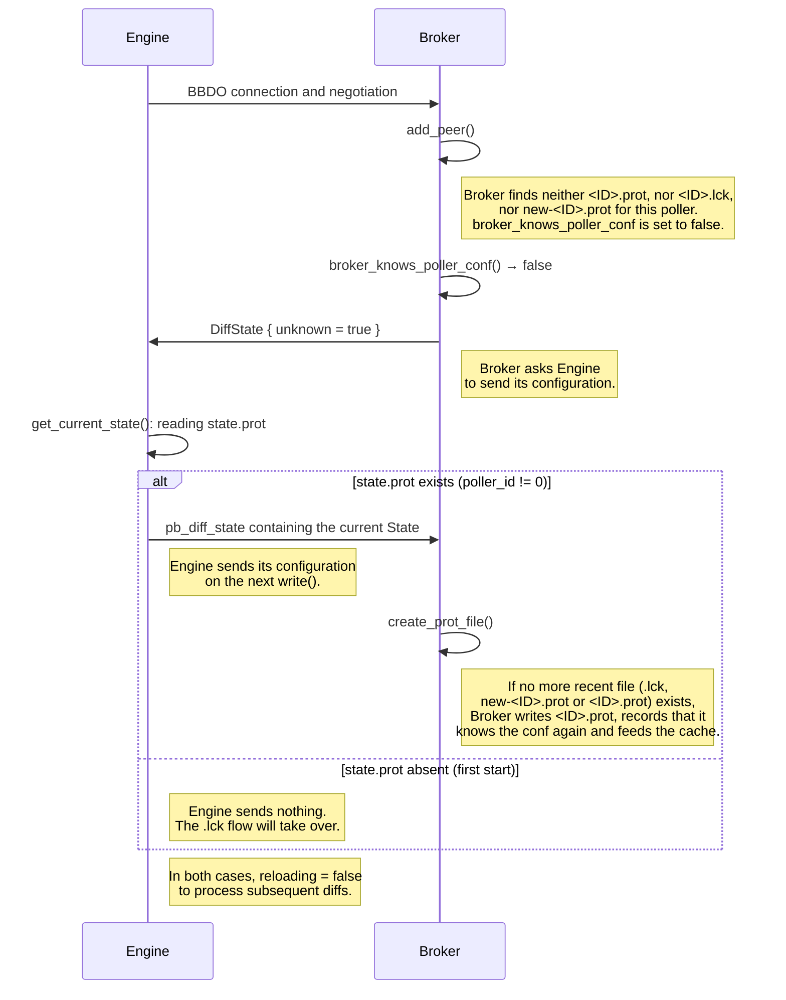
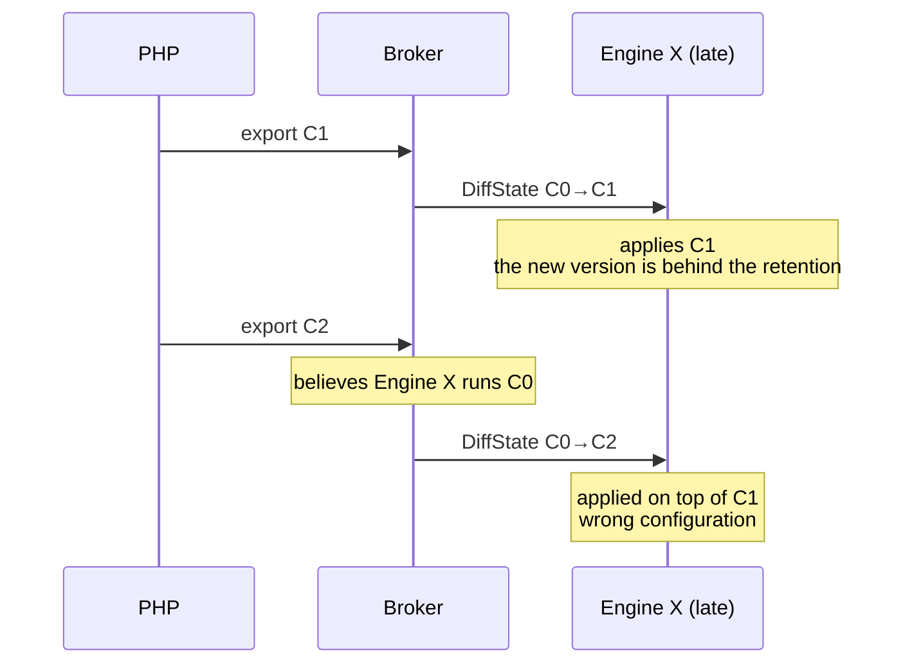
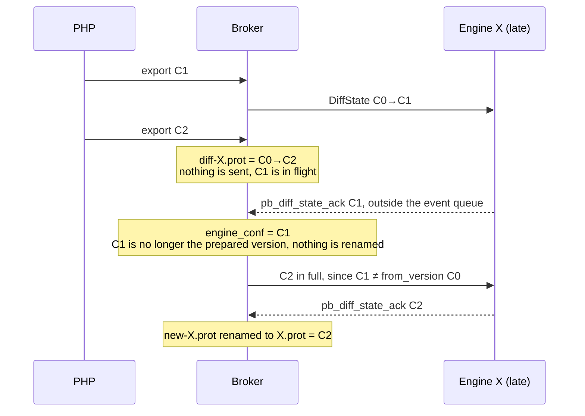
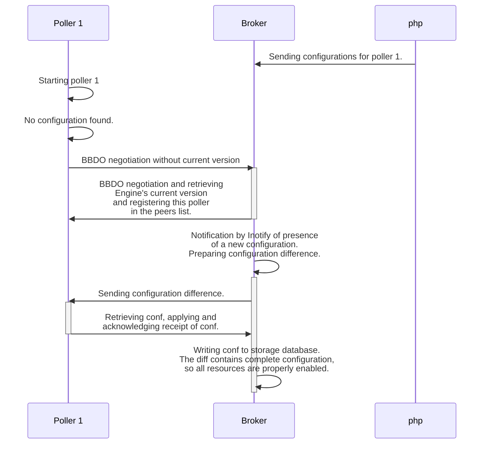
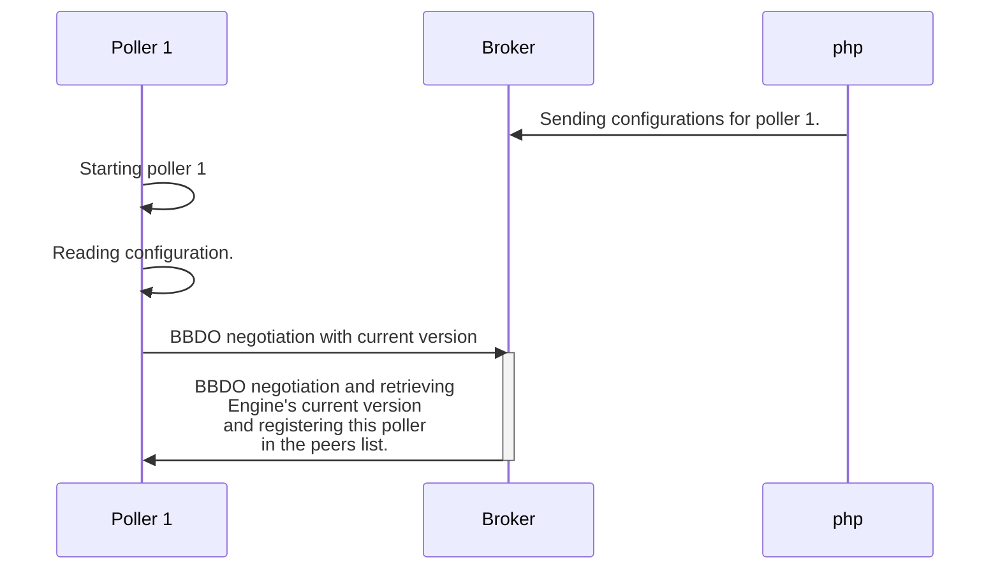

# Validating and writing the configuration

[← Previous](02-configuration-delivery-en.md) · [Index](README-en.md) · [Next →](04-centralized-cache-en.md)

<!-- TOC -->
* [Cross-poller validation: `load_foreign_objects()`](#cross-poller-validation-load_foreign_objects)
  * [`self`, and the case it covers](#self-and-the-case-it-covers)
  * [When the index is built](#when-the-index-is-built)
  * [Why the index owns its names](#why-the-index-owns-its-names)
  * [What the index changes -- and what it does not](#what-the-index-changes----and-what-it-does-not)
  * [The two validation paths, now aligned](#the-two-validation-paths-now-aligned)
* [Validating a poller configuration: the `CheckPollerConfig` gRPC endpoint](#validating-a-poller-configuration-the-checkpollerconfig-grpc-endpoint)
  * [Implementation](#implementation)
  * [Scope and roadmap](#scope-and-roadmap)
  * [Recommended porting order](#recommended-porting-order)
  * [Analysis: porting `resolve()` checks onto the `State`](#analysis-porting-resolve-checks-onto-the-state)
  * [What `expand()` covers and what `resolve()` adds](#what-expand-covers-and-what-resolve-adds)
  * [Moving from early throw to accumulation](#moving-from-early-throw-to-accumulation)
* [Calculating the difference](#calculating-the-difference)
* [Writing configuration to database](#writing-configuration-to-database)
  * [Case study](#case-study)
  * [Implementation](#implementation-1)
* [Tricky cases](#tricky-cases)
* [Cross-cutting objects](#cross-cutting-objects)
* [The necessity of centralized cache](#the-necessity-of-centralized-cache)
<!-- TOC -->

## Cross-poller validation: `load_foreign_objects()`

A poller on its own cannot judge everything. If it references a host it does not
define -- a dependency, an escalation, a group -- it has only one answer:
*undefined*. `Broker` knows the configurations of **every** poller, and can
therefore tell an object that truly does not exist from one that **lives
elsewhere**.

That is what `load_foreign_objects()` is for: building, from every stored
`<N>.prot`, the two name indexes then handed to `resolve()`:

```
hosts    : host_name                   → the poller defining it
services : {host_name, description}    → the poller defining it
```

### `self`, and the case it covers

The index is built over **all** the stored configurations, without knowing which
validation will use it: the current poller's own is in there and has to be
filtered out. Hence `foreign_objects::self`, set on every iteration.

This is not mere tidiness. The subtle case is an object **present in the poller's
previously stored configuration and dropped from the one being validated**:
without the filter it would read as "defined on this poller" just as it
disappears from it, and a dangling reference would go unnoticed. With the filter
it reads as undefined, which is the truth.

### When the index is built



Two properties not to break: the index is built **once per cycle** -- on a
deploy-all, rebuilding it per poller would read the store as many times as there
are pollers -- and it is declared **outside** the loop, because `resolve()`
borrows the names it holds.

### Why the index owns its names

`foreign_objects` is made of `std::string_view`: someone has to own the strings.
That used to be the `State` messages themselves, kept alive for the whole
validation -- tens of megabytes of deserialized configuration held in order to
read a few hundred thousand names out of it.

`foreign_states::names` owns them now (a `std::deque<std::string>`, whose elements
never move -- neither when it grows, nor when the structure is moved), names are
**interned** (a `host_name` shared by its twenty-five services is stored once),
and each message is released as soon as it has been walked. Measured on 10
pollers of 50,000 services (51.6 MB of `.prot`):

| | time (release included) | peak memory |
|---|---|---|
| index borrowing from the messages | 391 ms | 391 MB |
| owning index, interned names | **295 ms** | **82 MB** |

The cost is linear, about 5 ms per megabyte of `.prot`. The remaining 82 MB are
the index itself (500,000 entries); the distinct names now weigh about one
megabyte.

> ⚠️ The time **goes down** although slightly more work is done (the interning),
> and that is no paradox: releasing each message at once lets the allocator reuse
> its blocks for the next poller, instead of growing the heap to 391 MB before
> giving it all back. Measuring this requires timing the **release** too: the
> version that carries its garbage out in its return value makes the caller pay
> for it, after the clock has been stopped.

The bench is `broker/core/config/applier/test/broker_state_foreign_bench.cc`
(`DISABLED_`, so it costs nothing in CI):

```bash
tests/ut_broker --gtest_also_run_disabled_tests --gtest_filter='*ForeignObjectsCost*'
```

### What the index changes -- and what it does not

**It never makes a configuration valid.** All four places that consult it
increment `err.config_errors` **before** asking:

```
hostdependency_helper.cc:280   err.config_errors++;
hostdependency_helper.cc:282   if (uint64_t poller = elsewhere.poller_of_host(...))
```

An object living on another poller is therefore an error, exactly like one that
does not exist -- a dependency or an escalation does not cross a poller
boundary. What the index buys is the **precision of the diagnostic**:

| Without the index | With the index |
|---|---|
| "Dependent host 'X' … is not defined anywhere!" | "Dependent host 'X' … belongs to poller 2: \<reason\>" |

The difference is not cosmetic for whoever reads the message: the first sends
them hunting for a typo, the second says what actually happened.

### The two validation paths, now aligned

`resolve()` takes the foreign objects as an **empty default parameter**
(`common/engine_conf/state_helper.hh:47`). `CheckPollerConfig` did not pass them,
and so gave the degraded diagnostic -- the verdict itself was the same. Both
paths now build the same index:

| Path | Call |
|---|---|
| Ingestion -- `_read_poller_conf()` | `resolve(err, logger, foreign->objects)` |
| `CheckPollerConfig` -- `broker_impl.cc` | `resolve(err, logger, foreign.objects)` |

That leaves `self`, which the request does not carry: it names a directory and
nothing else. Since a poller configuration lives in a directory named after its
id -- which is where the ingestion takes it from, nothing carries it inside the
`.cfg` files -- the endpoint reads it from the directory name. When that name is
not an id, nothing can be excluded: the endpoint then **says so** in a `WARNING`
diagnostic, rather than silently letting through a reference to an object this
very directory has just dropped.

## Validating a poller configuration: the `CheckPollerConfig` gRPC endpoint

Because Broker already reads and resolves poller configurations with the
`engine_conf` library (see above), it can also *validate* one on demand, without
applying it. This is exposed as a new gRPC endpoint on the Broker service
(`broker/core/brokerrpc/broker.proto`), meant as a central, on-line counterpart
of `centengine --verify-config`:

```proto
rpc CheckPollerConfig(CheckPollerConfigRequest) returns (CheckPollerConfigResponse) {}

// directory holding centengine.cfg and the other .cfg files
message CheckPollerConfigRequest  { string directory = 1; }
message ConfigDiagnostic {
  enum Severity { WARNING = 0; ERROR = 1; }
  Severity severity = 1;
  string message = 2;
}
message CheckPollerConfigResponse { bool ok = 1; repeated ConfigDiagnostic diagnostics = 2; }
```

Given a directory that PHP filled (the very directories Broker ingests in
centralized mode), the endpoint returns the list of configuration problems it
found and an `ok` flag, `true` when there is no *error* (warnings do not make a
configuration unusable).

### Implementation

`CheckPollerConfig` reuses the exact offline pipeline used to read a poller
configuration: `parser::build_test_file` (rewrites the `cfg_file=` /
`resource_file=` paths so they resolve inside the directory), then
`parser::parse`, then `state_helper::expand`. The only new concern is *how the
problems are collected*.

The validation reports problems by logging (warnings/errors) and, for a few hard
failures, by throwing. Broker is multithreaded, so the check must **not** touch
the shared `CONFIG` logger: spdlog does not guard a logger's sink list against
concurrent modification while other threads log through it, so adding a sink on
the fly would be a data race. Instead, `parser` and `state_helper::expand` were
made to accept an **injected logger** (defaulting to the shared `CONFIG` logger,
so every existing caller is unchanged), and `CheckPollerConfig` passes a
**dedicated, single-threaded logger** backed by an in-memory *capturing sink*.
That logger is used by the RPC handler thread alone, so the sink needs no
locking (`base_sink<null_mutex>`) and the shared loggers are never modified. The
captured `warn`/`err` records become `WARNING`/`ERROR` diagnostics; a thrown
fatal failure is caught and appended as a final `ERROR`. `ok` is
`config_errors == 0` and no exception was thrown.

### Scope and roadmap

This is a **structural** check: `parse` + `expand` catch missing files,
unresolvable templates, host/service-group membership problems and timeperiod
cross-references (for example a timeperiod whose `exclude` names an undefined
one).

Historically most of verify-config's warnings/errors were produced later, by
`applier::state::apply` (the *resolve* phase), through the `check()`/`resolve()`
methods of Engine's runtime objects (`host`, `service`, `contact`, `notifier`,
…). That code is Engine-only, is not linked into `cbd`, and the central Broker
host may not even have `centengine` installed — so Broker cannot run it.

**Status: a `resolve` phase now exists in `engine_conf`.** A new
`state_helper::resolve(error_cnt&, logger)` runs **after `expand`** and validates
the `State` protobuf directly (no runtime object). It is **accumulate-only** (it
never throws; it only increments `config_warnings`/`config_errors` and logs),
which is exactly what a "report everything, then decide" validator needs. It is
wired into **all three consumers**, so a ported check has a single home and runs
identically everywhere:

- **`CheckPollerConfig`** (Broker) — `parse` + `expand` + `resolve` on the
  injected capturing logger;
- **ingestion** (`broker_state::_run_config_cycle`) — `parse` + `expand` +
  `resolve`; if `config_errors > 0` Broker refuses to push the configuration
  (see the `.lck` lifecycle above);
- **Engine** — `main.cc` (`--verify-config`, and the non-trusted `centengine.cfg`
  start path) and `events/loop.cc` (reload) all call `expand` + `resolve` before
  the applier and reject an invalid configuration.

  > Note: the **trusted-proto** start path (`state.prot` pushed by Broker) and
  > the runtime `apply_diff` path deliberately do **not** re-run `resolve` —
  > those configurations were already validated by Broker before being pushed
  > (a hand-written `.prot` is not a supported input). See the design decision
  > in the review notes.

The plan is to progressively **port each Engine runtime `resolve()` check onto
the `State`**: move the validation part into the matching `*_helper::resolve`
(driven by `state_helper::resolve`) and leave only the runtime wiring in the
Engine applier. **`contact` (the pilot) and `contactgroup` are already ported**
(`contact_helper::resolve` / `contactgroup_helper::resolve`, called by
`state_helper::resolve`, with the applier reduced to pure wiring — for
`contactgroup` this also made `add_object`/`modify_object` tolerant: a member
that does not exist is skipped, not thrown on). As `engine_conf` gains the
remaining checks, `CheckPollerConfig` becomes a true, central verify-config.

### Recommended porting order

`contact` and `contactgroup` are done. The remaining 11 are best ported in waves
that build up the shared name indexes in `state_helper::resolve` from the
simplest, most self-contained validators to the most algorithmic — each wave is
independently testable:

1. **Groups** — `hostgroup`, `servicegroup` (member-exists + illegal characters,
   exactly like `contactgroup`). They add the `hosts` / `services` name indexes
   that every later wave reuses. Note: `expand()` already validates group
   *membership integrity*; `resolve` only adds the members declared on the
   group-definition side.
2. **Escalations** — factor the shared `escalation` checks first
   (escalation_period + contactgroups exist), then `hostescalation` /
   `serviceescalation` (the referenced host / service exists).
3. **Dependencies** — `hostdependency`, `servicedependency`: dependent & master
   host/service exist, dependency_period exists, plus the first genuinely
   algorithmic check — **circularity** (graph traversal).
4. **The notifier family** — `notifier` has no standalone proto message (host and
   service embed its fields), so its shared validation becomes a helper called by
   both `host_helper::resolve` and `service_helper::resolve` (event_handler,
   check_command, check_period, notification_period, contacts and contactgroups
   exist). Then `host` (parents/children, its services) and `service`
   (`notification_interval < check_interval`), with `anomalydetection` (≈ service)
   coming almost for free. Kept last: most complex and reuses every index built by
   the earlier waves.

The reverse choice — doing the notifier family first (≈ 80 % of verify-config's
real value, and the pattern is already proven by `contact`) — is defensible, at
the cost of building all indexes at once and tackling the graph checks earlier.
The progressive order above is preferred for lower per-step risk.

### Analysis: porting `resolve()` checks onto the `State`

Most of the "verify-config" validation lives in the
`resolve(uint32_t& w, uint32_t& e)` methods of Engine's runtime objects. There
are **13**: `notifier`, `service`, `host`, `contact`, `contactgroup`,
`hostgroup`, `servicegroup`, `escalation`, `hostescalation`,
`serviceescalation`, `hostdependency`, `servicedependency`, `anomalydetection`.

Each splits cleanly into two parts:

- **Validation** — either an intrinsic property of the object or the existence
  of a reference ("does X exist / X == Y"). **Fully computable on the `State`
  protobuf**, with no runtime object.
- **Runtime wiring** — saving pointers (`*_ptr`, `it->second = …`), reverse
  links (`services.insert`, `add_child_host`, `get_escalations().push_back`,
  `get_parent_groups()`), event-broker notifications (`broker_relation_data`,
  `broker_group_member`). This has nothing to do with validation and **stays in
  the Engine applier**.

None of these 13 methods performs validation that requires a live runtime
object → **all 13 are migratable** to `engine_conf`, uniformly.

Validation content to port, per object:

| Object | Validation checks (→ portable onto State) |
|--------|-------------------------------------------|
| notifier | event_handler & check_command exist; check_period & notification_period exist; contacts & contactgroups exist |
| service | (notifier) + referenced host exists; sane recovery; `notification_interval < check_interval`; illegal characters |
| host | (notifier) + "no services" (warn); each of the host's services exists; parents exist; illegal characters; sane recovery |
| contact | host+service notification commands non-empty; notification timeperiods exist; sane host+service recovery; illegal characters |
| contactgroup | each member exists; illegal characters |
| hostgroup / servicegroup | each member exists; illegal characters |
| escalation | escalation_period exists; contactgroups exist |
| hostescalation / serviceescalation | host / service exists (+ escalation) |
| hostdependency / servicedependency | dependent & master host/service exist; not circular; dependency_period exists |
| anomalydetection | (= service) + parent service exists; non-null service_id & internal_id; host_id consistent with the host's; non-null max_check_attempts & retry_interval; {host_id, service_id} not already taken |

On the State side, the ported validator first builds name→object indexes
(commands, timeperiods, contacts, contactgroups, hosts, services) plus a
host→services index (which `resolve()` builds today as a side effect), then walks
each type accumulating `(w, e)` into `error_cnt`.

> **Implemented so far.** `state_helper::resolve` builds the command, timeperiod
> and contact name indexes (non-owning `flat_hash_set<string_view>`, mirroring
> `expand`), then walks the **contacts** and the **contactgroups**:
> - `contact_helper::resolve` checks: host/service notification commands
>   non-empty **and** defined; host/service notification timeperiods defined;
>   sane host/service recovery options; illegal characters in the contact name.
> - `contactgroup_helper::resolve` checks: every member contact is defined;
>   illegal characters in the contact group name.
>
> The remaining 11 object types are still validated by the Engine applier and
> stay on the roadmap above.

### What `expand()` covers and what `resolve()` adds

`expand()` and `resolve()` are **complementary**, with very little overlap.

`expand()` handles **group-membership integrity**: it validates and fills
host↔hostgroup, service↔servicegroup, contact↔contactgroup, flattens nested
groups, **explodes** group-based dependencies/escalations into concrete entries
(then clears the group fields), makes a service inherit from its host (host_id,
contacts, contactgroups, notif interval/period, timezone), and cross-checks
timeperiod exclusions. **Important: after `expand`, everything is referenced by
concrete name** (`host_name`, `(host_name, service_description)`) → the ported
validator uses exactly the same name-keyed lookups as `resolve()`.

What `expand()` does **not** do is checked by the `resolve` phase of `engine_conf` (`state_helper::resolve` and the `resolve()` of the `*_helper` classes), ported from the `resolve()` of the `Engine` objects: the *leaf* references (commands, timeperiods, a notifier's contacts/contactgroups, members declared on the group-definition side, hosts/services of escalations/dependencies/parents), and the pure checks (circularity, "host with no service", recovery sanity, interval, required fields, illegal characters).

### Moving from early throw to accumulation

Goal: have `CheckPollerConfig` **report all errors at once** and only fail at the
end, instead of stopping at the first `throw`. Today `parse`+`expand` mix two
behaviours: `error_cnt err` **accumulates** (`config_warnings`/`config_errors`),
but ~54 sites also `throw`, aborting the rest.

> **Applied to the resolve phase.** The new `resolve` validators follow the
> accumulate-only model from the start: `contact_helper::resolve` never throws,
> it only logs and increments `error_cnt`. The consumers decide what to do with
> the totals afterwards (Engine/ingestion reject when `config_errors > 0`;
> `CheckPollerConfig` reports every diagnostic). The throw→accumulate conversion
> discussed below still applies to the older `parse`/`expand` sites.

The throws fall into two families:

- **`check_validity()` (~34 sites, parse phase)** — missing mandatory identity
  fields (name, address, command line, id, type). An object with no name/id can
  no longer be indexed or referenced → these are the *legitimate* candidates to
  stay fatal (or to drop the object). **Detailed analysis still to do.**
- **`expand()` & related (~20 sites)** — unresolvable cross-references.
  **Analyzed: none is actually fatal** (no crash/corruption if removed). Two
  shapes:
  - *Accumulable* (throw in an `else` branch, nothing to skip):
    `hostdependency:199/211`, `host_helper:343`, `hostescalation:168`,
    `serviceescalation:189`, `timeperiod:328`.
  - *Accumulable-with-guard* (the throw only guarded an `end()` iterator
    dereference right below — just skip that block via `continue`):
    `service_helper:302/324`, `contact_helper:180`, `serviceescalation:207`,
    `servicedependency:327/344`, `contactgroup:136`, `servicegroup:129`.

Three concrete points:

1. `timeperiod_helper.cc:328` is already the target model (logs + counts each
   error, throws as the last statement) → converting it = removing the throw.
2. `servicedependency::_expand_services` (327/344) does not count yet and its
   function has no `error_cnt& err` parameter → it must be added to the
   signature.
3. `state_helper::hook` (6 throws, 99-214) is **not** in `expand`: it is the
   parser hook (key/value), with no access to `error_cnt` → a separate
   accumulation mechanism (signature change).

Latent bugs spotted along the way: uninitialized `double user_value` used when
`SimpleAtod` fails (`state_helper:130/153`); a debug `std::cout`
(`servicegroup_helper:125`); a "Coulx" typo (`servicedependency:344`); an empty
`;` (`servicedependency:342`).

## Calculating the difference

`Broker` is notified of new `Engine` configuration versions.

The configuration is received by the `config::applier::state` instance of `Broker`.

It is interesting to keep a small time window to be able to mutualize changes from different pollers: if several pollers are modified in parallel, `Broker` handles them together. That window is the 500 ms debounce, and a `pollers.lck` does away with the guessing altogether by naming its batch.

> **`inotify` leads now, not a timer.** The descriptor used to be read only in
> response to a 5-second tick: detection was bounded by that delay, the read
> consumed a single 4 KB buffer per tick (about a hundred events, the remainder
> waiting for the next one), and a cycle was paid for even when nothing had
> happened. The asynchronous wait removed all three: nothing runs at idle,
> detection is immediate, and re-arming after each read drains the queue. The
> 500 ms coalescing described above keeps the mutualization the fixed rate
> provided, and the timer has become a 5-minute safety net.

In the previous step, we evolved the negotiation between `Engine` and `Broker` but overall the two work as before. Just, in a certain number of cases, we avoid `Engine` resending its configuration to Broker.

## Writing configuration to database

### Case study

Currently, even if negotiation has evolved, `Broker` continues to write the configuration drop by drop following what pollers send it.

### Implementation

The good solution seems to be:

1. From poller differentials recovered on a configuration change, we create a global differential. The advantage is to resolve inter-poller conflicts in advance.

2. `Broker` must learn to be less strict on database writes. For example, if a host is deleted and we still send data on it, knowing that the host is just disabled, we should still be able to write the data.

3. When the global differential is ready, we would no longer be forced to wait for an `Instance` to process it. That said, if a poller is three weeks behind, what would be the impact on data of sending almost at poller connection the new configuration?

An algorithm for grouping differentials could follow the following solution:

- For added objects, we can do the union. We will have all added objects. On each addition, we must check among deleted ones if the object is not already referenced. If it is, we can move it to modified objects.

- For modified objects (which don't change poller), we can also do the union.

- For a host moved from one poller to another, one differential will say the host is added while another will say it is deleted.

- For a deleted object, we must check if it is not already added, and if it is, it must be put in modified objects.

On the Protobuf side, we have two configuration objects which are `State` and `DiffState`. They are good because serializable but they have the problem of being very limited for searches.

We therefore introduce two new objects `IndexedState` and `IndexedDiffState` which store objects in hash tables. A `merge()` method is implemented in `IndexedDiffState` to merge several differentials.

The diagram assumes pollers are already connected to `Broker`:



**Remarks.**

1. A point of vigilance: In case the second poller is very late, the arrival of the second `ConfigurationInstance` can really be delayed. If `Broker` waits for all `ConfigurationInstance` to update the base, it penalizes E1 data since the cache will take a long time before being updated.

2. Perhaps the global difference could be made on receiving acknowledgements. And timed with a timeout. For example from the first reception, Broker gives itself a 10s timeout, during this time span, as soon as it receives an acknowledgement, it enriches the global difference with the acknowledged configuration. When the timeout is finished, everything is sent to the database and cache.

3. A point of vigilance: we have assumed here that the configuration was coming from
   php. We also need to be able to recover if the configuration is already on the
   Engine side, including if it has been deleted on the Broker side.

For point 3., if Engine starts with a configuration already known by Broker, there is
no issue — the configuration is already in place. However, if an administrator has
deleted the configuration known by Engine from Broker's side, it would be good for
Engine to be able to send it to Broker to resolve the issue.

This case is handled as follows: during BBDO negotiation, if Broker finds neither an
`<ID>.prot` file nor an `<ID>.lck` file for a poller, it sends a
`DiffState{unknown=true}` to Engine. Engine detects this message and attempts to send
its current configuration to Broker. If `state.prot` exists, Engine sends it;
otherwise (first start, no configuration has been applied yet), Engine logs a warning
and sends nothing — the normal configuration flow (via `.lck` files) will take over.
In both cases, Engine immediately resets the `reloading` flag to `false` so that
subsequent diffs can be processed.

Broker receives the current `State`, then calls `create_prot_file()`. Before writing
`<ID>.prot`, Broker checks that no more recent configuration is already being
processed:

- if a `<ID>.lck` file exists in the PHP cache directory, PHP has just sent a new
  configuration; Broker lets the normal flow handle it;
- if a `new-<ID>.prot` file exists, the normal flow is already preparing the new
  configuration;
- if `<ID>.prot` already exists, the normal flow has already installed it.

In all three cases, Broker simply records that it knows this poller's
configuration again -- `set_broker_knows_poller_conf(id, true)` -- without
overwriting the file.

> **`broker_knows_poller_conf` is not the negation of `engine_conf`.** The two
> describe opposite sides of the exchange, and they are routinely true together.
> `engine_conf` is the version **the poller says it runs**, read from its
> `Welcome`. `broker_knows_poller_conf` says whether **Broker holds the content**
> of that version -- a `<ID>.prot` on disk, or a `<ID>.lck` announcing one. The
> whole recovery below rests on the combination "the poller runs v7, and we have
> no idea what v7 contains": `add_peer()` records `engine_conf` from the
> `Welcome`, then finds nothing on disk and sets `broker_knows_poller_conf` to
> false, and the next line reads it to send the `DiffState{unknown=true}`.

> **Not to be confused with a late poller.** This `unknown=true` mechanism only
> covers genuine configuration loss (no `<ID>.prot`, no `<ID>.lck`, no
> `new-<ID>.prot` in progress). The case of a poller that connects *after* PHP has
> pushed its configuration does not land here: either its announcement has not been
> read yet and it goes back for a cycle, or its `new-<ID>.prot` is waiting and is
> handed over directly (see
> [Delivery](02-configuration-delivery-en.md#delivery)) -- either way
> delivery resumes through the normal flow instead of a `DiffState{unknown=true}`.



The full journey of the files while a configuration is sent (`.lck`, `new-X.prot`, `diff-X.prot`, `X.prot`) is described in [The journey of a configuration](02-configuration-delivery-en.md#the-journey-of-a-configuration).

## Tricky cases

Two cases are a problem when a poller has retention, that is to say late events it is still sending to `Broker`.

**1. A host moved from a poller on time to a late poller, or the other way around.** Until the late poller has caught up with its retention, `Broker` may receive data about the same host from both pollers. Those from the late poller are older. This case remains open.

**2. A configuration pushed while `Engine` has already taken the previous one, without `Broker` knowing.** If `Broker` learnt the version of a poller from an event of the normal queue, that event would arrive behind the retention. `Broker` would then believe the poller still runs C0 while it already runs C1, and would compute the next difference on the wrong basis:



This case is solved, by four mechanisms described in [Delivery](02-configuration-delivery-en.md#delivery):

* **the acknowledgement does not go through the event queue.** `Engine` emits `pb_diff_state_ack` as soon as it has applied the configuration, and this BBDO message is handled apart: retention does not delay it;
* **`X.prot` only moves forward on acknowledgement**, by renaming `new-X.prot`. The next differences are therefore computed from the last acknowledged version;
* **nothing is sent while a configuration is in flight**, handed over and not acknowledged yet. C2 waits for the acknowledgement of C1;
* **when sending, `from_version` is compared to the version `Engine` runs.** If they differ, `Engine` receives the full configuration instead of the difference. An acknowledgement of an outdated version updates that version, but renames nothing.



There is a third worrying case concerning all cross-cutting objects. Let's consider Hostgroup for example. A poller whose certain hosts belong to Hostgroups, has a configuration declaring necessary Hostgroups with hosts it contains. The problem is that poller 1 only knows its hosts, and consequently the Hostgroups it has in definition also only know its hosts.

Let's take an example, we have hosts 1 and 2 on poller 1 and hosts 3 and 4 on poller 2. A Hostgroup contains all 4 hosts.

The configuration of poller 1 will therefore contain a declaration of the Hostgroup with only hosts 1 and 2 and the configuration of poller 2 will have another with hosts 3 and 4.

Let's now resume our centralized configuration, the configuration of poller 1 changes by removing hosts 1 and 2 from the Hostgroup. The config diff will simply delete the Hostgroup.

In case only poller 1 has configuration modifications, we end up with a diff that declares the deletion of the Hostgroup. This will be inserted in the global differential used to prepare the database. But we cannot delete the Hostgroup like that, it is still used by poller 2.

So for Hostgroups and Servicegroups, the differential system set up cannot apply.

The differential with Hostgroups, Servicegroups implemented like the others must be kept because it is used when sending the diff to the poller.

The problem is when gathering modifications on these objects for database writing and later for broker's global cache.

The neb::service object is more complete than a configuration::service configuration. So during initialization with a neb::service, we also have the service state, pending if nothing is given at the start. In case of a `configuration::service`, there is no state: `unified_sql` therefore creates the `resources` row with `status=4` (PENDING), `status_ordered=1` and `status_confirmed=1`, and a new configuration does not overwrite it (`COALESCE(status, 4)`), the real state arriving with the first check.

## Cross-cutting objects

We have a Protobuf DiffState object which is distributed in an indexed_diff_state, which, as its name indicates, indexes container objects.

For GlobalDiffState, we currently have the same objects. Could we inherit from indexed_diff_state to add specificities.

Let's imagine the structure of global_indexed_diff_state. This class inherits from indexed_diff_state. Let's process the merge of a DiffState.

* Poller 1 sees the arrival of a new Hostgroup with hosts 6 and 7. Its diff contains an added Hostgroup with two members. Poller 2 sees the same new Hostgroup to which hosts 8 and 10 are added.

	* Current state: the first diff will complete the global diff state with a new hostgroup and its members. The second diff will also complete the global diff state with the same new one. Their contents are not merged, the second overwrites the first.
	* Evolution: We can keep the same added/modified/removed structure but the viewpoints of different pollers must not interfere, so it's best to index these changes by poller. At the global cache level, we have the current state of all Hostgroups and we can really apply changes.

## The necessity of centralized cache

Let's start with two scenarios:
1. Engine knows no configuration, it starts and connects to broker. Broker sends it the complete configuration.
   In this case, Broker also calculates the "global" difference that will allow registering this configuration in the `centreon_storage` database. And monitoring can start running.
2. Let's now imagine situation 1. but we stop `Engine`. Then we restart it. It reconnects to `Broker` and gives the configuration it knows.
   On its side, `Broker` has no new configuration so it sends nothing to `Engine`. So `Engine` acknowledges nothing. So the global diff contains nothing on this poller that just restarted. When `Engine` previously stopped, all its resources were disabled. But nothing allows reactivating them for now. So `Engine` connects, works normally, but on `Broker` side we see nothing.

The second case with the system we know works very well because `Engine` sends all its configuration and resources are reactivated one by one.

Let's resume the configuration exchange diagram.

We assume Broker is already running.



Let's resume the previous case, but this time, `Engine` already knows the configuration.



In this second case, there is no configuration sending, so no acknowledgement, so no database update.
The user is left in the dark, because resources are disabled and don't reactivate.

Just before starting monitoring, `Engine` sends an `Instance` message that could be used to reactivate resources.

But here, we face another problem. Deleted resources like disabled resources just have the `enabled` column at 0 in the `resources` table. So, we cannot distinguish between the two.

So if we set `enabled` to 1, all resources, including old ones, will be reactivated which is problematic.

`Broker` must absolutely keep a trace of resources on its side, which allows reactivating what is needed at these moments. We therefore need a cache on `Broker`.
