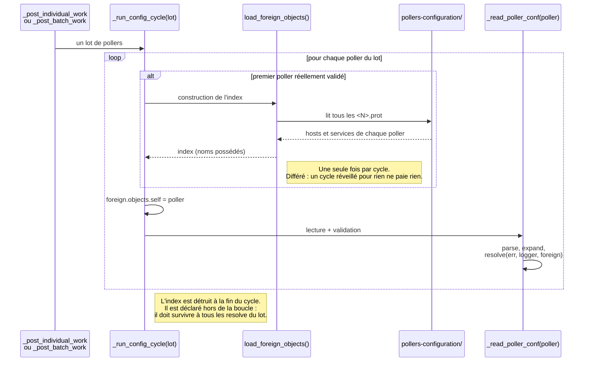
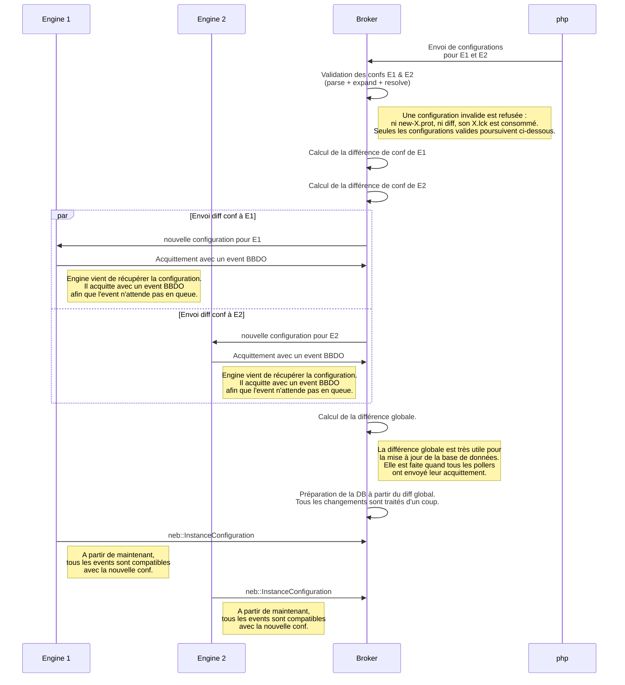
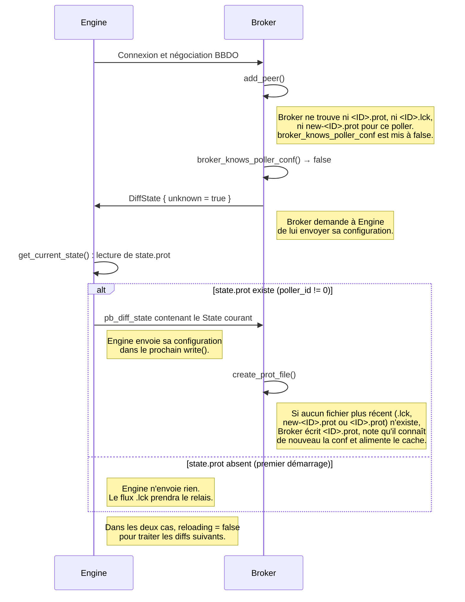
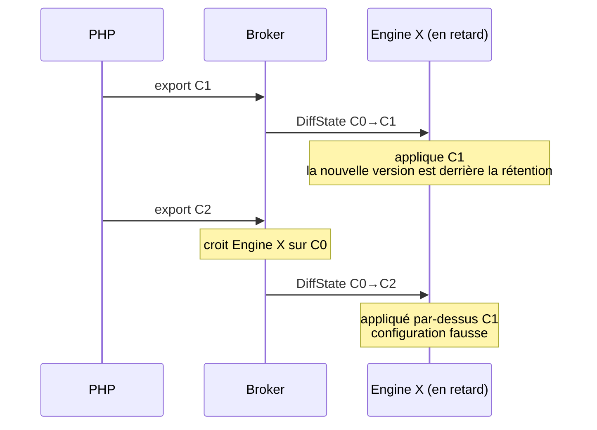
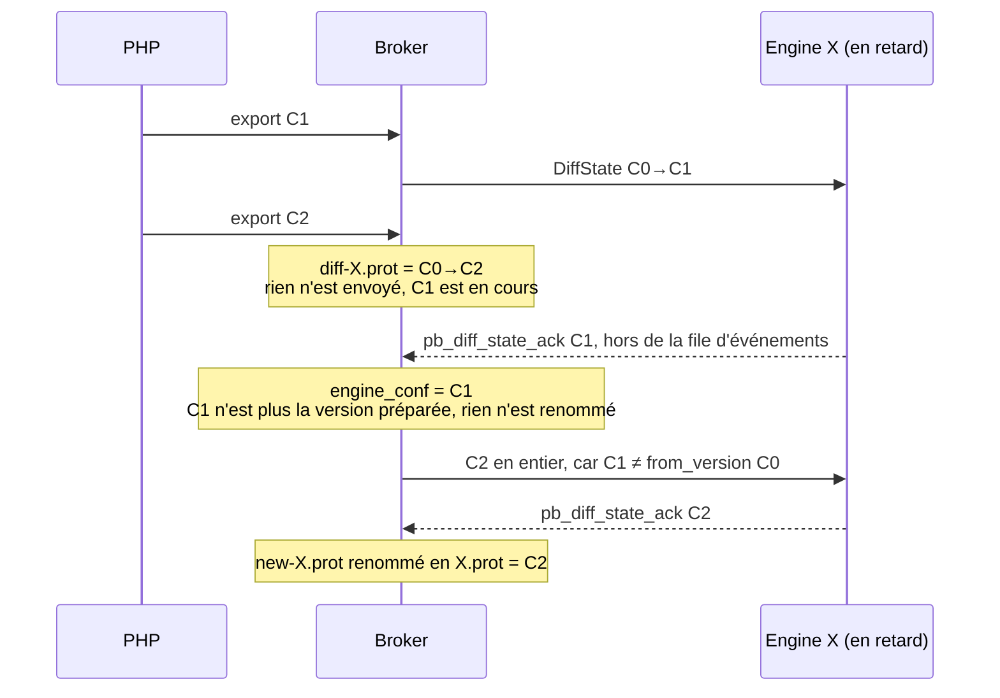
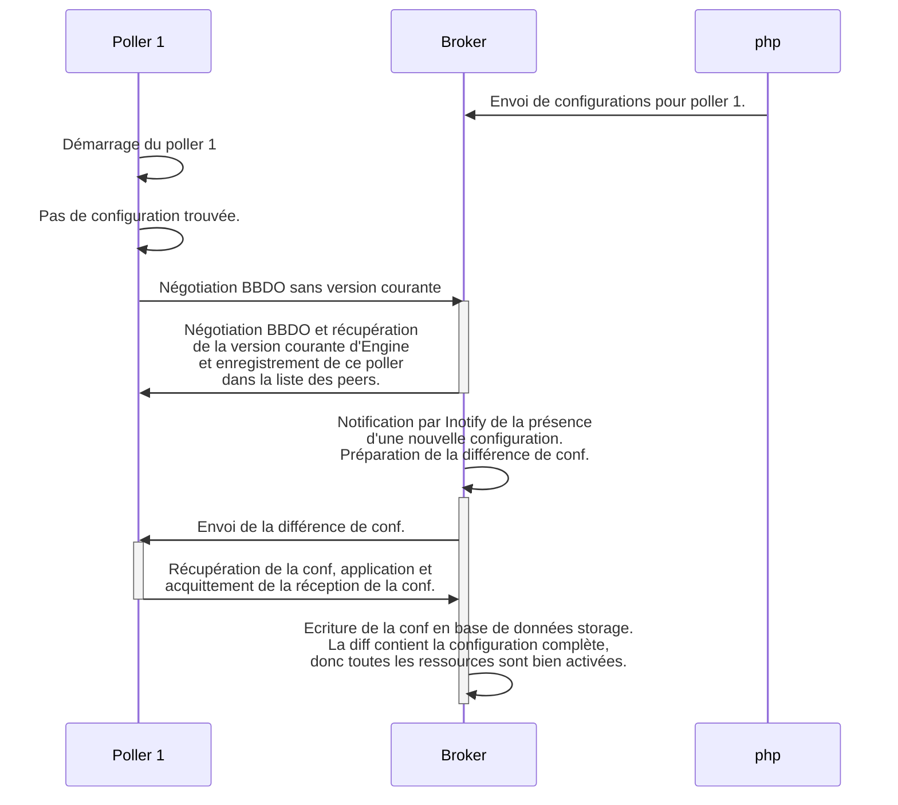
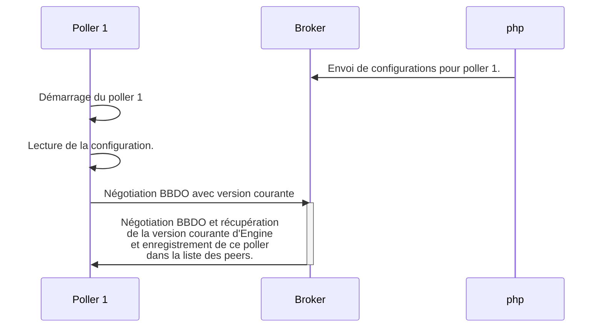

# Validation et écriture de la configuration

[← Précédent](02-configuration-delivery-fr.md) · [Index](README-fr.md) · [Suivant →](04-centralized-cache-fr.md)

<!-- TOC -->
* [La validation inter-pollers : `load_foreign_objects()`](#la-validation-inter-pollers--load_foreign_objects)
  * [`self`, et le piège qu'il couvre](#self-et-le-piège-quil-couvre)
  * [Quand l'index est construit](#quand-lindex-est-construit)
  * [Pourquoi l'index possède ses noms](#pourquoi-lindex-possède-ses-noms)
  * [Ce que l'index change — et ce qu'il ne change pas](#ce-que-lindex-change--et-ce-quil-ne-change-pas)
  * [Les deux chemins de validation, désormais alignés](#les-deux-chemins-de-validation-désormais-alignés)
* [Valider une configuration de poller : l'endpoint gRPC `CheckPollerConfig`](#valider-une-configuration-de-poller--lendpoint-grpc-checkpollerconfig)
  * [Implémentation](#implémentation)
  * [Portée et feuille de route](#portée-et-feuille-de-route)
  * [Ordre de portage recommandé](#ordre-de-portage-recommandé)
  * [Analyse : porter les checks de `resolve()` sur le `State`](#analyse--porter-les-checks-de-resolve-sur-le-state)
  * [Ce qu'`expand()` couvre et ce que `resolve()` complète](#ce-quexpand-couvre-et-ce-que-resolve-complète)
  * [Passer d'un throw précoce à une accumulation](#passer-dun-throw-précoce-à-une-accumulation)
* [Calcul de la différence](#calcul-de-la-différence)
* [Écriture de la configuration en base de données](#écriture-de-la-configuration-en-base-de-données)
  * [Étude de cas](#étude-de-cas)
  * [Mise en pratique](#mise-en-pratique)
* [Cas épineux](#cas-épineux)
* [Objets transverses](#objets-transverses)
* [De la nécessité du cache centralisé](#de-la-nécessité-du-cache-centralisé)
<!-- TOC -->

## La validation inter-pollers : `load_foreign_objects()`

Un poller seul ne peut pas juger de tout. S'il référence un host qu'il ne définit
pas — une dépendance, une escalade, un groupe — il n'a qu'une réponse : *indéfini*.
`Broker`, lui, connaît les configurations de **tous** les pollers, et peut donc
distinguer un objet réellement inexistant d'un objet qui **vit ailleurs**.

C'est le rôle de `load_foreign_objects()` : construire, à partir de tous les
`<N>.prot` stockés, deux index de noms passés ensuite à `resolve()` :

```
hosts    : host_name                        → poller qui le définit
services : {host_name, description}         → poller qui le définit
```

### `self`, et le piège qu'il couvre

L'index est bâti sur **toutes** les configurations stockées, sans savoir laquelle
sera validée ensuite : celle du poller courant en fait donc partie et doit être
écartée. D'où `foreign_objects::self`, positionné à chaque itération.

Ce n'est pas qu'une commodité. Le cas subtil est un objet **présent dans la
configuration précédemment stockée du poller, et retiré de celle qu'on valide** :
sans le filtre, il se lirait « défini sur ce poller » alors qu'il vient
justement d'en disparaître, et une référence pendante passerait inaperçue. Avec le
filtre, il se lit « indéfini », ce qui est la vérité.

### Quand l'index est construit



Deux propriétés à ne pas casser : l'index est construit **une seule fois par
cycle** — sur un déploiement complet, le reconstruire par poller relirait le
magasin autant de fois qu'il y a de pollers — et il est déclaré **hors** de la
boucle, parce que `resolve()` emprunte les noms qu'il contient.

### Pourquoi l'index possède ses noms

`foreign_objects` est fait de `std::string_view` : quelqu'un doit posséder les
chaînes. Ce furent d'abord les messages `State` eux-mêmes, gardés vivants pour
toute la durée de la validation — c'est-à-dire des dizaines de mégaoctets de
configuration désérialisée conservés pour en extraire quelques centaines de
milliers de noms.

Aujourd'hui `foreign_states::names` les possède (un `std::deque<std::string>`, dont
les éléments ne bougent jamais — ni à la croissance, ni au déplacement de la
structure), les noms sont **internés** (un `host_name` partagé par ses vingt-cinq
services est stocké une fois), et chaque message est libéré dès qu'il a été
parcouru. Mesuré sur 10 pollers de 50 000 services (51,6 Mo de `.prot`) :

| | temps (libération incluse) | pic mémoire |
|---|---|---|
| index emprunté aux messages | 391 ms | 391 Mo |
| index possédant, noms internés | **295 ms** | **82 Mo** |

Le coût est linéaire, environ 5 ms par mégaoctet de `.prot`. Les 82 Mo restants
sont l'index lui-même (500 000 entrées) ; les noms distincts ne pèsent plus qu'un
mégaoctet.

> ⚠️ Le temps **baisse** alors qu'on fait un peu plus de travail (l'internement),
> et ce n'est pas un paradoxe : libérer chaque message aussitôt laisse l'allocateur
> réutiliser ses blocs pour le poller suivant, au lieu de faire enfler le tas
> jusqu'à 391 Mo avant de tout rendre. Mesurer ceci demande de chronométrer la
> **libération** aussi : la version qui emporte ses déchets dans sa valeur de retour
> les fait payer à l'appelant, après la fin du chronomètre.

Le banc de mesure est `broker/core/config/applier/test/broker_state_foreign_bench.cc`
(`DISABLED_`, donc gratuit en intégration continue) :

```bash
tests/ut_broker --gtest_also_run_disabled_tests --gtest_filter='*ForeignObjectsCost*'
```

### Ce que l'index change — et ce qu'il ne change pas

**Il ne rend jamais une configuration valide.** Les quatre endroits qui le
consultent incrémentent `err.config_errors` **avant** de l'interroger :

```
hostdependency_helper.cc:280   err.config_errors++;
hostdependency_helper.cc:282   if (uint64_t poller = elsewhere.poller_of_host(...))
```

Un objet qui vit sur un autre poller est donc une erreur, exactement comme un
objet qui n'existe pas — une dépendance ou une escalade ne franchit pas la
frontière d'un poller. Ce que l'index apporte est la **précision du
diagnostic** :

| Sans l'index | Avec l'index |
|---|---|
| « Dependent host 'X' … is not defined anywhere! » | « Dependent host 'X' … belongs to poller 2 : \<raison\> » |

La différence n'est pas cosmétique pour qui reçoit le message : le premier envoie
chercher une faute de frappe, le second dit ce qui s'est réellement passé.

### Les deux chemins de validation, désormais alignés

`resolve()` prend les objets étrangers en **paramètre par défaut vide**
(`common/engine_conf/state_helper.hh:47`). `CheckPollerConfig` ne les passait pas,
et rendait donc le diagnostic dégradé — le verdict, lui, était le même. Les deux
chemins construisent maintenant le même index :

| Chemin | Appel |
|---|---|
| Ingestion — `_read_poller_conf()` | `resolve(err, logger, foreign->objects)` |
| `CheckPollerConfig` — `broker_impl.cc` | `resolve(err, logger, foreign.objects)` |

Reste la question de `self`, que la requête ne porte pas : elle ne nomme qu'un
répertoire. Comme une configuration de poller vit dans un répertoire nommé par son
id — c'est de là que l'ingestion le tire, rien ne le porte dans les `.cfg` —
l'endpoint le lit du nom du répertoire. Si ce nom n'est pas un id, rien ne peut
être exclu : l'endpoint le **dit** alors dans un diagnostic `WARNING`, plutôt que
de laisser passer sans bruit une référence à un objet que ce répertoire vient de
retirer.

## Valider une configuration de poller : l'endpoint gRPC `CheckPollerConfig`

Comme `Broker` lit et résout déjà les configurations de poller avec la
librairie `engine_conf` (voir ci-dessus), il peut aussi en *valider* une à la
demande, sans l'appliquer. C'est exposé par un nouvel endpoint gRPC du service
Broker (`broker/core/brokerrpc/broker.proto`), pensé comme le pendant central et
en-ligne de `centengine --verify-config` :

```proto
rpc CheckPollerConfig(CheckPollerConfigRequest) returns (CheckPollerConfigResponse) {}

// répertoire contenant centengine.cfg et les autres fichiers .cfg
message CheckPollerConfigRequest  { string directory = 1; }
message ConfigDiagnostic {
  enum Severity { WARNING = 0; ERROR = 1; }
  Severity severity = 1;
  string message = 2;
}
message CheckPollerConfigResponse { bool ok = 1; repeated ConfigDiagnostic diagnostics = 2; }
```

Pour un répertoire rempli par PHP (les répertoires mêmes que `Broker` ingère en
mode centralisé), l'endpoint renvoie la liste des problèmes de configuration
trouvés et un drapeau `ok`, `true` s'il n'y a aucune *erreur* (les warnings ne
rendent pas une configuration inutilisable).

### Implémentation

`CheckPollerConfig` réutilise exactement le pipeline hors-ligne employé pour
lire une configuration de poller : `parser::build_test_file` (réécrit les
chemins `cfg_file=` / `resource_file=` pour qu'ils se résolvent dans le
répertoire), puis `parser::parse`, puis `state_helper::expand`. La seule
nouveauté est *la façon de collecter les problèmes*.

La validation signale les problèmes en loguant (warnings/erreurs) et, pour
quelques échecs bloquants, en levant une exception. `Broker` est multithreadé,
donc le check ne doit **pas** toucher le logger `CONFIG` partagé : spdlog ne
protège pas la liste de sinks d'un logger contre une modification concurrente
pendant que d'autres threads loguent dessus — ajouter un sink à la volée serait
une *data race*. À la place, `parser` et `state_helper::expand` ont été rendus
capables de recevoir un **logger injecté** (par défaut le logger `CONFIG`
partagé, donc tous les appelants existants sont inchangés), et
`CheckPollerConfig` leur passe un **logger dédié, mono-thread** adossé à un *sink
capturant* en mémoire. Ce logger n'est utilisé que par le thread du handler gRPC,
donc le sink n'a besoin d'aucun verrou (`base_sink<null_mutex>`) et les loggers
partagés ne sont jamais modifiés. Les enregistrements `warn`/`err` capturés
deviennent les diagnostics `WARNING`/`ERROR` ; une exception fatale est attrapée
et ajoutée comme dernier `ERROR`. `ok` vaut `config_errors == 0` et aucune
exception levée.

### Portée et feuille de route

C'est un check **structurel** : `parse` + `expand` attrapent les fichiers
manquants, les templates non résolus, les problèmes d'appartenance aux groupes
de hosts/services et les références croisées de timeperiods (par exemple une
timeperiod dont l'`exclude` nomme une timeperiod inexistante).

Historiquement, l'essentiel des warnings/erreurs de verify-config était produit
plus tard, par `applier::state::apply` (la phase de *resolve*), via les méthodes
`check()`/`resolve()` des objets runtime d'Engine (`host`, `service`, `contact`,
`notifier`, …). Ce code est propre à Engine, n'est pas lié dans `cbd`, et l'hôte
du Broker central n'a pas forcément `centengine` installé — `Broker` ne peut donc
pas l'exécuter.

**État : une phase `resolve` existe désormais dans `engine_conf`.** Un nouveau
`state_helper::resolve(error_cnt&, logger)` s'exécute **après `expand`** et valide
directement le protobuf `State` (sans objet runtime). Il est **en accumulation
seule** (il ne lève jamais d'exception ; il incrémente seulement
`config_warnings`/`config_errors` et logue), ce qui est exactement ce qu'attend un
validateur « tout rapporter, puis décider ». Il est câblé dans les **trois
consommateurs**, de sorte qu'un check porté a un foyer unique et tourne
identiquement partout :

- **`CheckPollerConfig`** (Broker) — `parse` + `expand` + `resolve` sur le logger
  capturant injecté ;
- **ingestion** (`broker_state::_run_config_cycle`) — `parse` + `expand` +
  `resolve` ; si `config_errors > 0`, Broker refuse de pousser la configuration
  (voir le cycle de vie du `.lck` ci-dessus) ;
- **Engine** — `main.cc` (`--verify-config`, et le chemin de démarrage sur un
  `centengine.cfg` non-fiable) et `events/loop.cc` (reload) appellent tous
  `expand` + `resolve` avant l'applier et rejettent une configuration invalide.

  > Note : le chemin de démarrage **proto-fiable** (`state.prot` poussé par
  > Broker) et le chemin runtime `apply_diff` ne re-jouent **pas**
  > volontairement `resolve` — ces configurations ont déjà été validées par
  > Broker avant d'être poussées (un `.prot` écrit à la main n'est pas une entrée
  > supportée). Voir la décision de conception dans les notes de revue.

Le plan est de **porter progressivement chaque `resolve()` runtime d'Engine sur
le `State`** : déplacer la partie validation dans le `*_helper::resolve`
correspondant (piloté par `state_helper::resolve`) et ne laisser que le câblage
runtime dans l'applier d'Engine. **`contact` (le pilote) et `contactgroup` sont
déjà portés** (`contact_helper::resolve` / `contactgroup_helper::resolve`,
appelés par `state_helper::resolve`, l'applier réduit au pur câblage — pour
`contactgroup` cela a aussi rendu `add_object`/`modify_object` tolérants : un
membre inexistant est ignoré, plus de throw). À mesure qu'`engine_conf` acquiert
les checks restants, `CheckPollerConfig` devient un vrai verify-config central.

### Ordre de portage recommandé

`contact` et `contactgroup` sont faits. Les 11 restants sont à porter par vagues
qui construisent au fur et à mesure les index de noms partagés dans
`state_helper::resolve`, du validateur le plus simple et autonome au plus
algorithmique — chaque vague est testable isolément :

1. **Les groupes** — `hostgroup`, `servicegroup` (membre-existe + caractères
   illégaux, exactement comme `contactgroup`). Ils ajoutent les index de noms
   `hosts` / `services` que toutes les vagues suivantes réutilisent. Note :
   `expand()` valide déjà l'*intégrité des appartenances* de groupe ; `resolve`
   n'ajoute que les membres déclarés côté définition du groupe.
2. **Les escalations** — factoriser d'abord les checks partagés d'`escalation`
   (escalation_period + contactgroups existent), puis `hostescalation` /
   `serviceescalation` (le host / service référencé existe).
3. **Les dépendances** — `hostdependency`, `servicedependency` : host/service
   dépendant & maître existent, dependency_period existe, plus le premier check
   réellement algorithmique — la **circularité** (parcours de graphe).
4. **La famille notifier** — `notifier` n'a pas de message proto autonome (host et
   service embarquent ses champs), donc sa validation partagée devient un helper
   appelé par `host_helper::resolve` et `service_helper::resolve` (event_handler,
   check_command, check_period, notification_period, contacts et contactgroups
   existent). Puis `host` (parents/enfants, ses services) et `service`
   (`notification_interval < check_interval`), `anomalydetection` (≈ service)
   venant presque gratuitement. Gardée pour la fin : la plus complexe et réutilise
   tous les index construits par les vagues précédentes.

Le choix inverse — attaquer la famille notifier en premier (≈ 80 % de la valeur
réelle de verify-config, et le pattern est déjà prouvé par `contact`) — est
défendable, au prix de construire tous les index d'un coup et d'aborder les checks
de graphe plus tôt. L'ordre progressif ci-dessus est préféré pour un risque
moindre à chaque étape.

### Analyse : porter les checks de `resolve()` sur le `State`

Le gros de la validation « verify-config » vit dans les méthodes
`resolve(uint32_t& w, uint32_t& e)` des objets runtime d'Engine. Il y en a
**13** : `notifier`, `service`, `host`, `contact`, `contactgroup`, `hostgroup`,
`servicegroup`, `escalation`, `hostescalation`, `serviceescalation`,
`hostdependency`, `servicedependency`, `anomalydetection`.

Chacune se décompose en deux parties nettes :

- **Validation** — soit une propriété intrinsèque de l'objet, soit l'existence
  d'une référence (« est-ce que X existe / X == Y »). **Entièrement calculable
  sur le `State` protobuf**, sans objet runtime.
- **Câblage runtime** — sauvegarde de pointeurs (`*_ptr`, `it->second = …`),
  liens inverses (`services.insert`, `add_child_host`,
  `get_escalations().push_back`, `get_parent_groups()`), notifications
  event-broker (`broker_relation_data`, `broker_group_member`). Ça n'a rien à
  voir avec la validation et **reste dans l'applier d'Engine**.

Aucune de ces 13 méthodes ne fait de validation qui exige un objet runtime
vivant → **les 13 sont migrables** vers `engine_conf`, de façon uniforme.

Contenu de validation à porter, par objet :

| Objet | Contrôles de validation (→ portables sur State) |
|-------|--------------------------------------------------|
| notifier | event_handler & check_command existent ; check_period & notification_period existent ; contacts & contactgroups existent |
| service | (notifier) + host référencé existe ; recovery cohérent ; `notification_interval < check_interval` ; caractères illégaux |
| host | (notifier) + « aucun service » (warn) ; chaque service de l'host existe ; parents existent ; caractères illégaux ; recovery cohérent |
| contact | commandes notif host+service non vides ; timeperiods de notif existent ; recovery host+service cohérent ; caractères illégaux |
| contactgroup | chaque membre existe ; caractères illégaux |
| hostgroup / servicegroup | chaque membre existe ; caractères illégaux |
| escalation | escalation_period existe ; contactgroups existent |
| hostescalation / serviceescalation | host / service existe (+ escalation) |
| hostdependency / servicedependency | host/service dépendant & maître existent ; non circulaire ; dependency_period existe |
| anomalydetection | (= service) + service parent existe ; service_id & internal_id non nuls ; host_id cohérent avec celui du host ; max_check_attempts & retry_interval non nuls ; {host_id, service_id} non déjà pris |

Côté State, le validateur porté construit d'abord des index nom→objet (commands,
timeperiods, contacts, contactgroups, hosts, services) plus un index
host→services (que `resolve()` bâtit aujourd'hui comme effet de bord), puis
parcourt chaque type en accumulant `(w, e)` dans `error_cnt`.

> **Implémenté à ce jour.** `state_helper::resolve` construit les index de noms
> de commandes, de timeperiods et de contacts (`flat_hash_set<string_view>`
> non-possédants, à l'image d'`expand`), puis parcourt les **contacts** et les
> **contactgroups** :
> - `contact_helper::resolve` vérifie : commandes de notification host/service
>   non vides **et** définies ; timeperiods de notification host/service
>   définies ; options de recovery host/service cohérentes ; caractères illégaux
>   dans le nom du contact.
> - `contactgroup_helper::resolve` vérifie : chaque contact membre est défini ;
>   caractères illégaux dans le nom du groupe de contacts.
>
> Les 11 autres types d'objets sont encore validés par l'applier d'Engine et
> restent sur la feuille de route
> ci-dessus.

### Ce qu'`expand()` couvre et ce que `resolve()` complète

`expand()` et `resolve()` sont **complémentaires**, avec très peu de
recouvrement.

`expand()` s'occupe de **l'intégrité des appartenances de groupe** : il valide et
remplit host↔hostgroup, service↔servicegroup, contact↔contactgroup, aplatit les
groupes imbriqués, **éclate** les dépendances/escalations basées sur des groupes
en entrées concrètes (puis vide les champs de groupe), fait hériter le service de
son host (host_id, contacts, contactgroups, notif interval/period, timezone), et
cross-check les exclusions de timeperiods. **Point important : après `expand`,
tout est référencé par nom concret** (`host_name`, `(host_name,
service_description)`) → le validateur porté utilise exactement les mêmes lookups
par nom que `resolve()`.

Ce qu'`expand()` ne fait **pas** est vérifié par la phase `resolve` d'`engine_conf` (`state_helper::resolve` et les `resolve()` des `*_helper`), portée depuis les `resolve()` des objets d'`Engine` : les références *feuilles* (commandes, timeperiods, contacts, contactgroups d'un notifier, membres déclarés côté définition d'un groupe, hosts/services d'escalations/dépendances/parents), et les contrôles purs (circularité, « host sans service », cohérence recovery, interval, champs requis, caractères illégaux).

### Passer d'un throw précoce à une accumulation

Objectif visé : que `CheckPollerConfig` **rapporte toutes les erreurs d'un coup**
et n'échoue qu'à la fin, au lieu de s'arrêter au premier `throw`. Aujourd'hui
`parse`+`expand` mélangent deux comportements : `error_cnt err` **accumule**
(`config_warnings`/`config_errors`), mais ~54 sites font aussi un `throw` qui
avorte le reste.

> **Appliqué à la phase resolve.** Les nouveaux validateurs `resolve` suivent
> dès le départ le modèle en accumulation seule : `contact_helper::resolve` ne
> lève jamais d'exception, il logue et incrémente seulement `error_cnt`. Les
> consommateurs décident ensuite quoi faire des totaux (Engine/ingestion
> rejettent quand `config_errors > 0` ; `CheckPollerConfig` rapporte chaque
> diagnostic). La conversion throw→accumulation décrite ci-dessous concerne
> toujours les anciens sites `parse`/`expand`.

Les throws se répartissent en deux familles :

- **`check_validity()` (~34 sites, phase parse)** — champs d'identité
  obligatoires manquants (nom, adresse, command line, id, type). Un objet sans
  nom/id ne peut plus être indexé ni référencé → ce sont les candidats
  *légitimes* à rester fatals (ou à droper l'objet). **Analyse détaillée encore
  à faire.**
- **`expand()` & apparentés (~20 sites)** — références croisées introuvables.
  **Analysés : aucun n'est réellement fatal** (aucun crash/corruption si on
  l'enlève). Deux formes :
  - *Accumulable* (throw en branche `else`, rien à sauter) :
    `hostdependency:199/211`, `host_helper:343`, `hostescalation:168`,
    `serviceescalation:189`, `timeperiod:328`.
  - *Accumulable-avec-garde* (le throw ne protégeait qu'un déréférencement
    d'itérateur `end()` juste en dessous — il suffit de sauter ce bloc via
    `continue`) : `service_helper:302/324`, `contact_helper:180`,
    `serviceescalation:207`, `servicedependency:327/344`, `contactgroup:136`,
    `servicegroup:129`.

Trois points concrets :

1. `timeperiod_helper.cc:328` est déjà le modèle cible (logge + compte chaque
   erreur, throw en dernière instruction) → le convertir = retirer le throw.
2. `servicedependency::_expand_services` (327/344) ne compte pas encore et sa
   fonction n'a pas de paramètre `error_cnt& err` → il faut l'ajouter à la
   signature.
3. `state_helper::hook` (6 throws, 99-214) n'est **pas** dans `expand` : c'est le
   hook du parseur (clé/valeur), sans accès à `error_cnt` → mécanisme
   d'accumulation distinct (changement de signature).

Bugs latents repérés au passage : `double user_value` non initialisé utilisé si
`SimpleAtod` échoue (`state_helper:130/153`) ; `std::cout` de debug
(`servicegroup_helper:125`) ; typo « Coulx » (`servicedependency:344`) ; `;` vide
(`servicedependency:342`).

## Calcul de la différence

`Broker` est notifié sur les nouvelles versions de configuration
`Engine`.

La configuration est reçue par l’instance
`config::applier::state` de `Broker`.

Il est intéressant de se garder une petite plage de temps afin de
pouvoir mutualiser les changements des différents pollers. Pour le
moment les interrogations auprès de `inotify` sont faites toutes les 5 secondes,
peut-être faudra-t-il augmenter un peu ce délai ou le paramétrer
autrement. L'intérêt de faire cela à des intervalles réguliers est que si plusieurs
pollers sont modifiés en parallèle, `Broker` devrait pouvoir les traiter
ensemble.

> **C’est `inotify` qui mène, plus un timer.** Historiquement le descripteur
> n’était lu qu’en réponse à un tick de 5 secondes : la détection était bornée
> par ce délai, la lecture ne consommait qu’un tampon de 4 Ko par tick (une
> centaine d’événements, le reliquat attendant le tick suivant), et un cycle
> était payé même quand rien ne se passait. L’attente asynchrone a supprimé les
> trois : plus rien ne s’exécute au repos, la détection est immédiate, et le
> réarmement après chaque lecture vide la file. Le regroupement de 500 ms décrit
> plus haut conserve la mutualisation que le cadencement apportait, et le timer
> est devenu un filet de sécurité à 5 minutes.

Dans l’étape précédente, nous avons fait évoluer la négociation entre
`Engine` et `Broker` mais globalement les deux fonctionnent comme avant.
Juste, dans un certain nombre de cas, on évite qu’`Engine` renvoie sa
configuration à Broker.

## Écriture de la configuration en base de données

### Étude de cas

Actuellement, même si la négociation a évolué, `Broker` continue à
écrire la configuration au compte-goutte en suivant ce que lui envoient
les pollers.

### Mise en pratique

La bonne solution semble être :

1.  À partir des différentiels de poller récupérés sur un changement de
    configuration, on crée un différentiel global. L’intérêt est de
    régler à l’avance les conflits inter poller.

2.  `Broker` doit apprendre à être moins strict sur les écritures en
    base. Par exemple, si un host est supprimé et qu’on envoie encore
    des données dessus, sachant que le host est juste désactivé, on
    devrait pouvoir quand même écrire les données.

3.  Lorsque le différentiel global est prêt, on ne serait plus obligé
    d’attendre un `Instance` pour le traiter. Ceci dit, si un poller a
    trois semaines de retard, quel serait l’impact sur les données
    d’envoyer presqu’à la connexion du poller la nouvelle configuration
    ?

Un algorithme pour le regroupement des différentiels pourrait suivre la
solution suivante :

-   Pour les objets ajoutés, on peut faire la réunion. On aura la
    globalité des objets ajoutés. À chaque ajout, il faut vérifier parmi
    les supprimés si l’objet n’est pas déjà référencé. S’il l’est on
    peut le déplacer dans les objets modifiés.

-   pour les objets modifiés (qui ne changent pas de poller), on peut
    aussi faire la réunion.

-   Pour un host déplacé d’un poller vers un autre, un différentiel va
    dire que le host est ajouté tandis qu’un autre va dire qu’il est
    supprimé.

-   pour un objet supprimé, il faut vérifier s’il n’est pas déjà ajouté,
    et s’il l’est, il faut le mettre dans les objets modifiés.

Côté Protobuf, nous avons deux objets de configuration qui sont `State`
et `DiffState`. Ils sont bien, car sérialisables par contre ils ont le souci
d'être très limités pour les recherches.

On introduit donc deux nouveaux objets `IndexedState` et `IndexedDiffState` qui
stockent les objets dans des tables de hash. Une méthode `merge()` est implémentée
dans `IndexedDiffState` pour faire la fusion de plusieurs différentiels.

Le diagramme suppose que les pollers sont déjà connectés à `Broker` :



**Remarques.**

1. Un point de vigilance : Dans le cas où le second poller a
   beaucoup de retard, l’arrivée de la seconde `ConfigurationInstance` peut
   vraiment tarder. Si `Broker` attend tous les `ConfigurationInstance` pour mettre à
   jour la base, ça pénalise les données de E1 puisque le cache va mettre longtemps
   avant d'être mis à jour.

2. Peut-être que la différence globale pourrait être faite sur la réception des
   acquittements. Et cadencée avec un timeout. Par exemple à partir de la première
   réception, Broker se donne un timeout de 10s, pendant ce laps de temps, dès qu'il
   reçoit un acquittement, il enrichit la différence globale avec la configuration
   acquittée. Lorsque le timeout est terminé, tout est envoyé à la base de données
   et au cache.

3. Un point de vigilance, nous avons supposé ici que la configuration arrivait du php,
   il faut aussi être capable de tout reprendre si la configuration est déjà côté
   Engine, y compris si elle a été supprimée côté Broker.

Pour le point 3., si Engine démarre avec une configuration connue de Broker, il n’y
a pas de souci, la configuration est déjà en place. Par contre, dans le cas où un
administrateur a supprimé la configuration connue par Engine, ce serait bien
qu’Engine soit en mesure de l’envoyer à Broker pour régler le souci.

Ce cas est géré de la façon suivante : lors de la négociation BBDO, si Broker ne
trouve ni fichier `<ID>.prot` ni fichier `<ID>.lck` pour un poller, il envoie un
`DiffState{unknown=true}` à Engine. Engine détecte ce message et tente d'envoyer sa
configuration courante à Broker. Si `state.prot` existe, Engine l'envoie ; sinon
(premier démarrage, aucune configuration encore appliquée), Engine journalise un
avertissement et n'envoie rien — le flux normal de configuration (via les fichiers
`.lck`) prendra le relais. Dans les deux cas, Engine remet immédiatement le flag
`reloading` à `false` afin de pouvoir traiter les diffs suivants.

Broker reçoit le `State` courant, puis appelle `create_prot_file()`. Avant d'écrire
`<ID>.prot`, Broker vérifie qu'aucune configuration plus récente n'est déjà en cours
de traitement :

- si un fichier `<ID>.lck` existe dans le répertoire de cache PHP, c'est que PHP
  vient d'envoyer une nouvelle configuration ; Broker laisse le flux normal
  s'en charger ;
- si un fichier `new-<ID>.prot` existe, le flux normal est déjà en train de
  préparer la nouvelle configuration ;
- si `<ID>.prot` existe déjà, le flux normal a déjà installé la configuration.

Dans ces trois cas, Broker enregistre simplement qu'il connaît de nouveau la
configuration de ce poller — `set_broker_knows_poller_conf(id, true)` — sans écraser
le fichier.

> **À ne pas confondre avec un poller retardataire.** Ce mécanisme
> `unknown=true` ne concerne que la perte réelle de configuration (aucun
> `<ID>.prot`, aucun `<ID>.lck`, aucun `new-<ID>.prot` en cours). Le cas d’un
> poller qui se connecte *après* que PHP a poussé sa configuration ne tombe pas
> ici : ou bien son annonce n’a pas encore été lue et il repart pour un cycle,
> ou bien son `new-<ID>.prot` l’attend et lui est livré directement (voir
> [La livraison](02-configuration-delivery-fr.md#la-livraison)) — dans les deux cas la
> livraison reprend par le flux normal au lieu d’un `DiffState{unknown=true}`.



Le parcours complet des fichiers pendant l'envoi d'une configuration (`.lck`, `new-X.prot`, `diff-X.prot`, `X.prot`) est décrit dans [Le parcours d'une configuration](02-configuration-delivery-fr.md#le-parcours-dune-configuration).

## Cas épineux

Deux cas posent problème lorsqu'un poller a de la rétention, c'est-à-dire des événements en retard qu'il est encore en train de transmettre à `Broker`.

**1. Un host déplacé d'un poller à l'heure vers un poller en retard, ou l'inverse.** Jusqu'à ce que le poller en retard ait rattrapé sa rétention, `Broker` peut recevoir des données du même host venant des deux pollers. Celles du poller en retard sont plus anciennes. Ce cas reste ouvert.

**2. Une configuration poussée alors qu'`Engine` a déjà pris la précédente, sans que `Broker` le sache.** Si `Broker` apprenait la version d'un poller par un événement de la file normale, cet événement arriverait derrière la rétention. `Broker` croirait alors le poller encore sur C0 alors qu'il tourne déjà C1, et calculerait la différence suivante sur une mauvaise base :



Ce cas est réglé, par quatre mécanismes décrits dans [La livraison](02-configuration-delivery-fr.md#la-livraison) :

* **l'acquittement ne passe pas par la file d'événements.** `Engine` émet `pb_diff_state_ack` dès qu'il a appliqué la configuration, et ce message BBDO est traité à part : la rétention ne le retarde pas ;
* **`X.prot` n'avance qu'à l'acquittement**, par le renommage de `new-X.prot`. Les différences suivantes sont donc calculées depuis la dernière version acquittée ;
* **rien n'est envoyé tant qu'une configuration est en cours**, remise et pas encore acquittée. C2 attend l'acquittement de C1 ;
* **à l'envoi, `from_version` est comparée à la version qu'`Engine` fait tourner.** Si elles diffèrent, `Engine` reçoit la configuration complète au lieu de la différence. Un acquittement d'une version dépassée met à jour cette version, mais ne renomme rien.



Il y a un troisième cas inquiétant qui concerne tous les objets transverses. Considérons le Hostgroup par exemple.
Un poller dont certains hosts appartiennent à des Hostgroups, a une configuration déclarant les Hostgroups nécessaires avec les hosts qu'il contient. Le souci est que le poller 1 ne connaît que ses hosts, et par conséquent les Hostgroups qu'il a en définition ne connaissent aussi que ses hosts.

Prenons un exemple, nous avons les hosts 1 et 2 sur le poller 1 et les hosts 3 et 4 sur le poller 2.
Un Hostgroup contient les 4 hosts.

La configuration du poller 1 va donc contenir une déclaration du Hostgroup avec seulement les hosts 1 et 2 et la configuration du poller 2 en aura une autre avec les hosts 3 et 4.

Reprenons maintenant notre configuration centralisée, la configuration du poller 1 change en retirant les hosts 1 et 2 du Hostgroup. La diff de configuration va tout simplement supprimer le Hostgroup.

Dans le cas où seulement le poller 1 a des modifications de configuration, on se retrouve avec une diff qui déclare la suppression du Hostgroup. Ceci va être inséré au différentiel global utilisé pour préparer la base de données. Mais on ne peut pas supprimer le Hostgroup comme ça, il est toujours utilisé par le poller 2.

Donc pour les Hostgroups et Servicegroups, le système de différentiel mis en place ne peut pas s'appliquer.

Le différentiel avec Hostgroups, Servicegroups implémentés comme les autres doit être conservé car il est utilisé lors de l'envoi de la diff au poller.

Le souci est lorsqu'on rassemble les modifications sur ces objets pour l'écriture en base et plus tard pour le cache global de broker.

L'objet `neb::service` est plus complet que la configuration d'un `configuration::service`. Du coup, lors de l'initialisation avec un neb::service, on a aussi l'état du service, pending si rien n'est donné au départ. Dans le cas d'un `configuration::service`, il n'y a pas d'état : `unified_sql` crée donc la ligne de `resources` avec `status=4` (PENDING), `status_ordered=1` et `status_confirmed=1`, et une nouvelle configuration ne l'écrase pas (`COALESCE(status, 4)`), l'état réel arrivant avec le premier check.

## Objets transverses

Nous avons un objet Protobuf DiffState qui est réparti dans un indexed_diff_state, qui, comme son nom l'indique, indexe les objets des conteneurs.

Pour le GlobalDiffState, nous avons actuellement les même objets. Pourrions-nous hériter de indexed_diff_state pour y ajouter des spécificités.

Imaginons la structure du global_indexed_diff_state. Cette classe hérite de indexed_diff_state. Traitons le merge d'un DiffState.

* Le poller 1 voit l'arrivée d'un nouveau `Hostgroup` avec les hosts 6 et 7. Son diff contient un `Hostgroup` ajouté avec deux membres. Le poller 2 voit le même nouveau Hostgroup auquel on ajoute les hosts 8 et 10.

	* État des lieux : le premier diff va compléter le global diff state avec un nouveau `hostgroup` et ses membres. Le second diff va aussi compléter le global diff state avec le même nouveau. Leurs contenus ne sont pas mergés, le second écrase le premier.
	* Evolution : On peut garder la même structure added/modified/removed mais les points de vue des différents pollers ne doivent pas interférer, donc le mieux est d'indexer ces changements par poller. Au niveau du cache global, on a l'état actuel de tous les Hostgroups et on peut vraiment appliquer les changements.

## De la nécessité du cache centralisé

Commençons par deux cas de figure :
1. Engine ne connaît aucune configuration, il démarre et se connecte à broker. Broker lui envoie la configuration complète.
   Dans ce cas, Broker calcule aussi la différence "globale" qui va permettre d'enregistrer cette configuration dans la
   base de données `centreon_storage`. Et la supervision peut commencer à tourner.
2. Imaginons maintenant la situation 1. mais on arrête `Engine`. Puis on le redémarre. Il se reconnecte à `Broker` et donne la configuration qu'il connaît.
   De son côté, `Broker` n'a pas de nouvelle configuration donc il n'envoie rien à `Engine`. Donc `Engine` n'acquitte rien. Donc le diff global ne contient
   rien sur ce poller qui vient de redémarrer. Lors de l'arrêt précédent d'`Engine`, toutes ses ressources ont été désactivées. Mais rien ne permet de les
   réactiver pour le moment. Donc `Engine` se connecte, fonctionne normalement, mais côté `Broker` on ne voit rien.

Le second cas avec le système que nous connaissons fonctionne très bien car `Engine` envoie toute sa configuration et les ressources sont réactivées
les unes après les autres.

Reprenons le schéma d'échange de configuration.

On suppose que Broker est déjà en train de fonctionner.



Reprenons le cas précédent, mais cette fois-ci, `Engine` connaît déjà la configuration.



Dans ce second cas, il n'y a pas d'envoi de configuration, donc pas d'acquittement, donc pas de mise à jour de la base de données.
L'utilisateur se retrouve dans le noir, car les ressources sont désactivées et ne se réactivent pas.

Juste avant de démarrer la supervision, `Engine` envoie un message `Instance` qui pourrait servir pour réactiver les ressources.

Mais là, nous faisons face à un autre souci. Les ressources supprimées comme les ressources désactivées ont juste la colonne
`enabled` à 0 dans la table `resources`. Donc, on ne peut pas faire la différence entre les deux.

Donc si on met `enabled` à 1, toutes les ressources, y compris les anciennes seront réactivées ce qui est problématique.

`Broker` doit à tout prix garder une trace des ressources de son côté, ce qui permet de pouvoir réactiver ce qu'il faut
à ces moments-là. Nous avons donc besoin d'un cache sur `Broker`.
