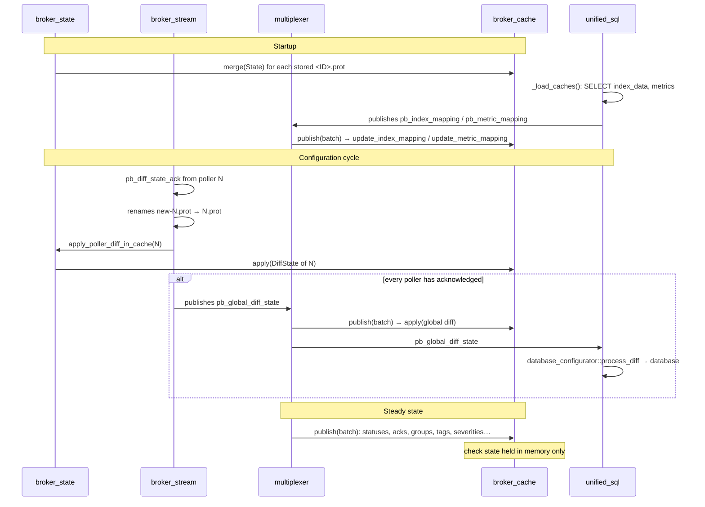

# SQL/storage streams

[← Previous](03-configuration-validation-en.md) · [Index](README-en.md) · [Next →](05-retention-rrd-en.md)

<!-- TOC -->
* [Feeding the cache](#feeding-the-cache)
* [What is persisted at shutdown](#what-is-persisted-at-shutdown)
  * [Content of the `.cache`](#content-of-the-cache)
  * [Compression of the `.cache`](#compression-of-the-cache)
  * [Re-injection at startup](#re-injection-at-startup)
  * [What is not persisted](#what-is-not-persisted)
* [Host `poller_id` population in the cache](#host-poller_id-population-in-the-cache)
  * [The problem](#the-problem)
  * [The fix — two complementary changes](#the-fix--two-complementary-changes)
  * [Why the global diff has no `poller_id`](#why-the-global-diff-has-no-poller_id)
* [*Legacy* mode](#legacy-mode)
* [Possible evolutions](#possible-evolutions)
<!-- TOC -->

These two streams have been deprecated in favor of the unified SQL stream. These streams do not work with BBDO 3
and are therefore unusable with centralized configuration.

It is therefore time to remove them, which will avoid issues with potential regressions.

Regarding *robot* tests, many are still based on these streams. Broker needs to start by default
with the unified SQL stream and the tests need to be adapted accordingly.

# Broker centralized cache

## Feeding the cache

The global cache (`broker_cache`) is owned by `config::applier::state` and
shared by every module of the process. Since the former stream caches stored
`neb::host`, `neb::service` and the like, it holds the same messages, in their
protobuf form (`pb_host`, `pb_service`, groups, severities, tags, mappings).
This forces conversions from the configuration, but the Lua stream exposes
these objects as they are and it is hard to do otherwise.

It is fed by three sources, in this order over the life of the process.

**1. The pollers' configuration.** It is what creates and removes objects. It
comes in two forms:

* a full `State`, applied by `merge()`, which replaces everything the poller
  defines. At startup, `broker_state` re-reads the stored `<poller_id>.prot`
  files and merges them one by one (`_merge_stored_config_in_cache`). Later
  on, a `pb_engine_state` sent by a restarting Engine is handled by
  unified_sql's `stream::_process_engine_state`, which does the `merge()` then
  rewrites the configuration to the database;
* a `DiffState` difference, applied by `apply()`. When a poller acknowledges
  its new configuration, `broker_stream` renames `new-<ID>.prot` to `<ID>.prot`
  then calls `broker_state::apply_poller_diff_in_cache()`. The cache thus
  follows the acknowledged difference **before** the global diff is published,
  so that whoever handles that global diff finds the cache already up to date.
  The difference is the only form that says what an export removed, hence its
  use instead of a `pb_engine_state`.

Both `merge()` and `apply()` recreate a host or service entry from the
configuration (`_fill_host`). The check state it carried is lost at that
moment, until the next status; see
[What is not persisted](#what-is-not-persisted).

**2. Events, through the multiplexer.** After handing a batch to the muxers,
the multiplexing engine calls `cache().publish(batch)`. The cache handles the
events that concern it itself, in `_publish()`: host and service statuses
(state, output, perfdata, `last_check`, flapping, notification counters…),
acknowledgements, severities, tags, groups and memberships, `index_mapping` and
`metric_mapping`, BAM dimensions, and the `pb_global_diff_state` global diff.
There is therefore no dedicated thread or subscription: the update is done on
the multiplexer's path, before the batch is handed to the notification driver
in `notification_mode=broker`, which relies on an already up-to-date cache.

**3. unified_sql, for the mappings.** `index_mapping` and `metric_mapping` are
not in the cache file: they live in the database, where PHP may also write. At
startup, `stream::_load_caches` reads them in SQL and **republishes** them as
`pb_index_mapping` / `pb_metric_mapping` events into the multiplexer. The cache
receives them through source 2, without issuing any SQL query itself, and the
neighbouring brokers connected over BBDO receive them too: a remote Lua stream
therefore has the `index_mapping`. The only direct write from unified_sql into
the cache is `update_host(pb_host)` in `_process_host`, on the BBDO2 path.



The global diff therefore reaches the cache twice: per poller at
acknowledgement, then as a whole through the multiplexer. `apply()` must stay
idempotent for that second pass to be a no-op.

## What is persisted at shutdown

`cbd` writes three files on a clean shutdown. None of them is rewritten
periodically: after a crash, the version from the last clean shutdown remains,
or there is no file at all on the very first start.

| File | Written by | Content | After a crash |
|---|---|---|---|
| `<cache_dir>.cache` | `~broker_cache` (`_save_cache`, called from `~state`) | `BrokerCache` protobuf message (`bbdo/neb.proto`), compressed with zstd by default, detailed below | version from the last clean shutdown; started downtimes, acks and notification states are therefore stale |
| `<pollers_config_dir>/topology.cache` | `~broker_state` (`save_topology_cache`) | `poller_id → remote_id` pairs, see [Topology persistence](06-remote-servers-en.md#topology-persistence) | missing or stale, not blocking: a mere hint |
| `<cache_dir>.cache.centreon-bam-monitoring` | `~monitoring_stream` (`_write_cache`) | BA/KPI states, see [Starting up, in both regimes](08-bam-en.md#starting-up-in-both-regimes) | version from the last clean shutdown |

### Content of the `.cache`

The `BrokerCache` message has fifteen sections. Five are reserved for
*legacy* mode: in centralized configuration the cache is rebuilt from the
pollers' `.prot` files, so they are neither written nor read. Two are declared
but dead: severities and tags are never serialized, in any mode. The other eight
are written and read back in both modes: they carry the state Broker owns and
that no configuration could rebuild.

| # | Section | Mode | What it carries |
|---|---|---|---|
| 1 | `instances` | legacy | pollers' `(id, name)` |
| 2 | `severities` | none | declared in the proto, **never written nor read** |
| 3 | `tags` | none | declared in the proto, **never written nor read** |
| 4 | `hosts` | legacy | full `Host` message, including check state |
| 5 | `services` | legacy | full `Service` message, including check state |
| 6 | `hostgroups` | legacy | group, pollers, members |
| 7 | `servicegroups` | legacy | group, pollers, members |
| 8 | `active_downtimes` | both | **started** downtimes (`is_in_effect()`), with their `comment_id` |
| 9 | `next_downtime_comment_id` | both | counter of the comments Broker creates (base `0x3FFFFFFF`) |
| 10 | `acknowledgements` | both | the map of live acknowledgements |
| 11 | `notification_states` | both | live notification chains: number, current id, last, next, events |
| 12 | `notification_overrides` | both | `notify` and `notification_period` toggles set by external command on a host or service |
| 13 | `contact_notification_overrides` | both | notification toggles and periods set on a contact |
| 14 | `poller_notification_overrides` | both | global `ENABLE/DISABLE_NOTIFICATIONS` per poller |
| 15 | `resource_ids` | both | event, problem and notification identifiers of the resources that have some, see `doc/engine-macros-en.md` |

Sections 8 and 11 are not fed by the cache itself but handed over by
`~broker_state`, just before the cache is destroyed: in-effect downtimes come
from `downtime_manager::get_scheduled_downtimes()` filtered on
`is_in_effect()`, notification states from
`notification_manager::snapshot_states()`, which keeps only non-empty chains.
Sections 9, 10, 12, 13 and 14 live in the cache permanently.
Section 15 too, in the `_resource_ids` table, apart from the host and service
entries: a configuration rebuilding an entry or a database row restoring it
leaves the identifiers alone, and read back they need no re-injection. A
resource removed from the configuration takes its identifiers away.

### Compression of the `.cache`

The file is compressed with zstd (level 1) unless the `cache_compression`
parameter of the `centreonBroker` section is `false`. It is `true` by default,
so PHP does not need to generate it. The parameter is held by
`config::applier::state`, the class that owns the cache, so it applies to cbd
and to cbmod alike.

A compressed file starts with a 6-byte header: the magic `\0CBC`, a format
version (1) and an algorithm (1 = zstd), followed by a zstd frame carrying a
checksum. A serialized protobuf message never starts with a null byte (field
number 0 does not exist), so the header cannot be mistaken for the start of a
plain file.

`_load_cache()` reads the header, **whatever the parameter is**:

* the header is there: the content is decompressed, then parsed;
* it is not: the file is parsed as a plain `BrokerCache`, as written by the
  previous versions or with `cache_compression: false`;
* unknown version or algorithm, truncated or corrupted file: an error is
  logged and the cache starts empty, as with a file that cannot be parsed.

The parameter only decides how `_save_cache()` writes. A version older than this
one cannot read a compressed file: it logs an error and starts with an empty
cache. To go back to such a version without losing the cache, set
`cache_compression` to `false` and restart Broker once beforehand.

On the cache file of a legacy platform (849 kB), zstd 1 gives 57 kB in 0.6 ms
(0.2 ms to decompress), where zlib 6 gives 75 kB in 5 ms. In centralized
configuration the file only carries the state Broker owns and stays small.
The library is the one of the system (`libzstd`), like `libcrypto` or `libz`.

### Re-injection at startup

`_load_cache()` runs in the cache constructor, before `_global_cache` is
assigned: it only stores sections 8 and 11 into `_pending_*` buffers.
Re-injection into the managers happens later, at one of two places depending on
the mode, and always **inside Broker**:

* *legacy* mode: `broker_state::_on_barrier_released()`;
* centralized configuration: unified_sql's `stream::_process_engine_state()`,
  after the `merge()` of the poller's configuration.

In both cases `broker_cache::reinject_pending()` runs, and each step is a no-op
when its manager is not loaded. The order is: downtimes
(`_reinject_pending_downtimes` →
`downtime_manager::reload_started_downtime`, which keeps the id and
`comment_id` then recomputes the depth), notification states
(`_reinject_pending_notification_states` → `notification_manager::restore()`),
acknowledgements (`_reinject_pending_acknowledgements`, which sets
`acknowledgement_type` back on the resource and publishes a
`pb_adaptive_*_status` for the database), then notification overrides.

**None of this goes back down to Engine.** In `notification_mode=broker`,
Engine is never told about acknowledgements or notification states; it does not
need them since Broker makes the decision. The only downstream messages are
`pb_diff_state`, `pb_notification_execute` and `pb_external_command`.

The cache file is also the **only** restoration source: Broker never re-reads
the `downtimes`, `acknowledgements`, `comments` tables nor the state columns of
`hosts`/`services`/`resources` at startup. unified_sql's `_load_caches` only
reads `instances`, `index_data`, `metrics`, the `resources` ids, `severities`
and `tags`.

### What is not persisted

* **The check state of resources** (state, `state_type`, attempt,
  `last_check`, output, perfdata, flapping history…). The cache holds it in
  memory through `update_host(pb_host_status)`, but in centralized configuration
  it is never written, and it is **lost on every `merge()`** since `_fill_host`
  recreates the entry from the configuration. It only survives in the database
  and in the poller's local `retention.dat`.
* **Future downtimes**, whose window has not started: they are neither in the
  cache nor re-read from the database. After a Broker restart, only the
  `downtimes` table keeps track of them.
* **Modified-attribute overrides** other than notification ones: active/passive
  check toggles, event handler, flap detection, obsess, changes of command,
  intervals, `max_attempts`, custom variables, anomalydetection sensitivity.
  The cache receives them through `pb_adaptive_host` but does not write them.

These three points are exactly what prevents removing the poller's
`retention.dat`; see [Potential issues to resolve](11-tickets-and-issues-en.md#potential-issues-to-resolve).

## Host `poller_id` population in the cache

### The problem

In the protobuf `State` message (sent by Engine as a `pb_engine_state` event),
the `poller_id` field is set at the **message level** — i.e., `state.poller_id()`
is non-zero and identifies the poller. However, the individual `Host` objects
embedded in `state.hosts()` do **not** carry their own `poller_id` field: they
only have `host_id`, `host_name`, and other host-specific attributes. The same
applies to `DiffHost` objects inside `DiffState` messages.

This matters because `broker_cache` stores hosts in a `_hosts` multi-index
container, and the cached `Host` objects must have a valid `instance_id`
(= `poller_id`) in order for the group-link removal logic in `apply()` to work
correctly. When a servicegroup or hostgroup is removed from a poller, the code
iterates over all service/host-group links and erases only those whose host
belongs to the affected poller, using the comparison:

```
host->obj().instance_id() == sgp.poller_id()
```

If `instance_id` is 0 because the host was never given a valid `poller_id`,
this comparison always fails and no links are ever removed.

### The fix — two complementary changes

**1. `_fill_host()` accepts a `poller_id_hint`**

The private helper `broker_cache::_fill_host()` now takes an optional
`poller_id_hint` parameter. When `cfg.poller_id() == 0` (which is always the
case for hosts coming from a `pb_engine_state`), the hint is used instead:

```cpp
uint64_t pid = cfg.poller_id() != 0 ? cfg.poller_id() : poller_id_hint;
```

`merge()` passes `state.poller_id()` as the hint:

```cpp
_fill_host(&h->mut_obj(), host, state.poller_id());
```

**2. `indexed_diff_state::add_diff_state()` stamps hosts with `poller_id`**

Before the global diff is published, `add_diff_state()` aggregates all
per-poller diffs. In both the full-state path and the differential path, the
key-builder lambda for hosts now explicitly calls `obj->set_poller_id(poller_id)`
before returning the host key:

```cpp
// Full state path
_add_message<Host, uint64_t>(
    diff_state.mutable_state()->mutable_hosts(), ...,
    [poller_id = diff_state.poller_id()](Host* obj) {
      obj->set_poller_id(poller_id);   // stamp before key extraction
      return obj->host_id();
    });

// Differential path
_add_diff_message<DiffHost, Host, uint64_t>(
    diff_state.mutable_hosts(), ...,
    [poller_id = diff_state.poller_id()](Host* obj) {
      obj->set_poller_id(poller_id);   // stamp before key extraction
      return obj->host_id();
    });
```

This ensures that the `Host` objects stored in the global diff already carry
a valid `poller_id`, so `apply()` can call `_fill_host()` without a hint and
still produce correctly-populated cache entries.

### Why the global diff has no `poller_id`

Note that the **global** `DiffState` (the one sent as `pb_global_diff_state`)
intentionally has `poller_id == 0` at the message level, because it
aggregates changes from multiple pollers. Each individual host object inside
this global diff carries its own `poller_id` (set by the stamping above), so
the per-host association is preserved even though the message-level id is
absent.

## *Legacy* mode

Without centralized configuration, the cache replaces the former stream caches
in a similar but not identical way: it may lose synchronization between a poller
and the central during a configuration update, for lack of an acknowledgement.

The differences with centralized mode come down to three points:

* **Source 1 is the poller itself.** A starting Engine sends its objects
  (`pb_instance`, `pb_host`, `pb_service`, groups…) and `_publish()` stores
  them; there is neither `.prot` nor `DiffState`.
* **The heavy sections are persisted.** Since nothing can rebuild the cache
  without the pollers, `_save_cache()` also writes sections 1 and 4 to 7
  (instances, hosts, services, groups) and `_load_cache()` reads them back.
  Severities and tags are not saved: a legacy restart loses them until the
  pollers send them again. In centralized mode these sections are rebuilt from the `.prot` files
  and ignored. Sections 8 to 14 are written and read back in both modes; see
  [What is persisted at shutdown](#what-is-persisted-at-shutdown).
* **Re-injection** of downtimes, notification states, acks and overrides
  happens in `broker_state::_on_barrier_released()`, not in
  `_process_engine_state`.

Sources 2 and 3 are identical in both modes.

## Possible evolutions

One evolution would be for the cache to become a full Broker module, hosted by
one broker, which neighbouring brokers would read and write through BBDO
messages. This makes sense with a broker cluster. Nothing has been started in
that direction: today, each `cbd` process has its own cache, fed by what flows
through its multiplexer.

The idea of transmitting the `index_mapping` to neighbouring brokers through
the multiplexer rather than writing into the cache from unified_sql is done,
see source 3 above.
