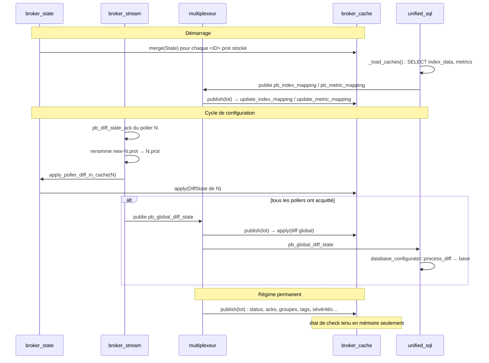

# Streams sql/storage

[← Précédent](03-configuration-validation-fr.md) · [Index](README-fr.md) · [Suivant →](05-retention-rrd-fr.md)

<!-- TOC -->
* [Alimentation du cache](#alimentation-du-cache)
* [Ce qui est persisté à l'arrêt](#ce-qui-est-persisté-à-larrêt)
  * [Contenu du `.cache`](#contenu-du-cache)
  * [Compression du `.cache`](#compression-du-cache)
  * [Réinjection au démarrage](#réinjection-au-démarrage)
  * [Ce qui n'est pas persisté](#ce-qui-nest-pas-persisté)
* [Renseignement du `poller_id` des hosts dans le cache](#renseignement-du-poller_id-des-hosts-dans-le-cache)
  * [Le problème](#le-problème)
  * [Le correctif — deux changements complémentaires](#le-correctif--deux-changements-complémentaires)
  * [Pourquoi le diff global n'a pas de `poller_id`](#pourquoi-le-diff-global-na-pas-de-poller_id)
* [Mode *legacy*](#mode-legacy)
* [Evolutions possibles](#evolutions-possibles)
<!-- TOC -->

Ces deux streams ont été dépréciés au profit du stream unifié SQL. Ces streams ne fonctionnent pas avec BBDO 3
et sont donc inutilisables avec la configuration centralisée.

Il est donc temps de les supprimer, cela évite des soucis avec de potentielles régressions.

Au niveau des tests *robot*, beaucoup sont encore basés sur ces streams. Il faut que Broker démarre par défaut
avec le stream unifié SQL et que les tests soient adaptés en conséquence.

# Cache centralisé Broker

## Alimentation du cache

Le cache global (`broker_cache`) est possédé par `config::applier::state` et
partagé par tous les modules du processus. Comme les anciens caches de stream
stockaient des `neb::host`, `neb::service` et consorts, il contient les mêmes
messages, sous leur forme protobuf (`pb_host`, `pb_service`, groupes, sévérités,
tags, mappings). Cela impose des conversions depuis la configuration, mais le
stream Lua expose ces objets tels quels et il est difficile de faire autrement.

Il est alimenté par trois sources, dans cet ordre au cours de la vie du
processus.

**1. La configuration des pollers.** C'est elle qui crée et supprime les
objets. Elle arrive sous deux formes :

* un `State` complet, appliqué par `merge()`, qui remplace tout ce que le poller
  définit. Au démarrage, `broker_state` relit les `<poller_id>.prot` stockés et
  les fusionne un à un (`_merge_stored_config_in_cache`). En cours de vie, un
  `pb_engine_state` envoyé par un Engine qui redémarre est traité par
  `stream::_process_engine_state` d'unified_sql, qui fait le `merge()` puis
  réécrit la configuration en base ;
* une différence `DiffState`, appliquée par `apply()`. Quand un poller acquitte
  sa nouvelle configuration, `broker_stream` renomme `new-<ID>.prot` en
  `<ID>.prot` puis appelle `broker_state::apply_poller_diff_in_cache()`. Le
  cache suit donc la différence acquittée **avant** que le diff global soit
  publié, de sorte que quiconque traite ce diff global trouve un cache déjà à
  jour. La différence est la seule forme qui dise ce qu'un export a retiré, d'où
  son emploi plutôt qu'un `pb_engine_state`.

`merge()` comme `apply()` recréent l'entrée d'un host ou d'un service à partir
de la configuration (`_fill_host`). L'état de check qu'elle portait est perdu à
ce moment-là, jusqu'au prochain status ; voir
[Ce qui n'est pas persisté](#ce-qui-nest-pas-persisté).

**2. Les événements, via le multiplexeur.** Après avoir distribué un lot aux
muxers, le moteur de multiplexing appelle `cache().publish(lot)`. Le cache
traite lui-même les événements qui le concernent, dans `_publish()` : status
d'hôte et de service (état, sortie, perfdata, `last_check`, flapping,
compteurs de notification…), acquittements, sévérités, tags, groupes et
adhésions, `index_mapping` et `metric_mapping`, dimensions BAM, et le diff
global `pb_global_diff_state`. Il n'y a donc ni thread ni abonnement dédié : la
mise à jour est faite dans le fil du multiplexeur, avant la remise du lot au
driver de notification en `notification_mode=broker`, qui compte sur un cache
déjà à jour.

**3. unified_sql, pour les mappings.** Les `index_mapping` et `metric_mapping`
ne sont pas dans le fichier de cache : ils vivent en base, où PHP peut aussi
écrire. Au démarrage, `stream::_load_caches` les lit en SQL et les **republie**
comme événements `pb_index_mapping` / `pb_metric_mapping` dans le multiplexeur.
Le cache les reçoit par la source 2, sans faire lui-même de requête SQL, et les
brokers voisins connectés en BBDO les reçoivent aussi : un stream Lua déporté
dispose donc de l'`index_mapping`. La seule écriture directe d'unified_sql dans
le cache est `update_host(pb_host)` dans `_process_host`, sur le chemin BBDO2.



Le diff global atteint donc le cache deux fois : par poller à l'acquittement,
puis en entier via le multiplexeur. `apply()` doit rester idempotent pour que
ce second passage soit sans effet.

## Ce qui est persisté à l'arrêt

Trois fichiers sont écrits par `cbd` à l'arrêt propre. Aucun n'est réécrit
périodiquement : un crash laisse la version du dernier arrêt propre, ou aucun
fichier au premier démarrage.

| Fichier | Écrit par | Contenu | Après un crash |
|---|---|---|---|
| `<cache_dir>.cache` | `~broker_cache` (`_save_cache`, appelé depuis `~state`) | message protobuf `BrokerCache` (`bbdo/neb.proto`), compressé en zstd par défaut, détaillé ci-dessous | version du dernier arrêt propre ; les downtimes démarrés, acks et états de notification sont donc périmés |
| `<pollers_config_dir>/topology.cache` | `~broker_state` (`save_topology_cache`) | paires `poller_id → remote_id`, voir [Persistance de la topologie](06-remote-servers-fr.md#persistance-de-la-topologie) | absent ou périmé, non bloquant : simple indice |
| `<cache_dir>.cache.centreon-bam-monitoring` | `~monitoring_stream` (`_write_cache`) | états des BA/KPI, voir [Le démarrage, dans les deux régimes](08-bam-fr.md#le-démarrage-dans-les-deux-régimes) | version du dernier arrêt propre |

### Contenu du `.cache`

Le message `BrokerCache` a quinze sections. Cinq sont réservées au mode
*legacy* : en configuration centralisée le cache est reconstruit à partir des
`.prot` des pollers, elles ne sont donc ni écrites ni lues. Deux sont déclarées
mais mortes : sévérités et tags ne sont jamais sérialisés, dans aucun mode. Les huit autres
sont écrites et relues dans les deux modes : elles portent l'état que Broker
possède en propre et qu'aucune configuration ne saurait reconstruire.

| # | Section | Mode | Ce qu'elle porte |
|---|---|---|---|
| 1 | `instances` | legacy | `(id, name)` des pollers |
| 2 | `severities` | aucun | déclarée dans le proto, **jamais écrite ni relue** |
| 3 | `tags` | aucun | déclarée dans le proto, **jamais écrite ni relue** |
| 4 | `hosts` | legacy | message `Host` complet, dont l'état de check |
| 5 | `services` | legacy | message `Service` complet, dont l'état de check |
| 6 | `hostgroups` | legacy | groupe, pollers, membres |
| 7 | `servicegroups` | legacy | groupe, pollers, membres |
| 8 | `active_downtimes` | les deux | downtimes **démarrés** (`is_in_effect()`), avec leur `comment_id` |
| 9 | `next_downtime_comment_id` | les deux | compteur des commentaires fabriqués par Broker (base `0x3FFFFFFF`) |
| 10 | `acknowledgements` | les deux | la map des acquittements vivants |
| 11 | `notification_states` | les deux | chaînes de notification vivantes : numéro, id courant, dernière, prochaine, événements |
| 12 | `notification_overrides` | les deux | bascules `notify` et `notification_period` posées par commande externe sur un host ou un service |
| 13 | `contact_notification_overrides` | les deux | bascules et périodes de notification posées sur un contact |
| 14 | `poller_notification_overrides` | les deux | `ENABLE/DISABLE_NOTIFICATIONS` global par poller |
| 15 | `resource_ids` | les deux | identifiants d'événement, de problème et de notification des ressources qui en ont, voir `doc/engine-macros-fr.md` |

Les sections 8 et 11 ne sont pas alimentées par le cache lui-même mais remises
par `~broker_state`, juste avant la destruction du cache : les downtimes en
cours viennent de `downtime_manager::get_scheduled_downtimes()` filtrés sur
`is_in_effect()`, les états de notification de
`notification_manager::snapshot_states()`, qui ne garde que les chaînes non
vides. Les sections 9, 10, 12, 13 et 14 vivent dans le cache en permanence.
La section 15 aussi, dans la table `_resource_ids`, à part des entrées hôtes
et services : une configuration qui reconstruit une entrée ou une ligne de base
qui la restaure ne touche pas aux identifiants, et relus, ils n'ont pas besoin
de réinjection. Une ressource retirée de la configuration emporte ses
identifiants.

### Compression du `.cache`

Le fichier est compressé en zstd (niveau 1), sauf si le paramètre
`cache_compression` de la section `centreonBroker` vaut `false`. Il vaut `true`
par défaut, PHP n'a donc pas besoin de le générer. Le paramètre est porté par
`config::applier::state`, la classe qui possède le cache : il vaut donc aussi
bien pour cbd que pour cbmod.

Un fichier compressé commence par un en-tête de 6 octets : le magique `\0CBC`,
une version de format (1) et un algorithme (1 = zstd), suivis d'une trame zstd
munie d'une somme de contrôle. Un message protobuf sérialisé ne commence jamais
par un octet nul (le numéro de champ 0 n'existe pas) : l'en-tête ne peut donc
pas être pris pour le début d'un fichier brut.

`_load_cache()` lit l'en-tête, **quelle que soit la valeur du paramètre** :

* l'en-tête est là : le contenu est décompressé, puis parsé ;
* il n'y est pas : le fichier est parsé comme un `BrokerCache` brut, tel que
  l'écrivent les versions précédentes ou `cache_compression: false` ;
* version ou algorithme inconnu, fichier tronqué ou corrompu : une erreur est
  journalisée et le cache démarre vide, comme pour un fichier impossible à
  parser.

Le paramètre ne décide que de l'écriture par `_save_cache()`. Une version
antérieure à celle-ci ne sait pas lire un fichier compressé : elle journalise
une erreur et démarre avec un cache vide. Pour revenir à une telle version sans
perdre le cache, il faut passer auparavant `cache_compression` à `false` et
redémarrer Broker une fois.

Sur le fichier de cache d'une plateforme legacy (849 ko), zstd 1 donne 57 ko en
0,6 ms (0,2 ms pour décompresser), là où zlib 6 donne 75 ko en 5 ms. En
configuration centralisée, le fichier ne porte que l'état propre à Broker et
reste petit. La bibliothèque est celle du système (`libzstd`), comme `libcrypto`
ou `libz`.

### Réinjection au démarrage

`_load_cache()` s'exécute dans le constructeur du cache, avant que
`_global_cache` soit affecté : il ne fait que ranger les sections 8 et 11 dans
des tampons `_pending_*`. La réinjection dans les gestionnaires a lieu plus
tard, à deux endroits selon le mode, et toujours **à l'intérieur de Broker** :

* mode *legacy* : `broker_state::_on_barrier_released()` ;
* configuration centralisée : `stream::_process_engine_state()` d'unified_sql,
  après le `merge()` de la configuration du poller.

Dans les deux cas, `broker_cache::reinject_pending()` s'exécute, et chaque
étape ne fait rien si son gestionnaire n'est pas chargé. L'ordre est : downtimes
(`_reinject_pending_downtimes` →
`downtime_manager::reload_started_downtime`, qui conserve id et `comment_id`
puis recalcule la profondeur), états de notification
(`_reinject_pending_notification_states` → `notification_manager::restore()`),
acquittements (`_reinject_pending_acknowledgements`, qui remet
`acknowledgement_type` sur la ressource et publie un `pb_adaptive_*_status`
pour la base), puis overrides de notification.

**Rien de tout cela ne redescend vers Engine.** En `notification_mode=broker`,
Engine n'est jamais informé des acquittements ni des états de notification ;
il n'en a pas besoin puisque la décision est prise par Broker. Les seuls
messages descendants sont `pb_diff_state`, `pb_notification_execute` et
`pb_external_command`.

Le fichier de cache est aussi la **seule** source de restauration : Broker ne
relit jamais les tables `downtimes`, `acknowledgements`, `comments` ni les
colonnes d'état de `hosts`/`services`/`resources` au démarrage. `_load_caches`
d'unified_sql ne lit que `instances`, `index_data`, `metrics`, les ids de
`resources`, `severities` et `tags`.

### Ce qui n'est pas persisté

* **L'état de check des ressources** (état, `state_type`, tentative,
  `last_check`, sortie, perfdata, historique de flapping…). Le cache le tient
  en mémoire via `update_host(pb_host_status)`, mais en configuration
  centralisée il n'est jamais écrit, et il est **perdu à chaque `merge()`**
  puisque `_fill_host` recrée l'entrée depuis la configuration. Il ne survit que
  dans la base et dans le `retention.dat` local du poller.
* **Les downtimes futurs**, dont la fenêtre n'a pas commencé : ils ne sont ni
  dans le cache ni relus depuis la base. Après un redémarrage de Broker, seule la
  table `downtimes` en garde trace.
* **Les overrides d'attributs modifiés** autres que ceux de notification :
  bascules de checks actifs/passifs, event handler, flap detection, obsess,
  changements de commande, d'intervalles, de `max_attempts`, de custom
  variables, sensibilité des anomalydetection. Le cache les reçoit par
  `pb_adaptive_host` mais ne les écrit pas.

Ces trois points sont exactement ce qui empêche de supprimer le `retention.dat`
du poller ; voir [Soucis potentiels à résoudre](11-tickets-and-issues-fr.md#soucis-potentiels-à-résoudre).

## Renseignement du `poller_id` des hosts dans le cache

### Le problème

Dans le message protobuf `State` (envoyé par Engine sous forme d'événement
`pb_engine_state`), le champ `poller_id` est positionné au **niveau du message**
— c'est-à-dire que `state.poller_id()` est non nul et identifie le poller.
Cependant, les objets `Host` individuels contenus dans `state.hosts()` ne portent
**pas** leur propre champ `poller_id` : ils n'ont que `host_id`, `host_name` et
d'autres attributs spécifiques au host. Il en va de même pour les objets
`DiffHost` dans les messages `DiffState`.

C'est important car `broker_cache` stocke les hosts dans un conteneur multi-index
`_hosts`, et les objets `Host` mis en cache doivent avoir un `instance_id`
(= `poller_id`) valide pour que la logique de suppression des liens de groupe dans
`apply()` fonctionne correctement. Quand un servicegroup ou un hostgroup est
supprimé d'un poller, le code itère sur tous les liens service/host-group et
n'efface que ceux dont le host appartient au poller concerné, via la comparaison :

```
host->obj().instance_id() == sgp.poller_id()
```

Si `instance_id` vaut 0 parce que le host n'a jamais reçu de `poller_id` valide,
cette comparaison échoue toujours et aucun lien n'est jamais supprimé.

### Le correctif — deux changements complémentaires

**1. `_fill_host()` accepte un `poller_id_hint`**

Le helper privé `broker_cache::_fill_host()` accepte désormais un paramètre
optionnel `poller_id_hint`. Quand `cfg.poller_id() == 0` (ce qui est toujours le
cas pour les hosts provenant d'un `pb_engine_state`), le hint est utilisé à la
place :

```cpp
uint64_t pid = cfg.poller_id() != 0 ? cfg.poller_id() : poller_id_hint;
```

`merge()` passe `state.poller_id()` comme hint :

```cpp
_fill_host(&h->mut_obj(), host, state.poller_id());
```

**2. `indexed_diff_state::add_diff_state()` estampille les hosts avec `poller_id`**

Avant la publication du diff global, `add_diff_state()` agrège tous les diffs
par poller. Sur le chemin full-state comme sur le chemin différentiel, le lambda
de construction de clé pour les hosts appelle désormais explicitement
`obj->set_poller_id(poller_id)` avant de retourner la clé :

```cpp
// Chemin full-state
_add_message<Host, uint64_t>(
    diff_state.mutable_state()->mutable_hosts(), ...,
    [poller_id = diff_state.poller_id()](Host* obj) {
      obj->set_poller_id(poller_id);   // estampillage avant extraction de la clé
      return obj->host_id();
    });

// Chemin différentiel
_add_diff_message<DiffHost, Host, uint64_t>(
    diff_state.mutable_hosts(), ...,
    [poller_id = diff_state.poller_id()](Host* obj) {
      obj->set_poller_id(poller_id);   // estampillage avant extraction de la clé
      return obj->host_id();
    });
```

Cela garantit que les objets `Host` stockés dans le diff global portent déjà un
`poller_id` valide, de sorte qu'`apply()` peut appeler `_fill_host()` sans hint
et produire quand même des entrées de cache correctement renseignées.

### Pourquoi le diff global n'a pas de `poller_id`

Le **diff global** (celui envoyé en tant que `pb_global_diff_state`) a
intentionnellement `poller_id == 0` au niveau du message, car il agrège des
changements provenant de plusieurs pollers. Chaque objet host individuel dans ce
diff global porte son propre `poller_id` (positionné par l'estampillage ci-dessus),
de sorte que l'association par host est préservée même si l'identifiant au niveau
du message est absent.

## Mode *legacy*

Sans configuration centralisée, le cache remplace les anciens caches de stream de
manière analogue, mais pas à l'identique : il peut perdre la synchronisation
entre un poller et le central pendant une mise à jour de configuration, faute
d'acquittement.

Les différences avec le mode centralisé tiennent en trois points :

* **La source 1 est le poller lui-même.** Un Engine qui démarre envoie ses
  objets (`pb_instance`, `pb_host`, `pb_service`, groupes…) et c'est
  `_publish()` qui les range, il n'y a ni `.prot` ni `DiffState`.
* **Les sections lourdes sont persistées.** Comme rien ne permet de reconstruire
  le cache sans les pollers, `_save_cache()` écrit aussi les sections 1 et 4 à 7
  (instances, hosts, services, groupes) et `_load_cache()` les relit. Sévérités
  et tags ne sont pas sauvegardés : un redémarrage legacy les perd jusqu'au
  prochain envoi par les pollers. En centralisé, ces sections sont reconstruites depuis les `.prot` et
  ignorées. Les sections 8 à 14 sont écrites et relues dans les deux modes ; voir
  [Ce qui est persisté à l'arrêt](#ce-qui-est-persisté-à-larrêt).
* **La réinjection** des downtimes, états de notification, acks et overrides a
  lieu dans `broker_state::_on_barrier_released()`, et non dans
  `_process_engine_state`.

Les sources 2 et 3 sont identiques dans les deux modes.

## Evolutions possibles

Une évolution serait que le cache devienne un module Broker à part entière,
porté par un broker, auquel les brokers voisins accéderaient en lecture et en
écriture par messages BBDO. Cette solution prend son sens avec un cluster de
brokers. Rien n'est engagé dans cette direction : aujourd'hui, chaque processus
`cbd` a son propre cache, alimenté par ce qui transite dans son multiplexeur.

L'idée de transmettre l'`index_mapping` aux brokers voisins par le multiplexeur
plutôt que d'écrire dans le cache depuis unified_sql est réalisée, voir la
source 3 ci-dessus.
