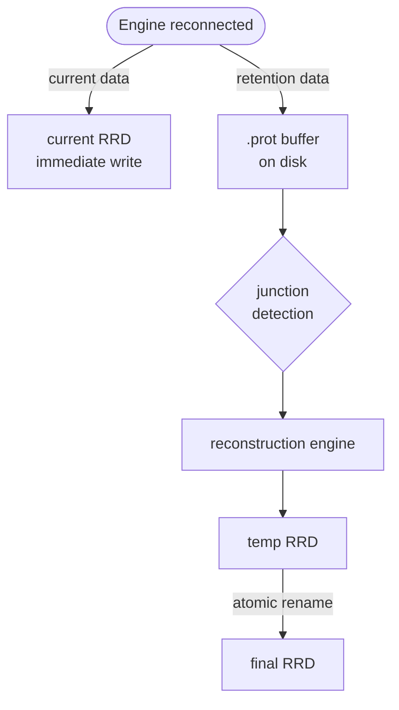
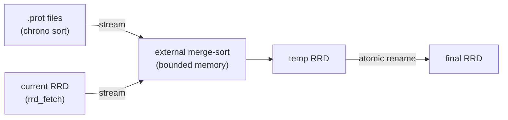
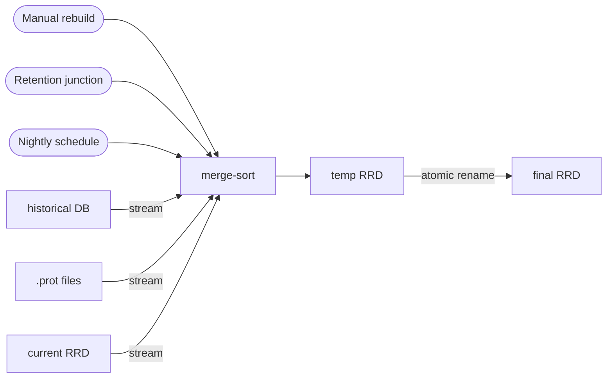
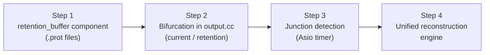

# Retention and RRD stream

[← Previous](04-centralized-cache-en.md) · [Index](README-en.md) · [Next →](06-remote-servers-en.md)

<!-- TOC -->
* [Current problem](#current-problem)
* [Proposed architecture](#proposed-architecture)
  * [Overview](#overview)
  * [Phase 1: Reconnection](#phase-1-reconnection)
  * [Phase 2: Junction detection](#phase-2-junction-detection)
  * [Phase 3: Merge via the reconstruction engine](#phase-3-merge-via-the-reconstruction-engine)
* [Buffer format](#buffer-format)
  * [`.prot` files](#prot-files)
  * [Merge triggers](#merge-triggers)
* [Multiple disconnections](#multiple-disconnections)
* [Integration with the existing rebuild](#integration-with-the-existing-rebuild)
* [Edge cases](#edge-cases)
  * [Retention exceeded](#retention-exceeded)
  * [Broker crash during merge](#broker-crash-during-merge)
  * [Broker crash during buffering](#broker-crash-during-buffering)
* [Concurrency](#concurrency)
* [Migration plan](#migration-plan)
  * [Step 1 — `retention_manager` component ✅ implemented](#step-1--retention_manager-component--implemented)
  * [Step 2 — Bifurcation in `stream.cc` ✅ implemented](#step-2--bifurcation-in-streamcc--implemented)
  * [Step 3 — Junction detection ✅ implemented](#step-3--junction-detection--implemented)
    * [Progressive partial merge](#progressive-partial-merge)
  * [Step 4 — Unified reconstruction engine ✅ implemented](#step-4--unified-reconstruction-engine--implemented)
<!-- TOC -->

## Current problem

When an Engine is disconnected for a long period (e.g. one week), it accumulates
retention data. Upon reconnection, Broker receives this data in the order Engine
emitted it — oldest first. Throughout the entire transmission of the retention
data, current data is not visible.

This behaviour raises two distinct problems:

1. **Visibility**: current data (real-time monitoring state) only reaches Broker
   once all retention data has been transmitted.
2. **RRD writing**: RRD requires data to be inserted in strictly chronological
   order. Any value older than the last written timestamp is silently rejected.
   It is therefore impossible to insert past data once recent data has been
   written.

## Proposed architecture

### Overview

The central idea is to split the data stream into two channels as soon as Engine
reconnects:



Current data is written immediately to the live RRD, guaranteeing visibility
without delay. Retention data is stored in an intermediate buffer (memory-first,
spilling to disk if needed) and merged in later.

### Phase 1: Reconnection

```mermaid
gantt
    dateFormat X
    axisFormat %s
    section Current RRD
        normal data      : 0, 10
        empty (gap)      : crit, 10, 20
        current data     : 20, 30
    section .prot buffer
        buffered retention data : active, 10, 20
```



- The current RRD contains data from before the disconnection and current data
  (after reconnection). The disconnection period remains a gap in the RRD.
- The `.prot` buffer accumulates data from the disconnection period as Engine
  retransmits it.

### Phase 2: Junction detection

The junction is reached when the last data point in the buffer and the first
post-reconnection data point in the current RRD are at most one step apart
(configurable, default 5 minutes):

```mermaid
gantt
    dateFormat X
    axisFormat %s
    section .prot buffer
        retention data   : 10, 19
    section Current RRD
        current data     : 20, 30
    section Junction
        gap ≤ step       : milestone, 19, 20
```



This condition is reliable because the step is statically known for each metric.

### Phase 3: Merge via the reconstruction engine

Once the junction is detected (or on an external trigger), the reconstruction
engine produces a new complete RRD file:



The external merge-sort guarantees bounded memory consumption regardless of the
amount of buffered data: each source is read sequentially; only the head of each
stream is in memory at any given time.

## Buffer format

### `.prot` files

The buffer uses *length-delimited* protobuf messages written in *append* mode.
`storage::pb_metric` and `storage::pb_status` events received by the RRD module
are large; before being stored in the buffer they are converted into compact
protobuf messages defined in a file internal to the RRD module
(`broker/rrd/proto/rrd_retention.proto`) — this format is never transmitted over
the network:

```protobuf
message MetricRetentionPoint {
  uint64 time  = 1;
  double value = 2;
}

message StatusRetentionPoint {
  uint64 time   = 1;
  uint32 status = 2;
}

// Each on-disk .prot file contains exactly one of these batch messages.
message MetricRetentionBatch {
  repeated MetricRetentionPoint points = 1;
}

message StatusRetentionBatch {
  repeated StatusRetentionPoint points = 1;
}
```

Points accumulate in an **in-memory protobuf batch** (`MetricRetentionBatch` or
`StatusRetentionBatch`). The batch is only serialised to disk when it reaches
the configured rotation threshold or when the manager is destroyed (graceful
shutdown). Each on-disk `.prot` file therefore contains exactly one batch
message.

The `retention_manager` creates **one `.prot` file per metric and per status**,
co-located with the `.rrd` files:

- `<metric_id>.prot` in `metrics_path` for metrics
- `<index_id>.prot` in `status_path` for statuses

This per-identifier organisation is essential for the merge (Step 4): at the
junction of metric X, only the rotation files for X are opened, without
scanning unrelated data.

Files are stored alongside the `.rrd` files in the RRD broker's `metrics_path`
and `status_path` directories (JSON parameters, production values e.g.
`/var/lib/centreon/metrics` and `/var/lib/centreon/status`):

```
{metrics_path}/<metric_id>.prot              ← graceful-shutdown flush
{metrics_path}/<metric_id>.<ts>.prot         ← rotated, immutable, awaiting merge
{status_path}/<index_id>.prot
{status_path}/<index_id>.<ts>.prot
```

Example in production:

```
/var/lib/centreon/metrics/42.prot
/var/lib/centreon/metrics/42.1735000000.prot
/var/lib/centreon/status/7.prot
```

Rotation is triggered when the combined number of points in the in-memory batch
reaches `retention_buffer_max_pending_points` (default: **144**, i.e. 12 hours
at one point per 5 minutes). The Unix timestamp is inserted before `.prot` in
rotated file names.

A file is **immutable** once rotated: it can be read as a stream during the merge
without locking. After a successful merge, the corresponding `.prot` files are
deleted.

### Merge triggers

| Trigger | Description |
|---|---|
| Junction detected | Buffer has caught up with the current RRD (gap ≤ step) |
| File count | Number of rotated files reaches `retention_buffer_max_files` (default: 5) |
| Schedule | Low-load nightly merge |
| Manual | Explicit administration command |

The `retention_buffer_max_files` parameter is read from the RRD endpoint JSON
block (like `cache_size`). When the number of rotated files for a metric reaches
this limit, a partial merge is triggered immediately to free space before buffering
continues.

## Multiple disconnections

If an Engine disconnects several times, gaps accumulate in the buffer without
creating extra files: the buffer accepts all gaps in the same
`(metric_id, timestamp, value)` structure, regardless of how many there are.

```mermaid
gantt
    dateFormat X
    axisFormat %s
    section Current RRD
        active : 0,  5
        active : 10, 15
        active : 20, 25
        active : 30, 35
    section .prot buffer
        gap 1  : active, 5,  10
        gap 2  : active, 15, 20
        gap 3  : active, 25, 30
```



The merge remains a single operation: all data in the buffer (all gaps combined)
is merged with the current RRD in a single pass.

## Integration with the existing rebuild

The current RRD rebuild and the retention merge are structurally identical: both
create a temporary RRD, write in chronological order from multiple sources, then
perform an atomic rename. They therefore share the same **reconstruction engine**:



Practical consequence: a manually triggered rebuild **automatically absorbs** the
pending `.prot` files for the affected metrics. There is no separate code path to
maintain.

## Edge cases

### Retention exceeded

If the disconnection period exceeds the RRD archive duration (e.g. 3-month
disconnection for a 1-month RRD), the junction can never be reached. In that case:

- There is no point storing data that is too old; it is discarded immediately.
- When the buffer is merged, a few data points may fall outside the RRD window
  (they will be ignored by RRD but do not cause errors).
- The `.prot` files are deleted after the merge, whether complete or partial.

### Broker crash during merge

The atomic rename guarantees that a crash during the merge leaves the system in a
consistent state: either the old RRD is intact, or the new one is in place. The
`.prot` files are only deleted after a successful rename.

### Broker crash during buffering

If Broker crashes while retention data is being buffered (outside of a merge),
the `.prot` files are on disk but the in-memory state is lost. Full reconstruction
is possible without any separate metadata file.

| Lost state | Reconstruction source |
|---|---|
| `last_retention_time[id]` | last record of the metric's last `.prot` file |
| `earliest_current_time[id]` | no need to recover — reset when first current data point arrives |
| `last_partial_merge[id]` | first record of the metric's oldest `.prot` file − 1 step |

**Potentially truncated current file**

A crash mid-write may leave the current file with an incomplete trailing protobuf
message. On startup, Broker repairs each current file: it reads it sequentially
up to the last *complete* message (the length-delimited format makes truncation
detectable) then truncates the file at that offset. Rotated files are always
intact by definition (immutable once rotated).

**Startup algorithm**

```
for each metric that has .prot files:
  1. repair the current file if needed (truncate to last valid message)
  2. read the last record → last_retention_time
  3. last_partial_merge = first record of oldest file − step
  4. check the junction condition immediately
     (may have been reached before the crash)
```

`earliest_current_time` is reset to "unknown"; junction detection resumes
naturally as soon as the first current data point arrives.

**In-memory data not yet flushed to disk**

Because the buffer is memory-first, data received but not yet written to disk at
the time of the crash is permanently lost. This data is retention data — already
in the past — whose absence slightly widens the gap in the graph without affecting
real-time monitoring. This trade-off is acceptable: a synchronous flush after each
record would be too costly, and a periodic flush would add complexity for a
marginal benefit on data that is offline by definition.

## Concurrency

The `retention_buffer` is accessed from two concurrent paths:

- **Write path**: data reception from `output::write()` (muxer thread)
- **Merge path**: reading `.prot` files and reconstructing the RRD (Asio thread
  via `asio::post`)

The fundamental property that simplifies synchronisation is that **rotated files
are immutable**: the write path always writes to the *current* file for a metric,
while the merge path always reads *rotated* files. These two operations never
contend for the same file — except at rotation time.

**Model: per-metric mutex**

```cpp
struct MetricRetentionState {
  absl::Mutex           mutex;
  int                   current_fd;
  uint64_t              last_retention_time;
  uint64_t              earliest_current_time;
  uint64_t              last_partial_merge;
  std::vector<fs::path> rotated_files;  // immutable, readable without lock
};
```

- **Write path**: acquires the mutex, appends to `current_fd`, updates timestamps,
  checks the junction condition, releases. Critical section: a few microseconds.
- **Merge trigger**: acquires the mutex, performs rotation (closes `current_fd`,
  adds it to `rotated_files`, opens a new file), releases immediately. Then reads
  `rotated_files` **without holding the lock** (immutable). The critical section
  is limited to the rotation, not the duration of the merge.
- **After merge**: acquires the mutex, updates `last_partial_merge`, deletes the
  merged files, releases.

Lock contention is therefore limited to a few microseconds per rotation. The merge
itself (potentially several seconds for large files) runs entirely without any lock.

## Migration plan

The transformation of the current RRD module into this new architecture is carried
out in four sequential steps, summarised in the following diagram:



No protocol change is required: Broker determines itself whether a data point is
retention by comparing its timestamp to `now - step[id]`. If the timestamp is
older than this threshold, the data point is treated as retention and routed to
the buffer; otherwise it goes directly to the RRD.

**Origin of `step` and `rrd_len`**

The RRD module has no database access. Both values are carried directly by the
`pb_metric` and `pb_status` events via the `interval()` and `rrd_len()` fields.
From the very first event received for a metric, `step[id]` and `rrd_len[id]` are
known and stored in the `MetricRetentionState`. After a crash and restart, these
values are recovered from the first event received for each metric — no additional
persistence is required.

### Step 1 — `retention_manager` component ✅ implemented

The component `broker/rrd/src/retention_manager.cc` (+ `.hh`) is responsible
for:

- Accumulating `MetricRetentionPoint` / `StatusRetentionPoint` data points into
  in-memory protobuf batches (`MetricRetentionBatch` / `StatusRetentionBatch`),
  one batch per metric/status identifier.
- Flushing a batch to a rotated `.prot` file when the combined point count
  reaches `retention_buffer_max_pending_points` (default: **144**). This
  parameter is read from the RRD endpoint JSON configuration.
- Serialising remaining in-memory batches to disk on graceful shutdown
  (`~retention_manager()`), so no data is lost across restarts.
- Scanning `metrics_path` and `status_path` on `init()` to recover files left
  by a previous instance (crash recovery).
- Keeping `last_activity_time` per identifier to detect and clean up orphan
  buffers after `retention_buffer_orphan_interval` seconds of inactivity.
- Keeping in memory the latest timestamp received per `metric_id` (and per
  `index_id` for statuses) to enable junction detection (Step 3).
- Storing `step[id]` on receipt of the first event for a metric.

This component is tested independently with synthetic data in
`broker/rrd/test/retention_manager.cc`.

### Step 2 — Bifurcation in `stream.cc` ✅ implemented

The `write()` method of `stream<T>` routes each data point based on its age
relative to `now - step`, where `step` is always available from the event itself
(`pb_metric::interval()` / `pb_status::interval()`):

- `timestamp ≥ now - step` → **current** path: write directly to the RRD
  backend.  Record `_metric_earliest_current[id]` (or
  `_status_earliest_current[id]`) = earliest current timestamp seen for this
  identifier since the stream was instantiated.  This value is used by Step 3
  to detect the junction.
- `timestamp < now - step` → **old / backfill** data: route to the
  `retention_manager` only.  The RRD backend is **not** called.

The bifurcation applies to both `storage::pb_metric` / `storage::pb_status`
(protobuf) and the legacy `storage::metric` / `storage::status` events.

`_metric_earliest_current[id]` is cleared on `_do_metric_merge()` (gap filled)
and on remove-graph events.  `cleanup_orphans()` is called from `update()`
(invoked on SIGHUP).

Requires Step 1.

### Step 3 — Junction detection ✅ implemented

Detection is **event-driven**: the check is performed inside `write()` on every
incoming data point, in O(1) via an `unordered_map` lookup. No periodic scan of
all metrics is needed.

Monitoring does not stop during downtimes: data is collected every 5 minutes
without interruption. Consequently, a large gap between two consecutive timestamps
in the retention stream (> 2 × `step`) is a reliable signal: it marks the
boundary between two distinct disconnection periods. This is the natural moment to
check the junction condition for the batch that has just ended.

The junction is reached as soon as one of these two conditions is true:

| Condition | Trigger |
|---|---|
| `last_retention[id] + step ≥ earliest_current[id]` | arrival of a current or retention data point for `id` |
| `last_retention[id] + step ≥ now` | arrival of a retention data point (no current data known yet) |

A third trigger covers batch endings: when a retention data point shows a gap
`timestamp − last_retention[id] > 2 × step`, the previous batch is finished; the
conditions above are checked immediately against `last_retention[id]` before
updating the value.

#### Progressive partial merge

When the retention backlog is large (disconnection of several days or weeks),
waiting for the full junction before triggering the merge means the user sees no
graph reconstruction during the entire catch-up period.

To address this, a **partial merge** is triggered as soon as the buffer for a
metric covers a complete slice of configurable duration (default: 1 day) since the
last merge (or since the start of buffering). Each processed slice produces a valid
RRD immediately visible; the user sees the graph rebuild day by day as data is
received.

This trigger is handled by the same event-driven mechanism: on each incoming
retention data point, check whether
`last_retention[id] − last_partial_merge[id] ≥ partial_merge_interval`.

The reconstruction engine (Step 4) must therefore support partial merges: merging
only the `.prot` files covering the slice
`[last_partial_merge[id], last_partial_merge[id] + partial_merge_interval]`
without waiting for the complete buffer to be available.

When a junction or partial merge is detected, the merge is triggered asynchronously
via `asio::post` so as not to block the write path.

A cleanup timer handles only **orphan buffers**: metrics whose retention is present
but for which no data has arrived for more than `retention_buffer_orphan_interval`
seconds (host deleted, metric disabled…). Its role is to free resources, not to
detect junctions. It fires at the same period `retention_buffer_orphan_interval`.

This parameter is read from the RRD endpoint JSON block (like `cache_size`), with
a default value of **3600 seconds** (1 hour). If the key is absent from the
configuration file, this default applies.

Requires Step 2.

### Step 4 — Unified reconstruction engine ✅ implemented

Extend the existing RRD rebuild mechanism (START / DATA / END sequence) to accept
as input either:

- A manually triggered rebuild (current behaviour), or
- The result of a detected junction (Step 3).

In both cases, the engine:

1. Reads the relevant `.prot` files in chronological order (external merge-sort
   with bounded memory).
2. Merges with the data already in the current RRD via `rrd_fetch`.
3. Writes a new temporary RRD file in strictly increasing order.
4. Atomically substitutes the new RRD for the old one via `rename(2)`.
5. Deletes the merged `.prot` files.

The existing manual rebuild code path becomes a special case of this engine: no
visible change for users who trigger a rebuild via the interface.

**librrd / rrdcached compatibility**

The RRD module supports two backends: `librrd` (direct writes) or `rrdcached`
(writes via a daemon that batches updates). The reconstruction engine must adapt
its behaviour depending on the active backend:

| Step | librrd | rrdcached |
|---|---|---|
| Before `rrd_fetch` (step 2) | nothing | `FLUSH <path>` — forces rrdcached to write pending data to disk |
| After `rename(2)` (step 4) | nothing | `FORGET <old_path>` — purges rrdcached's internal queue for the old path |

Without `FLUSH`, `rrd_fetch` would read an incomplete file (recent data still in
rrdcached's memory buffer). Without `FORGET`, rrdcached would attempt to write to
a non-existent or incorrect path after the rename.

The existing rebuild mechanism likely already handles `FLUSH`; `FORGET` after
rename is the point to verify during implementation.
