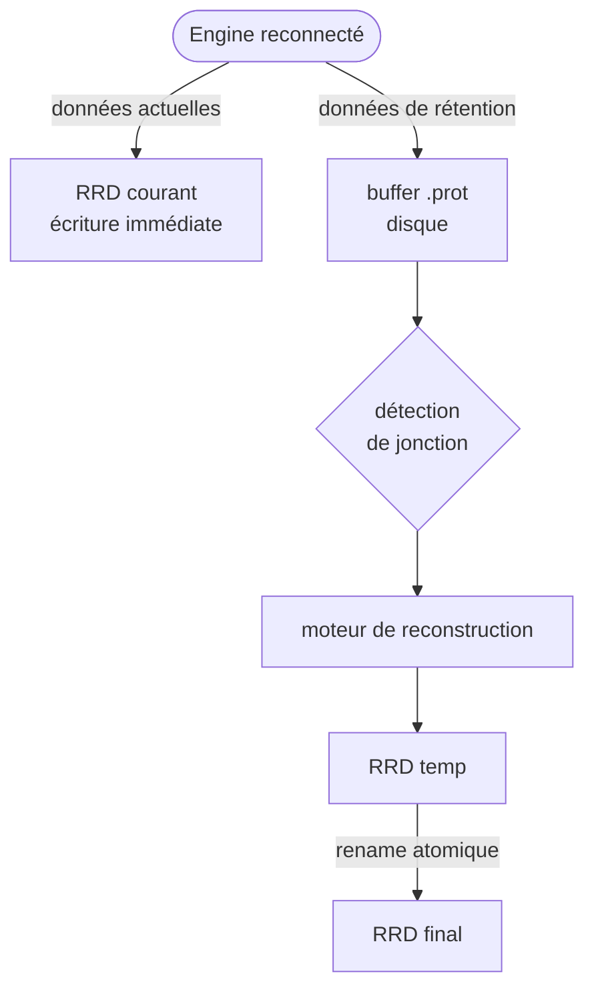
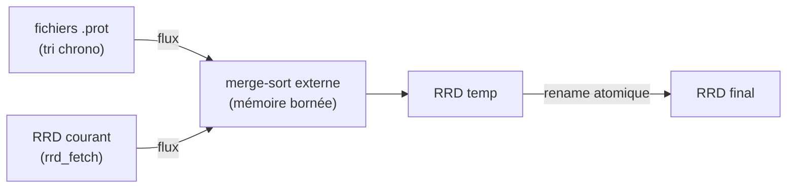
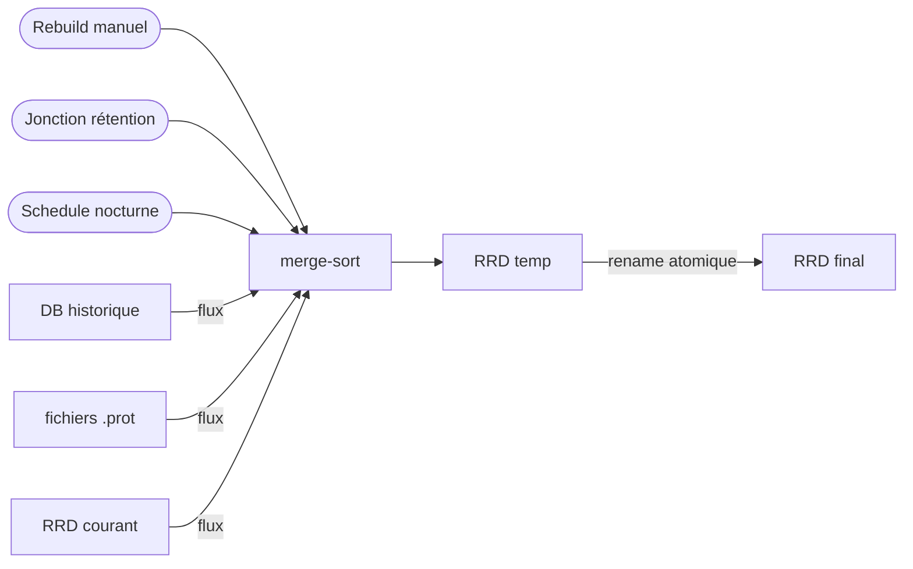
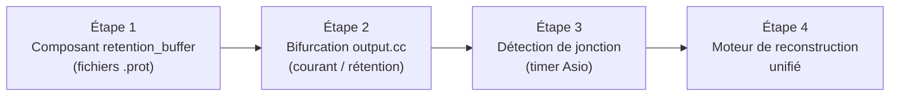

# Rétention et stream RRD

[← Précédent](04-centralized-cache-fr.md) · [Index](README-fr.md) · [Suivant →](06-remote-servers-fr.md)

<!-- TOC -->
* [Problème actuel](#problème-actuel)
* [Architecture proposée](#architecture-proposée)
  * [Vue d'ensemble](#vue-densemble)
  * [Phase 1 : Reconnexion](#phase-1--reconnexion)
  * [Phase 2 : Détection de la jonction](#phase-2--détection-de-la-jonction)
  * [Phase 3 : Merge via le moteur de reconstruction](#phase-3--merge-via-le-moteur-de-reconstruction)
* [Format du buffer](#format-du-buffer)
  * [Fichiers `.prot`](#fichiers-prot)
  * [Déclencheurs du merge](#déclencheurs-du-merge)
* [Gestion des déconnexions multiples](#gestion-des-déconnexions-multiples)
* [Intégration avec le rebuild existant](#intégration-avec-le-rebuild-existant)
* [Cas limites](#cas-limites)
  * [Rétention dépassée](#rétention-dépassée)
  * [Crash broker pendant le merge](#crash-broker-pendant-le-merge)
  * [Reprise après crash pendant le buffering](#reprise-après-crash-pendant-le-buffering)
* [Concurrence](#concurrence)
* [Plan de migration](#plan-de-migration)
  * [Étape 1 — Composant `retention_manager` ✅ implémenté](#étape-1--composant-retention_manager--implémenté)
  * [Étape 2 — Bifurcation dans `stream.cc` ✅ implémentée](#étape-2--bifurcation-dans-streamcc--implémentée)
  * [Étape 3 — Détection de jonction ✅ implémentée](#étape-3--détection-de-jonction--implémentée)
    * [Merge partiel progressif](#merge-partiel-progressif)
  * [Étape 4 — Moteur de reconstruction unifié ✅ implémentée](#étape-4--moteur-de-reconstruction-unifié--implémentée)
<!-- TOC -->

## Problème actuel

Lorsqu'un Engine est déconnecté pendant une longue période (ex. : une semaine), il
accumule des données en rétention. À la reconnexion, Broker reçoit ces données dans
l'ordre d'émission d'Engine, c'est-à-dire les plus anciennes en premier. Pendant
toute la durée de transmission de la rétention, les données actuelles ne sont pas
visibles.

Ce comportement pose deux problèmes distincts :

1. **Visibilité** : les données actuelles (état de monitoring en temps réel) ne
   parviennent à Broker qu'une fois toute la rétention transmise.
2. **Écriture RRD** : RRD impose que les données soient insérées en ordre
   chronologique strict. Toute valeur antérieure au dernier timestamp écrit est
   silencieusement rejetée. Il est donc impossible d'insérer des données dans le
   passé une fois que des données récentes ont été écrites.

## Architecture proposée

### Vue d'ensemble

L'idée centrale est de séparer le flux de données en deux canaux dès la reconnexion :



Les données actuelles sont écrites immédiatement dans le RRD courant, garantissant
leur visibilité sans délai. Les données de rétention sont stockées dans un buffer
intermédiaire en mémoire (et sur disque si besoin) et intégrées ultérieurement via
un merge.

### Phase 1 : Reconnexion

```mermaid
gantt
    dateFormat X
    axisFormat %s
    section RRD courant
        données normales   : 0, 10
        vide (trou)        : crit, 10, 20
        données actuelles  : 20, 30
    section Buffer .prot
        données de rétention en attente : active, 10, 20
```



- Le RRD courant contient les données d'avant la déconnexion et les données
  actuelles (après reconnexion). La période de déconnexion reste un trou dans le
  RRD.
- Le buffer `.prot` accumule les données de la période de déconnexion au fur et à
  mesure qu'Engine les retransmet.

### Phase 2 : Détection de la jonction

La jonction est atteinte lorsque la dernière donnée du buffer et la première donnée
post-reconnexion du RRD courant sont séparées d'au plus un step (paramétrable,
5 minutes par défaut) :

```mermaid
gantt
    dateFormat X
    axisFormat %s
    section Buffer .prot
        données de rétention : 10, 19
    section RRD courant
        données actuelles    : 20, 30
    section Jonction
        écart ≤ step         : milestone, 19, 20
```



Cette condition est fiable car le step est connu statiquement pour chaque métrique.

### Phase 3 : Merge via le moteur de reconstruction

Une fois la jonction détectée (ou sur déclencheur externe), le moteur de
reconstruction produit un nouveau fichier RRD complet :



Le merge-sort externe garantit une consommation mémoire bornée quelle que soit la
quantité de données en attente : chaque source est lue séquentiellement, seule la
tête de chaque flux est en mémoire à un instant donné.

## Format du buffer

### Fichiers `.prot`

Le buffer utilise des messages protobuf *length-delimited* écrits en *append* :

```protobuf
message MetricPoint {
  uint32 metric_id = 1;
  int64  timestamp = 2;
  double value     = 3;
}
```

Les fichiers sont co-localisés avec les fichiers `.rrd`, dans les répertoires
`metrics_path` et `status_path` de l'endpoint RRD (paramètres JSON) :

```
{metrics_path}/<metric_id>.prot              ← flush arrêt gracieux
{metrics_path}/<metric_id>.<ts>.prot         ← roté, immuable, en attente de merge
{status_path}/<index_id>.prot
{status_path}/<index_id>.<ts>.prot
```

Exemple en production :

```
/var/lib/centreon/metrics/42.prot
/var/lib/centreon/metrics/42.1735000000.prot
/var/lib/centreon/status/7.prot
```

La rotation se déclenche quand le nombre de points cumulé dans le batch en mémoire
atteint `retention_buffer_max_pending_points` (défaut : **144**, soit 12 heures à
un point toutes les 5 minutes). L'horodatage Unix est inséré avant `.prot` dans
le nom des fichiers rotatés.

Un fichier est **immuable** une fois roté : il peut être lu en streaming pendant le
merge sans verrouillage. Après un merge réussi, les fichiers `.prot` correspondants
sont supprimés.

### Déclencheurs du merge

| Déclencheur        | Description                                                                  |
|--------------------|------------------------------------------------------------------------------|
| Jonction détectée  | Buffer a rattrapé le RRD courant (écart ≤ step)                              |
| Nombre de fichiers | Nombre de fichiers rotatés atteint `retention_buffer_max_files` (défaut : 5) |
| Schedule           | Merge nocturne à faible charge                                               |
| Manuel             | Commande d'administration explicite                                          |

Le paramètre `retention_buffer_max_files` est lu dans le bloc JSON de l'endpoint
RRD (comme `cache_size`). Quand le nombre de fichiers rotatés d'une métrique
atteint cette limite, un merge partiel est déclenché immédiatement pour libérer
de l'espace avant de continuer le buffering.

## Gestion des déconnexions multiples

Si un Engine se déconnecte plusieurs fois, les trous s'accumulent dans le buffer
sans créer de fichiers supplémentaires : le buffer accueille tous les gaps dans
la même structure `(metric_id, timestamp, value)`, quel que soit leur nombre.

```mermaid
gantt
    dateFormat X
    axisFormat %s
    section RRD courant
        actif  : 0,  5
        actif  : 10, 15
        actif  : 20, 25
        actif  : 30, 35
    section Buffer .prot
        gap 1  : active, 5,  10
        gap 2  : active, 15, 20
        gap 3  : active, 25, 30
```



Le merge reste une opération unique : toutes les données du buffer (tous gaps
confondus) sont fusionnées avec le RRD courant en un seul passage.

## Intégration avec le rebuild existant

Le rebuild RRD actuel et le merge de rétention sont structurellement identiques :
tous deux créent un RRD temporaire, écrivent en ordre chronologique depuis des
sources multiples, puis effectuent un rename atomique. Ils partagent donc le même
**moteur de reconstruction** :



Conséquence pratique : un rebuild déclenché manuellement **absorbe automatiquement**
les fichiers `.buf` en attente pour les métriques concernées. Il n'y a pas de chemin
de code séparé à maintenir.

## Cas limites

### Rétention dépassée

Si la période de déconnexion est supérieure à la durée des archives RRD (ex. :
déconnexion de 3 mois pour un RRD avec 1 mois de rétention), la jonction ne peut
jamais être atteinte. Dans ce cas :

- inutile de stocker les données trop vieilles, elles sont directement jetées.
- Quand le buffer est mergé, peut-être qu'il reste quelques données hors de la fenêtre
  RRD (elles seront ignorées par RRD mais ne causent pas d'erreur)
- Les fichiers `.prot` sont supprimés après le merge, qu'il soit complet ou partiel

### Crash broker pendant le merge

Le rename atomique garantit qu'un crash pendant le merge laisse le système dans un
état cohérent : soit l'ancien RRD est intact, soit le nouveau est en place. Les
fichiers `.prot` ne sont supprimés qu'après un rename réussi.

### Reprise après crash pendant le buffering

Si Broker crashe alors que des données de rétention sont en cours de buffering
(hors merge), les fichiers `.prot` sont sur disque mais l'état en mémoire est
perdu. La reconstruction est entièrement possible sans fichier de métadonnées
séparé.

| État perdu                  | Source de reconstruction                                               |
|-----------------------------|------------------------------------------------------------------------|
| `last_retention_time[id]`   | dernier enregistrement du dernier `.prot` de la métrique               |
| `earliest_current_time[id]` | inutile à récupérer — réinitialisé à la première donnée courante reçue |
| `last_partial_merge[id]`    | premier enregistrement du plus vieux `.prot` de la métrique − 1 step   |

**Fichier courant potentiellement tronqué**

Un crash en pleine écriture peut laisser le fichier courant avec un dernier
message protobuf incomplet. Au démarrage, Broker répare chaque fichier courant :
il le lit séquentiellement jusqu'au dernier message *complet* (le format
length-delimited permet de détecter l'incomplétude) puis tronque le fichier à cet
offset. Les fichiers rotatés sont toujours intacts par définition (immuables dès
la rotation).

**Algorithme de démarrage**

```
pour chaque métrique ayant des fichiers .prot :
  1. réparer le fichier courant si nécessaire (truncate au dernier message valide)
  2. lire le dernier enregistrement → last_retention_time
  3. last_partial_merge = premier enregistrement du plus vieux fichier − step
  4. vérifier immédiatement la condition de jonction
     (peut-être atteinte avant le crash)
```

`earliest_current_time` est réinitialisé à « inconnu » ; la détection de jonction
reprend naturellement dès la première donnée courante reçue.

**Données en mémoire non encore flushées**

Le buffer étant memory-first, les données reçues mais pas encore écrites sur disque
au moment du crash sont définitivement perdues. Il s'agit de données de rétention
— donc déjà dans le passé — dont l'absence agrandit légèrement le trou dans le
graphe sans affecter le monitoring en temps réel. Ce compromis est acceptable : un
flush synchrone après chaque enregistrement serait trop coûteux, et un flush
périodique ajouterait de la complexité pour un bénéfice marginal sur des données
qui sont de toute façon hors ligne.

## Concurrence

Le `retention_buffer` est accédé depuis deux chemins simultanés :

- **Write path** : réception de données depuis `output::write()` (thread du muxer)
- **Merge path** : lecture des fichiers `.prot` et reconstruction du RRD (thread
  Asio via `asio::post`)

La propriété fondamentale qui simplifie la synchronisation est que les **fichiers
rotatés sont immuables** : le write path écrit toujours dans le fichier *courant*
de la métrique, le merge path lit toujours les fichiers *rotatés*. Ces deux
opérations ne se disputent jamais le même fichier — sauf au moment de la rotation.

**Modèle : mutex par métrique**

```cpp
struct MetricRetentionState {
  absl::Mutex           mutex;
  int                   current_fd;
  uint64_t              last_retention_time;
  uint64_t              earliest_current_time;
  uint64_t              last_partial_merge;
  std::vector<fs::path> rotated_files;  // immuables, lisibles sans lock
};
```

- **Write path** : acquiert le mutex, append dans `current_fd`, met à jour les
  timestamps, vérifie la condition de jonction, relâche. Section critique :
  quelques microsecondes.
- **Déclenchement du merge** : acquiert le mutex, effectue la rotation (ferme
  `current_fd`, l'ajoute à `rotated_files`, ouvre un nouveau fichier), relâche
  immédiatement. Puis lit les `rotated_files` **sans lock** (immuables). La
  section critique se limite à la rotation, pas à la durée du merge.
- **Après merge** : acquiert le mutex, met à jour `last_partial_merge`, supprime
  les fichiers mergés, relâche.

La contention est donc réduite à quelques microsecondes par rotation. Le merge
lui-même (potentiellement plusieurs secondes pour des fichiers volumineux) s'exécute
entièrement sans aucun verrou.

## Plan de migration

La transformation du module RRD actuel vers cette nouvelle architecture se fait en
quatre étapes séquentielles, résumées dans le diagramme suivant :



Aucun changement de protocole n'est nécessaire : Broker détermine lui-même si une
donnée est en rétention en comparant son horodatage à `now - step[id]`. Si le
timestamp est plus ancien que ce seuil, la donnée est considérée comme de la
rétention et aiguillée vers le buffer ; sinon elle va directement dans le RRD.

**Origine de `step` et `rrd_len`**

Le module RRD n'a pas accès à la base de données. Ces deux valeurs sont portées
directement par les événements `pb_metric` et `pb_status` via les champs
`interval()` et `rrd_len()`. Dès le premier événement reçu pour une métrique,
`step[id]` et `rrd_len[id]` sont connus et stockés dans le `MetricRetentionState`.
Au redémarrage après crash, ces valeurs sont récupérées depuis le premier événement
reçu pour chaque métrique — aucune persistance supplémentaire n'est nécessaire.

Les événements reçus par le module RRD sont `storage::pb_metric` (métriques) et
`storage::pb_status` (états). Ces messages sont volumineux ; avant d'être stockés
dans le buffer ils sont convertis en messages protobuf compacts définis dans un
fichier interne au module RRD (`broker/rrd/proto/rrd_retention.proto`) — ce format
n'est jamais transmis sur le réseau :

```protobuf
message MetricRetentionPoint {
  uint64 time  = 1;
  double value = 2;
}

message StatusRetentionPoint {
  uint64 time   = 1;
  uint32 status = 2;
}

// Chaque fichier .prot sur disque contient exactement un de ces messages batch.
message MetricRetentionBatch {
  repeated MetricRetentionPoint points = 1;
}

message StatusRetentionBatch {
  repeated StatusRetentionPoint points = 1;
}
```

Les points s'accumulent dans un **batch protobuf en mémoire** (`MetricRetentionBatch`
ou `StatusRetentionBatch`). Le batch n'est sérialisé sur disque que lorsqu'il
atteint le seuil de rotation configuré, ou à la destruction du manager (arrêt
gracieux). Chaque fichier `.prot` sur disque contient donc exactement un message
batch.

Le `retention_manager` crée **un fichier `.prot` par métrique et par status**,
co-localisé avec les fichiers `.rrd` :

- `<metric_id>.prot` dans `metrics_path` pour les métriques
- `<index_id>.prot` dans `status_path` pour les états

Cette organisation par identifiant est essentielle pour le merge (Étape 4) : à
la jonction de la métrique X, on ouvre uniquement les fichiers de rotation de X,
sans scanner de données étrangères.

### Étape 1 — Composant `retention_manager` ✅ implémenté

Le composant `broker/rrd/src/retention_manager.cc` (+ `.hh`) est responsable
de :

- Accumuler les points `MetricRetentionPoint` / `StatusRetentionPoint` dans des
  batchs protobuf en mémoire (`MetricRetentionBatch` / `StatusRetentionBatch`),
  un batch par identifiant métrique/status.
- Flusher un batch vers un fichier `.prot` roté lorsque le nombre de points
  cumulés atteint `retention_buffer_max_pending_points` (défaut : **144**). Ce
  paramètre est lu dans la config JSON de l'endpoint RRD.
- Sérialiser les batchs restants en mémoire sur disque à l'arrêt gracieux
  (`~retention_manager()`), pour ne perdre aucune donnée entre deux démarrages.
- Scanner `metrics_path` et `status_path` lors du `init()` pour récupérer les
  fichiers laissés par une instance précédente (reprise après crash).
- Maintenir `last_activity_time` par identifiant pour détecter et nettoyer les
  buffers orphelins après `retention_buffer_orphan_interval` secondes d'inactivité.
- Maintenir en mémoire le dernier horodatage reçu par `metric_id` (et par
  `index_id` pour les status) pour permettre la détection de jonction (Étape 3).
- Stocker `step[id]` lors de la réception du premier événement pour une métrique.

Ce composant est testé indépendamment avec des données synthétiques dans
`broker/rrd/test/retention_manager.cc`.

### Étape 2 — Bifurcation dans `stream.cc` ✅ implémentée

La méthode `write()` de `stream<T>` aiguille chaque point selon son âge par
rapport à `now - step`, où `step` est toujours disponible dans l'événement lui-même
(`pb_metric::interval()` / `pb_status::interval()`) :

- `timestamp ≥ now - step` → chemin **courant** : écriture directe dans le
  backend RRD.  Enregistre `_metric_earliest_current[id]` (ou
  `_status_earliest_current[id]`) = premier horodatage courant vu pour cet
  identifiant depuis l'instanciation du stream.  Utilisé par l'Étape 3 pour
  détecter la jonction.
- `timestamp < now - step` → données **anciennes / backfill** : délégation au
  `retention_manager` uniquement.  Le backend RRD **n'est pas** appelé.

La bifurcation s'applique à `storage::pb_metric` / `storage::pb_status` (protobuf)
et aux événements legacy `storage::metric` / `storage::status`.

`_metric_earliest_current[id]` est effacé dans `_do_metric_merge()` (gap comblé)
et sur les événements remove-graph.  `cleanup_orphans()` est appelé depuis
`update()` (déclenché sur SIGHUP).

Nécessite Étape 1.

### Étape 3 — Détection de jonction ✅ implémentée

La détection est **event-driven** : la vérification se fait dans `write()` à chaque
arrivée de donnée, en O(1) par lookup dans une `unordered_map`. Aucun scan
périodique de toutes les métriques n'est nécessaire.

La supervision ne s'arrête pas pendant les downtimes : les données sont collectées
toutes les 5 minutes sans interruption. Par conséquent, un grand écart entre deux
timestamps consécutifs dans le flux de rétention (> 2 × `step`) est un signal
fiable : c'est la frontière entre deux périodes de déconnexion distinctes. C'est
le moment naturel pour vérifier la jonction du batch qui vient de se terminer.

La jonction est atteinte dès que l'une de ces deux conditions est vraie :

| Condition                                          | Déclencheur                                                     |
|----------------------------------------------------|-----------------------------------------------------------------|
| `last_retention[id] + step ≥ earliest_current[id]` | arrivée d'une donnée courante ou de rétention pour `id`         |
| `last_retention[id] + step ≥ now`                  | arrivée d'une donnée de rétention (sans donnée courante connue) |

Un troisième déclencheur s'ajoute pour les fins de batch : lorsqu'une donnée de
rétention présente un écart `timestamp − last_retention[id] > 2 × step`, le batch
précédent est terminé ; on vérifie immédiatement les conditions ci-dessus pour
`last_retention[id]` avant de mettre à jour la valeur.

#### Merge partiel progressif

Lorsque le retard de rétention est important (déconnexion de plusieurs jours ou
semaines), attendre la jonction complète pour déclencher le merge signifie que
l'utilisateur ne voit aucune reconstruction sur le graphe pendant toute la durée
du rattrapage.

Pour y remédier, un **merge partiel** est déclenché dès que le buffer d'une
métrique couvre une tranche complète de durée configurable (défaut : 1 jour) depuis
le dernier merge (ou depuis le début du buffering). Chaque tranche traitée produit
un RRD valide et visible immédiatement ; l'utilisateur voit le graphe se reconstruire
jour par jour au fil de la réception des données.

Ce déclencheur est géré par le même mécanisme event-driven : à chaque arrivée de
donnée de rétention, on vérifie si
`last_retention[id] − last_partial_merge[id] ≥ partial_merge_interval`.

Le moteur de reconstruction (Étape 4) doit donc supporter les merges partiels :
fusionner uniquement les `.prot` couvrant la tranche `[last_partial_merge[id],
last_partial_merge[id] + partial_merge_interval]` sans attendre que le buffer
complet soit disponible.

Quand une jonction ou un merge partiel est détecté, le merge est déclenché de façon
asynchrone via `asio::post` pour ne pas bloquer le chemin de write.

Un timer de nettoyage gère uniquement les **buffers orphelins** : métriques dont
la rétention est présente mais dont aucune donnée n'est arrivée depuis plus de
`retention_buffer_orphan_interval` secondes (host supprimé, métrique désactivée…).
Son rôle est de libérer les ressources, pas de détecter des jonctions. Il se
déclenche à la même période `retention_buffer_orphan_interval`.

Ce paramètre est lu dans le bloc JSON de l'endpoint RRD (comme `cache_size`) avec
une valeur par défaut de **3600 secondes** (1 heure). Si la clé est absente du
fichier de configuration, cette valeur par défaut s'applique.

Nécessite Étape 2.

### Étape 4 — Moteur de reconstruction unifié ✅ implémentée

Étendre le mécanisme de rebuild RRD existant (séquence START / DATA / END) pour
qu'il accepte en entrée soit :

- Un rebuild déclenché manuellement (comportement actuel), soit
- Le résultat d'une jonction détectée (Étape 3).

Dans les deux cas, le moteur :

1. Lit les fichiers `.prot` concernés par ordre chronologique (merge-sort externe
   à mémoire bornée).
2. Fusionne avec les données courantes déjà dans le RRD via `rrd_fetch`.
3. Écrit un nouveau fichier RRD temporaire en ordre strictement croissant.
4. Substitue atomiquement le nouveau RRD à l'ancien via `rename(2)`.
5. Supprime les fichiers `.prot` fusionnés.

Le chemin de code du rebuild manuel existant devient alors un cas particulier de
ce moteur : pas de changement visible pour les utilisateurs qui déclenchent un
rebuild via l'interface.

**Compatibilité librrd / rrdcached**

Le module RRD peut fonctionner avec deux backends : `librrd` (écriture directe)
ou `rrdcached` (écriture via un daemon qui batche les updates). Le moteur de
reconstruction doit adapter son comportement selon le backend actif :

| Étape | librrd | rrdcached |
|---|---|---|
| Avant `rrd_fetch` (étape 2) | rien | `FLUSH <path>` — force l'écriture des données en attente dans rrdcached |
| Après `rename(2)` (étape 4) | rien | `FORGET <old_path>` — purge la queue interne de rrdcached pour l'ancien chemin |

Sans le `FLUSH`, `rrd_fetch` lirait un fichier incomplet (données récentes encore
dans le buffer de rrdcached). Sans le `FORGET`, rrdcached tenterait d'écrire dans
un chemin inexistant ou incorrect après le rename.

Le mécanisme de rebuild existant gère déjà probablement le `FLUSH` ; le `FORGET`
après rename est le point à vérifier lors de l'implémentation.
