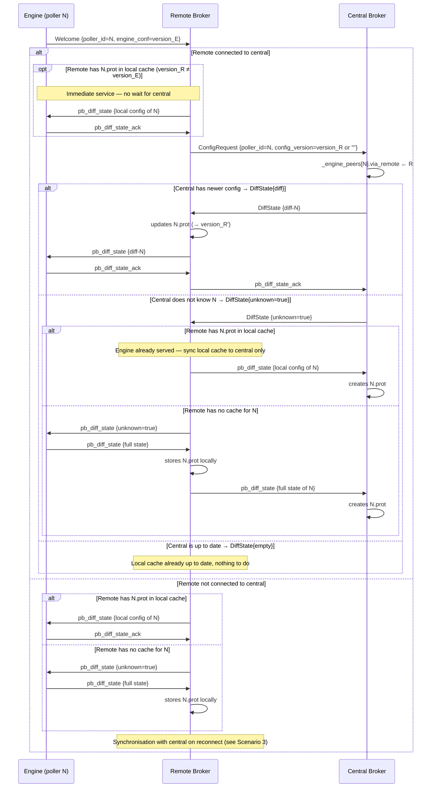
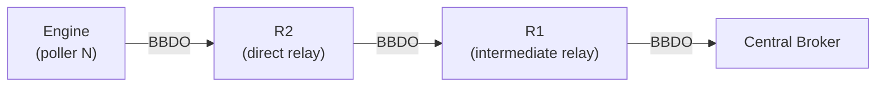
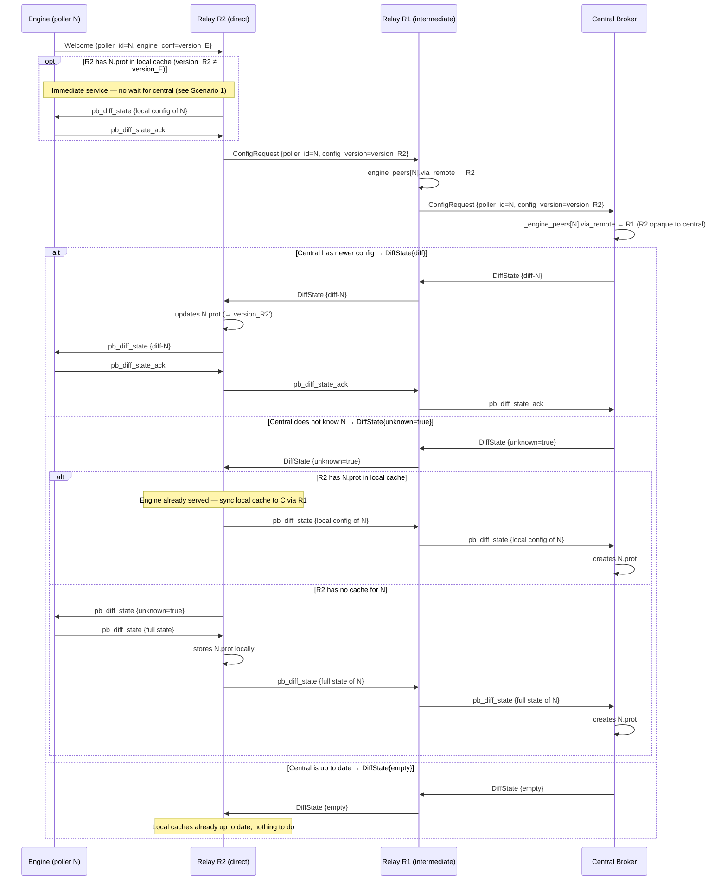
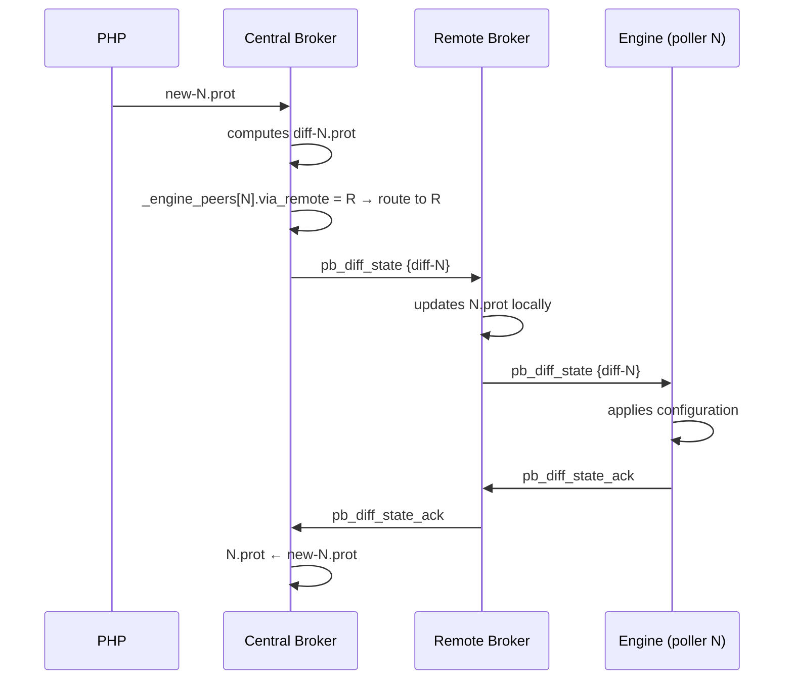
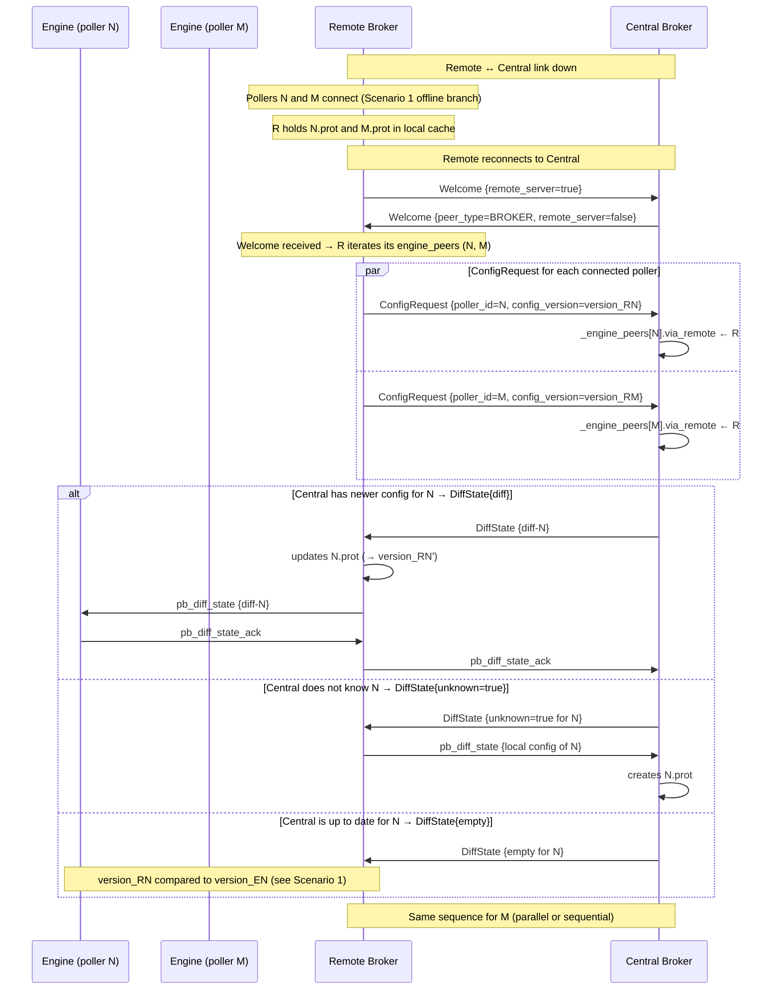
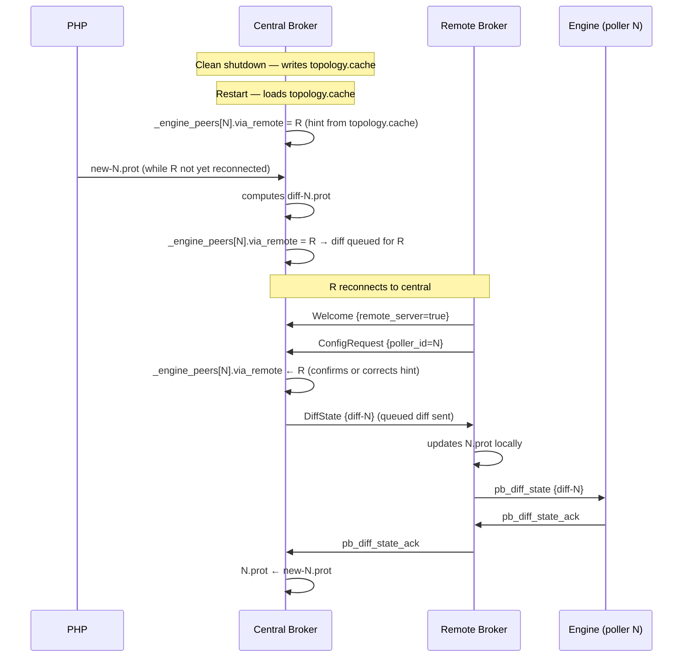
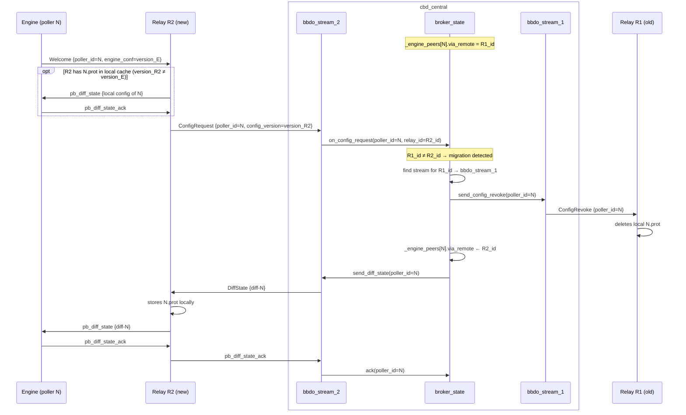
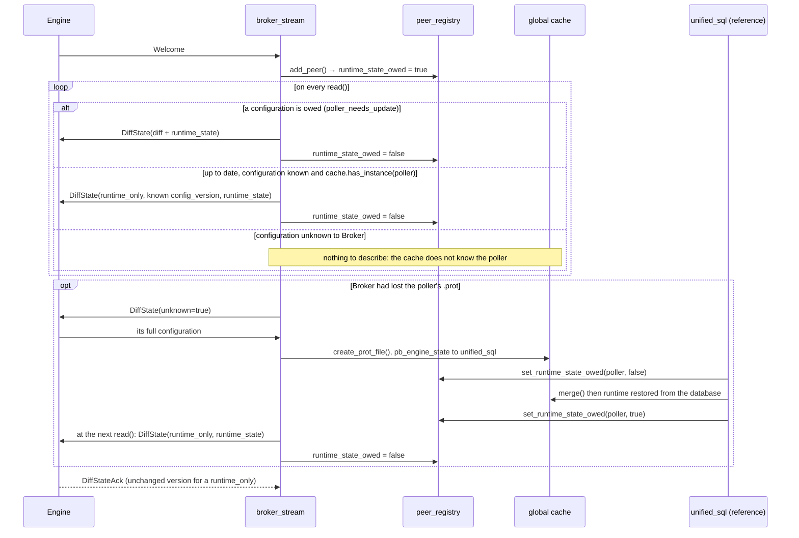

# Remote Servers and centralized configuration

[← Previous](05-retention-rrd-en.md) · [Index](README-en.md) · [Next →](07-downtimes-acknowledgements-en.md)

<!-- TOC -->
* [Current situation](#current-situation)
* [Relay identification](#relay-identification)
  * [Central vs relay](#central-vs-relay)
  * [Behaviour on ConfigRequest receipt](#behaviour-on-configrequest-receipt)
  * [Relay auto-detection](#relay-auto-detection)
* [New BBDO messages](#new-bbdo-messages)
* [Topology in broker\_cache](#topology-in-broker_cache)
* [Topology persistence](#topology-persistence)
* [Scenario 1: poller connects to the remote](#scenario-1-poller-connects-to-the-remote)
* [Scenario 1b: relay chain (multi-hop)](#scenario-1b-relay-chain-multi-hop)
  * [Hop-by-hop routing](#hop-by-hop-routing)
  * [ConfigRequest forwarding](#configrequest-forwarding)
* [Scenario 2: configuration pushed by PHP](#scenario-2-configuration-pushed-by-php)
* [Scenario 3: remote offline then reconnects](#scenario-3-remote-offline-then-reconnects)
* [Scenario 4: central restart](#scenario-4-central-restart)
* [Poller migration between two remotes](#poller-migration-between-two-remotes)
* [gRPC GetTopology endpoint](#grpc-gettopology-endpoint)
* [.prot file storage](#prot-file-storage)
* [broker\_state evolution](#broker_state-evolution)
  * [Known, connected, running: three states, three questions](#known-connected-running-three-states-three-questions)
  * [A poller behind a relay behaves like a direct one](#a-poller-behind-a-relay-behaves-like-a-direct-one)
* [Required changes](#required-changes)
* [Roll-out](#roll-out)
  * [Step 1 — New BBDO messages (✅ implemented)](#step-1--new-bbdo-messages--implemented)
  * [Step 2 — via_remote + relay detection (✅ implemented)](#step-2--via_remote--relay-detection--implemented)
  * [Step 3 — ConfigRequest sent by the relay (✅ implemented)](#step-3--configrequest-sent-by-the-relay--implemented)
  * [Step 4 — ConfigRequest handling at the central (✅ implemented)](#step-4--configrequest-handling-at-the-central--implemented)
  * [Step 5 — Forward DiffState/ack in the relay (✅ implemented)](#step-5--forward-diffstateack-in-the-relay--implemented)
  * [Step 6 — PHP push via relay (✅ implemented)](#step-6--php-push-via-relay--implemented)
  * [Step 7 — Migration + ConfigRevoke (✅ implemented)](#step-7--migration--configrevoke--implemented)
  * [Step 8 — Topology persistence (✅ implemented)](#step-8--topology-persistence--implemented)
  * [Step 9 — gRPC GetTopology (✅ implemented)](#step-9--grpc-gettopology--implemented)
  * [Common Robot infrastructure to create in tests/resources/:](#common-robot-infrastructure-to-create-in-testsresources)
<!-- TOC -->

A **remote server** is an intermediate node between the central and a group of pollers. It has its own `cbd` instance and its own local database. Its poller Engine instances connect to its local `cbd` — they do not see the central directly.

## Current situation

The centralized configuration mechanism as currently implemented only covers `ENGINE` peers:

```cpp
if (peer_type() == common::ENGINE &&
    _state.poller_needs_update(poller_id())) {
```

A remote server connects to the central as a `BROKER` peer. It therefore receives no configuration diff. Its local pollers are not visible to the central and never receive their centralized configuration.

## Relay identification

### Central vs relay

Both the central and a relay have incoming BBDO connections (from pollers or other relays) and outgoing BBDO connections (to rrd for the central, to the central for the relay). The presence of a CBD output alone is therefore not enough to tell them apart.

**The real discriminant is `pollers_config_dir`**: the central is configured with a `pollers_config_dir` directory where PHP deposits `.prot` files. A relay does not have one.

```cpp
bool supports_centralized_conf() const override {
  return !_pollers_config_dir.empty();
}
```

| | Central | Relay |
|---|---|---|
| `pollers_config_dir` | configured | empty |
| `supports_centralized_conf()` | `true` | `false` |
| BBDO output | toward rrd | toward the central |
| `ConfigRequest` received | handles (replies with `DiffState`) | forwards upstream |

### Behaviour on ConfigRequest receipt

When a `bbdo_stream` receives a `ConfigRequest` for poller N:

- `supports_centralized_conf() == true` → we are the **central**: look up N's `.prot` and reply with `DiffState`.
- `supports_centralized_conf() == false` → we are a **relay**: record `_engine_peers[N].via_remote`, then forward the `ConfigRequest` on the CBD output stream.

### Relay auto-detection

No new `PeerType` and no flag in the `Welcome` message are needed. A cbd automatically detects itself as a relay as soon as the following three conditions are met:

1. **BBDO3 active** — centralized configuration is enabled
2. **At least one incoming Engine connection** — this cbd receives pollers
3. **`supports_centralized_conf() == false` and at least one outgoing connection to a CBD** — this cbd is connected to an upstream broker without being the central itself

Once in relay mode, a cbd sends a `ConfigRequest` to the central for each Engine poller that connects. It is through these `ConfigRequest` messages that the central discovers the topology — not from the `Welcome`. There is no explicit declaration: the relay behaviour manifests itself naturally.

## New BBDO messages

A new message allows the remote to request a poller's configuration from the central. The response is an ordinary `DiffState` — the same message the central sends to a directly connected Engine.

```proto
message ConfigRequest {
  uint64 poller_id      = 1;
  string config_version = 2;  // hash of the local .prot for this poller
                               // empty if the remote has no cached config for this poller
}
// No ConfigResponse: the central replies with a standard DiffState.
```

The central compares `config_version` with its own version for this poller and responds:
- `config_version` empty **or** central does not know N → `DiffState{unknown=true}`
- versions identical → empty `DiffState` (no changes, nothing to do)
- central has a newer version → `DiffState{diff}`

The remote handles this `DiffState` the same way a direct Engine would: whether received in response to a `ConfigRequest` or pushed by the central (scenario 2), the behaviour is identical. This is the same mechanism as the direct Engine↔central negotiation (the `engine_conf` field in `Welcome`), proxied one level through the remote.

## Topology in broker\_cache

Topology (which poller is behind which remote) is encoded directly in the `via_remote` field of `engine_peer` entries in `_engine_peers`. When remote R sends `ConfigRequest {poller_id=N}`, the central creates (or updates) an `engine_peer{poller_id=N, via_remote=R}` entry in `_engine_peers`. When PHP pushes a diff, the central looks up `_engine_peers[N].via_remote` to determine which remote to route the diff to.

The central has only a partial view: for a chain `N → R2 → R1 → central`, it only sees `via_remote=R1`. R2 is opaque to it.

There is no separate `remote_relay` table: the information is derived from `_engine_peers`, in the `peer_registry`. `broker_state` handles the **persistence** of the topology via `topology.cache` (see next section), which stores `(poller_id, remote_id)` pairs to reconstruct hints on restart.

## Topology persistence

In centralized configuration mode, the topology is persisted to survive a central restart, in a file separate from the `.cache`.

On clean shutdown, the central writes a `topology.cache` file (protobuf) in the pollers configuration directory (`broker_state::save_topology_cache()`). On startup, it reloads it as a **hint**: the topology is considered valid until proven otherwise. Incoming `ConfigRequest` messages as remotes reconnect correct or confirm each entry.

On crash (no clean shutdown), `topology.cache` is absent or stale. This is not blocking: the central starts without topology and rebuilds it as remotes reconnect. PHP diffs produced during this window are queued.

## Scenario 1: poller connects to the remote

A poller Engine connects to the remote. Two situations are possible depending on whether the remote is itself connected to the central.

The remote cannot know whether its local copy of N's config is up to date without querying the central — when the connection is up, it **always** sends a `ConfigRequest`. When the connection is down, it behaves as if the central had replied `unknown=true`.

In both cases, if the remote already holds a local `N.prot` cache and the central says it does not know N, the local cache is authoritative: the remote sends it to Engine **and** to the central to resynchronise them.



## Scenario 1b: relay chain (multi-hop)

This scenario generalises Scenario 1 to a topology with several relays in series.



R2 is the direct relay for the poller. R1 is an intermediate relay between R2 and the central.

### Hop-by-hop routing

`via_remote` remains a single integer representing the **immediate next hop** toward the poller:

| Node | `_engine_peers[N].via_remote` |
|------|-------------------------------|
| Central C | `R1_id` |
| Relay R1 | `R2_id` |
| Relay R2 | `0` (direct connection) |

Each relay derives its next hop from **the connection on which the `ConfigRequest` arrived** — no full path is needed in the message.

### ConfigRequest forwarding

When a relay receives a `ConfigRequest` for a poller it does not serve directly, it:
1. records the source connection as `_engine_peers[N].via_remote`;
2. forwards the `ConfigRequest` upstream unchanged.

`DiffState` responses and acknowledgements travel in the opposite direction, each relay routing via its own `_engine_peers[N].via_remote`.



## Scenario 2: configuration pushed by PHP

PHP produces a new configuration for poller N, which is behind remote R.



## Scenario 3: remote offline then reconnects

Phase 1: the remote ↔ central link is down, one or more pollers connect to the remote (see Scenario 1, "not connected to central" branch).
Phase 2: the remote reconnects to the central.

When the Welcome negotiation completes, the remote recognises its peer as a CBD (peer_type=BROKER). As it is itself in relay mode, it then iterates all its local `engine_peer` entries and sends one `ConfigRequest` per poller. This is what triggers the batch resynchronisation.



## Scenario 4: central restart

The central restarts. PHP may have pushed a config during the outage.



## Poller migration between two remotes

Poller N moves from R1 to R2 (PHP reconfiguration). When N connects to R2, `broker_state` detects the migration and must send `ConfigRevoke` to R1 — but this message must go through `bbdo_stream_1`, the stream connected to R1, not through `bbdo_stream_2` which received the `ConfigRequest`.

The diagram below breaks the central into its internal components: `broker_state` manages the topology, `bbdo_stream_1` is the stream toward R1, `bbdo_stream_2` is the stream toward R2.



## gRPC GetTopology endpoint

A gRPC endpoint exposes the central's current topology. It is useful for debugging, monitoring, and PHP.

The central always has exactly **one level of CBD** directly connected to it. Its view is partial: for a chain `N → R2 → R1 → central`, N appears as directly behind R1 — R2 is invisible.

```proto
// excerpt from broker.proto
message PollerEntry {
  uint64 poller_id   = 1;
  string poller_name = 2;
}

message BrokerEntry {
  uint64               poller_id   = 1;
  string               broker_name = 2;
  repeated PollerEntry pollers     = 3;
}

message TopologyResponse {
  repeated BrokerEntry direct_brokers = 1; // brokers directly connected to the central
  repeated PollerEntry direct_pollers = 2; // pollers directly connected to the central (no broker)
}
```

Example for the topology `N → R2 → R1 → central`, `M → R1 → central`, `P → central`:

```
direct_brokers:
  { poller_id: R1_id, broker_name: "r1", pollers: [
      { poller_id: N_id, poller_name: "n" },
      { poller_id: M_id, poller_name: "m" }
  ]}
direct_pollers:
  { poller_id: P_id, poller_name: "p" }
```

N appears behind R1 even though it is actually behind R2 — the central cannot do better with the information it has.

## .prot file storage

The central remains the source of truth for configurations it knows. The remote stores `.prot` files locally for its pollers so it can serve them if the central is disconnected (scenario 3, phase 1). This local persistence also allows it to send a targeted `ConfigRequest` with a version number at reconnection time.

A relay only stores `.prot` files for the Engine pollers **directly connected** to it. It does not store `.prot` files for child relays or their pollers — each relay is responsible for its own direct pollers only.

## broker\_state evolution

The former single `peer` struct mixed Engine-specific fields with generic ones. It has been replaced by three distinct structs, each stored in its own `flat_hash_map`. Engine peers are indexed by `poller_id` alone -- a poller has one Engine -- while the other two are indexed by `peer_key = tuple<poller_id, poller_name, broker_name>`. All of them, and the mutex guarding them, live in `peer_registry`:

```cpp
enum class peer_state : uint8_t { expected, connected, running };
enum class conf_round : uint8_t { out, sent, acknowledged };

struct engine_peer {
    uint64_t    poller_id;
    std::string poller_name;
    /* expected: known from topology.cache only, a routing hint rather than a
     * peer; connected: directly or through a relay; running: connected, and
     * the last pb_instance said its Engine runs. */
    peer_state  state = peer_state::expected;
    time_t      connected_since = 0; // meaningless while state is expected
    bool        extended_negotiation;
    std::string available_conf;      // diff available to send to the engine
    std::string engine_conf;         // config version the engine declares it has
    /* out: not part of the configuration round; sent: available_conf handed
     * over, acknowledgement awaited; acknowledged: waits for the round to
     * close. */
    conf_round  round = conf_round::out;
    /* Whether Broker holds the *content* of the version above: a <ID>.prot on
     * disk, or a <ID>.lck announcing one. A property of Broker, not of the
     * poller -- the two are routinely true together. */
    bool        broker_knows_poller_conf;
    uint64_t    via_remote;          // relay in front of this peer, or 0
    /* Whether the poller is still owed the runtime snapshot of its resources
     * (RuntimeState). True by construction, true again when Broker rebuilds
     * a lost configuration, false once the snapshot was sent. */
    bool        runtime_state_owed = true;
    std::string timezone;            // IANA name advertised at negotiation
    /* The version last handed over, until the poller acknowledges one,
     * applied or not: no other configuration is sent meanwhile. */
    std::string conf_in_flight;
    /* The last version the poller could not apply, and why. It is not sent
     * again. */
    std::string rejected_conf;
    std::string rejection_error;
};

struct broker_peer {
    uint64_t    poller_id;
    std::string poller_name;
    std::string broker_name;
    time_t      connected_since;
    bool        extended_negotiation;
};

struct unknown_peer {
    uint64_t         poller_id;
    std::string      poller_name;
    std::string      broker_name;
    time_t           connected_since;
    common::PeerType peer_type;       // precise type if determined later
    bool             extended_negotiation;
};

// Reporting struct returned by connected_peers()
struct peer {
    engine_peer      ep;
    common::PeerType peer_type;
};

using peer_key = std::tuple<uint64_t, std::string, std::string>;

absl::flat_hash_map<uint64_t, engine_peer>  _engine_peers
    ABSL_GUARDED_BY(_connected_peers_m);
absl::flat_hash_map<peer_key, broker_peer>  _broker_peers
    ABSL_GUARDED_BY(_connected_peers_m);
absl::flat_hash_map<peer_key, unknown_peer> _unknown_peers
    ABSL_GUARDED_BY(_connected_peers_m);
/* Which relay leads to which poller, persisted in topology.cache. */
absl::flat_hash_map<uint64_t, uint64_t>     _poller_to_relay
    ABSL_GUARDED_BY(_connected_peers_m);
```

Three type-separated maps eliminate all dispatch at iteration time: methods that operate on engine peers (`poller_needs_update()`, `try_close_conf_round()`, etc.) iterate `_engine_peers` directly without any type test. `connected_peers()` aggregates the three maps into a vector of `peer` with the correct `peer_type` for each entry, leaving out the Engine entries that are known but not connected.

A read-modify-write sequence on one peer -- read the version it runs, build the diff, arm the new one -- must not interleave with another one on the same poller, or the same file would be written twice. `lock_engine_peer()` hands out a handle that holds the registry lock from the first read to the last write; every other access goes through the plain accessors, which lock for the duration of a single operation.

```cpp
// Targeted iteration over engine peers:
for (auto& [key, ep] : _engine_peers) {
    if (std::get<0>(key) == poller_id) { /* engine logic */ }
}

// Adding a peer — erase from all maps first
// in case the type changed on reconnection:
_engine_peers.erase(key);
_broker_peers.erase(key);
_unknown_peers.erase(key);
switch (peer_type) {
    case common::ENGINE:  _engine_peers[key]  = engine_peer{...};  break;
    case common::BROKER:  _broker_peers[key]  = broker_peer{...};  break;
    default:              _unknown_peers[key] = unknown_peer{...}; break;
}
```

### Known, connected, running: three states, three questions

An entry in `_engine_peers` does not mean the same thing depending on how it
got there, and conflating the three led to real bugs. The registry therefore
answers three separate questions.

**Known** — an entry exists. A poller enters the registry either because it
connected, or because `topology.cache` said, at the previous shutdown, that it
was reachable through a relay. The latter is a *routing hint*: it lets a
configuration pushed by PHP during the outage be prepared and addressed to the
right relay before that relay is back. It is not a connection, and nothing that
reports on connections may count it.

**Connected** — `engine_peer::state` is past `peer_state::expected`, which is what `engine_peer::connected()` tells. An entry restored from `topology.cache` is created `expected`. `add_peer()` at negotiation and `register_poller_via_relay()`, when a relay speaks for the poller, make it `connected` and set `connected_since`. There is no `disconnected` state: a disconnection erases the whole entry.

`is_poller_connected(poller_id)` answers this one, and it is what
`connected_pollers()` and `connected_peers()` filter on — so `GetPollers` and
`GetPeers` no longer report the hints restored from `topology.cache` as pollers
with an empty name connected since 1970.

**Running** — `engine_peer::state` is `peer_state::running` when the last `pb_instance` told us the poller's Engine runs. A peer is `connected`, not `running`, at connection time: it may well be connected with its Engine not started yet. Running implies connected by construction, the three states being a single field: a `pb_instance` received for an `expected` entry is dropped.

It is maintained by `set_instance_running()`, whose only caller is BAM's
`monitoring_stream`, and read back by that same module only. On
`pb_instance(running=false)`, BAM reads the flag *before* flipping it: a poller
that was not running is replaying an event it had kept, not stopping, and its
KPI downtime state must not be reset. Being the single writer is what makes
that read-then-flip reliable, so the flag deliberately stays BAM's business —
it is stored in the registry rather than in the module only so that it survives
a BAM stream restart.

`is_poller_running(poller_id)` answers this one. Neither it nor
`set_instance_running()` appears on the base class `state`: they would mean
nothing in `cbmod`, which supervises no poller. They stop at `broker_state`,
and BAM reaches them by downcasting the state — guarded by `peer_type()`
rather than asserted in a comment, because a module is loaded by configuration
and a configuration that loaded this one outside cbd should lose the downtime
reset, not the process.

**Owed its snapshot** — `engine_peer::runtime_state_owed` says whether the
poller is still owed the `RuntimeState` that replaces `retention.dat`. True by
construction, false once the snapshot left, true again once a lost
configuration was rebuilt. The registry is the single source of truth, the
stream keeps nothing of its own.



> **Why the split matters.** These three used to be a single method,
> `has_connection_from_poller()`, which returned the *running* flag. unified_sql's
> `remove_poller()` asks "is this poller connected?" before deleting a poller the
> database still shows as running — its last guard before dropping its
> `instances`, `hosts` and `resources` rows. Since `running` was only ever fed by
> BAM, a Broker without the BAM module answered "not connected" for every poller
> and the guard never held. It now calls `is_poller_connected()`.

### A poller behind a relay behaves like a direct one

`_prepare_diff_for_poller()` returns early for a poller that is known but not
connected. Without that gate, an entry restored from `topology.cache` was
treated as a peer to serve: a `diff-<N>.prot` was written and `available_conf`
armed for a poller nobody could reach. `_peer_needs_update()` then stayed true
for it, `try_close_conf_round()` never closed the round, and the global
diff of **every other poller of the round** was held back until that relay came
back.

A directly connected poller that is away has no entry at all, so it has always
returned early there, leaving its `new-<ID>.prot` on disk for when it shows up.
The gate gives the relay-attached poller exactly that behaviour.

The symmetrical gap was on the catch-up side: `prepare_relay_config_response()`
looked at `diff-`, `new-` and `<ID>.prot`, but not at a pending `<ID>.lck` —
a configuration announced by PHP that no cycle had read yet. Where the direct
path nudges the debounce from `_feed_cache_and_wake_up_resources()`, the relay
path waited for the five-minute safety net. It now performs the same lookup and
the same nudge. It still answers with whatever is available rather than
withholding the older state as the direct path does: a `ConfigRequest` is a
request/response and leaving it unanswered would stall the handshake; the newer
configuration follows through `pollers_via_relay_needing_update()` within
the debounce.

## Required changes

| Component | Change |
|-----------|--------|
| `bbdo/bbdo.proto` | Add `bool remote_server` to `Welcome` |
| `bbdo/bbdo.proto` | Add `ConfigRequest` and `ConfigRevoke` messages |
| `peer_registry` | Hold the three typed `flat_hash_map`s -- `_engine_peers`, `_broker_peers`, `_unknown_peers` -- plus `_poller_to_relay`, behind their own mutex; `broker_state` delegates to it |
| `broker_cache` | Persist topology in `topology.cache` on clean shutdown (`poller_id → remote_id` pairs) |
| `broker_stream::read()` (central) | Detect `remote_server=true`; handle `ConfigRequest`; populate `_engine_peers[N].via_remote`; send `ConfigRevoke` on migration |
| `broker_state` (central) | Route PHP diffs via `_engine_peers[N].via_remote`; queue diffs when remote is absent |
| `broker_state` (remote) | Store `.prot` files locally; send `ConfigRequest`; collect and relay acks |
| `broker.proto` (gRPC) | Add `GetTopology` |

## Roll-out

### Step 1 — New BBDO messages (✅ implemented)
  No Robot test at this stage — validation is purely at compilation and unit test level
  (message serialisation/deserialisation).

### Step 2 — via_remote + relay detection (✅ implemented)
  Same — unit tests on `is_relay()` and the detection logic.

### Step 3 — ConfigRequest sent by the relay (✅ implemented)
  → CCCRC1 (`centralized-relay-conf.robot`): A configured relay receives an Engine. Verify in the
  central's logs that `ConfigRequest{poller_id=N}` is received.

  Implemented keywords: `Ctn Config Relay`, `Ctn Start Relay`, `Ctn Stop Relay`
  (in `tests/resources/Broker.py` and `tests/resources/resources.resource`).

### Step 4 — ConfigRequest handling at the central (✅ implemented)
  → CCCRC2 (`centralized-relay-conf.robot`): A poller configuration is pre-created before the
  central broker starts. Verify that the central processes the lck file, computes the diff, and
  sends a non-unknown `DiffState` to the relay when a `ConfigRequest` arrives.

  CCCRC1 covers the unknown path (central has no config → sends `DiffState{unknown=true}`).
  CCCRC2 covers the diff_ready path (central has config → sends `DiffState` with content).

### Step 5 — Forward DiffState/ack in the relay (✅ implemented)
  → CCCRC3 (`centralized-relay-conf.robot`): Pre-created config for poller 1. Central sends
  `DiffState` to relay. The relay queues it in `_pending_diff_states` and forwards it to Engine
  on the next `read()` cycle of the ENGINE-connected stream. Engine applies it and sends back a
  `DiffStateAck`. The relay queues the ack in `_pending_diff_state_acks` and forwards it upstream
  to the central on the next `read()` cycle of the BROKER-connected stream. No local storage on
  the relay. Verified by: central log `received diff state ack from poller 1`.
  The handler for `pb_diff_state_ack` was also fixed to use `obj.poller_id()` (not `poller_id()`)
  so that forwarded acks (where the BROKER stream's poller_id is the relay's, not the Engine's)
  are routed correctly.

### Step 6 — PHP push via relay (✅ implemented)
  When PHP pushes a new `.lck` for a poller whose Engine is behind a relay, the central must
  route the resulting DiffState through the relay rather than looking for a direct ENGINE stream.

  **Implementation**: `broker_state::pollers_via_relay_needing_update(relay_id)` collects
  the pollers with `via_remote == relay_id` that `_peer_needs_update()` reports as still owed
  a configuration — the same test as everywhere else, deliberately not rewritten here.  In `broker_stream::read()`, when `peer_type() == BROKER &&
  !is_relay()`, the central iterates this list and pushes the `diff-N.prot` to the relay —
  identical to the `ConfigRequest` diff_ready path, but triggered by the PHP push timer instead
  of an incoming request.

  → CCCRC4 (`centralized-relay-conf.robot`): Initial config established via relay (ack received).
  Then `Ctn Prepare Engine Config` adds 5 hosts + `Ctn Notify Broker Of Engine Config Change` →
  verify central log "BBDO: sending DiffState to relay for poller 1" then "received diff state ack
  from poller 1".

### Step 7 — Migration + ConfigRevoke (✅ implemented)
  When Engine N reconnects via a new relay R2 while previously registered behind R1, the central
  detects the migration and must send `ConfigRevoke{poller_id=N}` to R1 so it can clean up.

  **Implementation**:
  - `broker_state::_pending_config_revokes` — `flat_hash_map<relay_id, vector<engine_id>>` guarded
    by `_connected_peers_m`.
  - `register_engine_peer_via_relay`: when `old_relay != 0 && old_relay != relay_poller_id`,
    pushes `engine_id` into `_pending_config_revokes[old_relay]` before updating `via_remote`.
  - `pop_pending_config_revokes(relay_id)`: drains the queue under WriterMutex; called by the old
    relay's BROKER stream in `read()`.
  - `broker_stream::read()` (central, `BROKER && !is_relay()`): sends `pb_config_revoke` for each
    engine popped from the queue.
  - `broker_stream::_handle_bbdo_event()` (relay, `pb_config_revoke`): logs receipt and calls
    `clear_pending_for_poller(pid)` to discard stale forwarding state.

  → CCCRC5 (`centralized-relay-conf.robot`): Engine connects via Relay3 (poller_id=4, port 5669),
  initial config acked.  Then cbmod output port changed to 5670, Relay4 (poller_id=5) started,
  Engine restarted → Relay4 sends ConfigRequest → central detects migration →
  central sends ConfigRevoke to Relay3 (verified in relay3 log) + DiffState to Relay4 → ack.

### Step 8 — Topology persistence (✅ implemented)
  **Implementation**:
  - `TopologyCache` protobuf message added to `bbdo/bbdo.proto` — on-disk format for
    `(poller_id, relay_id)` pairs.
  - `broker_state::save_topology_cache()` — called from the destructor on clean shutdown;
    iterates `_engine_peers` and writes all entries with `via_remote != 0`.
  - `broker_state::load_topology_cache()` — called from `apply()` the first time
    `_pollers_config_dir` is set; populates `_engine_peers[N]` hints so that PHP diffs
    pushed during the outage can be routed via `via_remote` before relays reconnect.

  → CCCRC6 (`centralized-relay-conf.robot`): Relay→central flow established (initial
  DiffStateAck received). Central stopped cleanly. New config pushed. Central restarted.
  Verify that the relay reconnects and DiffStateAck is received again (topology.cache hint
  enables routing before relay reconnects).

### Step 9 — gRPC GetTopology (✅ implemented)
  **Implementation**: `broker_impl::GetTopology` iterates `connected_peers()` and builds
  a `TopologyResponse` with `direct_brokers` (ENGINE peers with `via_remote != 0` grouped
  under their relay entry) and `direct_pollers` (ENGINE peers with `via_remote == 0`).
  Python test keyword `ctn_check_broker_topology(relay_poller_id, engine_poller_ids)` added
  to `tests/resources/Broker.py`.

  → CCCRC7 (`centralized-relay-conf.robot`): Relay3 (poller_id=4) connected to central
  with Engine (poller_id=1) behind it. Call `GetTopology` on central gRPC port. Verify
  that `direct_brokers` contains relay3 with poller 1 listed under it.

### Common Robot infrastructure to create in tests/resources/:
  - `Relay.py` (or extension of `Broker.py`) — config/start/stop of a relay cbd
  - Keyword `Ctn Config Engine For Relay`
  - Keyword `Ctn Wait For Relay To Be Ready` (relay↔central connection log)
  - Keyword `Ctn Check Poller Config Via Relay` (verifies `N.prot` on the relay side)

  Tests would live in `tests/remote-servers/remote-servers.robot`. They can be created
  incrementally — BCSRV1 from step 3, BCSRV2/3 at steps 5/6, etc.
