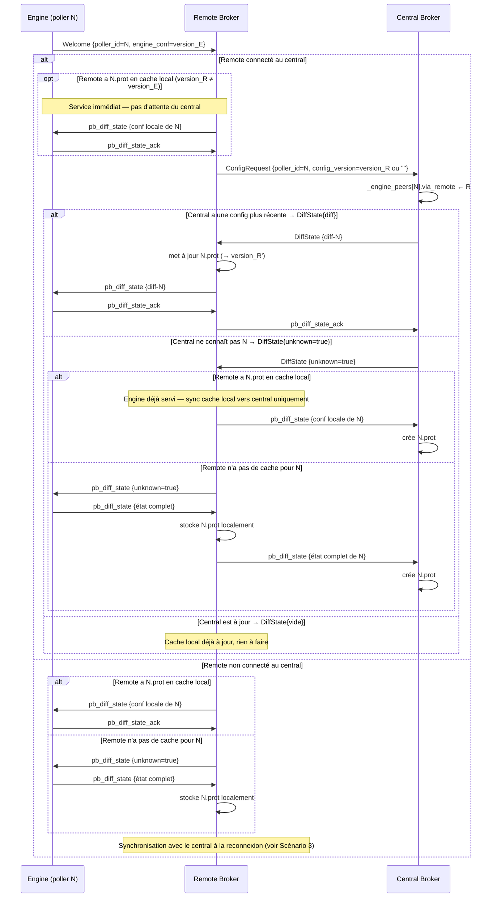
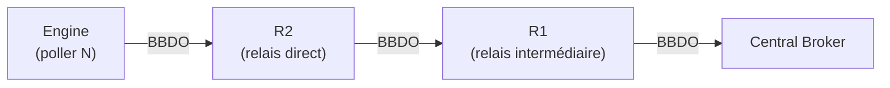
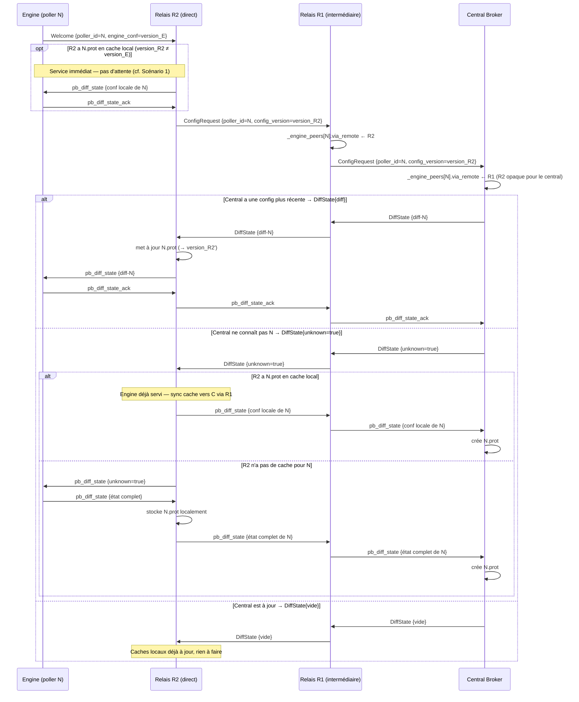
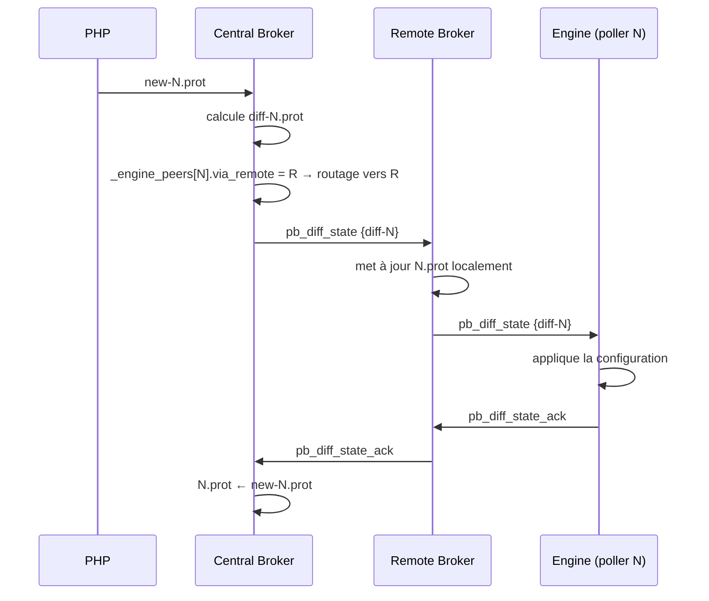
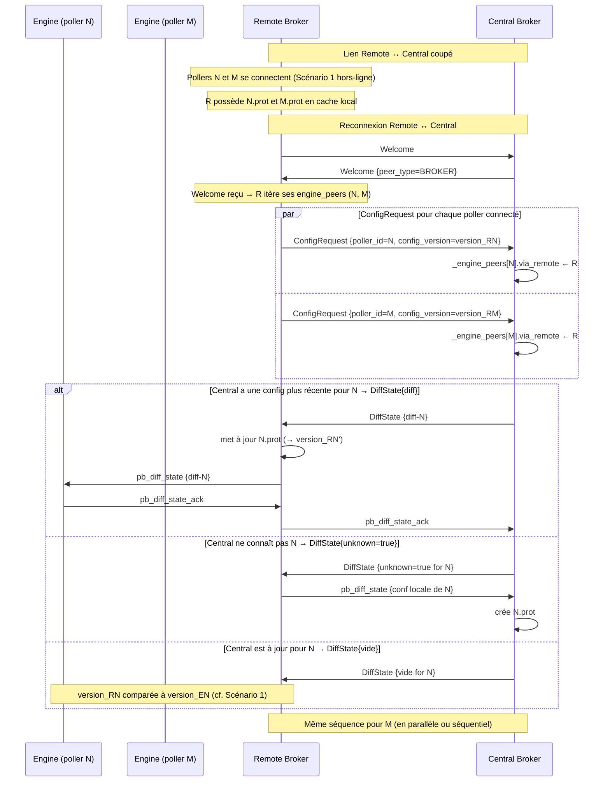
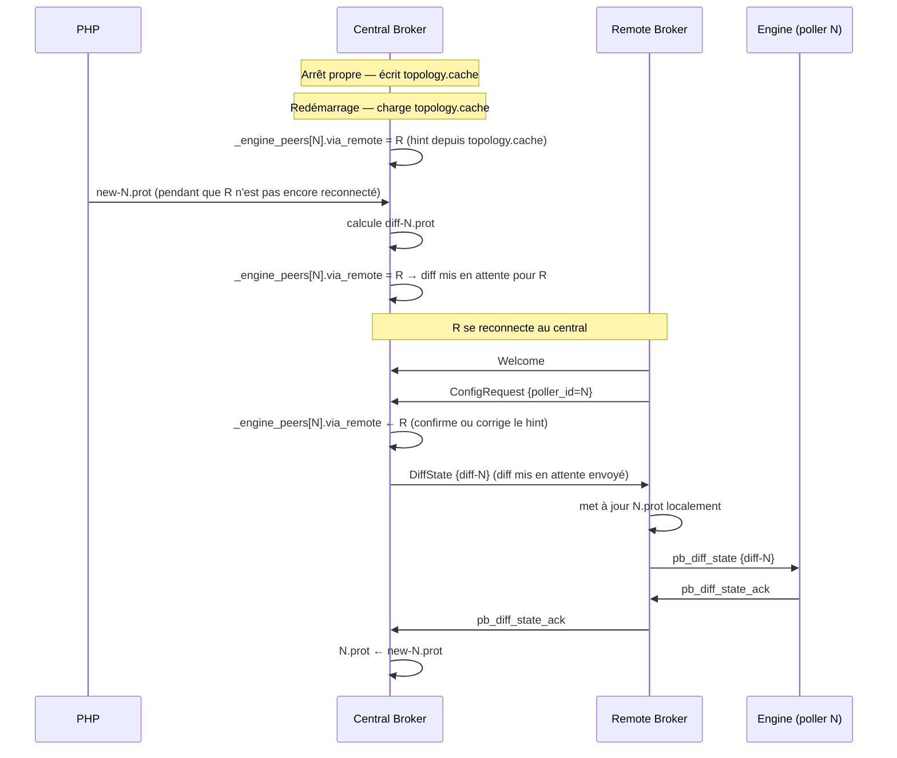
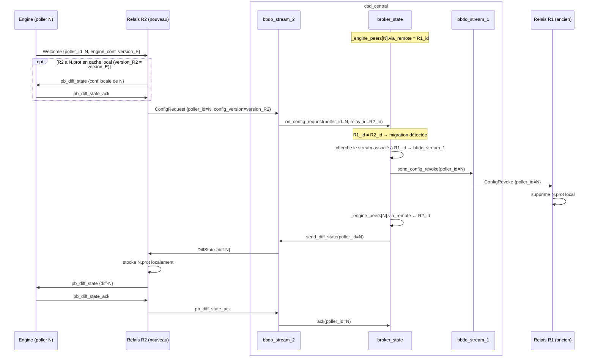
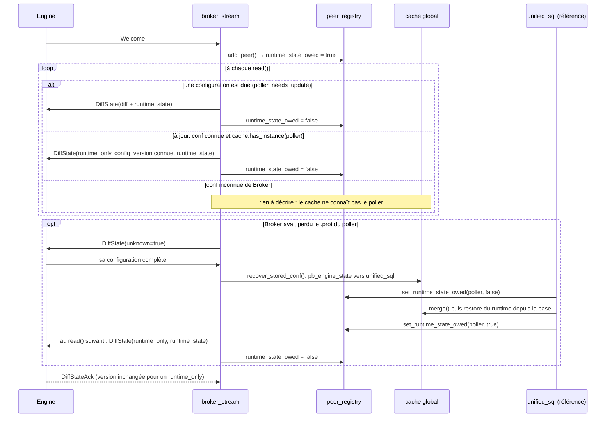

# Remote Servers et configuration centralisée

[← Précédent](05-retention-rrd-fr.md) · [Index](README-fr.md) · [Suivant →](07-downtimes-acknowledgements-fr.md)

<!-- TOC -->
* [Situation actuelle](#situation-actuelle)
* [Identification d'un relais](#identification-dun-relais)
  * [Central vs relais](#central-vs-relais)
  * [Comportement sur réception d'un ConfigRequest](#comportement-sur-réception-dun-configrequest)
  * [Auto-détection du mode relais](#auto-détection-du-mode-relais)
* [Nouveaux messages BBDO](#nouveaux-messages-bbdo)
* [Topologie dans broker\_cache](#topologie-dans-broker_cache)
* [Persistance de la topologie](#persistance-de-la-topologie)
* [Scénario 1 : connexion d'un poller au remote](#scénario-1--connexion-dun-poller-au-remote)
* [Scénario 1b : chaîne de relais (multi-hop)](#scénario-1b--chaîne-de-relais-multi-hop)
  * [Routage hop-by-hop](#routage-hop-by-hop)
  * [Forwarding du ConfigRequest](#forwarding-du-configrequest)
* [Scénario 2 : configuration poussée par PHP](#scénario-2--configuration-poussée-par-php)
* [Scénario 3 : remote hors-ligne puis reconnexion](#scénario-3--remote-hors-ligne-puis-reconnexion)
* [Scénario 4 : redémarrage du central](#scénario-4--redémarrage-du-central)
* [Migration d'un poller entre deux remotes](#migration-dun-poller-entre-deux-remotes)
* [Endpoint gRPC GetTopology](#endpoint-grpc-gettopology)
* [Stockage des fichiers .prot](#stockage-des-fichiers-prot)
* [Évolution de broker\_state](#évolution-de-broker_state)
  * [Connu, connecté, démarré : trois états, trois questions](#connu-connecté-démarré--trois-états-trois-questions)
  * [Un poller derrière un relais se comporte comme un poller direct](#un-poller-derrière-un-relais-se-comporte-comme-un-poller-direct)
* [Modifications nécessaires](#modifications-nécessaires)
* [Mise en place](#mise-en-place)
  * [Étape 1 — Nouveaux messages BBDO (✅ implémenté)](#étape-1--nouveaux-messages-bbdo--implémenté)
  * [Étape 2 — via_remote + détection relais (✅ implémenté)](#étape-2--via_remote--détection-relais--implémenté)
  * [Étape 3 — ConfigRequest envoyé par le relais (✅ implémentée)](#étape-3--configrequest-envoyé-par-le-relais--implémentée)
  * [Étape 4 — Traitement du ConfigRequest au central (✅ implémentée)](#étape-4--traitement-du-configrequest-au-central--implémentée)
  * [Étape 5 — Forward DiffState/ack dans le relais (✅ implémenté)](#étape-5--forward-diffstateack-dans-le-relais--implémenté)
  * [Étape 6 — PHP push via relais (✅ implémentée)](#étape-6--php-push-via-relais--implémentée)
  * [Étape 7 — Migration + ConfigRevoke (✅ implémentée)](#étape-7--migration--configrevoke--implémentée)
  * [Étape 8 — Persistance de la topologie (✅ implémentée)](#étape-8--persistance-de-la-topologie--implémentée)
  * [Étape 9 — gRPC GetTopology (✅ implémentée)](#étape-9--grpc-gettopology--implémentée)
  * [Infrastructure Robot commune à créer dans tests/resources/ :](#infrastructure-robot-commune-à-créer-dans-testsresources-)
<!-- TOC -->

Un **remote server** est un nœud intermédiaire entre le central et un groupe de pollers. Il possède sa propre instance `cbd` et sa propre base de données locale. Ses pollers Engine se connectent à son `cbd` local — ils ne voient pas directement le central.

## Situation actuelle

Le mécanisme de configuration centralisée tel qu'il est implémenté aujourd'hui ne couvre que les pairs de type `ENGINE` :

```cpp
if (peer_type() == common::ENGINE &&
    _state.poller_needs_update(poller_id())) {
```

Un remote server se connecte au central en tant que pair `BROKER`. Il ne reçoit donc aucun diff de configuration. Ses pollers locaux ne sont pas visibles du central et ne reçoivent jamais leur configuration centralisée.

## Identification d'un relais

### Central vs relais

Le central et un relais ont tous les deux des connexions BBDO entrantes (depuis des pollers ou d'autres relais) et des connexions BBDO sortantes (vers rrd pour le central, vers le central pour le relais). La présence d'un output CBD seul ne suffit donc pas à les différencier.

**Le vrai discriminant est `pollers_config_dir`** : le central est configuré avec un répertoire `pollers_config_dir` où PHP dépose les fichiers `.prot`. Un relais ne l'a pas.

```cpp
bool supports_centralized_conf() const override {
  return !_pollers_config_dir.empty();
}
```

| | Central | Relais |
|---|---|---|
| `pollers_config_dir` | configuré | vide |
| `supports_centralized_conf()` | `true` | `false` |
| Output BBDO | vers rrd | vers le central |
| Réception `ConfigRequest` | traite (répond avec `DiffState`) | forward vers l'upstream |

### Comportement sur réception d'un ConfigRequest

Quand un `bbdo_stream` reçoit un `ConfigRequest` pour le poller N :

- `supports_centralized_conf() == true` → on est le **central** : rechercher le `.prot` de N et répondre avec `DiffState`.
- `supports_centralized_conf() == false` → on est un **relais** : enregistrer `_engine_peers[N].via_remote`, puis forwarder le `ConfigRequest` sur le stream CBD output.

### Auto-détection du mode relais

Aucun nouveau `PeerType` et aucun flag dans le `Welcome` ne sont nécessaires. Un cbd se détecte automatiquement comme relais dès que les trois conditions suivantes sont réunies :

1. **BBDO3 actif** — la configuration centralisée est activée
2. **Au moins une connexion entrante d'un Engine** — ce cbd reçoit des pollers
3. **`supports_centralized_conf() == false` et au moins une connexion sortante vers un CBD** — ce cbd est connecté à un broker amont sans être lui-même le central

Dès qu'il est en mode relais, un cbd envoie un `ConfigRequest` au central pour chaque poller Engine qui se connecte. C'est via ces `ConfigRequest` que le central découvre la topologie — pas depuis le `Welcome`. Il n'y a aucune déclaration explicite : le comportement du relais se manifeste de lui-même.

## Nouveaux messages BBDO

Un nouveau message permet au remote de demander la configuration d'un poller au central. La réponse est un `DiffState` ordinaire — le même message que le central envoie à un Engine connecté directement.

```proto
message ConfigRequest {
  uint64 poller_id      = 1;
  string config_version = 2;  // hash du .prot local pour ce poller
                               // vide si le remote n'a pas de cache pour ce poller
}
// Le central répond avec un DiffState standard.
```

Le central compare `config_version` avec sa propre version pour ce poller et répond :
- `config_version` vide **ou** central ne connaît pas N → `DiffState{unknown=true}`
- versions identiques → `DiffState` vide (aucun changement, rien à faire)
- central a une version plus récente → `DiffState{diff}`

Le remote traite ce `DiffState` de la même façon qu'un Engine direct : qu'il soit reçu en réponse à un `ConfigRequest` ou en push depuis le central (scénario 2), le comportement est identique. C'est le même mécanisme que la négociation directe Engine↔central (champ `engine_conf` du `Welcome`), déporté d'un niveau via le remote.

## Topologie dans broker\_cache

La topologie (quel poller est derrière quel remote) est encodée directement dans le champ `via_remote` des entrées `engine_peer` de `_engine_peers`. Quand le remote R envoie `ConfigRequest {poller_id=N}`, le central crée (ou met à jour) une entrée `engine_peer{poller_id=N, via_remote=R}` dans `_engine_peers`. Lors d'un push PHP, le central consulte `_engine_peers[N].via_remote` pour savoir vers quel remote router le diff.

Le central n'a qu'une vue partielle : pour une chaîne `N → R2 → R1 → central`, il voit uniquement `via_remote=R1`. R2 lui est opaque.

Il n'y a pas de table `remote_relay` séparée : l'information est dérivée de `_engine_peers`, dans le `peer_registry`. `broker_state` assure la **persistance** de la topologie via `topology.cache` (voir section suivante), qui stocke les paires `(poller_id, remote_id)` pour reconstituer les hints au redémarrage.

## Persistance de la topologie

En configuration centralisée, la topologie est persistée pour survivre à un redémarrage du central, dans un fichier distinct du `.cache`.

À l'arrêt propre, le central écrit un fichier `topology.cache` (protobuf) dans le répertoire des configurations des pollers (`broker_state::save_topology_cache()`). Au démarrage, il le recharge comme **hint** : la topologie est considérée valide jusqu'à preuve du contraire. Les `ConfigRequest` entrants au fur et à mesure des reconnexions des remotes corrigent ou confirment chaque entrée.

En cas de crash (pas d'arrêt propre), `topology.cache` est absent ou périmé. Ce n'est pas bloquant : le central démarre sans topologie et la reconstruit à mesure que les remotes se reconnectent. Les diffs PHP produits pendant cette fenêtre sont mis en attente.

## Scénario 1 : connexion d'un poller au remote

Un poller Engine se connecte au remote. Deux situations sont possibles selon que le remote est lui-même connecté ou non au central.

Le remote ne peut pas savoir si sa copie locale de la config de N est à jour sans interroger le central — quand la connexion est établie, il fait avec ce qu'il a à sa disposition.
Mais il envoie aussi un `ConfigRequest`. Quand la connexion est établie, ça lui permet de récupérer la dernière mise à jour de configuration de ce poller et dans ce cas
de notifier le poller qu'une nouvelle configuration est disponible.

Les configurations n'évoluent pas tant que ça et donc la plupart du temps, le remote est au courant de la dernière configuration.
Inutile d'attendre à chaque fois une réponse du central pour que le poller démarre.



## Scénario 1b : chaîne de relais (multi-hop)

Ce scénario généralise le Scénario 1 à une topologie avec plusieurs relais en série.



R2 est le relais direct du poller. R1 est un relais intermédiaire entre R2 et le central.

### Routage hop-by-hop

`via_remote` reste un simple entier représentant le **saut suivant immédiat** vers le poller :

| Nœud | `_engine_peers[N].via_remote` |
|------|-------------------------------|
| Central C | `R1_id` |
| Relais R1 | `R2_id` |
| Relais R2 | `0` (connexion directe) |

Chaque relais déduit son saut suivant de **la connexion sur laquelle le `ConfigRequest` est arrivé** — pas besoin de chemin complet dans le message.

### Forwarding du ConfigRequest

Quand un relais reçoit un `ConfigRequest` pour un poller qu'il ne sert pas directement, il :
1. enregistre la connexion source comme `_engine_peers[N].via_remote` ;
2. reforwarde le `ConfigRequest` vers son upstream sans modification.

Les `DiffState` et acquittements transitent dans le sens inverse, chaque relais routant via son propre `_engine_peers[N].via_remote`.



## Scénario 2 : configuration poussée par PHP

PHP produit une nouvelle configuration pour le poller N, qui est derrière le remote R.



## Scénario 3 : remote hors-ligne puis reconnexion

Phase 1 : le lien remote ↔ central est coupé, un ou plusieurs pollers se connectent au remote (voir Scénario 1, branche "non connecté au central").
Phase 2 : le remote se reconnecte au central.

À la fin de la négociation Welcome, le remote reconnaît que son pair est un CBD (peer_type=BROKER). Comme il est lui-même en mode relais, il itère alors tous ses `engine_peer` locaux et envoie un `ConfigRequest` par poller. C'est ce qui déclenche la resynchronisation en batch.



## Scénario 4 : redémarrage du central

Le central redémarre. PHP a pu pousser une config pendant l'interruption.



## Migration d'un poller entre deux remotes

Un poller N passe de R1 à R2 (reconfiguration côté PHP). Quand N se connecte à R2, le central détecte la migration via `broker_state` et doit envoyer `ConfigRevoke` à R1 — mais ce message doit transiter par `bbdo_stream_1`, le stream connecté à R1, et non par `bbdo_stream_2` qui a reçu le `ConfigRequest`.

Le diagramme ci-dessous décompose le central en ses composants internes : `broker_state` gère la topologie, `bbdo_stream_1` est le stream vers R1, `bbdo_stream_2` est le stream vers R2.



## Endpoint gRPC GetTopology

Un endpoint gRPC expose la topologie courante du central. Il est utile pour le débogage, le monitoring et PHP.

Le central a toujours exactement **un niveau de CBD** directement connecté. Sa vue est partielle : pour une chaîne `N → R2 → R1 → central`, N apparaît comme directement derrière R1 — R2 est invisible.

```proto
// extrait de broker.proto
message PollerEntry {
  uint64 poller_id   = 1;
  string poller_name = 2;
}

message BrokerEntry {
  uint64               poller_id   = 1;
  string               broker_name = 2;
  repeated PollerEntry pollers     = 3;
}

message TopologyResponse {
  repeated BrokerEntry direct_brokers = 1; // brokers directement connectés au central
  repeated PollerEntry direct_pollers = 2; // pollers directement connectés au central (sans broker)
}
```

Exemple pour la topologie `N → R2 → R1 → central`, `M → R1 → central`, `P → central` :

```
direct_brokers:
  { poller_id: R1_id, broker_name: "r1", pollers: [
      { poller_id: N_id, poller_name: "n" },
      { poller_id: M_id, poller_name: "m" }
  ]}
direct_pollers:
  { poller_id: P_id, poller_name: "p" }
```

N apparaît derrière R1 bien qu'il soit en réalité derrière R2 — le central ne peut pas faire mieux avec les informations dont il dispose.

## Stockage des fichiers .prot

Le central reste la source de vérité pour les configs qu'il connaît. Le remote stocke localement les `.prot` de ses pollers pour pouvoir les servir en cas de déconnexion du central (scénario 3, phase 1). Cette persistance locale est aussi ce qui lui permet d'envoyer un `ConfigRequest` ciblé avec un numéro de version au moment de la reconnexion.

Un relais ne stocke que les `.prot` des pollers Engine qui lui sont **directement connectés**. Il ne stocke pas les `.prot` des relais enfants ni de leurs pollers — chaque relais est responsable de ses propres pollers directs.

## Évolution de broker\_state

L'ancienne structure `peer` unique mélangeait des champs spécifiques aux Engine et des champs génériques. Elle a été remplacée par trois structures distinctes, chacune stockée dans sa propre `flat_hash_map`. Les pairs Engine sont indexés par le seul `poller_id` — un poller n'a qu'un Engine — tandis que les deux autres le sont par `peer_key = tuple<poller_id, poller_name, broker_name>`. Toutes, ainsi que le mutex qui les protège, vivent dans `peer_registry` :

```cpp
enum class peer_state : uint8_t { expected, connected, running };
enum class conf_round : uint8_t { out, sent, acknowledged };

struct engine_peer {
    uint64_t    poller_id;
    std::string poller_name;
    /* expected : connu du seul topology.cache, indice de routage et non pair ;
     * connected : directement ou via un relais ; running : connecté, et le
     * dernier pb_instance a dit que son Engine tourne. */
    peer_state  state = peer_state::expected;
    time_t      connected_since = 0; // sans objet tant que state vaut expected
    bool        extended_negotiation;
    std::string available_conf;      // diff disponible à envoyer à l'engine
    std::string engine_conf;         // version de config que l'engine déclare avoir
    /* out : hors du tour de configuration ; sent : available_conf remise,
     * acquittement attendu ; acknowledged : attend la fermeture du tour. */
    conf_round  round = conf_round::out;
    /* Si Broker détient le *contenu* de la version ci-dessus : un <ID>.prot sur
     * disque, ou un <ID>.lck qui en annonce un. Propriété de Broker, pas du
     * poller — les deux sont couramment vraies ensemble. */
    bool        broker_knows_poller_conf;
    uint64_t    via_remote;          // relais devant ce pair, ou 0
    /* Si le poller doit encore recevoir le snapshot runtime de ses ressources
     * (RuntimeState). Vrai par construction, remis à vrai quand Broker
     * reconstruit une configuration perdue, faux une fois le snapshot envoyé. */
    bool        runtime_state_owed = true;
    std::string timezone;            // nom IANA annoncé à la négociation
    /* La dernière version remise, jusqu'à ce que le poller en acquitte une,
     * appliquée ou non : aucune autre configuration ne part entre-temps. */
    std::string conf_in_flight;
    /* La dernière version que le poller n'a pas pu appliquer, et pourquoi.
     * Elle n'est plus renvoyée. */
    std::string rejected_conf;
    std::string rejection_error;
};

struct broker_peer {
    uint64_t    poller_id;
    std::string poller_name;
    std::string broker_name;
    time_t      connected_since;
    bool        extended_negotiation;
};

struct unknown_peer {
    uint64_t         poller_id;
    std::string      poller_name;
    std::string      broker_name;
    time_t           connected_since;
    common::PeerType peer_type;       // type précis si connu ultérieurement
    bool             extended_negotiation;
};

// Structure de reporting retournée par connected_peers()
struct peer {
    engine_peer      ep;
    common::PeerType peer_type;
};

using peer_key = std::tuple<uint64_t, std::string, std::string>;

absl::flat_hash_map<uint64_t, engine_peer>  _engine_peers
    ABSL_GUARDED_BY(_connected_peers_m);
absl::flat_hash_map<peer_key, broker_peer>  _broker_peers
    ABSL_GUARDED_BY(_connected_peers_m);
absl::flat_hash_map<peer_key, unknown_peer> _unknown_peers
    ABSL_GUARDED_BY(_connected_peers_m);
/* Quel relais mène à quel poller, persisté dans topology.cache. */
absl::flat_hash_map<uint64_t, uint64_t>     _poller_to_relay
    ABSL_GUARDED_BY(_connected_peers_m);
```

Trois maps séparées par type éliminent tout dispatch à l'itération : les méthodes qui opèrent sur les engine peers (`poller_needs_update()`, `try_close_conf_round()`, etc.) itèrent directement `_engine_peers` sans test de type. `connected_peers()` agrège les trois maps en un vecteur de `peer` avec le `peer_type` correct pour chaque entrée, en laissant de côté les entrées Engine connues mais non connectées.

Une séquence lecture-modification-écriture sur un pair — lire la version qu'il tourne, construire le diff, armer la nouvelle — ne doit pas s'entrelacer avec une autre sur le même poller, sinon le même fichier serait écrit deux fois. `lock_engine_peer()` rend un handle qui tient le verrou du registre de la première lecture à la dernière écriture ; tous les autres accès passent par les accesseurs simples, qui verrouillent le temps d'une seule opération.

```cpp
// Itération ciblée sur les engine peers :
for (auto& [key, ep] : _engine_peers) {
    if (std::get<0>(key) == poller_id) { /* logique engine */ }
}

// Ajout d'un peer — suppression préalable dans les trois maps
// au cas où le type aurait changé à la reconnexion :
_engine_peers.erase(key);
_broker_peers.erase(key);
_unknown_peers.erase(key);
switch (peer_type) {
    case common::ENGINE:  _engine_peers[key]  = engine_peer{...};  break;
    case common::BROKER:  _broker_peers[key]  = broker_peer{...};  break;
    default:              _unknown_peers[key] = unknown_peer{...}; break;
}
```

### Connu, connecté, démarré : trois états, trois questions

Une entrée de `_engine_peers` ne veut pas dire la même chose selon la façon
dont elle est arrivée là, et les confondre a produit de vrais bugs. Le registre
répond donc à trois questions distinctes.

**Connu** — une entrée existe. Un poller entre dans le registre soit parce
qu'il s'est connecté, soit parce que `topology.cache` disait, au dernier arrêt,
qu'on l'atteignait via un relais. Ce second cas est un *indice de routage* : il
permet de préparer une configuration poussée par PHP pendant la coupure et de
l'adresser au bon relais avant que celui-ci ne revienne. Ce n'est pas une
connexion, et rien de ce qui rend compte des connexions ne doit le compter.

**Connecté** — `engine_peer::state` a dépassé `peer_state::expected`, ce que dit `engine_peer::connected()`. Une entrée restaurée du `topology.cache` est créée `expected`. `add_peer()` à la négociation et `register_poller_via_relay()`, quand un relais parle pour le poller, la font passer à `connected` et posent `connected_since`. Il n'y a pas d'état `disconnected` : une déconnexion supprime l'entrée entière.

`is_poller_connected(poller_id)` répond à cette question, et c'est sur elle que
filtrent `connected_pollers()` et `connected_peers()` — `GetPollers` et
`GetPeers` ne remontent donc plus les indices restaurés du `topology.cache`
comme des pollers au nom vide connectés depuis 1970.

**Démarré** — `engine_peer::state` vaut `peer_state::running` quand le dernier `pb_instance` a annoncé que l'Engine du poller tourne. Un pair est `connected`, pas `running`, au moment de la connexion : il peut très bien être connecté avec son Engine pas encore démarré. Démarré implique connecté par construction, les trois états tenant dans un seul champ : un `pb_instance` reçu pour une entrée `expected` est ignoré.

Il est entretenu par `set_instance_running()`, dont l'unique appelant est le
`monitoring_stream` de BAM, et relu par ce seul module. Sur un
`pb_instance(running=false)`, BAM lit le flag *avant* de le basculer : un poller
qui ne tournait pas rejoue un événement qu'il avait conservé, il ne s'arrête
pas, et l'état de downtime de ses KPI ne doit pas être remis à zéro. C'est le
fait d'être l'unique écrivain qui rend cette lecture-puis-bascule fiable, donc
le flag reste volontairement l'affaire de BAM — il est rangé dans le registre
plutôt que dans le module uniquement pour survivre à un redémarrage du flux BAM.

`is_poller_running(poller_id)` répond à cette question. Ni elle ni
`set_instance_running()` n'apparaissent sur la classe de base `state` : elles
n'auraient aucun sens dans `cbmod`, qui ne supervise aucun poller. Elles
s'arrêtent à `broker_state`, et BAM les atteint en descendant le type du state
— avec un garde sur `peer_type()` plutôt qu'une simple affirmation en
commentaire, parce qu'un module est chargé par configuration et qu'une
configuration qui aurait chargé celui-ci hors de cbd doit perdre le reset de
downtime, pas le processus.

**Dû son snapshot** — `engine_peer::runtime_state_owed` dit si le poller doit
encore recevoir le `RuntimeState` qui remplace `retention.dat`. Vrai par
construction, faux une fois le snapshot parti, vrai à nouveau quand une
configuration perdue a été reconstruite. Le registre est la seule source de
vérité, le stream ne garde rien de son côté.



> **Pourquoi la scission compte.** Ces trois questions n'en faisaient qu'une,
> `has_connection_from_poller()`, qui retournait le flag *running*. Le
> `remove_poller()` d'unified_sql demande « ce poller est-il connecté ? » avant de
> supprimer un poller que la base montre encore comme démarré — son dernier
> garde-fou avant d'effacer ses lignes `instances`, `hosts` et `resources`. Comme
> `running` n'était alimenté que par BAM, un Broker sans le module BAM répondait
> « pas connecté » pour tous les pollers et le garde-fou ne tenait jamais. Il
> appelle désormais `is_poller_connected()`.

### Un poller derrière un relais se comporte comme un poller direct

`_prepare_diff_for_poller()` sort immédiatement pour un poller connu mais non
connecté. Sans ce garde, une entrée restaurée du `topology.cache` était traitée
comme un pair à servir : un `diff-<N>.prot` était écrit et `available_conf`
armé pour un poller que personne ne pouvait joindre. `_peer_needs_update()`
restait alors vrai pour lui, `try_close_conf_round()` ne refermait
jamais le round, et le diff global de **tous les autres pollers du round**
était retenu jusqu'au retour du relais.

Un poller connecté en direct mais absent n'a aucune entrée, et sortait donc
déjà immédiatement à cet endroit, laissant son `new-<ID>.prot` sur disque pour
sa prochaine connexion. Le garde donne exactement ce comportement au poller
derrière un relais.

Le manque symétrique était du côté du rattrapage :
`prepare_relay_config_response()` regardait `diff-`, `new-` et `<ID>.prot`,
mais pas un `<ID>.lck` en attente — une configuration annoncée par PHP qu'aucun
cycle n'avait encore lue. Là où le chemin direct réveille le debounce depuis
`_feed_cache_and_wake_up_resources()`, le chemin relais attendait le filet de
sécurité de cinq minutes. Il fait désormais le même examen et le même réveil.
Il répond toujours avec ce qui est disponible plutôt que de retenir l'état plus
ancien comme le fait le chemin direct : un `ConfigRequest` est une
requête/réponse et ne pas y répondre bloquerait la négociation ; la
configuration plus récente suit via
`pollers_via_relay_needing_update()` dans la foulée du debounce.

## Modifications nécessaires

| Composant | Modification |
|-----------|-------------|
| `bbdo/bbdo.proto` | Ajouter `ConfigRequest` et `ConfigRevoke` |
| `peer_registry` | Porter les trois `flat_hash_map` typées — `_engine_peers`, `_broker_peers`, `_unknown_peers` — et `_poller_to_relay`, derrière leur propre mutex ; `broker_state` lui délègue |
| `broker_cache` | Persistance de la topologie dans `topology.cache` à l'arrêt propre (paires `poller_id → remote_id`) |
| `broker_stream::read()` (central) | Détecter les `ConfigRequest` entrants ; peupler `_engine_peers[N].via_remote` ; envoyer `ConfigRevoke` sur migration |
| `broker_state` (central) | Router les diffs PHP via `_engine_peers[N].via_remote` ; mettre en attente si remote absent |
| `broker_state` (remote) | Stocker les `.prot` localement ; envoyer les `ConfigRequest` ; collecter et relayer les acks |
| `broker.proto` (gRPC) | Ajouter `GetTopology` |

## Mise en place

### Étape 1 — Nouveaux messages BBDO (✅ implémenté)
  Pas de test Robot à ce stade — la validation est purement à la compilation et aux tests unitaires
  (sérialisation/désérialisation des messages).

### Étape 2 — via_remote + détection relais (✅ implémenté)
  Idem — test unitaire sur is_relay() et la logique de détection.

### Étape 3 — ConfigRequest envoyé par le relais (✅ implémentée)
  → CCCRC1 (`centralized-relay-conf.robot`) : Un relay configuré reçoit un Engine. Vérifier dans
  les logs du central que `ConfigRequest{poller_id=N}` est bien reçu.

  Keywords implémentés : `Ctn Config Relay`, `Ctn Start Relay`, `Ctn Stop Relay`
  (dans `tests/resources/Broker.py` et `tests/resources/resources.resource`).

### Étape 4 — Traitement du ConfigRequest au central (✅ implémentée)
  → CCCRC2 (`centralized-relay-conf.robot`) : Une configuration de poller est pré-créée avant le
  démarrage du broker central. Vérifier que le central traite le fichier lck, calcule le diff, et
  envoie un `DiffState` non-unknown au relay lors de la réception d'un `ConfigRequest`.

  CCCRC1 couvre le cas unknown (central sans config → envoie `DiffState{unknown=true}`).
  CCCRC2 couvre le cas diff_ready (central avec config → envoie `DiffState` avec contenu).

### Étape 5 — Forward DiffState/ack dans le relais (✅ implémenté)
  → CCCRC3 (`centralized-relay-conf.robot`) : Config pré-créée pour le poller 1. Le central envoie
  un `DiffState` au relais. Le relais le met en file dans `_pending_diff_states` et le transmet à
  Engine au prochain cycle `read()` du stream ENGINE. Engine l'applique et renvoie un
  `DiffStateAck`. Le relais met l'ack en file dans `_pending_diff_state_acks` et le remonte au
  central au prochain cycle `read()` du stream BROKER. Aucun stockage local sur le relais.
  Vérifié par : log central `received diff state ack from poller 1`.
  Le handler `pb_diff_state_ack` a également été corrigé pour utiliser `obj.poller_id()` (et non
  `poller_id()`) afin que les acks forwardés soient traités correctement.

### Étape 6 — PHP push via relais (✅ implémentée)
  Quand PHP pousse un nouveau `.lck` pour un poller dont l'Engine est derrière un relais, le central
  doit router le DiffState résultant via le relais plutôt que de chercher un flux ENGINE direct.

  **Implémentation** : `broker_state::pollers_via_relay_needing_update(relay_id)` collecte les
  pollers dont `via_remote == relay_id` que `_peer_needs_update()` signale comme encore en attente
  de configuration — le même test que partout ailleurs, délibérément non réécrit ici. Dans `broker_stream::read()`, quand `peer_type() == BROKER &&
  !is_relay()`, le central itère cette liste et pousse le `diff-N.prot` au relais — identique au
  chemin diff_ready du `ConfigRequest`, mais déclenché par le timer PHP push.

  → CCCRC4 (`centralized-relay-conf.robot`) : Config initiale établie via relais (ack reçu). Puis
  `Ctn Prepare Engine Config` ajoute 5 hôtes + `Ctn Notify Broker Of Engine Config Change` →
  vérifier dans le log du central "BBDO: sending DiffState to relay for poller 1" puis "received
  diff state ack from poller 1".

### Étape 7 — Migration + ConfigRevoke (✅ implémentée)
  Quand Engine N se reconnecte via un nouveau relais R2 alors qu'il était enregistré derrière R1,
  le central détecte la migration et doit envoyer `ConfigRevoke{poller_id=N}` à R1.

  **Implémentation** :
  - `broker_state::_pending_config_revokes` — `flat_hash_map<relay_id, vector<engine_id>>` protégée
    par `_connected_peers_m`.
  - `register_engine_peer_via_relay` : quand `old_relay != 0 && old_relay != relay_poller_id`,
    empile `engine_id` dans `_pending_config_revokes[old_relay]` avant de mettre à jour `via_remote`.
  - `pop_pending_config_revokes(relay_id)` : vide la file sous WriterMutex ; appelée par le flux
    BROKER de l'ancien relais dans `read()`.
  - `broker_stream::read()` (central, `BROKER && !is_relay()`) : envoie `pb_config_revoke` pour
    chaque engine dépilé.
  - `broker_stream::_handle_bbdo_event()` (relais, `pb_config_revoke`) : logue la réception et
    appelle `clear_pending_for_poller(pid)`.

  → CCCRC5 (`centralized-relay-conf.robot`) : Engine se connecte via Relay3 (poller_id=4, port 5669),
  config initiale ackée. Puis port cbmod changé en 5670, Relay4 (poller_id=5) démarré, Engine
  redémarré → Relay4 envoie ConfigRequest → central détecte la migration → envoie ConfigRevoke
  à Relay3 (vérifié dans le log relay3) + DiffState à Relay4 → ack.

### Étape 8 — Persistance de la topologie (✅ implémentée)
  **Implémentation** :
  - Message protobuf `TopologyCache` ajouté dans `bbdo/bbdo.proto` — format disque pour les
    paires `(poller_id, relay_id)`.
  - `broker_state::save_topology_cache()` — appelé depuis le destructeur à l'arrêt propre ;
    itère `_engine_peers` et écrit toutes les entrées avec `via_remote != 0`.
  - `broker_state::load_topology_cache()` — appelé depuis `apply()` lors du premier
    positionnement de `_pollers_config_dir` ; peuple `_engine_peers[N]` comme hints pour
    que les diffs PHP poussés pendant la coupure soient routés via `via_remote` avant que
    les relays se reconnectent.

  → CCCRC6 (`centralized-relay-conf.robot`) : Flow relay→central établi (DiffStateAck
  initial reçu). Central arrêté proprement. Nouvelle config poussée. Central redémarré.
  Vérifier que le relay se reconnecte et qu'un DiffStateAck est de nouveau reçu (le hint
  topology.cache permet le routage avant la reconnexion du relay).

### Étape 9 — gRPC GetTopology (✅ implémentée)
  **Implémentation** : `broker_impl::GetTopology` itère `connected_peers()` et construit un
  `TopologyResponse` avec `direct_brokers` (peers ENGINE avec `via_remote != 0` groupés sous
  leur relay) et `direct_pollers` (peers ENGINE avec `via_remote == 0`).
  Keyword Python `ctn_check_broker_topology(relay_poller_id, engine_poller_ids)` ajouté dans
  `tests/resources/Broker.py`.

  → CCCRC7 (`centralized-relay-conf.robot`) : Relay3 (poller_id=4) connecté au central avec
  Engine (poller_id=1) derrière lui. Appel de `GetTopology` sur le port gRPC du central.
  Vérifier que `direct_brokers` contient relay3 avec le poller 1 listé en dessous.

### Infrastructure Robot commune à créer dans tests/resources/ :
  - Relay.py (ou extension de Broker.py) — config/start/stop d'un relay cbd
  - Keyword Ctn Config Engine For Relay
  - Keyword Ctn Wait For Relay To Be Ready (log de connexion relay↔central)
  - Keyword Ctn Check Poller Config Via Relay (vérifie N.prot côté relay)

  Les tests vivraient dans tests/remote-servers/remote-servers.robot. On peut les créer au fil des
  étapes d'implémentation — BCSRV1 dès l'étape 3, BCSRV2/3 à l'étape 5/6, etc.
