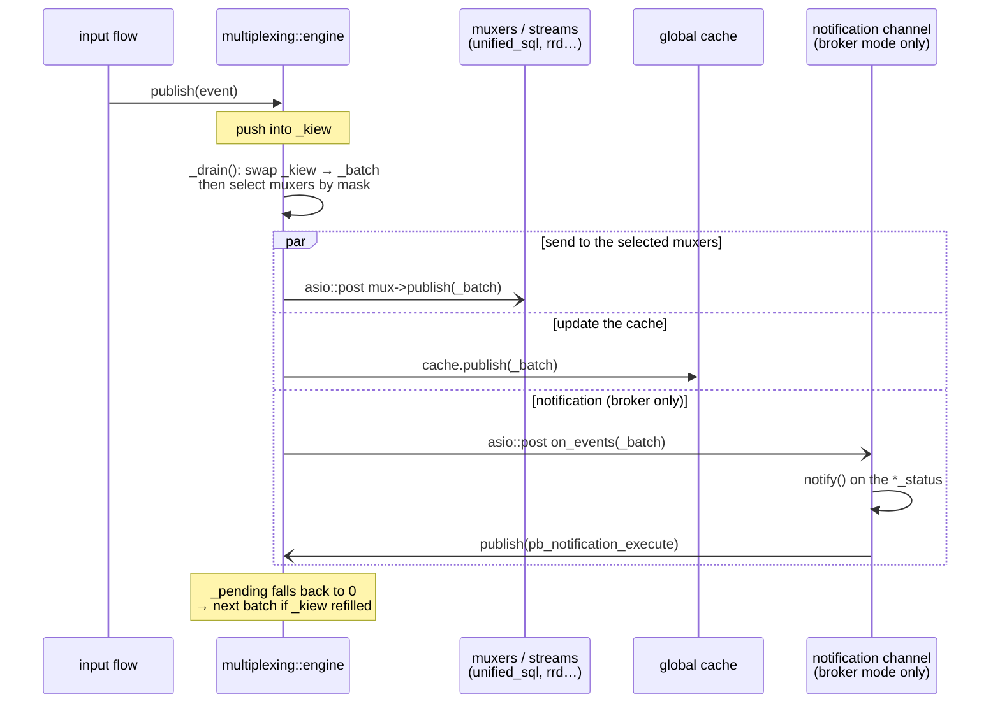

# Centralized downtime and acknowledgement management

[← Previous](06-remote-servers-en.md) · [Index](README-en.md) · [Next →](08-bam-en.md)

<!-- TOC -->
* [Problem](#problem)
* [Solution: the notification_mode parameter](#solution-the-notification_mode-parameter)
* [Persistence](#persistence)
* [Migration and downtimes / acknowledgements](#migration-and-downtimes--acknowledgements)
* [Driving the notification decision on Broker](#driving-the-notification-decision-on-broker)
  * [Backend initialization](#backend-initialization)
  * [Trigger: a third treatment in `multiplexing::engine`](#trigger-a-third-treatment-in-multiplexingengine)
  * [Turning off the decision on Engine](#turning-off-the-decision-on-engine)
<!-- TOC -->

> For the implementation details of the shared downtime scheduling library and the Broker-specific
> callbacks to implement, see [Downtimes library — Broker integration guide](../downtimes-integration-en.md).
>
> For how comments were moved out of Engine's memory so that Broker owns them (transient comment
> objects, deletion by id / in bulk, ids carried by retention), see
> [Comments — Engine ↔ Broker integration](../comments-integration-en.md).
>
> For how acknowledgement tracking moved from cbmod into Broker's global cache (storage, closure
> derived from the resource status, persistence across a cbd restart, and the GetAcknowledgements
> endpoint), see [Acknowledgements — Engine ↔ Broker integration](../acknowledgements-integration-en.md).

## Problem

In the current architecture, downtimes and acknowledgements are managed directly by Engine. PHP
sends commands to Engine, which stores and applies these objects locally. Two distinct problems
arise from this.

**BAM / Engine synchronisation (existing problem)**

Broker's BAM module manages *inherited downtimes*: when a host or service enters a downtime,
BAM can propagate that downtime to a Business Activity. To do so, Broker must create or delete
downtimes in Engine via external commands. However, Engine remains the source of truth for its
own downtimes — Broker merely injects commands into it. On Engine or Broker restart, the two
can fall out of sync: Engine has lost the inherited downtimes that Broker thought were active,
or conversely Broker is unaware of downtimes that Engine retained in its retention file. This
desynchronisation causes false alerts or unwanted alert suppression.

**Poller HA migration (upcoming problem)**

If a host is migrated from poller A to poller B under Poller HA, the downtimes and
acknowledgements defined on A are not automatically transferred to B. The host would arrive on
B without its active downtimes, risking false alerts during a maintenance window.

## Solution: the notification_mode parameter

**In legacy mode**, Engine continues to manage downtimes, acknowledgements, and notifications
exactly as it always has. No change.

**In centralized configuration mode** (BBDO3), the `notification_mode` parameter in `Broker`'s configuration controls who manages notifications, downtimes, and acknowledgements. `Broker` activates or deactivates its downtime management accordingly; PHP adapts by sending commands either to `Broker` (via `BrokerRpc`) or to `Engine` (via the command pipe). `Engine` does not read this setting: it learns during the negotiation, through the `broker_handles_notifications` field of the `Welcome`, that `Broker` is in charge, and then stops deciding on its own (see [Turning off the decision on Engine](#turning-off-the-decision-on-engine)).

- `notification_mode = engine` **(default)**: Engine manages everything exactly as in legacy
  mode. PHP continues to send downtime and acknowledgement commands to Engine via the command
  pipe. Suitable for single-poller zones and as a migration step from legacy.

- `notification_mode = broker`: Broker becomes the sole authority. PHP sends downtimes,
  acknowledgements, and escalation rules to Broker via the `BrokerRpc` gRPC API; Broker stores
  them directly in its database. Broker makes the notification **decision** (contact selection,
  escalations) and dispatches only the **execution** (macro expansion + command launch) to the
  supervising poller through the `pb_notification_execute` event; Engine no longer decides
  notifications on its own, it merely executes what Broker dispatches to it. Engine is never
  informed of downtimes, acknowledgements, or escalation rules. `hostescalation` and
  `serviceescalation` objects are removed from `centengine.cfg` entirely.
  This mode is **required** when Poller HA is active (multiple pollers in a zone with automatic
  resource distribution); it is also available as a standalone option for single-poller zones,
  allowing the infrastructure to be built and tested before HA is introduced.

**BAM with `notification_mode = broker`**: the BAM module runs inside Broker and has direct
access to the downtime store. The synchronisation problem described above disappears — there
is no longer any Engine-side copy to fall out of sync with.

> Acknowledgements follow this model since ticket T3: the `AcknowledgeHostProblem`,
> `AcknowledgeServiceProblem`, `RemoveHostAcknowledgement` and `RemoveServiceAcknowledgement` RPCs
> are served by `broker_acknowledgement_manager`, which replays Engine's flow (comment, event,
> status, notification, `logs` row) and applies the clearing rule on statuses itself. Details in
> [Acknowledgements — Engine ↔ Broker integration](../acknowledgements-integration-en.md#notification_mode--broker-broker-is-the-acknowledgement-authority).
>
> **Two side effects to address**: since Engine knows neither the downtimes nor the
> acknowledgements, its `$TOTAL*UNHANDLED$` macros over-count unhandled problems (decided fix: a
> downward mirror `(host_id, service_id, scheduled_downtime_depth, acknowledgement_type)` pushed to
> the owning poller, with a resync when it connects); and expiration through
> `acknowledgement_timeout`, an Engine timer, no longer fires (not ported to Broker at this stage).

## Persistence

Downtimes and acknowledgements are written to the database for display, but the database is not
what restores them: on restart, Broker re-reads its `<cache_dir>.cache` file, which holds the
**started** downtimes, the live acknowledgements and the notification states (see
[What is persisted at shutdown](04-centralized-cache-en.md#what-is-persisted-at-shutdown)). Future downtimes are neither
in that file nor re-read from the database. No Engine interaction is needed.

## Migration and downtimes / acknowledgements

No action is required during a host migration. Downtimes and acknowledgements live in Broker's
database and remain accessible regardless of which poller currently monitors the host. The
`RuntimeState` carries no downtime or acknowledgement data in centralized
configuration mode.

## Driving the notification decision on Broker

In `notification_mode = broker`, the notification **decision** (model C, see
`doc/ha-target-architecture`) runs in Broker: the `common/notifications` library
(`notification_manager`) is instantiated there with the
`broker_notification_callbacks` backend, and Broker dispatches the **execution**
(macro expansion + command launch) to the supervising poller through the
`pb_notification_execute` event (`io::bbdo`). The poller only executes it.

### Backend initialization

The backend is injected **at the same place as the timeperiods initialization**
on Broker, and only when `notification_mode = broker`. In engine mode nothing is
instantiated.

### Trigger: a third treatment in `multiplexing::engine`

Broker observes state changes through the `pb_host_status`/`pb_service_status`
events coming up from the pollers. The natural observation point is the core of
`multiplexing::engine`, whose drain loop (`_drain()`) already processes each
**batch** of events (obtained by swapping the main `_kiew` queue with the `_batch`
one) through two parallel treatments: sending to the muxers/streams
(`unified_sql`, `rrd`, …) and updating the **global cache**. We add a **third
treatment**, active only in broker mode: a consumer that, for each `*_status`,
calls `notify()` on the `notification_manager`.

Key points:

- The notification channel exists **only in broker mode**: in engine mode no task
  is created (zero cost, a mere pointer check in the loop).
- Like the muxers, it runs on the asio pool and **counts as one consumer of the
  batch** in `_pending`: the next batch is only dispatched once **all** consumers
  — notification included — are done, whoever brings the counter down to zero
  carrying the loop on. This per-batch serialization is enough to guarantee a
  single `notify()` runs at a time (the `notification_manager` is not
  thread-safe), **without a strand**.
- The muxers are **not all** posted to: `_drain()` computes the mask of the types
  the batch holds and only keeps the muxers whose write filter intersects it. A
  cbd serving 100 pollers therefore posts to the 2 muxers that want the monitoring
  flow, not to all 100. Rejections are still logged (trace), but on the engine
  side rather than inside `muxer::publish`.
- **Ordering** relative to the cache / `unified_sql` does not matter: in
  centralized config the cache configuration comes from `State`/`diff_state`, not
  from the status events; a `*_status` only carries a runtime state change. The
  consumer takes the triggering state from the event itself.

### Turning off the decision on Engine

In broker mode, Engine's notification decision must be neutralized to avoid a
**double notification** (a local one from Engine and the one dispatched by
Broker). The mechanism: **at negotiation**, Broker advertises in its `Welcome`
message the `broker_handles_notifications` flag (true when
`notification_mode=broker`); Engine receives it (`cbmod_stream`, `pb_welcome`
case), stores it in `cbmod_state`, and `notifier::notify()` then becomes a
**no-op**. Engine no longer decides; it only **executes** the notifications
Broker dispatches (`execute_broker_notification`, triggered by
`pb_notification_execute`) — that execution path is **independent** of this gate.

Design notes:

- **Sticky flag**: once received, it is not reset if Broker briefly disconnects
  — Engine does not take the decision back, which would reopen the double-
  notification door. A durably absent Broker is an HA concern (out of scope).
- **Startup window**: before negotiation the flag is false, so Engine would
  decide — but it has not run any check yet at that point, so it is harmless.
- Engine is **not informed** of `notification_mode` as such: it only learns, at
  runtime and through negotiation, that "Broker handles notifications" — in line
  with the "Engine config does not carry the mode" principle.
