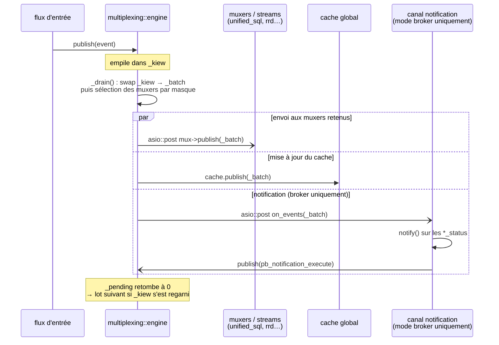

# Gestion centralisée des downtimes et acquittements

[← Précédent](06-remote-servers-fr.md) · [Index](README-fr.md) · [Suivant →](08-bam-fr.md)

<!-- TOC -->
* [Problème](#problème)
* [Solution : le paramètre notification_mode](#solution--le-paramètre-notification_mode)
* [Persistance](#persistance)
* [Migration et downtimes / acquittements](#migration-et-downtimes--acquittements)
* [Pilotage de la décision de notification côté Broker](#pilotage-de-la-décision-de-notification-côté-broker)
  * [Initialisation du backend](#initialisation-du-backend)
  * [Déclenchement : un troisième traitement dans `multiplexing::engine`](#déclenchement--un-troisième-traitement-dans-multiplexingengine)
  * [Coupure de la décision côté Engine](#coupure-de-la-décision-côté-engine)
<!-- TOC -->

> Pour le détail de la librairie de planification partagée et des callbacks à implémenter côté
> Broker, voir [Librairie downtimes — Guide d'intégration Broker](../downtimes-integration-fr.md).
>
> Pour la façon dont les commentaires ont été sortis de la mémoire d'Engine afin que Broker en soit
> propriétaire (objets commentaire éphémères, suppression par id / en masse, ids portés par la
> rétention), voir [Commentaires — intégration Engine ↔ Broker](../comments-integration-fr.md).
>
> Pour la façon dont le suivi des acquittements est passé de cbmod au cache global de Broker
> (stockage, fermeture dérivée du status de la ressource, persistance au redémarrage de cbd, et le
> point d'entrée GetAcknowledgements), voir
> [Acquittements — intégration Engine ↔ Broker](../acknowledgements-integration-fr.md).

## Problème

Dans l'architecture actuelle, les downtimes et acquittements sont gérés directement par Engine.
PHP envoie des commandes à Engine, qui stocke et applique ces objets localement. Deux problèmes
distincts en découlent.

**Synchronisation BAM / Engine (problème existant)**

Le module BAM de Broker gère les *downtimes hérités* : quand un host ou service entre en
downtime, BAM peut propager ce downtime à une activité métier (Business Activity). Pour ce
faire, Broker doit créer ou supprimer des downtimes dans Engine via des commandes externes.
Or Engine reste la source de vérité de ses propres downtimes — Broker ne fait qu'y injecter
des commandes. Lors d'un redémarrage d'Engine ou de Broker, les deux peuvent se retrouver
désynchronisés : Engine a perdu les downtimes hérités que Broker pensait actifs, ou
inversement Broker ignore des downtimes qu'Engine a conservés dans sa rétention. Cette
désynchronisation provoque des fausses alertes ou des suppressions d'alertes non voulues.

**Migration Poller HA (problème à venir)**

Si un host est migré du poller A vers le poller B dans le cadre du Poller HA, les downtimes
et acquittements définis sur A ne sont pas automatiquement transférés à B. Le host arriverait
sur B sans ses downtimes actifs, risquant de générer de fausses alertes pendant une fenêtre
de maintenance.

## Solution : le paramètre notification_mode

**En mode legacy**, Engine continue de gérer les downtimes, les acquittements et les
notifications exactement comme il l'a toujours fait. Aucun changement.

**En mode configuration centralisée** (BBDO3), le paramètre `notification_mode` dans la configuration de `Broker` contrôle qui gère les notifications, downtimes et acquittements. `Broker` active ou désactive sa gestion des downtimes en conséquence ; PHP s'adapte en envoyant les commandes soit à `Broker` (via `BrokerRpc`), soit à `Engine` (via le pipe de commandes). `Engine` ne lit pas ce paramètre : il apprend à la négociation, par le champ `broker_handles_notifications` du `Welcome`, que `Broker` a la main, et cesse alors de décider seul (voir [Coupure de la décision côté Engine](#coupure-de-la-décision-côté-engine)).

- `notification_mode = engine` **(défaut)** : Engine gère tout exactement comme en mode legacy.
  PHP continue d'envoyer les commandes de downtime et d'acquittement à Engine via le pipe de
  commandes. Convient aux zones mono-poller et comme étape de migration depuis le mode legacy.

- `notification_mode = broker` : Broker devient la seule autorité. PHP envoie les downtimes,
  acquittements et règles d'escalade à Broker via l'API gRPC `BrokerRpc` ; Broker les stocke
  directement dans sa base de données. Broker prend la **décision** de notification (sélection
  des contacts, escalades) et dispatche la seule **exécution** (expansion de macros + lancement
  de la commande) au poller superviseur via l'événement `pb_notification_execute` ; Engine ne
  décide plus de notification de lui-même, il se contente d'exécuter ce que Broker lui dispatche.
  Engine n'est jamais informé des downtimes, des acquittements ni des règles d'escalade. Les
  objets `hostescalation` et `serviceescalation` sont supprimés de `centengine.cfg` entièrement.
  Ce mode est **obligatoire** en mode Poller HA (plusieurs pollers dans une zone avec
  distribution automatique des ressources) ; il est aussi disponible comme option sur les zones
  mono-poller, ce qui permet de construire et valider l'infrastructure avant d'aborder le HA.

**BAM avec `notification_mode = broker`** : le module BAM s'exécute dans Broker et dispose
d'un accès direct au store de downtimes. Le problème de synchronisation décrit ci-dessus
disparaît — il n'existe plus de copie côté Engine susceptible de se désynchroniser.

> Les acquittements suivent ce modèle depuis le ticket T3 : les RPC `AcknowledgeHostProblem`,
> `AcknowledgeServiceProblem`, `RemoveHostAcknowledgement` et `RemoveServiceAcknowledgement` sont
> servis par `broker_acknowledgement_manager`, qui rejoue le flux d'Engine (commentaire, événement,
> statut, notification, ligne `logs`) et applique lui-même la règle de levée sur les status. Détail
> dans [Acquittements — intégration Engine ↔ Broker](../acknowledgements-integration-fr.md#mode-notification_mode--broker--broker-est-lautorité-dacquittement).
>
> **Deux effets de bord à traiter** : Engine ne connaissant ni les downtimes ni les acquittements,
> ses macros `$TOTAL*UNHANDLED$` surcomptent les problèmes non traités (correction décidée : un
> miroir descendant `(host_id, service_id, scheduled_downtime_depth, acknowledgement_type)` poussé
> au poller propriétaire, avec resynchronisation à sa connexion) ; et l'expiration par
> `acknowledgement_timeout`, timer Engine, ne se déclenche plus (non portée côté Broker à ce stade).

## Persistance

Les downtimes et acquittements sont écrits en base pour l'affichage, mais ce n'est pas la base
qui sert à les restaurer : au redémarrage, Broker relit son fichier `<cache_dir>.cache`, qui
contient les downtimes **démarrés**, les acquittements vivants et les états de notification
(voir [Ce qui est persisté à l'arrêt](04-centralized-cache-fr.md#ce-qui-est-persisté-à-larrêt)). Les downtimes futurs ne
sont ni dans ce fichier ni relus depuis la base. Aucune interaction avec Engine n'est nécessaire.

## Migration et downtimes / acquittements

Aucune action n'est requise lors d'une migration de host. Les downtimes et acquittements vivent
dans la base de Broker et restent accessibles quel que soit le poller qui supervise le host
après la migration. Le `RuntimeState` ne contient aucune donnée de downtime ou
d'acquittement en mode configuration centralisée.

## Pilotage de la décision de notification côté Broker

En `notification_mode = broker`, la **décision** de notification (modèle C, cf.
`doc/ha-target-architecture`) tourne dans Broker : la librairie
`common/notifications` (`notification_manager`) y est instanciée avec le backend
`broker_notification_callbacks`, et Broker dispatche l'**exécution** (expansion de
macros + lancement de la commande) au poller superviseur via l'événement
`pb_notification_execute` (`io::bbdo`). Le poller ne fait que l'exécuter.

### Initialisation du backend

Le backend est injecté **au même endroit que l'initialisation des timeperiods**
côté Broker, et uniquement quand `notification_mode = broker`. En mode engine,
rien n'est instancié.

### Déclenchement : un troisième traitement dans `multiplexing::engine`

Broker observe les changements d'état via les `pb_host_status`/`pb_service_status`
qui remontent des pollers. Le point d'observation naturel est le cœur de
`multiplexing::engine`, dont la boucle de drainage (`_drain()`) traite déjà chaque
**lot** d'événements (obtenu en échangeant la file principale `_kiew` avec le lot
`_batch`) selon deux traitements parallèles : l'envoi aux muxers/streams
(`unified_sql`, `rrd`, …) et la mise à jour du **cache global**. On ajoute un
**troisième traitement**, actif uniquement en mode broker : un consommateur qui,
pour chaque `*_status`, appelle `notify()` sur le `notification_manager`.

Points clés :

- Le canal notification n'existe **qu'en mode broker** : en mode engine, aucune
  tâche n'est créée (coût nul, un simple test de pointeur dans la boucle).
- Comme les muxers, il est traité par le pool asio et **compte pour un
  consommateur du lot** dans `_pending` : le lot suivant n'est dispatché qu'une
  fois **tous** les consommateurs — notification comprise — terminés, celui qui
  ramène le compteur à zéro reprenant la boucle. Cette sérialisation par lot
  suffit à garantir qu'un seul `notify()` s'exécute à la fois (le
  `notification_manager` n'est pas thread-safe), **sans strand**.
- Les muxers ne sont **pas tous** postés : `_drain()` calcule le masque des types
  présents dans le lot et ne retient que les muxers dont le filtre d'écriture
  l'intersecte. Un cbd servant 100 pollers poste ainsi aux 2 muxers qui veulent le
  flux de supervision, non aux 100. Les rejets restent journalisés (trace), mais
  côté engine et non plus dans `muxer::publish`.
- L'**ordre** avec le cache / `unified_sql` est sans importance : en conf
  centralisée, la config du cache vient des `State`/`diff_state`, pas des status ;
  un `*_status` ne porte qu'un changement d'état runtime. Le consommateur tire
  l'état déclencheur de l'événement lui-même.

### Coupure de la décision côté Engine

En mode broker, la décision de notification d'Engine doit être neutralisée pour
éviter une **double notification** (une locale par Engine, une dispatché par
Broker). Le mécanisme : **à la négociation**, Broker annonce dans son message
`Welcome` le drapeau `broker_handles_notifications` (vrai quand
`notification_mode=broker`) ; Engine le reçoit (`cbmod_stream`, case
`pb_welcome`), le mémorise dans `cbmod_state`, et `notifier::notify()` devient
alors un **no-op**. Engine ne décide plus ; il ne fait qu'**exécuter** les
notifications que Broker lui dispatche (`execute_broker_notification`, déclenchée
par `pb_notification_execute`) — ce chemin d'exécution est **indépendant** de ce
gate.

Notes de conception :

- **Drapeau collant (sticky)** : une fois reçu, il n'est pas réinitialisé si
  Broker se déconnecte brièvement — Engine ne reprend pas la main, ce qui
  rouvrirait justement la porte à la double notification. Le cas « Broker
  durablement absent » relève de la HA (hors périmètre).
- **Fenêtre de démarrage** : avant la négociation le drapeau est faux, donc
  Engine déciderait — mais il n'a pas encore exécuté de check à ce stade, donc
  sans conséquence.
- Engine **n'est pas informé** de `notification_mode` en tant que tel : il reçoit
  seulement, au runtime et via la négociation, l'information « Broker gère les
  notifications » — conforme au principe « la configuration d'Engine ne porte
  pas le mode ».
