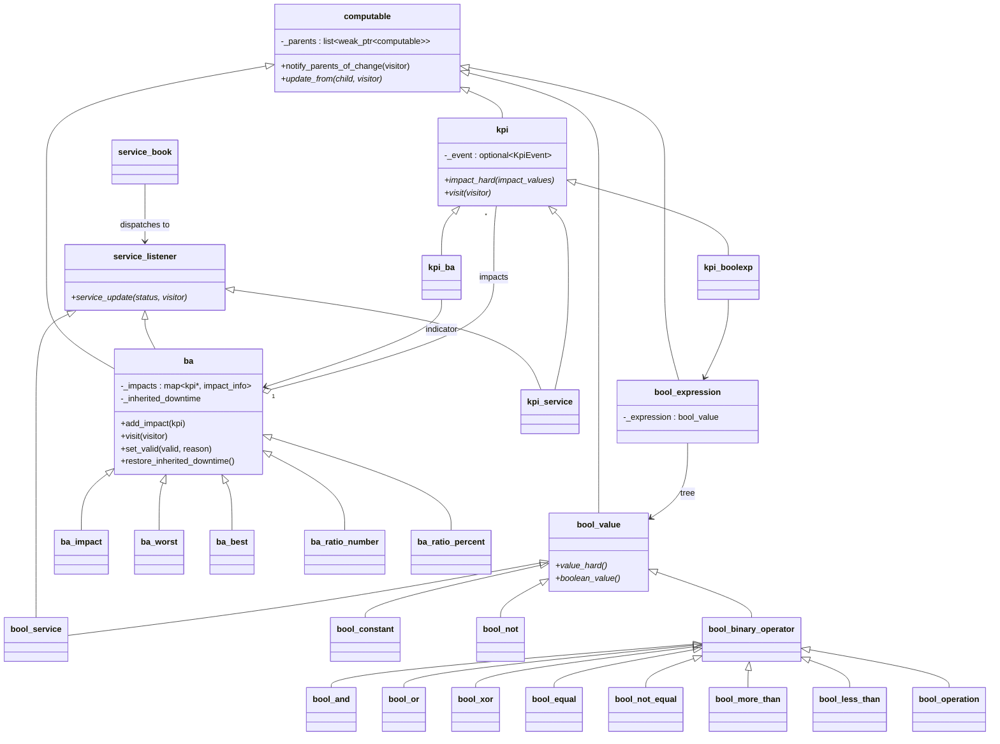
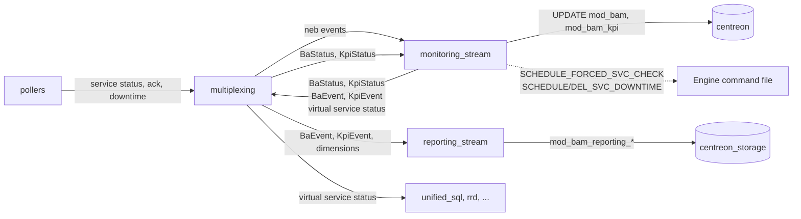
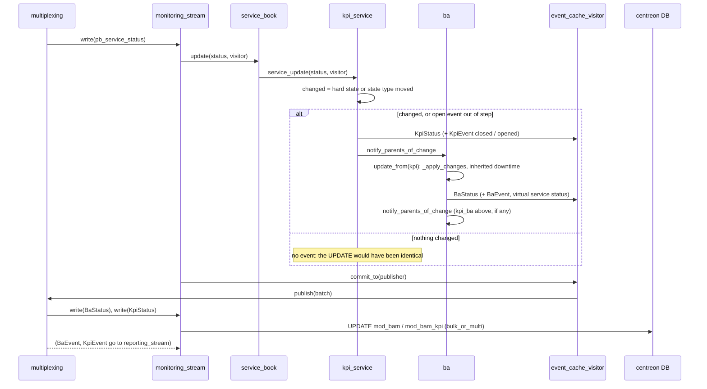
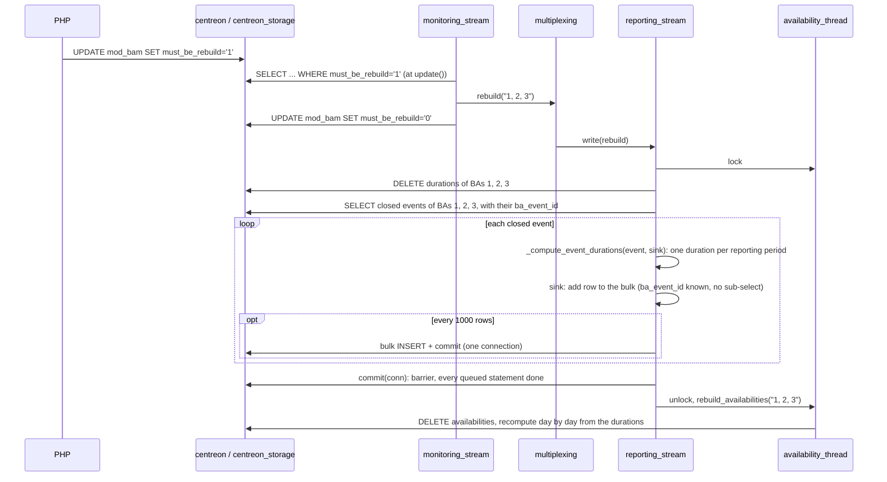
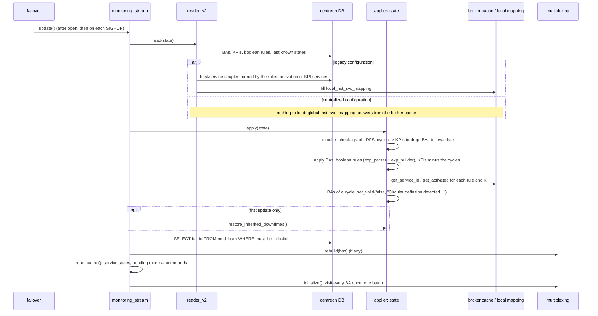
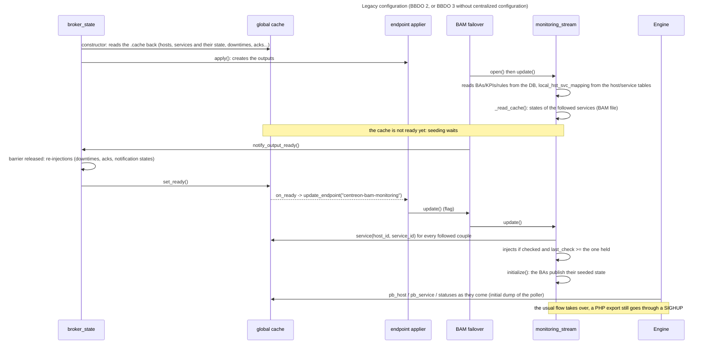
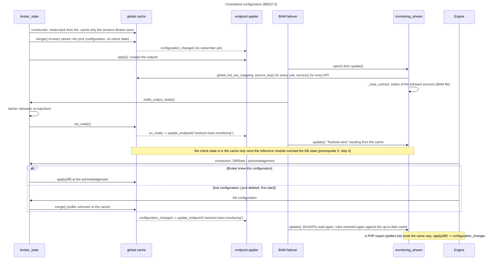

# BAM in Broker

[← Previous](07-downtimes-acknowledgements-en.md) · [Index](README-en.md) · [Next →](09-ha-preparatory-work-en.md)

<!-- TOC -->
* [The objects](#the-objects)
* [Two streams, one module](#two-streams-one-module)
  * [The monitoring stream, event by event](#the-monitoring-stream-event-by-event)
  * [The reporting stream](#the-reporting-stream)
  * [The rebuild](#the-rebuild)
* [Starting up, in both regimes](#starting-up-in-both-regimes)
  * [Two signals from the global cache: ready, and configuration changed](#two-signals-from-the-global-cache-ready-and-configuration-changed)
* [Circular definitions](#circular-definitions)
* [What was measured and where](#what-was-measured-and-where)
<!-- TOC -->

BAM, the Business Activity Monitoring, is a Broker module, `20-bam.so`, loaded by the
central cbd. It turns the states of services into the states of *Business Activities*
(BAs), publishes them as if they were services of a virtual host, and keeps the history
that the reporting reads. This chapter describes how it works today, after the 2026-09
rework: what runs where, how it starts in both configuration regimes, how its two streams
share the work, and what happens to a configuration that loops on itself.

## The objects

A BA is computed from *KPIs*. A KPI is one of three things: a **service** (its hard state
is what counts), another **BA** (a BA of BAs), or a **boolean rule** (an expression on
service states, `{host svc} {IS} {CRITICAL} {OR} ...`). Each BA has a type that says how
its KPIs combine: `impact` (a level starting at 100 that each degraded KPI lowers),
`worst`, `best`, `ratio_number` and `ratio_percent` (how many KPIs are CRITICAL). Every BA
owns a **virtual service**, `ba_<id>` on the host `_Module_BAM_<poller>`, through which
its state is seen by the rest of the platform like any service.

Only the **hard** state of a KPI takes part in the computation. BAM used to carry a soft
state alongside, computed at every step and never read by anyone: it was removed in
2026-09. The `*_soft` fields of the `KpiStatus` BBDO message remain, filled with the hard
values, so that nothing downstream has to change.

In memory this is a graph of `computable` objects: `kpi_service`, `kpi_ba`, `kpi_boolexp`
at the leaves, `bool_*` operators for the rules, `ba_*` at the top. A child that changes
calls `notify_parents_of_change`, and each parent recomputes itself from that one child
(`update_from`), then notifies its own parents if it changed in turn. The downward links
are `shared_ptr`; the upward ones, `weak_ptr`, so that a BA and its KPIs do not keep each
other alive across reloads.

## Two streams, one module

The module registers two output types, which the Broker configuration declares as two
distinct outputs:

| output type | class | database | job |
|---|---|---|---|
| `bam` | `monitoring_stream` | `centreon` (configuration), plus `centreon_storage` for what it reads | real time: compute the BAs, write their current state to `mod_bam` and `mod_bam_kpi`, publish the virtual services |
| `bam_bi` | `reporting_stream` | `centreon_storage` | history: `mod_bam_reporting_*` events, durations per reporting period, daily availabilities |

They do not talk to each other directly. Everything goes through the multiplexing engine,
each stream declaring the event types it wants (`connector.cc`). The monitoring stream
reads what the pollers send — service statuses, acknowledgements, downtimes, instances —
and what BAM itself produces: `BaStatus`, `KpiStatus`, `InheritedDowntime`. The reporting
stream reads only BAM's own BI events: `BaEvent`, `KpiEvent`, `BaDurationEvent`, the
dimension events, and the `rebuild` signal.

The loop on the left is deliberate: a `BaStatus` or a `KpiStatus` produced by a
computation is published like any event, and it is the same monitoring stream that
receives it back and writes it to the database, with the same batching (`bulk_or_multi`)
as everything else. The BI events take the other branch and end up in the reporting
stream.

### The monitoring stream, event by event

A service status enters `service_book`, which knows which listeners follow each
`(host_id, service_id)`: the `kpi_service` objects, and the BAs whose virtual service it
is. The KPI updates its state and, **only if something changed**, visits itself — which
produces a `KpiStatus` and, on a state change, closes the open `KpiEvent` and opens a new
one — then notifies its BA. The BA recomputes, visits itself in turn (`BaStatus`,
`BaEvent`, and the status of its virtual service when its state moved), computes its
inherited downtime, and notifies its own parents. All the events of one incoming status
are collected by an `event_cache_visitor` and published to the multiplexing **as one
batch**, in the order others, BA events, KPI events.

The "only if something changed" is recent (2026-09). A `KpiStatus` used to be produced for
every check result of every KPI service, whether it changed or not, and each one became
an identical `UPDATE mod_bam_kpi`. The visit is still owed when the KPI changed, when it
has events restored from the database waiting to be committed, or when its open event no
longer matches its state — the case of a state restored from the cache, which updates
without visiting.

Two side channels leave the stream:

* when a BA changes state, a `SCHEDULE_FORCED_SVC_CHECK` of its virtual service is queued
  for Engine, batched and sent through the command file a few seconds later;
* the **inherited downtime**: a BA configured to inherit downtimes goes into downtime when
  all its impacting KPIs are, and out when one of them is not. In the Engine-managed
  regime this is a `SCHEDULE_SVC_DOWNTIME` / `DEL_SVC_DOWNTIME_FULL` on the virtual
  service, sent through the command file; when Broker owns downtimes
  (`notification_mode=broker`), the in-process `downtime_manager` is driven directly.

### The reporting stream

It receives the BI events and writes them: a `BaEvent` or `KpiEvent` is inserted the first
time it is seen and updated when it closes; a closed `BaEvent` is broken down into one
duration per reporting period of the BA, through the `timeperiod` objects of the shared
library, and written to `mod_bam_reporting_ba_events_durations`. The **dimension** events
describe the configuration (BAs, BVs, KPIs, timeperiods, relations) for the reporting
tables; they arrive framed by a `DimensionTruncateTableSignal` pair, are held until the
closing signal, then the tables are truncated and refilled in one go. An
`availability_thread` wakes up at midnight and computes the availabilities of the day
before, from the durations. When a rebuild spans years, it does the same day by day, but
reads and writes by chunks of a month: one query for the durations of the chunk, one for
the events still open, one multi-row insert for its availabilities. It used to run two
queries and one insert per BA and period for every single day, under the lock the
reporting stream also waits for: 752 ms to 207 ms measured on 83 days.

At startup the reporting stream loads the timeperiods and the **open** events of the
database — the ones an UPDATE can still reach — closes them, since the previous run left
them so, and starts its thread. An event it does not know when one arrives is looked up
in the database, through the `(id, start_time)` index, before being inserted: an old
event replayed from a retention file is updated, not duplicated. The two event tables
used to be read whole at every start, years of history for a yes-or-no question.

Since 2026-09 the stream handles the protobuf form of every event only. Nothing in BAM
emits the legacy BBDO2 structures any more; an older peer or an old retention file can
still deliver some, and `write()` turns them into protobuf at the door with
`neb::bbdo2_to_bbdo3` before any treatment. The two parallel implementations that existed
for each event type — one per form — are gone.

### The rebuild

When the reporting periods of a BA change, PHP flags it `must_be_rebuild` in `mod_bam`.
The monitoring stream reads the flag when it applies its configuration, publishes a
`rebuild` event naming the BAs, and clears the flag. The reporting stream deletes every
duration of those BAs, reads their closed events back, recomputes the durations and
writes them, then asks the availability thread to recompute their availabilities. All of
it runs under the availability thread's lock.

Measured on 20000 durations, this rebuild took 9.9 s: one `UPDATE`-then-`INSERT` statement
per duration, each a transaction of its own because the BAM outputs run with
`queries_per_transaction` at 0, i.e. autocommit, so each paid a commit. The durations are
now inserted by batches of 1000 rows, one statement each, on one pinned connection, with
a final commit that doubles as a barrier: 0.18 s. The `tests/benchmarks/bam-rebuild`
benchmark measures it.

## Starting up, in both regimes

The monitoring stream does not read its configuration when it is constructed. The
failover that owns the stream calls `update()` once the stream is open, and again on
every Broker reload (`SIGHUP`): `reader_v2` reads the BAM tables of the configuration
database — BAs, KPIs, boolean rules, and the state each object was last known in — and
`configuration::applier::state` applies the result, creating, modifying or removing the
in-memory objects by difference with the previous apply.

The one thing that differs between the two configuration regimes is **how names become
ids**. A BAM configuration names a service in exactly one place, the `{host service}` of a
boolean rule; everything else already carries ids. And the KPI applier has to know
whether a KPI service is still activated, to drop the KPI otherwise.

* In **legacy** configuration, `reader_v2` builds a `local_hst_svc_mapping` from the
  `host` and `service` tables: one query resolving only the couples the boolean rules
  actually name, and the activation column of the services the KPIs point at.
* In **centralized** configuration (`supports_centralized_conf()`), the mapping is a
  `global_hst_svc_mapping` that answers from the **Broker global cache**, the same one
  that holds the pollers' configurations. No query is made: a service the cache does not
  hold is a service no poller has, so its KPI is dropped exactly as a deactivated one is
  in legacy mode. The two regimes have to drop the same KPIs — `BA_DEACTIVATED_SERVICE`
  and `CBABOODEACTIVATEDSVC` check that they do.

The runtime state of the KPI services is not in the database; it is in a cache file,
`<broker>.cache.centreon-bam-monitoring`, written when the stream stops and read back
after the configuration is applied: the last known state of every followed service, and
the external commands that were queued and not yet sent. The BAs are then visited once,
which publishes the restored, coherent state in one go.

One thing is neither in the database nor in the cache: whether a BA's downtime was
**inherited**. `mod_bam` only says the BA is in downtime. Until 2026-09 the in-memory
inherited downtime was rebuilt by accident — the never-initialised soft state made the
cache restore look like a change, which made every BA recompute. With the soft state
gone, the rebuild is explicit: at the first apply, a BA that inherits downtimes, that the
database says is in downtime, and whose impacting KPIs are all in downtime, gets its
inherited downtime object back, silently, since the downtime already exists on its
virtual service. `BECBAMIDTU2` and `BEBAMIDT2` are the tests that caught the regression.

That restoration has a blind spot: when the KPIs left downtime while cbd was down, not
every KPI is in downtime at startup, the object is not recreated, and the downtime BAM had
put on the virtual service would stay for ever. The downtime itself closes it: it carries
BAM's author and comment, shared constants of `internal.hh`. A BA that sees such a downtime
active on its virtual service — replayed by Engine when the poller connects, or found in
the Broker `downtime_manager` at the first apply when Broker owns the downtimes — takes it
back as its inherited downtime and recomputes at once, which lifts it if the KPIs no longer
justify it (`ba::adopt_inherited_downtime`; `BEBAMIDT3`, `BECBAMIDTU3`).

### Two signals from the global cache: ready, and configuration changed

Since 2026-10, BAM no longer depends only on the moment its failover opens it. The Broker
global cache sends it two signals, and BAM always answers them the same way: it asks the
endpoint applier for an `update_endpoint("centreon-bam-monitoring")`, i.e. the
`failover::update()` a `SIGHUP` would send to every output, restricted to its own. The
failover raises its flag and calls `monitoring_stream::update()` at the next turn of its
loop, on its own thread and under the stream lock: nothing in BAM has to become
thread-safe, and several signals in a row cost a single `update()`, the flag being a
boolean.

* **`on_ready`** — the cache is *ready* once the startup barrier is released, that is once
  every output opened its stream a first time and `broker_state` re-injected the downtimes,
  acknowledgements, notification states and switches it persists
  (`broker_cache::set_ready()`, called from `_on_barrier_released()`). A subscriber that
  registers afterwards is served at once. BAM subscribes when its connector is created:
  this is where it **seeds the state of its KPI services from the global cache**.
* **`configuration_changed`** — emitted outside the lock at the end of every `merge()` and
  `apply()`, i.e. whenever the configuration the cache describes changed: a configuration
  round closed after the pollers acknowledged, a lost configuration rebuilt from Engine.
  BAM then reads its tables again and resolves its rules and KPIs against a cache that
  knows the new objects. In centralized configuration this replaces the cbd reload PHP
  performed after every legacy export; without it, a BA created in the UI was only seen at
  the next `SIGHUP`.

Seeding from the global cache follows one rule, *freshest wins*: for every couple the
`service_book` follows, the cache entry is injected only if the service has been checked
(`checked`) and its `last_check` is at least the one BAM already holds, whether it came from
its own `.cache.centreon-bam-monitoring` file or from a status received meanwhile. A
configuration-only entry, still PENDING, therefore overwrites nothing.

The tests that pin this behaviour down: `CBA_CONF_PUSHED_NO_RELOAD` (BA created after
startup, pushed through `.lck`, visible without a reload), `CBA_PROT_LOST_RESTART` (`1.prot`
deleted, then cbd restarted), `CBA_KPI_SERVICE_ADDED_LATER` (KPI whose service only exists
after an export).

## Circular definitions

A BA can be a KPI of another BA, and a boolean rule can read any service, including the
virtual service of a BA. Nothing in the web interface prevents a BA from being, through
any number of steps, its own ancestor. Such a configuration cannot be computed: each
change would propagate around the cycle for ever.

Before applying anything, `applier::state` builds a graph of the configuration —
BAs, KPIs, boolean rules, services — with an edge wherever a change propagates: from a
KPI's source (service, BA or rule) to the KPI, from the KPI to its BA, from a BA to its
virtual service, from a service to the rules that name it. A depth-first walk with an
explicit path finds the cycles; a node met again while still on the path closes one, and
the path from that node to the top is the cycle.

What is then done with it changed in 2026-09. The check used to throw, which stopped the
whole apply: not one BA was computed, and the failover reconnected for ever, re-reading
the same configuration and throwing again. One loop in the configuration disabled BAM.
Now:

* every KPI of a cycle is left out of the configuration before it is applied, which
  breaks the cycle whatever order the graph was walked in;
* every BA of a cycle is applied, but **invalid**: UNKNOWN whatever its type would
  compute, with `Circular definition detected. BA <name> includes itself as a KPI.` as
  its output. The output is what the monitoring stream writes into the `comment` column
  of `mod_bam`, so the user sees it in the interface. Every BA type honours the invalid
  flag in both its state and its output — only `impact` did for the state before, and
  none for the output, which also covers the other cause of invalidity, a KPI whose
  target does not exist;
* the cycle is logged in clear, `BA 1 -> KPI 11 -> BA 2 -> KPI 10 -> BA 1`;
* everything outside the cycle is applied and computed as usual. The next apply, once the
  user has removed the offending KPI, sets the BAs valid again.

`ApplierCircular` (unit) and `BAM_CIRCULAR` (robot) cover it: a BA of BA loop with a sane
BA beside it, the loop fixed on reload, and a loop through a boolean rule.

## What was measured and where

The `tests/benchmarks/` directory holds two BAM benchmarks, filed in the same store as the
others and compared with `./bench.py compare`:

* `bam-startup`: the time of every step of `reader_v2::read()` as the platform and the
  BAM configuration grow, separately;
* `bam-rebuild`: the BI rebuild of the event durations as the history grows.

Two lessons from the second one are worth keeping in mind before optimising anything
that writes to MariaDB from Broker: check how the connection commits before changing
how it sends, and do not trust a profile of the client alone when the client is waiting.
A bulk statement of N rows commits once, in autocommit too; N statements commit N times.
