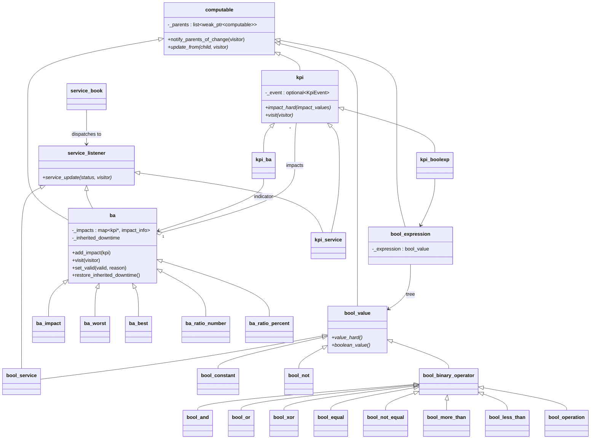
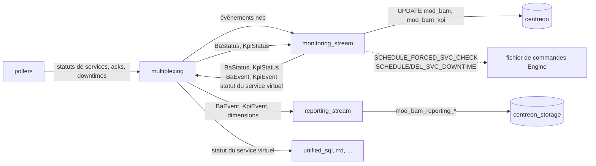
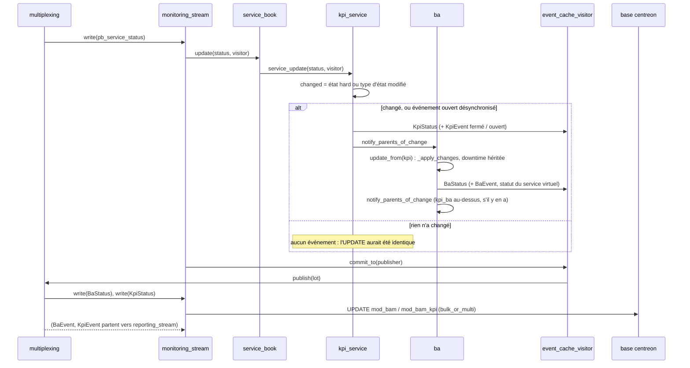
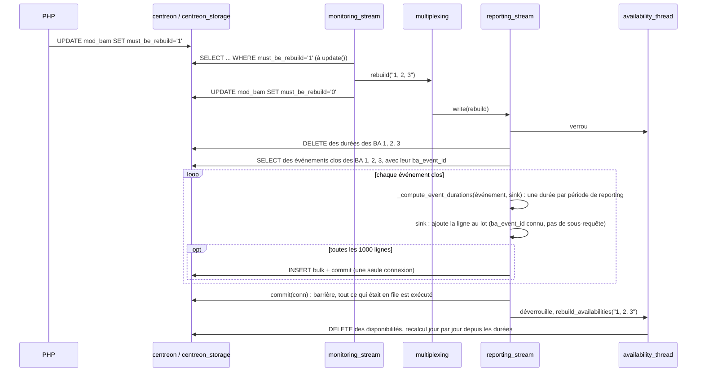
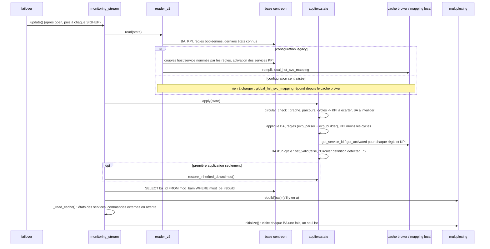
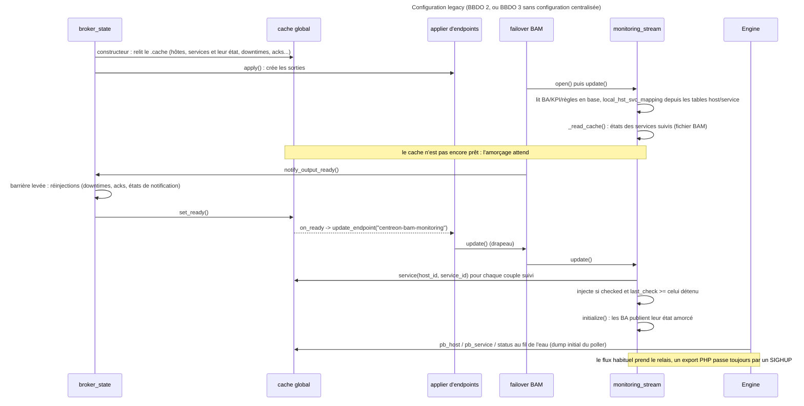
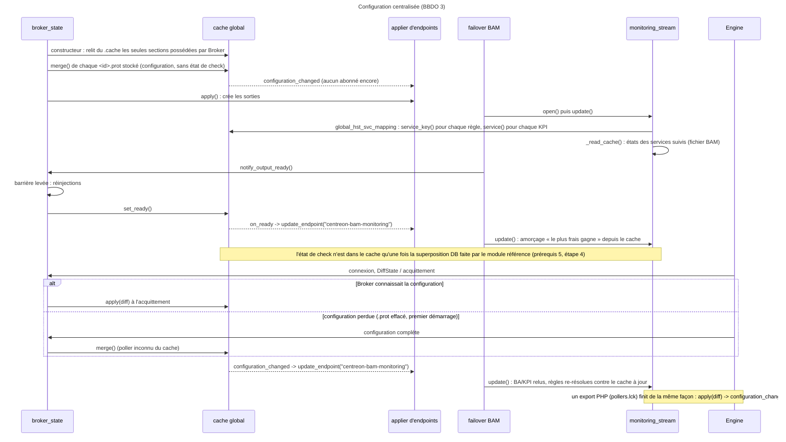

# BAM dans Broker

[← Précédent](07-downtimes-acknowledgements-fr.md) · [Index](README-fr.md) · [Suivant →](09-ha-preparatory-work-fr.md)

<!-- TOC -->
* [Les objets](#les-objets)
* [Deux streams, un module](#deux-streams-un-module)
  * [Le monitoring stream, événement par événement](#le-monitoring-stream-événement-par-événement)
  * [Le reporting stream](#le-reporting-stream)
  * [Le rebuild](#le-rebuild)
* [Le démarrage, dans les deux régimes](#le-démarrage-dans-les-deux-régimes)
  * [Deux signaux du cache global : prêt, et configuration changée](#deux-signaux-du-cache-global--prêt-et-configuration-changée)
* [Les définitions circulaires](#les-définitions-circulaires)
* [Ce qui a été mesuré, et où](#ce-qui-a-été-mesuré-et-où)
<!-- TOC -->

BAM, le *Business Activity Monitoring*, est un module de Broker, `20-bam.so`, chargé par le
cbd central. Il transforme les états des services en états d'*activités métier* (BA), les
publie comme s'il s'agissait de services d'un hôte virtuel, et tient l'historique que le
reporting lit. Ce chapitre décrit son fonctionnement actuel, après les travaux de 2026-09 :
ce qui tourne où, comment il démarre dans les deux régimes de configuration, comment ses
deux streams se partagent le travail, et ce qu'il advient d'une configuration qui boucle
sur elle-même.

## Les objets

Un BA se calcule à partir de *KPI*. Un KPI est l'une de trois choses : un **service** (c'est
son état hard qui compte), un autre **BA** (un BA de BA), ou une **règle booléenne** (une
expression sur des états de services, `{host svc} {IS} {CRITICAL} {OR} ...`). Chaque BA a un
type qui dit comment ses KPI se combinent : `impact` (un niveau qui part de 100 et que
chaque KPI dégradé abaisse), `worst`, `best`, `ratio_number` et `ratio_percent` (combien de
KPI sont CRITICAL). Chaque BA possède un **service virtuel**, `ba_<id>` sur l'hôte
`_Module_BAM_<poller>`, par lequel son état est vu par le reste de la plateforme comme
celui de n'importe quel service.

Seul l'état **hard** d'un KPI participe au calcul. BAM portait aussi un état soft, calculé à
chaque étape et jamais lu : il a été supprimé en 2026-09. Les champs `*_soft` du message
BBDO `KpiStatus` subsistent, remplis avec les valeurs hard, pour que rien en aval n'ait à
changer.

En mémoire, c'est un graphe d'objets `computable` : `kpi_service`, `kpi_ba`, `kpi_boolexp`
aux feuilles, les opérateurs `bool_*` pour les règles, les `ba_*` au sommet. Un enfant qui
change appelle `notify_parents_of_change`, et chaque parent se recalcule à partir de ce seul
enfant (`update_from`), puis notifie ses propres parents s'il a changé à son tour. Les liens
descendants sont des `shared_ptr` ; les liens remontants des `weak_ptr`, pour qu'un BA et
ses KPI ne se maintiennent pas mutuellement en vie au travers des rechargements.

## Deux streams, un module

Le module enregistre deux types de sortie, que la configuration de Broker déclare comme
deux sorties distinctes :

| type de sortie | classe | base | rôle |
|---|---|---|---|
| `bam` | `monitoring_stream` | `centreon` (configuration), plus `centreon_storage` pour ce qu'il lit | temps réel : calculer les BA, écrire leur état courant dans `mod_bam` et `mod_bam_kpi`, publier les services virtuels |
| `bam_bi` | `reporting_stream` | `centreon_storage` | historique : événements `mod_bam_reporting_*`, durées par période de reporting, disponibilités quotidiennes |

Ils ne se parlent pas directement. Tout passe par le moteur de multiplexing, chaque stream
déclarant les types d'événements qu'il veut (`connector.cc`). Le monitoring stream lit ce
que les pollers envoient — statuts de services, acquittements, downtimes, instances — et ce
que BAM produit lui-même : `BaStatus`, `KpiStatus`, `InheritedDowntime`. Le reporting stream
ne lit que les événements BI propres à BAM : `BaEvent`, `KpiEvent`, `BaDurationEvent`, les
événements de dimension, et le signal `rebuild`.

La boucle à gauche est voulue : un `BaStatus` ou un `KpiStatus` issu d'un calcul est publié
comme n'importe quel événement, et c'est le même monitoring stream qui le reçoit en retour
et l'écrit en base, avec le même groupement (`bulk_or_multi`) que tout le reste. Les
événements BI prennent l'autre branche et finissent dans le reporting stream.

### Le monitoring stream, événement par événement

Un statut de service entre dans le `service_book`, qui sait quels auditeurs suivent chaque
`(host_id, service_id)` : les objets `kpi_service`, et les BA dont c'est le service virtuel.
Le KPI met son état à jour et, **seulement si quelque chose a changé**, se visite — ce qui
produit un `KpiStatus` et, sur un changement d'état, ferme le `KpiEvent` ouvert et en ouvre
un nouveau — puis notifie son BA. Le BA se recalcule, se visite à son tour (`BaStatus`,
`BaEvent`, et le statut de son service virtuel quand son état a bougé), calcule sa downtime
héritée, et notifie ses propres parents. Tous les événements d'un statut entrant sont
collectés par un `event_cache_visitor` et publiés vers le multiplexing **en un seul lot**,
dans l'ordre autres, événements BA, événements KPI.

Le « seulement si quelque chose a changé » est récent (2026-09). Un `KpiStatus` était
produit pour chaque résultat de check de chaque service KPI, changé ou non, et chacun
devenait un `UPDATE mod_bam_kpi` identique au précédent. La visite reste due quand le KPI a
changé, quand il a des événements restaurés de la base en attente d'être commités, ou quand
son événement ouvert ne correspond plus à son état — le cas d'un état restauré depuis le
cache, qui met à jour sans visiter.

Deux voies latérales sortent du stream :

* quand un BA change d'état, un `SCHEDULE_FORCED_SVC_CHECK` de son service virtuel est mis
  en file pour Engine, groupé et envoyé par le fichier de commandes quelques secondes plus
  tard ;
* la **downtime héritée** : un BA configuré pour hériter des downtimes passe en downtime
  quand tous ses KPI impactants le sont, et en sort quand l'un d'eux ne l'est plus. Dans le
  régime où Engine gère les downtimes, c'est un `SCHEDULE_SVC_DOWNTIME` /
  `DEL_SVC_DOWNTIME_FULL` sur le service virtuel, envoyé par le fichier de commandes ; quand
  Broker possède les downtimes (`notification_mode=broker`), le `downtime_manager` interne
  est piloté directement.

### Le reporting stream

Il reçoit les événements BI et les écrit : un `BaEvent` ou un `KpiEvent` est inséré la
première fois qu'il est vu et mis à jour quand il se ferme ; un `BaEvent` fermé est
découpé en une durée par période de reporting du BA, grâce aux objets `timeperiod` de la
bibliothèque partagée, et écrit dans `mod_bam_reporting_ba_events_durations`. Les
événements de **dimension** décrivent la configuration (BA, BV, KPI, périodes, relations)
pour les tables de reporting ; ils arrivent encadrés par une paire de
`DimensionTruncateTableSignal`, sont retenus jusqu'au signal de fermeture, puis les tables
sont vidées et remplies d'un coup. Un `availability_thread` se réveille à minuit et calcule
les disponibilités de la veille à partir des durées. Quand un rebuild couvre des années, il
fait de même jour par jour, mais lit et écrit par lots d'un mois : une requête pour les
durées du lot, une pour les événements encore ouverts, une insertion multi-lignes pour ses
disponibilités. Il faisait auparavant deux requêtes et une insertion par BA et période pour
chaque jour, sous le verrou que le reporting stream attend aussi : 752 ms ramenés à 207 ms
mesurés sur 83 jours.

Au démarrage, le reporting stream charge les périodes et les événements **ouverts** de la
base — ceux qu'un UPDATE peut encore atteindre — les ferme, puisque l'exécution précédente
les a laissés ainsi, et lance son thread. Un événement qu'il ne connaît pas quand il
arrive est cherché en base, par l'index `(id, start_time)`, avant d'être inséré : un vieil
événement rejoué depuis un fichier de rétention est mis à jour, pas dupliqué. Les deux
tables d'événements étaient lues en entier à chaque démarrage, des années d'historique pour
une question à oui ou non.

Depuis 2026-09 le stream ne traite que la forme protobuf de chaque événement. Plus rien dans
BAM n'émet les structures legacy BBDO2 ; un pair plus ancien ou un vieux fichier de
rétention peuvent encore en livrer, et `write()` les convertit en protobuf à l'entrée avec
`neb::bbdo2_to_bbdo3` avant tout traitement. Les deux implémentations parallèles qui
existaient pour chaque type d'événement — une par forme — ont disparu.

### Le rebuild

Quand les périodes de reporting d'un BA changent, PHP le marque `must_be_rebuild` dans
`mod_bam`. Le monitoring stream lit le drapeau quand il applique sa configuration, publie un
événement `rebuild` nommant les BA, et efface le drapeau. Le reporting stream supprime
toutes les durées de ces BA, relit leurs événements clos, recalcule les durées et les
écrit, puis demande au thread des disponibilités de recalculer les leurs. Tout cela sous le
verrou du thread des disponibilités.

Mesuré sur 20 000 durées, ce rebuild prenait 9,9 s : un statement `UPDATE` puis `INSERT` par
durée, chacun dans sa propre transaction puisque les sorties BAM tournent avec
`queries_per_transaction` à 0, c'est-à-dire en autocommit, donc chacun payait un commit. Les
durées sont maintenant insérées par lots de 1000 lignes, un statement chacun, sur une
connexion épinglée, avec un commit final qui sert de barrière : 0,18 s. Le bench
`tests/benchmarks/bam-rebuild` le mesure.

## Le démarrage, dans les deux régimes

Le monitoring stream ne lit pas sa configuration à sa construction. Le failover qui possède
le stream appelle `update()` une fois le stream ouvert, puis à chaque rechargement de Broker
(`SIGHUP`) : `reader_v2` lit les tables BAM de la base de configuration — BA, KPI, règles
booléennes, et l'état dans lequel chaque objet a été vu pour la dernière fois — et
`configuration::applier::state` applique le résultat, en créant, modifiant ou supprimant les
objets en mémoire par différence avec l'application précédente.

La seule chose qui diffère entre les deux régimes de configuration est **la résolution des
noms en identifiants**. Une configuration BAM nomme un service à un seul endroit, le
`{host service}` d'une règle booléenne ; tout le reste porte déjà des identifiants. Et
l'applier des KPI doit savoir si un service KPI est toujours activé, pour écarter le KPI
sinon.

* En configuration **legacy**, `reader_v2` construit un `local_hst_svc_mapping` depuis les
  tables `host` et `service` : une requête qui ne résout que les couples effectivement
  nommés par les règles, et la colonne d'activation des services visés par les KPI.
* En configuration **centralisée** (`supports_centralized_conf()`), le mapping est un
  `global_hst_svc_mapping` qui répond depuis le **cache global de Broker**, celui qui
  détient les configurations des pollers. Aucune requête n'est faite : un service absent du
  cache est un service qu'aucun poller n'a, et son KPI est écarté exactement comme celui d'un
  service désactivé en legacy. Les deux régimes doivent écarter les mêmes KPI —
  `BA_DEACTIVATED_SERVICE` et `CBABOODEACTIVATEDSVC` le vérifient.

L'état d'exécution des services KPI n'est pas en base ; il est dans un fichier de cache,
`<broker>.cache.centreon-bam-monitoring`, écrit à l'arrêt du stream et relu après
l'application de la configuration : le dernier état connu de chaque service suivi, et les
commandes externes mises en file et pas encore envoyées. Les BA sont ensuite visités une
fois, ce qui publie l'état restauré et cohérent d'un seul coup.

Une chose n'est ni en base ni dans le cache : le fait qu'une downtime de BA soit
**héritée**. `mod_bam` dit seulement que le BA est en downtime. Jusqu'en 2026-09 l'objet de
downtime héritée en mémoire était reconstruit par accident — l'état soft, jamais
initialisé, faisait passer la restauration du cache pour un changement, ce qui faisait
recalculer chaque BA. Le soft disparu, la reconstruction est explicite : à la première
application, un BA qui hérite des downtimes, que la base dit en downtime, et dont tous les
KPI impactants sont en downtime, retrouve son objet, silencieusement, puisque la downtime
existe déjà sur son service virtuel. `BECBAMIDTU2` et `BEBAMIDT2` sont les tests qui ont
attrapé la régression.

Cette restauration a un angle mort : quand les KPI sont sortis de downtime pendant que cbd
était arrêté, tous les KPI ne sont pas en downtime au démarrage, l'objet n'est pas recréé, et
la downtime que BAM avait posée sur le service virtuel resterait pour toujours. C'est la
downtime elle-même qui le comble : elle porte l'auteur et le commentaire de BAM, constantes
partagées d'`internal.hh`. Un BA qui voit une telle downtime active sur son service virtuel —
rejouée par Engine à la connexion du poller, ou trouvée dans le `downtime_manager` de Broker à
la première application quand Broker possède les downtimes — la reprend comme sa downtime
héritée et recalcule aussitôt, ce qui la lève si les KPI ne la justifient plus
(`ba::adopt_inherited_downtime` ; `BEBAMIDT3`, `BECBAMIDTU3`).

### Deux signaux du cache global : prêt, et configuration changée

Depuis 2026-10, BAM ne dépend plus seulement du moment où son failover l'ouvre. Le cache global
de Broker lui envoie deux signaux, et BAM y répond toujours de la même façon : il demande à
l'applier d'endpoints un `update_endpoint("centreon-bam-monitoring")`, c'est-à-dire le
`failover::update()` qu'un `SIGHUP` enverrait à toutes les sorties, limité à la sienne. Le
failover lève son drapeau et appelle `monitoring_stream::update()` au tour suivant de sa boucle,
sur son propre thread et sous le verrou du stream : rien dans BAM n'a à devenir thread-safe, et
plusieurs signaux rapprochés ne coûtent qu'un `update()`, le drapeau étant un booléen.

* **`on_ready`** — le cache est *prêt* quand la barrière de démarrage est levée, une fois que
  chaque sortie a ouvert son stream une première fois et que `broker_state` a réinjecté les
  downtimes, acquittements, états et bascules de notification qu'il persiste
  (`broker_cache::set_ready()`, appelé depuis `_on_barrier_released()`). Un abonné enregistré
  après coup est servi immédiatement. BAM s'y abonne à la création de son connecteur : c'est
  là qu'il **amorce l'état de ses KPI service depuis le cache global**.
* **`configuration_changed`** — émis hors verrou à la fin de chaque `merge()` et `apply()`,
  c'est-à-dire chaque fois que la configuration que le cache décrit a changé : tour de conf
  clos après acquittement des pollers, configuration perdue reconstruite depuis Engine. BAM
  relit alors ses tables et re-résout ses règles et KPI contre un cache qui connaît les nouveaux
  objets. C'est ce qui remplace, en configuration centralisée, le rechargement de cbd que PHP
  faisait après chaque export en legacy ; sans lui, une BA créée dans l'interface n'était vue
  qu'au prochain `SIGHUP`.

L'amorçage depuis le cache global suit une règle simple, *le plus frais gagne* : pour chaque
couple suivi par le `service_book`, l'entrée du cache n'est injectée que si le service a été
contrôlé (`checked`) et si son `last_check` est au moins celui que BAM détient déjà, qu'il
vienne de son fichier `.cache.centreon-bam-monitoring` ou d'un status reçu entre-temps. Une
entrée de configuration seule, au statut PENDING, n'écrase donc rien.

Les tests qui fixent ce comportement : `CBA_CONF_PUSHED_NO_RELOAD` (BA créée après le démarrage,
poussée par `.lck`, visible sans rechargement), `CBA_PROT_LOST_RESTART` (`1.prot` effacé puis cbd
redémarré), `CBA_KPI_SERVICE_ADDED_LATER` (KPI dont le service n'existe qu'après un export).

## Les définitions circulaires

Un BA peut être KPI d'un autre BA, et une règle booléenne peut lire n'importe quel service,
y compris le service virtuel d'un BA. Rien dans l'interface web n'empêche un BA d'être, en
un nombre quelconque d'étapes, son propre ancêtre. Une telle configuration ne se calcule
pas : chaque changement se propagerait autour du cycle sans fin.

Avant d'appliquer quoi que ce soit, `applier::state` construit un graphe de la
configuration — BA, KPI, règles, services — avec une arête partout où un changement se
propage : de la source d'un KPI (service, BA ou règle) vers le KPI, du KPI vers son BA, d'un
BA vers son service virtuel, d'un service vers les règles qui le nomment. Un parcours en
profondeur avec une pile explicite trouve les cycles ; un nœud revu alors qu'il est encore
sur la pile en ferme un, et le chemin de ce nœud jusqu'au sommet est le cycle.

Ce qu'on en fait a changé en 2026-09. La vérification levait une exception, ce qui arrêtait
toute l'application : pas un BA n'était calculé, et le failover se reconnectait sans fin,
relisant la même configuration et relevant la même exception. Une boucle dans la
configuration désactivait BAM. Désormais :

* chaque KPI d'un cycle est retiré de la configuration avant son application, ce qui casse
  le cycle quel que soit l'ordre de parcours du graphe ;
* chaque BA d'un cycle est appliqué, mais **invalide** : UNKNOWN quoi que son type
  calcule, avec pour sortie `Circular definition detected. BA <nom> includes itself as a
  KPI.`. Cette sortie est ce que le monitoring stream écrit dans la colonne `comment` de
  `mod_bam`, donc l'utilisateur la voit dans l'interface. Chaque type de BA honore le
  drapeau d'invalidité dans son état et dans sa sortie — seul `impact` le faisait pour
  l'état, aucun pour la sortie — ce qui couvre aussi l'autre cause d'invalidité, un KPI dont
  la cible n'existe pas ;
* le cycle est journalisé en clair, `BA 1 -> KPI 11 -> BA 2 -> KPI 10 -> BA 1` ;
* tout ce qui est hors du cycle est appliqué et calculé normalement. L'application
  suivante, une fois le KPI fautif retiré par l'utilisateur, revalide les BA.

`ApplierCircular` (unitaire) et `BAM_CIRCULAR` (robot) le couvrent : une boucle de BA de BA
avec un BA sain à côté, la boucle corrigée au rechargement, et une boucle par règle
booléenne.

## Ce qui a été mesuré, et où

Le répertoire `tests/benchmarks/` contient deux benchs BAM, filés dans le même store que les
autres et comparés avec `./bench.py compare` :

* `bam-startup` : le temps de chaque étape de `reader_v2::read()` quand la plateforme et la
  configuration BAM grandissent, séparément ;
* `bam-rebuild` : le rebuild BI des durées d'événements quand l'historique grandit.

Deux leçons du second valent d'être gardées avant d'optimiser quoi que ce soit qui écrit
dans MariaDB depuis Broker : regarder comment la connexion commite avant de changer comment
elle envoie, et ne pas se fier au seul profil du client quand le client attend. Un bulk de N
lignes commite une fois, en autocommit aussi ; N statements commitent N fois.
