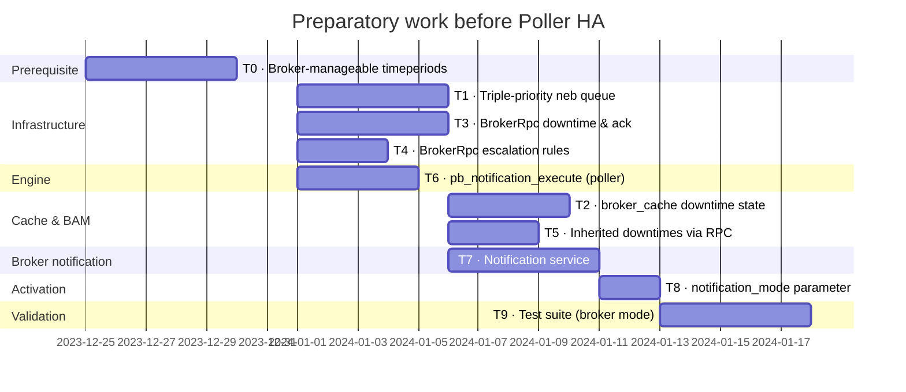

# Preparatory work before Poller HA

[← Previous](08-bam-en.md) · [Index](README-en.md) · [Next →](10-poller-ha-en.md)

<!-- TOC -->
* [Prerequisite: timeperiods must be Broker-manageable](#prerequisite-timeperiods-must-be-broker-manageable)
* [Triple-priority neb queue](#triple-priority-neb-queue)
  * [Implementation](#implementation)
    * [Container: `std::deque` + `size_t` index](#container-stddeque--size_t-index)
    * [Classification at insertion](#classification-at-insertion)
    * [Acknowledgement](#acknowledgement)
    * [Disk spill (retention on disk)](#disk-spill-retention-on-disk)
    * [Benchmark results](#benchmark-results)
    * [Entry type: struct vs pair, emplace_back vs push_back](#entry-type-struct-vs-pair-emplace_back-vs-push_back)
    * [Timestamp field: insertion time, not event data time](#timestamp-field-insertion-time-not-event-data-time)
    * [Handling connection loss: `nack_events()`](#handling-connection-loss-nack_events)
* [BAM: reading downtime state from the Broker cache](#bam-reading-downtime-state-from-the-broker-cache)
  * [What the cache tracks](#what-the-cache-tracks)
  * [What BAM does today](#what-bam-does-today)
  * [What remains](#what-remains)
* [Implementing notification_mode = broker on single-poller zones](#implementing-notification_mode--broker-on-single-poller-zones)
  * [BrokerRpc gRPC endpoints](#brokerrpc-grpc-endpoints)
  * [Inherited downtimes via BrokerRpc](#inherited-downtimes-via-brokerrpc)
  * [Escalation rules](#escalation-rules)
  * [pb_notification_execute](#pb_notification_execute)
* [Test strategy](#test-strategy)
* [Prerequisite 5: removing `retention.dat`](#prerequisite-5-removing-retentiondat)
  * [Where things stand](#where-things-stand)
  * [Target](#target)
  * [What stays out of the snapshot](#what-stays-out-of-the-snapshot)
  * [Tests involved](#tests-involved)
<!-- TOC -->

The work described in this section is implemented **before** Poller HA. Its core is **moving
notifications onto Broker**: with `notification_mode = broker`, a centralized notification
service (rather than each poller) decides on and runs notifications. This is an indispensable
building block of Poller HA — without it the notification chain would break on every poller
migration or failure. So this infrastructure is built on single-poller zones, and validated
thoroughly, before the complexity of multi-poller HA is introduced.

That move has a **prerequisite**, though: Broker must be able to evaluate **timeperiods** (a
notification's viability depends on the allowed notification window). As long as that
computation lives only in Engine, Broker's notification service cannot decide on its own.
Extracting timeperiods into a Broker-manageable library is therefore ticket **T0**, which
gates the notification service (T7) — see
[Prerequisite: timeperiods must be Broker-manageable](#prerequisite-timeperiods-must-be-broker-manageable).

| Ticket | Description |
|--------|-------------|
| **T0** | Extract timeperiods into a Broker-manageable library (prerequisite) |
| **T1** | Triple-priority neb queue |
| **T2** | `broker_cache` downtime state tracking (cache done, BAM reading to do, see [BAM: reading downtime state from the Broker cache](#bam-reading-downtime-state-from-the-broker-cache)) |
| **T3** | BrokerRpc endpoints: downtimes and acknowledgements |
| **T4** | BrokerRpc endpoints: escalation rules |
| **T5** | Inherited downtimes via BrokerRpc (BAM) |
| **T6** | Poller-side execution of dispatched notifications (`pb_notification_execute`) + turning off Engine's decision |
| **T7** | Notification decision (`notification_manager`) in Broker |
| **T8** | `notification_mode` parameter |
| **T9** | Test suite for `notification_mode = broker` |



T0 is a prerequisite of the notification service: without Broker-side timeperiod evaluation,
T7 cannot decide on a notification's viability. T1, T3, T4, and T6 have no dependencies and can
be developed in parallel. T2 requires both T1 (neb priority path) and T3 (BrokerRpc path). T7
requires T0 (timeperiods), T3, and T4. T8 requires both T6 (Engine side) and T7 (Broker side).
T9 gates on everything.

## Prerequisite: timeperiods must be Broker-manageable

Moving notifications onto Broker (T7, `notification_mode = broker`) assumes Broker can
**evaluate timeperiods**. The decision to send a notification rests on *viability*
(`is_notification_viable`), which consults the `notification_period` (and, depending on the
case, the `check_period`): "is the current instant within the allowed notification window?",
"when will notifications become allowed again?". As long as that computation lives only in
Engine, Broker's notification service cannot decide on its own — it could neither suspend nor
reschedule a notification based on the time of day.

This prerequisite has two parts:

1. **The timeperiod evaluation code must be a library independent of Engine.** The computation
   (`get_next_valid_time`, `check_time_against_period`, daterange and exclusion handling) used
   to live in `engine/`, coupled to its globals. It has been extracted into a standalone
   library (`common/timeperiods/`, target `timeperiods`): the timeperiod registry is owned
   by a `timeperiod_manager` (one per process), and every coupling to Engine has been removed —
   the logger and the characters forbidden in names are **injected at `load()`** rather than
   read from Engine globals. Broker can therefore link this library and use it as-is.
   Details and an implementation comparison (current code / Boost / Abseil) in
   [doc/timeperiods-rework-en.md](../timeperiods-rework-en.md).

2. **Broker must know the timeperiod definitions.** They are part of the centralized
   configuration: Broker already receives them via the poller's `.prot` and stores them in its
   centralized cache. The notification service feeds its `timeperiod_manager` from that cache,
   exactly as Engine feeds its own from its applied configuration.

In short: **moving notifications onto Broker (T7) is blocked until timeperiods are
Broker-manageable.** Extracting the library (T0) is therefore a prerequisite of the preparatory
work, not an optional step.

## Triple-priority neb queue

Today the neb module maintains a single FIFO queue for all monitoring events. When Engine has
a large retention backlog (e.g. after a two-week disconnection), every event — including urgent
downtimes and acknowledgements — must wait behind hours of accumulated check results before
reaching Broker.

To resolve this, the neb event queue is split into three. The queue an event is placed in is
determined **at insertion time**, based on the event type and its timestamp:

| Event type | Classification rule | Queue |
|------------|---------------------|-------|
| `pb_downtime`, `pb_acknowledgement` | **Always priority (P)** — age is irrelevant; what matters is whether the downtime or acknowledgement is still active | P |
| Host / service status | Inserted into **Current (C)**; demoted to **Historical (H)** when `now − insertion_time ≥ priority_age_threshold` (default: 5 min) | C or H |
| Performance data, logs, other bulk events | Always **Historical (H)** | H |

The `priority_age_threshold` (default 5 minutes, one typical check interval) is configurable.
In normal operation all check results are fresh and go to queue C — queues C and H are then
indistinguishable from a single secondary queue. The distinction only activates under backlog:
old check results go directly to H at insertion while recent ones drain from C before H.

This preserves the causality between a downtime and the resource it is associated with (both
remain in the `neb` namespace), while guaranteeing that urgent events are never blocked by
accumulated bulk data.

**Boundary with the `bbdo` namespace**

`bbdo`-namespace messages (`pb_diff_state`, `pb_diff_state_ack`, `Health`, `pb_welcome`) remain
completely out-of-band — they bypass all three queues entirely. These are connection and
configuration management messages, not monitoring event stream entries; their delivery must be
independent of any queue state.

```
bbdo namespace   →  bypasses all queues  (connection / config management)
neb priority P   →  drained first        (urgent monitoring events — always active)
neb current C    →  drained second       (fresh real-time check results)
neb historical H →  drained last         (bulk data, old check results)
```

**Connected Engine with large historical queue**

Even when Engine is actively connected but saturated with check results, a new `pb_downtime` or
`pb_acknowledgement` is placed in queue P and delivered to Broker immediately,
without waiting for queues C or H to drain.

**Reconnection after a long absence**

This is the more subtle and important case. Consider Engine reconnecting after several days of
disconnection. It has a large historical queue (accumulated check results). Immediately after
reconnection, a monitored resource goes down — Engine generates a real-time check result and
places it in queue C. Meanwhile, the `pb_downtime` for that resource — created days
ago, still sitting in queue P — drains first:

```
Engine reconnects
  → queue P drains: pb_downtime (created 5 days ago, still active) → Broker
  → queue C drains: check result DOWN (real-time) → Broker
  → queue H drains: accumulated old check results → Broker

Broker receives pb_downtime first → downtime is active → DOWN arrives → notification suppressed ✓
```

The age of the `pb_downtime` event is irrelevant: what matters is whether the downtime is
**still active**, not when it was created. Queue P guarantees that Broker has the
correct downtime state before it processes the first real-time check result.

Expired downtimes are also handled correctly. A downtime that started and ended during the
disconnection period appears as a `pb_downtime_start` / `pb_downtime_end` pair, both in queue P,
in order. Broker processes them in sequence: downtime created, then closed.
When the first real-time check result arrives, no downtime is active — and notification fires
correctly.

- BrokerRpc (path 2 below) remains the appropriate path for downtimes created directly via the
  PHP/API layer, and for the case where Engine is completely disconnected.

### Implementation

#### Container: `std::deque` + `size_t` index

The current `_events` is a `std::list<std::shared_ptr<io::data>>` with an iterator `_pos`
pointing to the next event to read. `std::list` was chosen for iterator stability: `push_back`
and `pop_front` do not invalidate iterators to other elements. With index-based position
tracking this constraint disappears.

Each queue entry carries the event timestamp alongside the pointer, extracted once at insertion:

```cpp
struct queue_entry {
    int64_t                    timestamp;  // extracted at insertion, INT64_MAX for always-priority
    std::shared_ptr<io::data>  event;
};

std::deque<queue_entry> _priority_events;    // Queue P: INT64_MAX events
std::deque<queue_entry> _current_events;     // Queue C: fresh status events
std::deque<queue_entry> _historical_events;  // Queue H: bulk/old events
size_t _priority_read_pos{0};
size_t _current_read_pos{0};
size_t _historical_read_pos{0};
size_t _current_events_size{0};             // live entries in _current_events (tombstones excluded)
```

Storing the timestamp in the entry eliminates any `dynamic_cast` or virtual dispatch at
classification time. The `_push_to_queue` "exhausted queue" adjustment that currently does
`_pos = --_events.end()` disappears: when `_priority_read_pos == _priority_events.size()` and
a new priority event is pushed, `_priority_read_pos` already equals the index of the new element.

#### Classification at insertion

| Condition | Queue | Stored timestamp |
|-----------|-------|-----------------|
| type ∈ {`pb_downtime`, `pb_acknowledgement`} | P | `INT64_MAX` |
| host/service status | C (at insertion); demoted to H once `now − insertion_time ≥ priority_age_threshold` | `now` (insertion time) |
| all other types (perf data, logs, …) | H | `now` (insertion time) |

`priority_age_threshold` defaults to **5 minutes** (one typical check interval) and is
configurable in Broker's JSON configuration.

#### Acknowledgement

`ack_events` takes a single count and drains queues in order P → C → H until the count is
exhausted. Because events are always delivered to the caller in that same order, a single count
unambiguously identifies which events to remove.

```cpp
void ack_events(uint32_t count);
```

The caller reads a batch, writes it to the stream, and acknowledges however many were accepted:

```cpp
muxer.read(to_fill, max);

uint32_t written = stream.write(to_fill);
muxer.ack_events(written);
```

`pb_ack` is unchanged — it carries a single `acknowledged_events` count, which is sufficient
because Engine's retention queue is also a simple FIFO and only needs to know how many events
Broker has received.

#### Disk spill (retention on disk)

The muxer already supports persistent retention on disk via `_file` (`persistent_file`): when
the in-memory queue is full, events overflow to a file on disk so that they survive a Broker
restart and are eventually delivered once the connection recovers. This mechanism is called
**disk spill** — excess events that no longer fit in RAM are spilled into the retention file.

With the triple-priority queue, the spill policy is:

- Queue H events spill to `_file` first (they are the least urgent).
- Queue C events spill next.
- Queue P events have a separate, higher in-memory limit before spilling.
- Events reloaded from `_file` on restart are reclassified based on their **event type** — the
  `queue_entry` timestamp is an in-memory artifact that is not persisted on disk. Events of type
  `pb_downtime` or `pb_acknowledgement` go back into queue P (they
  are potentially still active and must reach Broker before any check results); all other events
  go into queue H (they are historical backlog at this point). The file format is unchanged and
  files produced by older versions reload correctly.

#### Benchmark results

The choice of `std::deque` + `size_t` index over `std::list` + iterator was validated with
Google Benchmark modelling the real muxer access pattern (push / sequential read / ack):

| Scenario | Queue size | List | Deque | Ratio |
|----------|-----------|------|-------|-------|
| SteadyState | 4 096 | 5 323 816 ns | 4 612 033 ns | ×1.15 |
| BacklogDrain | 131 072 | 21 757 648 ns | 18 809 356 ns | ×1.16 |
| StatsDistance | 4 096 | 7 340 ns | 1.13 ns | ×6 500 |
| StatsDistance | 65 536 | 138 620 ns | 1.13 ns | ×122 000 |

`std::deque` is **15% faster** on all access patterns due to cache locality (elements in
contiguous chunks vs. scattered list nodes).

`StatsDistance` isolates `_update_stats()` which calls `std::distance(begin, _pos)` — O(N) on
`std::list`. With `_read_pos` on `std::deque` this becomes O(1). At 65 536 events in queue,
the list takes **138 µs** per call vs **1.13 ns** for the deque index — a factor of 122 000.

#### Entry type: struct vs pair, emplace_back vs push_back

Each queue entry is `struct queue_entry { int64_t timestamp; std::shared_ptr<io::data> event; }`.
Using a named struct instead of `std::pair<int64_t, shared_ptr<io::data>>` has zero runtime cost:
the compiler generates identical code (same memory layout, same field offsets). The struct is
preferred solely for readability (`.timestamp` / `.event` vs `.first` / `.second`).

#### Timestamp field: insertion time, not event data time

The `timestamp` field stores `std::chrono::system_clock::now()` captured **at the moment
`push_back` is called** — not the event's `last_check` field.

This choice preserves a key invariant: because events are enqueued in FIFO order and the
stored timestamp reflects when the event entered the queue, **the deque is always sorted
by age** — entries near the front are older than entries near the back.

This invariant enables an early-exit scan when looking for stale events to demote from queue C
to queue H:

```
[very old] [old] [normal] [normal] …
  demote   demote   STOP — everything after is also fresh
```

Because queue C never contains `INT64_MAX` entries (those go directly into queue P at insertion),
the scan requires no special-casing. As soon as the scan reaches an entry whose timestamp exceeds
the demotion threshold, all subsequent entries also exceed it, and the loop terminates
immediately.

**In-flight events and tombstone demotion**

At any point, the first `_current_read_pos` entries in `_current_events` are *in-flight*: they
have been sent to Broker but not yet acknowledged. The demotion scan starts at
`_current_read_pos`, not at 0 — in-flight events have already been delivered and cannot be
moved.

In practice, `_current_read_pos` is 0 whenever demotion is needed: for a pending entry to be
stale it must have been in C for more than `priority_age_threshold` (5 minutes); because the
deque is sorted by age, in-flight entries are older still, so if no acknowledgement has returned
for that long the connection is broken and `nack_events()` will already have reset
`_current_read_pos` to 0.

Regardless, demotion is implemented as **tombstoning**: there is no middle-of-deque erasure at all.
When entry at position `_current_read_pos` is stale:
1. Its event is pushed to queue H.
2. The `event` pointer in the `_current_events` entry is set to `nullptr`.
3. `_current_read_pos` is advanced past the tombstone.

```
before:  [e0 in-flight] [e1 in-flight] [e2 in-flight] [e3 stale] [e4 stale] [e5 fresh]
         _current_read_pos = 3
demote:  [e0 in-flight] [e1 in-flight] [e2 in-flight] [null]     [null]     [e5 fresh]
         _current_read_pos = 5   (e3, e4 already in H)
```

`read()` resumes at the new `_current_read_pos` and never returns a null entry to the caller.

When `ack_events` processes C, it pops non-null entries for the acked count, then discards any
leading nulls:

```cpp
// ack 3 events that came from C
pop e0  // non-null, count 1
pop e1  // non-null, count 2
pop e2  // non-null, count 3 — done
pop     // null, cleanup
pop     // null, cleanup
// _current_read_pos: 5 − 5 pops = 0
```

Each demotion is O(1) (one pointer write + one index increment). The null cleanup is folded
into the normal ack pop loop at no extra asymptotic cost.

`get_event_queue_size()` relies on a dedicated counter rather than iterating the deques.
The counter is incremented on each `push_back` and decremented both when an entry is tombstoned
(event set to `nullptr`) and when a non-null entry is popped during ack. This keeps the size
query O(1) and avoids any deque traversal.

Had `last_check` been stored instead, an event arriving late (reconnection replay, out-of-order
delivery) could carry a very old `last_check` despite being inserted after fresher events,
breaking the ordering invariant and forcing a full-deque scan.

#### Handling connection loss: `nack_events()`

When a connection is lost before an acknowledgement arrives, `nack_events()` resets all three
`_read_pos` values to 0. In-flight events in all three queues re-enter the pending state and
will be re-sent on the next connection. In queue C, the sorted order is preserved after the
reset: the previously in-flight entries (oldest) sit at the front, ahead of the entries that
were never sent.

`emplace_back` brings no gain over `push_back(std::move(e))` on the write path: events arrive
pre-constructed from the engine or network layer and are moved into the queue — there is no
temporary to elide. On the read path, `push_back` copies each `queue_entry` into the output
vector, which increments the `shared_ptr` atomic reference count. `emplace_back` cannot avoid
this: the reference count increment is the **irreducible cost** of `read()`, independent of
container or insertion API.

## BAM: reading downtime state from the Broker cache

This work is ticket T2 of the plan above. The cache was then called `global_cache`; it has since become `broker_cache`. The goal was twofold: have the `Broker` cache track the downtime state of each resource, and have BAM read it there instead of keeping its own state, which can drift on restart. The first half is done, the second remains to do.

### What the cache tracks

`broker_cache` keeps `scheduled_downtime_depth` for every host and service, in both notification modes:

- in `notification_mode=engine`, the depth is taken from the `Engine` statuses (`HostStatus`, `ServiceStatus` and their adaptive versions);
- in `notification_mode=broker`, the `Broker` `downtime_manager` owns the downtimes, and its callbacks update the depth in the cache (`add_downtime()` / `remove_downtime()`) before publishing it in an adaptive status. `Engine` statuses then no longer overwrite that value. Started downtimes are saved with the cache at shutdown and re-injected at startup; the depth is recomputed by counting them per resource, idempotently (see [broker_state, cache and downtime_manager lifecycle](02-configuration-delivery-en.md#broker_state-cache-and-downtime_manager-lifecycle)).

```
engine mode: external command → Engine → status (depth) → Broker → broker_cache
                                       → pb_downtime    → Broker → centreon_storage.downtimes, BAM
broker mode: BrokerRpc / external command → downtime_manager → broker_cache.add_downtime()
                                                             → pb_downtime → centreon_storage.downtimes, BAM
```

In both cases a `pb_downtime` is also published: this is what BAM listens to.

### What BAM does today

BAM does not use the cache depth:

- a `kpi_service` knows it is in downtime only through the `pb_downtime` events it receives, whose identifiers it stores in `_downtime_ids`; it ignores `scheduled_downtime_depth` in statuses;
- at startup, once the cache is ready, `service_book::seed_from_cache()` only takes the check state from the cache; BAM's own cache (`ServicesBookState`) holds the state and the acknowledgement, not the downtime;
- in `notification_mode=engine`, stopping a poller resets the downtime state of its KPIs, which is rebuilt from the `pb_downtime` events `Engine` sends back when it restarts. In broker mode this reset does not happen, since the downtimes live in `Broker`.

### What remains

Derive the downtime state of a KPI from `scheduled_downtime_depth > 0`, read in the statuses and, at startup, in the cache. No new cache function is needed: `service(host_id, service_id)` is enough.

One question must be settled first: BAM dates its BI events with the downtime `actual_start_time` and `actual_end_time`. The depth alone does not give these times; we would have to settle for the status time, or keep the `pb_downtime` events for dating and take only the state from the cache.

This change is mode-independent and does not solve the injection of inherited downtimes (see below).

## Implementing notification_mode = broker on single-poller zones

The `notification_mode = broker` option is implemented and validated on single-poller zones
before any HA work begins. This covers:

### BrokerRpc gRPC endpoints

The `BrokerRpc` service gains downtime and acknowledgement endpoints (see
[Centralized downtimes and acknowledgements](10-poller-ha-en.md#centralized-downtimes-and-acknowledgements)).
PHP switches from direct Engine command pipe calls to these endpoints. Broker stores downtimes
and acknowledgements directly in `centreon_storage`.

### Inherited downtimes via BrokerRpc

In the current BAM implementation, inherited downtimes are injected into Engine via external
commands. With `notification_mode = broker`, BAM creates inherited downtimes via the same
`BrokerRpc` endpoints as any other downtime. Broker is the single authority — there is no
Engine-side state to lose on restart.

The BAM/Engine synchronisation problem described in [Problem](07-downtimes-acknowledgements-en.md#problem) disappears entirely in
`notification_mode = broker` mode: inherited downtimes survive Engine restarts because they
live in Broker's database.

In `notification_mode = engine` (legacy behaviour), inherited downtime injection into Engine
remains unchanged. The BAM cache read improvement reduces the risk of read-side desync but
does not address the write-side problem.

### Escalation rules

In `notification_mode = engine`, escalation rules live in each poller's `centengine.cfg` as
`hostescalation` and `serviceescalation` objects. Engine evaluates them locally at notification
time.

In `notification_mode = broker`, escalation rules are moved out of Engine configuration
entirely. PHP sends them to Broker via `BrokerRpc`; Broker stores them in its database and
evaluates them as part of its own notification decision (`notification_manager`).

Two consequences follow:

- **Escalation rules survive host migration** — rules live in Broker's database regardless of
  which poller currently monitors the host. No migration step is needed.
- **Cross-poller escalations become possible** — a single escalation rule can reference hosts
  or services spread across multiple pollers. This was structurally impossible in the per-poller
  model, where each Engine only knew about its own resources.

As a corollary, `hostescalation` / `serviceescalation` objects are no longer a co-location
constraint in the resource distribution algorithm: because the notification decision runs in
Broker and has access to all escalation rules regardless of poller, there is no requirement that
escalated hosts share a poller.

### pb_notification_execute

In `notification_mode = broker`, Broker makes the notification decision (contact selection +
escalations, from its cache) and dispatches only the execution to the poller that supervises the
resource, through a `pb_notification_execute` BBDO event (`io::bbdo`, Broker→poller). The poller
expands the macros and runs each contact's notification command; it no longer decides
notifications on its own. Suppression by downtimes and acknowledgements happens on Broker,
*before* dispatch. See [Driving the notification decision on Broker](07-downtimes-acknowledgements-en.md#driving-the-notification-decision-on-broker)
for the full mechanism.

## Test strategy

Both modes are validated on single-poller zones before HA work begins:

- `notification_mode = engine`: all existing tests must pass unchanged — this is the
  compatibility baseline.
- `notification_mode = broker`: a dedicated test suite validates the full cycle:
  downtime creation via BrokerRpc, notification suppression, acknowledgement, inherited
  downtime propagation by BAM, and Engine restart survivability of all downtime records.

Once both modes are stable, Poller HA can be implemented with confidence that the notification
and downtime infrastructure is solid.

## Prerequisite 5: removing `retention.dat`

Last of the five prerequisites to Poller HA. A poller's local `retention.dat` does not survive a resource changing poller: the target poller does not have the file. The runtime state of resources must therefore be held by `Broker` and sent back down to the poller that needs it. Design discussed and settled on 2026-09-30, implemented from 2026-10-01 to 2026-10-07; the one-shot read of `retention.dat` when a poller switches to centralized was added on 2026-11-01.

### Where things stand

What `retention.dat` carries, by family, and its fate in centralized configuration:

| Family | Content | Fate |
|---|---|---|
| Notifications, acknowledgements, notification overrides, downtimes, contacts | last notification, number, `notified_on`, `notification_0..5` slots, `acknowledgement_*`, `notifications_enabled`, `notification_period`, downtime blocks, contacts' notification dates | **Already in Broker** (sections 8 to 14 of the `.cache`, see [What is persisted at shutdown](04-centralized-cache-en.md#what-is-persisted-at-shutdown)). Dead weight on the Engine side in `notification_mode=broker` |
| Check state | current state, `last_hard_state`, `state_type`, attempt, `last_check`, `last_*_change`, output, perfdata, execution time, event and problem ids, flapping history | **The gap.** Broker holds it in memory through statuses but does not persist it in centralized mode, loses it on every `merge()`, and no downstream message carries it |
| "modified_attributes" overrides | active/passive checks, event handler, flap detection, obsess, command, intervals, `max_attempts`, check period, modified custom variables, anomalydetection sensitivity | Broker receives them through `pb_adaptive_host` but does not persist them. Nothing downstream |
| Scheduling | `next_check`, `check_options` | Nearly inert: `use_retained_scheduling_info` is false by default and the scheduler overwrites `next_check` |
| Program | global flags, `next_*_id` counters | Flags **already inert**: the applier writes legacy globals the runtime no longer reads. Only the counters matter |

Two facts frame the design. `retention.dat` is written every 60 minutes and on clean shutdown,
with no temporary file nor rename: Broker, fed per event, is fresher than it, and the
`centreon_storage` database fresher still after a crash, since the `.cache` dates from the last
clean shutdown. And the database already carries nearly everything: the `hosts`, `services` and
`resources` tables have a column for every state field of `pb_host` and `pb_service`, with nine
exceptions that are all configuration (`recovery_notification_delay`, services' `timezone` and
`dependent_service_id`, groups' `alias` and `poller_id`, `engine_config_version`, custom
variables' `password`) or derivable (`long_output`, concatenated into `output`; `host_name`).

The inventory of the retention applier also showed it is already half broken, which argues for
replacing it rather than repairing it: `is_command_exist` always returns false, the program
block flags go into dead globals, the `last_hard_state_change` condition is inverted on the
service side, the host's event handler branch calls `set_check_command`, and the host mask is
applied to services.

### Target

Four steps, in this order.

**Step 1 — a "reference" module feeds the cache state from the database.** See
[Feeding the cache](04-centralized-cache-en.md#feeding-the-cache) for the three current sources. In centralized
configuration, the `.prot` files give the cache its objects but not their state; the database
has the state. The unified_sql module, declared as reference, reads at startup the state
columns of `hosts`, `services` and `resources` and **overlays** them onto the entries the cache
already holds. It neither creates nor deletes anything: a row without a cache entry is a
deleted object or a removed poller, an entry without a row is a new object whose first status
will come. The `enabled` column does not matter in this mode. The write goes **directly into
the cache**, in `_load_caches`, hence during the stream's first `open()`, before
`notify_output_ready`: the startup barrier waits for it with no new mechanism, and the
multiplexer, not yet started, is not involved, which avoids producing 200,000 pseudo-statuses
that unified_sql would receive back.

Legacy mode is not concerned: nothing fills the cache before unified_sql, and the `.cache`
there already carries the full `Host` and `Service` messages, hence the state. It stays as it
is. The reference flag and its arbitration only make sense in centralized mode.

*Arbitration.* If several modules declare themselves as reference, the first declared wins:
the declaration returns a boolean, the following ones get false, log a warning naming the
elected one and load nothing. No blocking error: a wrong configuration must never prevent
Broker from starting.

*Done on 2026-10-01.* The `unified_sql` output carries a JSON key `reference`, **true by
default**: a platform with a single `unified_sql` output has nothing to write, and PHP does
not change. `"reference": false` opts an output out, e.g. a second `unified_sql` towards
another database. The declaration is made in `factory::new_endpoint`, not when the stream
opens: the endpoint applier creates the outputs one after the other, in configuration file
order, on the main thread, so "first declared wins" is deterministic — the sorted `btree_map`
of endpoints plays no part, it only matters after creation. On the cache side,
`declare_reference(name)` returns the verdict, `release_reference(name)` is called by the
connector destructor when a reload removes the output, and `reference_endpoint()` names the
elected one. The verdict goes down from the connector to the stream, which logs it when it
opens ("this output is / is not the reference of the global cache") and will use it for the
overlay. Tests: `CBSS_REFERENCE`, `CBSS_REFERENCE_OPT_OUT`.

*Done on 2026-10-02, the overlay.* The reference output does it in `_load_caches` (`_restore_runtime_in_cache`), i.e. at the
first `open()` of its stream, before it reports ready to the barrier: whoever waits for the
cache (BAM, through `on_ready`) finds the state in it. The source depends on what the output
writes: the `resources` table when `store_in_resources`, the `hosts`/`services` tables
otherwise, a path on its way out. When the output writes both (the default for now), the
`resources` pass is followed by a complement read from `hosts`/`services`
(`_restore_runtime_complement_from_hosts_services`), see below. Each row is laid onto its entry by
`broker_cache::restore_host_runtime` / `restore_service_runtime`, which take a function setting
only the fields the source knows: the cache keeps the rule and the copy-on-write mechanics,
unified_sql keeps the knowledge of the columns. The row of a resource the cache does not hold is
skipped, the configuration of the entry is left alone, and "freshest wins" — a never-checked row
lays nothing, an entry whose `last_check` is more recent than the row is not modified, which
makes the restoration harmless on a reload where the cache is already alive. Written directly
into the cache, not published: a published status would come back to this very stream and be
written to the database again, one row per resource.

The two sources do not say the same things. `resources` knows the status, whether it is
confirmed (hard), the date of the last change, the attempt, the last check and its type, the
output, the flapping, and two booleans, acknowledged and in downtime; it ignores the previous
hard state, the `last_time_*`, the perfdata, the notification counters, the acknowledgement
type and the downtime depth. The hard state is therefore set only when the status is confirmed,
and the two booleans only when Broker does not own acknowledgements and downtimes: when it
does, its own persisted state is re-injected right after, with the type and the depth.
`hosts`/`services` know the whole runtime, and the list copied is the one `merge()`/`apply()`
already keep from a replaced entry; the real state is read there through
`COALESCE(real_state, state)`, since `state` is forced to UNREACHABLE/UNKNOWN while the poller
is *outdated*, and the `output` column of the services, which joins output and long output on a
newline, is split back. `resources.status`, for its part, is never forced. Tests:
`CBA_KPI_RUNTIME_RESTORED_FROM_RESOURCES` and `CBA_KPI_RUNTIME_RESTORED_FROM_HOSTS_SERVICES` (Engine
stopped, BAM cache file removed, cbd restarted: the restoration then BAM's seeding make the BA
CRITICAL without a single status, from each of the two sources).

*Done on 2026-10-26, the complement.* `store_in_resources` and `store_in_hosts_services` are both
on for now; `hosts`/`services` will later give way to two tables holding only the data still
used that `resources` lacks. Until then, when the output writes both, the fields `resources`
ignores are taken from `hosts`/`services` after the `resources` pass: perfdata, long output,
previous hard state and its date, `last_time_*`, latency, execution time, next check and, when
Broker does not own them, the notification counters, the acknowledgement type (only if
`resources` says acknowledged) and the downtime depth. The status, output and other fields from
`resources` are not touched. The same "freshest wins" rule applies. The two tables are written
from the same status but in separate batches with no transaction: after a crash, a resource may
receive the complement of the previous check, which its next check fixes; no stricter check was
judged worth it. When the new tables arrive, only this complement has to read them instead.

*Database unreachable at first `open()`.* The barrier releases on timeout, poller statuses
start arriving, and the overlay happens later, on the successful connection. It must then
fill only the still-blank entries, or compare `last_check`, so as not to put an old state over
a fresh one.

*`merge()` and `apply()` keep the state.* Today they recreate the entry from the configuration
and lose the runtime fields. They must take them over from the replaced entry, otherwise the
startup overlay is lost on the first `pb_engine_state`.

*`broker_cache::on_ready`.* A module that needs the complete cache has no business knowing the
barrier. The cache exposes `on_ready(callback)`, run at once if the cache is already ready,
otherwise at `set_ready()`, called once by `broker_state::_on_barrier_released`. Callbacks run
outside the cache mutex and each subscriber posts onto its own executor. BAM is the first
client: it loads BA and KPI definitions in `open()` then reads the initial KPI state in
`on_ready`, and drops its SQL catch-up on hosts and services, in both modes. This is what makes
cbd's behaviour uniform: a module waits for the cache, and what fills it behind is the core's
business. The `broker_module_parents` dependency was not suitable: it only orders the `dlopen`,
while outputs then open in parallel, each in its own failover thread.

**Step 2 — a downstream snapshot in `DiffState`.** The `RuntimeState` message
described in [Runtime state preservation during migration](10-poller-ha-en.md#runtime-state-preservation-during-migration)
is sent **on every poller connection**, not only on migration: this is what replaces
`retention.dat` at an ordinary startup. Engine applies it after the configuration, where the
retention used to apply.

*Done on 2026-10-05.* On the Broker side, `broker_cache::fill_runtime_state(poller_id, out)` fills
the snapshot from the checked entries of the poller and `broker_stream::_add_runtime_state` adds it
to the `DiffState`. A poller gets its snapshot **once per connection**, a flag on the stream: with the
`DiffState` of the configuration it owes, or, when it is up to date, in a `DiffState` carrying nothing
else, flagged `runtime_only` and bearing the version it already runs, so that its acknowledgement
changes nothing in the peer registry. Nothing is sent to a poller whose configuration is unknown. On
the Engine side, `configuration::applier::runtime_state` lays the snapshot onto the objects, modelled
on the "status" part of the retention applier and honouring `retain_status_information`; it is called
after `_apply_diff_conf` in a diff, after `_processing` in a full state, and alone, leaving the
configuration, the scheduler, the modules and `state.prot` untouched, when the `DiffState` is
`runtime_only`. Acknowledgement, downtime and notification fields are set only when Engine owns
them. Test: `CERS1` (`engine/centralized-runtime-state.robot`): Engine restarted without
`retention.dat`, an OK result is logged as a recovery from CRITICAL, which proves the restored state.

*The unknown-configuration case, done the same day.* When Broker lost a poller's `.prot`, it has
nothing to send it at connection: the cache does not know its resources. Engine sends its
configuration back, Broker stores it, and the reference output, in `_process_engine_state`,
merges the poller's entries into the cache **then restores their runtime from the database at
once**, before raising the flag again through `set_runtime_state_owed(poller_id, true)`; the flag is lowered right before the merge, so that no empty snapshot leaves between the merge and the restoration. `broker_state` then
marks the poller as owed its snapshot, the `runtime_state_owed` flag of the peer registry, and
the stream serving it sends it at the next turn, alone. The stream never sends a snapshot for a
poller the cache does not know yet anyway: it would be empty. Test: `CERS2` (Broker restarted
without its `1.prot`, Engine running: the configuration comes back, the state follows).

**Step 3 — modified-attribute overrides.** The database has the attribute columns, but no
mask: `modified_attributes` exists neither in `neb.proto`, nor in the cache, nor in what
unified_sql writes. It is therefore to be rebuilt: from the fields present in an adaptive event,
which carries the modified attribute only, and at startup by comparing the database with the
configuration. The reference module then reloads these attributes through the same path as the
check state, and the snapshot sends them back down under the mask. Custom variables and
anomalydetection sensitivity, unknown to the cache, stay out of scope.

*Batch 1, done on 2026-10-05: adaptive events in centralized mode.* Before it, Engine emitted
none in that mode: `forward_pb_host` and `forward_pb_service` started with
`if (cbm->centralized_conf()) return;`, placed before the `NEBTYPE_ADAPTIVE*_UPDATE` branch. The
return was meant for the full definition, which Broker already has from the `.prot`, but it took
`pb_adaptive_host` and `pb_adaptive_service` with it: a `DISABLE_HOST_CHECK` sent to a
centralized poller reached neither the cache nor the database. The return moved down into the
full-definition branch; the adaptive branch goes out in both modes. Test: `BEEXTBRK_ADAPTIVE`
(`DISABLE/ENABLE_HOST_CHECK` and `_SVC_CHECK` sent to Broker, checked in `hosts`, `services`
and `resources`).

*Batch 2, done on 2026-10-05: the mask in the cache.* `neb.proto` gains the `ModifiedAttribute`
enum, same values as Engine's `MODATTR_*` under the `MOD_` prefix, and a `modified_attributes`
field on `Host` and `Service`, which Engine never sends: the cache holds it. A `pb_adaptive_host`
or `pb_adaptive_service` carries the toggled attribute only; when applying it, the cache sets its
bit too. `notify` and `notification_period` set the bit only when Broker does not own the
notifications, their toggle being otherwise a native override already persisted.
`copy_*_runtime` carries the mask over, then each check attribute only when its bit is set: an
export of the configuration takes the lead back on what was not toggled, and the toggle survives
on the rest, exactly what the retention applier did with its mask. Unit test:
`AdaptiveOverrideSurvivesRebuild`.

*Batch 3, done on 2026-10-06: the mask in the database and its restoration.* The `hosts` and
`services` tables have always had a `modified_attributes` column nobody wrote. On an adaptive
event, unified_sql now sets there the bit of each present attribute, with the attribute itself,
whatever the writing mode of the output: `resources` has neither the mask nor most of the
attributes, so `hosts`/`services` are the only memory of the overrides, even for an output
writing `resources` only. The mask only grows (`modified_attributes | bit`), as in Engine. The
rule for `notify` and `notification_period` is the cache's. At startup, the reference module,
after laying the check state back from its source, reads `hosts` and `services` `WHERE
modified_attributes<>0` and carries onto the cache entry the mask and the attributes it
protects, through `copy_host_overrides` and `copy_service_overrides`, the part of
`copy_*_runtime` that deals with overrides only. A cache entry already carrying a mask is not
overwritten: alive, it knows better than the database. Tests: `BEEXTBRK_ADAPTIVE` checks the bit
in the database after the toggle and after its return, `BEEXTBRK_ADAPTIVE_RESTART` restarts
Broker and waits for "overrides of 1 hosts and 1 services restored"; unit test
`OverridesRestoredFromReference`. The snapshot does not send these overrides back down to Engine
yet: that is batch 4.

*Batch 4, done on 2026-10-06: the overrides in the snapshot.* `HostRuntime` and
`ServiceRuntime` gain a `RuntimeOverrides` sub-message, shared by both, carrying
`modified_attributes` and the attributes it protects (`notify`, `active_checks`,
`passive_checks`, `event_handler_enabled`, `flap_detection`, `obsess_over`, `check_interval`,
`retry_interval`, `max_check_attempts`, `check_freshness`, `check_period`,
`notification_period`). Its presence says it all: no sub-message, no override. The check
command and the event handler are not part of it: the `CHANGE_*_CHECK_COMMAND` and
`CHANGE_*_EVENT_HANDLER` external commands are disabled in Engine (the "SECURITY PATCH" of
`cmd_change_object_char_var`), so their `MOD_CHECK_COMMAND` and `MOD_EVENT_HANDLER_COMMAND`
bits are never set, neither by the cache nor by unified_sql. `fill_runtime_state` fills an
attribute only when its bit is set, and a resource enters the snapshot as soon as it has a
check state **or** a mask: a host toggled before its first check comes back with
`checked=false` and its overrides. On the Engine side, `applier::runtime_state::apply` applies
the check state only when `checked` is true, then the overrides under the mask as the retention
applier did: a timeperiod that no longer exists drops its bit, `DISABLE_*_CHECK` also clears
`should_be_scheduled`, and `modified_attributes` is set on the object, which `GetHost` /
`GetService` expose. The configuration log says "N resources with overridden attributes".
Test: `BEEXTBRK_ADAPTIVE_RESTART` restarts Broker then Engine without `retention.dat`, and reads
through gRPC that `host_1` and `service_1` still have their active checks disabled with bit 2,
and that `host_1` keeps its `workhours` check period with bit 16384.
Unit test: `FillRuntimeState`. Custom variables and anomalydetection sensitivity stay out of
scope.

*Batch 5, done on 2026-11-12: overrides survive a configuration change.* Until then, a configuration export modifying a resource reset its attributes from the configuration on both sides: `applier::service::modify_object` (and its host and anomalydetection counterparts) set `notifications_enabled`, `check_interval`... without looking at the mask, and `database_configurator` wrote `notify=VALUES(notify)` on the row, whose mask stayed, contradicting the value. A host moved from one poller to another (`CERS10`) showed the sharpest gap: Engine kept the override, received through the snapshot, and the database lost it. The rule adopted is that of `retain_nonstatus_information`: an attribute toggled by an external command follows the last command, not the configuration, as long as its bit is set, in all three memories. On the Engine side, `runtime_state::capture_overrides` takes the mask and the attributes it protects before the setters of `modify_object`, and `runtime_state::apply_overrides`, the applier of batch 4, puts them back after: the configuration applies whole, the overrides come back on top, as `copy_*_runtime` does in the cache. On the database side, the upserts of `hosts`, `services` and `anomalydetections` write every protectable column as `col=IF(COALESCE(modified_attributes,0)&bit,col,VALUES(col))`: the row keeps its value under its bit, the configuration fills the rest (each upsert names only the columns it writes: `hosts` does not write `notification_period`, anomalydetections not `check_period`). `resources` has no mask: its four columns concerned (`notifications_enabled`, `active_checks_enabled`, `passive_checks_enabled`, `max_check_attempts`) are taken from the global cache entry when it carries the bit, from the configuration otherwise; the diff carries no overrides and the cache keeps its own, merged or not. A set bit never falls, `ENABLE_*` sets it like `DISABLE_*`: a resource toggled once ignores the configuration value of that attribute for good, as with `retention.dat`. Tests: `CERS11` (notifications and check interval toggled on a service, active checks on a host, then an export changing the interval, `max_check_attempts` and the alias: gRPC, `hosts`, `services` and `resources` keep the overrides and take the rest), `CERS10` completed; unit tests `PbModifyKeepsOverrides` (service and host).

The life of an override, across the five batches. In phase 2, `Engine` and the cache each protect the override on their own side, without exchange: the diff does not carry it, and the cache is what feeds `resources`, which has no mask.

```mermaid
sequenceDiagram
    participant E as Engine
    participant C as global cache
    participant U as unified_sql
    participant DB as hosts/services + resources

    Note over E,DB: 1. The external command (batches 1 to 3)
    E->>E: DISABLE_SVC_NOTIFICATIONS: notify=false, modified_attributes |= bit
    E->>C: pb_adaptive_service(notify=false)
    C->>C: notify=false, modified_attributes |= bit
    E->>U: pb_adaptive_service
    U->>DB: services.notify=0, modified_attributes |= bit; resources.notifications_enabled=0

    Note over E,DB: 2. An export modifies the service (batch 5)
    C-->>E: DiffState(diff, no snapshot: poller already served)
    E->>E: capture_overrides → modify_object → apply_overrides
    E-->>C: DiffStateAck
    C->>C: apply(diff): copy_*_runtime keeps notify under its bit
    U->>DB: services: notify=IF(modified_attributes&bit, notify, VALUES(notify))
    U->>C: service(host_id, service_id) → notifications_enabled from the cache if the bit is set
    U->>DB: resources.notifications_enabled

    Note over E,DB: 3. Broker restarts (batch 3)
    U->>DB: SELECT ... WHERE modified_attributes<>0
    U->>C: copy_service_overrides (unless the cache already carries a mask)

    Note over E,DB: 4. Engine restarts (batch 4)
    C-->>E: DiffState(runtime_state: RuntimeOverrides under the mask)
    E->>E: apply_overrides
```

**Step 4 — Engine.** In centralized configuration, Engine stops reading `retention.dat` as soon
as a snapshot arrives, and keeps writing it as a safety net until validated. Scheduling and
program block flags are not carried over. The fate of the `next_*_id` counters is still to be
decided (settled since: `Broker` keeps the identifiers of each resource and the snapshot sends them back, see [Event and problem identifiers](../engine-macros-en.md#event-and-problem-identifiers)). Legacy and BBDO2 are unchanged.

*Done on 2026-10-05.* At startup, `main.cc` parses `retention.dat` only when Engine has no
`proto-conf` directory, i.e. in legacy mode; in centralized mode it says so in its log
("retention.dat is not read: the runtime state comes from Broker") and starts from the state
the connection `DiffState` will bring. The `READ_STATE_INFORMATION` external command is ignored
with a warning in that mode, it would lay a stale state over a fresher one. Writing the file,
every 60 minutes and at shutdown, is kept as is. `CERS1` checks that the message shows up and
that no read is attempted any more.

*Revised on 2026-11-01: read once, then no longer written.* The case of a poller switching from the legacy configuration to the centralized one had been forgotten: its `retention.dat` still carries what `Broker` cannot know yet, mainly the downtimes `Engine` holds when `notification_mode` is not `broker`, `Engine`'s notification state, and the anomalydetection sensitivities. So, in centralized configuration:

* a `retention.dat` that exists at startup is read, then renamed `retention.dat.migrated`, even when its parsing failed (a corrupted file would otherwise be read at each startup; it is kept for diagnosis). `Engine` logs "retention file '…' read once and renamed to '…'", or "no retention file to read: the runtime state comes from `Broker`" when there is none, on its standard output since the log file is not open yet;
* the file is no longer written: `retention::dump::save` returns right away, the periodic save event is not scheduled any more, and the `SAVE_STATE_INFORMATION` external command is ignored with a warning, like `READ_STATE_INFORMATION`.

On the first centralized start, there is no `state.prot` yet: `Engine` parses the `centengine.cfg` the packaged service gives it, so the objects exist when the retention is applied, then the `RuntimeState` of `Broker` is applied over it, the database being fresher. The centralized criterion is the presence of the `proto-conf` directory, the same as for reading `state.prot`. This one-shot read solves the migration only: the downtimes held by `Engine` are still not restored at the following restarts. `CERS8` covers the switch, and `CERS1` checks that a stop no longer writes the file.

*Revised on 2026-11-02: the `Engine` downtimes in a separate file.* Without `retention.dat`, a centralized `Engine` in `notification_mode=engine` lost all its downtimes at each restart: it owns them, and the `Broker` snapshot does not send them back. So it saves them in `downtimes.prot`, next to `state.prot` in the `proto-conf` directory: an `EngineDowntimes` message (`bbdo/neb.proto`), a list of `Downtime`, serialized in binary and not compressed, one to two hundred bytes per downtime.

* It is written at the same moments as `retention.dat` in legacy mode, and under the same `retain_state_information` condition: at shutdown, on the periodic retention event and on `SAVE_STATE_INFORMATION`. `retention::dump::save` switches to `retention::downtimes_file::save` in centralized mode; the periodic event is therefore scheduled again, and `SAVE_STATE_INFORMATION` is no longer ignored. The file is written to a temporary file then renamed. The downtimes BAM puts on the virtual services of its BAs are skipped, as in `retention.dat`. In `notification_mode=broker`, `Engine` owns no downtime and the file is empty.
* It is read at startup, once the configuration is applied and before `initialize_downtime_data()`, at the same moment as the `retention.dat` downtimes in legacy mode. The downtimes are recreated by their ids, as the retention applier does; a downtime whose resource no longer exists is skipped, and so is a downtime already known, which a `retention.dat` read at the switch would have brought. The depth is not saved: it is rebuilt when the recreated downtimes start, without double counting since the snapshot no longer carries it. `Engine` logs "Startup: N downtime(s) restored from '…'".

The file is local to the poller: it will not help the Poller HA, which will require `Broker` to own the downtimes. `CERS9` checks that a downtime survives two restarts with a depth of 1, then that it is no longer restored once deleted; `CERS8` checks that after the switch the downtime coming from `retention.dat` goes into `downtimes.prot`; `CERS1` checks that a stop writes `downtimes.prot` and not `retention.dat`.

### What stays out of the snapshot

Acknowledgements, started downtimes and notification chains stay in the `.cache`: their
semantics belong to Broker and the database does not carry the notification chain. Future
downtimes are persisted nowhere on the Broker side besides the database; this is a known gap,
independent of this prerequisite.

### Tests involved

`SDER`, the three `ANO_*_SENSITIVITY_*`, `BECMT_RETENTION` and `BECMT_RETENTION_ACK` depend on the content of `retention.dat`. The three `CANO_*_SENSITIVITY_*` checked that the file was written in centralized configuration; they were removed on 2026-11-01, when it stopped being written. The 98 files calling `Ctn Clear Retention` only do cleanup.
