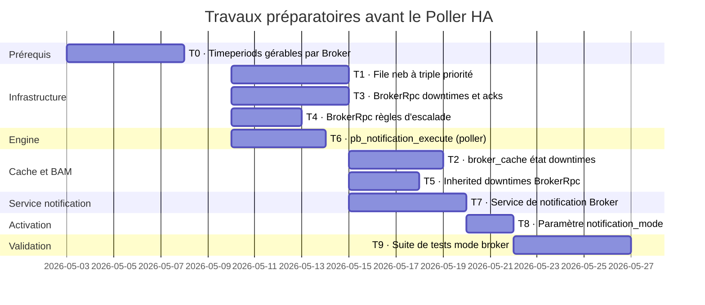

# Travaux préparatoires avant le Poller HA

[← Précédent](08-bam-fr.md) · [Index](README-fr.md) · [Suivant →](10-poller-ha-fr.md)

<!-- TOC -->
* [Prérequis : les timeperiods doivent être gérables par Broker](#prérequis--les-timeperiods-doivent-être-gérables-par-broker)
* [File `neb` à triple priorité](#file-neb-à-triple-priorité)
  * [Implémentation](#implémentation)
    * [Conteneur : `std::deque` + index `size_t`](#conteneur--stddeque--index-size_t)
    * [Classification à l'insertion](#classification-à-linsertion)
    * [Acquittement](#acquittement)
    * [Débordement sur disque (rétention)](#débordement-sur-disque-rétention)
    * [Résultats de benchmark](#résultats-de-benchmark)
    * [Type d'entrée : struct vs pair, emplace_back vs push_back](#type-dentrée--struct-vs-pair-emplace_back-vs-push_back)
    * [Champ timestamp : heure d'insertion, pas heure de collecte](#champ-timestamp--heure-dinsertion-pas-heure-de-collecte)
    * [Perte de connexion : `nack_events()`](#perte-de-connexion--nack_events)
* [BAM : lecture de l'état des downtimes depuis le cache Broker](#bam--lecture-de-létat-des-downtimes-depuis-le-cache-broker)
  * [Ce que suit le cache](#ce-que-suit-le-cache)
  * [Ce que fait BAM aujourd'hui](#ce-que-fait-bam-aujourdhui)
  * [Ce qui reste](#ce-qui-reste)
* [Implémentation de notification_mode = broker sur zones mono-poller](#implémentation-de-notification_mode--broker-sur-zones-mono-poller)
  * [Endpoints gRPC BrokerRpc](#endpoints-grpc-brokerrpc)
  * [Inherited downtimes via BrokerRpc](#inherited-downtimes-via-brokerrpc)
  * [Règles d'escalade](#règles-descalade)
  * [pb_notification_execute](#pb_notification_execute)
* [Stratégie de test](#stratégie-de-test)
* [Prérequis 5 : élimination de `retention.dat`](#prérequis-5--élimination-de-retentiondat)
  * [État des lieux](#état-des-lieux)
  * [Cible](#cible)
  * [Ce qui reste hors du snapshot](#ce-qui-reste-hors-du-snapshot)
  * [Tests concernés](#tests-concernés)
<!-- TOC -->

Les travaux décrits dans cette section sont implémentés **avant** le Poller HA. Le cœur de
ces travaux est le **déplacement des notifications sur Broker** : avec `notification_mode =
broker`, c'est un service de notification centralisé (et non plus chaque poller) qui décide et
exécute les notifications. C'est une brique indispensable du Poller HA — sans elle, la chaîne
de notification se romprait à chaque migration ou panne de poller. On construit donc cette
infrastructure sur des zones mono-poller, et on la valide en profondeur, avant d'introduire la
complexité du HA multi-pollers.

Ce déplacement a toutefois un **prérequis** : Broker doit savoir évaluer les **timeperiods**
(la viabilité d'une notification dépend de la plage de notification autorisée). Tant que ce
calcul n'existe que dans Engine, le service de notification de Broker ne peut pas décider seul.
L'extraction des timeperiods en bibliothèque gérable par Broker est donc le ticket **T0**, qui
bloque le service de notification (T7) — voir
[Prérequis : les timeperiods doivent être gérables par Broker](#prérequis--les-timeperiods-doivent-être-gérables-par-broker).

| Ticket | Description                                       |
|--------|---------------------------------------------------|
| **T0** | Extraction des timeperiods en bibliothèque gérable par Broker (prérequis) |
| **T1** | File neb à triple priorité                        |
| **T2** | Suivi de l'état des downtimes dans `broker_cache` (cache fait, lecture par BAM à faire, voir [BAM : lecture de l'état des downtimes depuis le cache Broker](#bam--lecture-de-létat-des-downtimes-depuis-le-cache-broker)) |
| **T3** | Endpoints BrokerRpc : downtimes et acquittements  |
| **T4** | Endpoints BrokerRpc : règles d'escalade           |
| **T5** | Inherited downtimes via BrokerRpc (BAM)           |
| **T6** | Exécution des notifications dispatchées côté poller (`pb_notification_execute`) + coupure de la décision Engine |
| **T7** | Décision de notification (`notification_manager`) dans Broker |
| **T8** | Paramètre `notification_mode`                     |
| **T9** | Suite de tests pour `notification_mode = broker`  |



T0 est un prérequis du service de notification : sans évaluation des timeperiods côté Broker,
T7 ne peut pas décider de la viabilité d'une notification. T1, T3, T4 et T6 n'ont aucune
dépendance et peuvent être développés en parallèle. T2 requiert T1 (chemin neb prioritaire)
et T3 (chemin BrokerRpc). T7 requiert T0 (timeperiods), T3 et T4. T8 requiert T6 (côté Engine)
et T7 (côté Broker). T9 est bloqué par tous les autres.

## Prérequis : les timeperiods doivent être gérables par Broker

Déplacer les notifications sur Broker (T7, `notification_mode = broker`) suppose que Broker
sache **évaluer les plages horaires (timeperiods)**. La décision d'émettre une notification
repose sur la *viabilité* (`is_notification_viable`), qui consulte la `notification_period`
(et, selon les cas, la `check_period`) : « l'instant courant est-il dans la plage de
notification autorisée ? », « quand la notification redeviendra-t-elle permise ? ». Tant que ce
calcul n'existe que dans Engine, le service de notification de Broker ne peut pas décider seul —
il ne saurait ni suspendre ni reprogrammer une notification en fonction de l'horaire.

Ce prérequis a deux volets :

1. **Le code d'évaluation des timeperiods doit être une bibliothèque indépendante d'Engine.**
   Le calcul (`get_next_valid_time`, `check_time_against_period`, gestion des dateranges et des
   exclusions) vivait dans `engine/`, couplé à ses globals. Il a été extrait dans une
   bibliothèque autonome (`common/timeperiods/`, cible `timeperiods`) : le registre des
   timeperiods est porté par un `timeperiod_manager` (un par process), et tout couplage à
   Engine a été coupé — le logger et les caractères interdits dans les noms sont **injectés au
   `load()`** plutôt que lus dans les globals d'Engine. Broker peut donc linker cette
   bibliothèque et l'utiliser telle quelle. Détails et comparatif des implémentations
   (code actuel / Boost / Abseil) dans [doc/timeperiods-rework-fr.md](../timeperiods-rework-fr.md).

2. **Broker doit connaître les définitions de timeperiods.** Elles font partie de la
   configuration centralisée : Broker les reçoit déjà via le `.prot` du poller et les stocke
   dans son cache centralisé. Le service de notification alimente son `timeperiod_manager` à
   partir de ce cache, exactement comme Engine alimente le sien depuis sa configuration
   appliquée.

En résumé : **le déplacement des notifications sur Broker (T7) est bloqué tant que les
timeperiods ne sont pas gérables par Broker.** L'extraction de la bibliothèque (T0) est donc un
prérequis des travaux préparatoires, et non une étape optionnelle.

## File `neb` à triple priorité

Aujourd'hui le module neb maintient une unique file FIFO pour tous les événements de monitoring.
Quand Engine accumule un gros backlog de rétention (par exemple après deux semaines de
déconnexion), chaque événement — y compris les downtimes et acquittements urgents —
doit attendre derrière des heures de résultats de checks avant d'atteindre Broker.

Pour résoudre ce problème, la file d'événements neb est divisée en trois. La file dans laquelle
un événement est placé est déterminée **à l'insertion**, en fonction du type d'événement et de
son horodatage :

| Type d'événement                                               | Règle de classification                                                                                                         | File |
|----------------------------------------------------------------|---------------------------------------------------------------------------------------------------------------------------------|------|
| `pb_downtime`, `pb_acknowledgement` | **Toujours prioritaire (P)** — l'âge est sans importance ; ce qui compte c'est que le downtime ou l'acquittement soit encore actif | P |
| Statut host / service                                          | Inséré en **Courante (C)** ; rétrogradé en **Historique (H)** lorsque `now − heure_insertion ≥ priority_age_threshold` (défaut : 5 min) | C ou H |
| Données de performance, logs, autres événements volumineuses   | Toujours **Historique (H)**                                                                                                     | H |

Le paramètre `priority_age_threshold` (défaut 5 minutes, soit un intervalle de check typique)
est configurable. En fonctionnement normal, tous les résultats de checks sont frais et vont en
file C — les files C et H sont alors indiscernables d'une unique file secondaire. La distinction
s'active uniquement en cas de backlog : les vieux résultats de checks vont directement en H à
l'insertion, pendant que les récents transitent par C avant H.

Cela préserve la causalité entre un downtime et la ressource à laquelle il est associé (les deux
restent dans le namespace `neb`), tout en garantissant que les événements urgents ne sont jamais
bloqués par des données volumineuses accumulées.

**Frontière avec le namespace `bbdo`**

Les messages du namespace `bbdo` (`pb_diff_state`, `pb_diff_state_ack`, `Health`, `pb_welcome`)
restent complètement hors-bande — ils contournent les trois files entièrement. Ce sont des
messages de gestion de connexion et de configuration, pas des entrées du flux d'événements de
monitoring ; leur livraison doit être indépendante de tout état de file.

```
namespace bbdo      →  contourne toutes les files  (gestion connexion / configuration)
neb prioritaire P   →  vidée en premier            (événements monitoring urgents — toujours actifs)
neb courante C      →  vidée en second             (résultats de checks temps réel)
neb historique H    →  vidée en dernier            (données volumineuses, vieux résultats)
```

**Engine connecté avec une file historique chargée**

Même quand Engine est actif mais saturé de résultats de checks, un nouveau `pb_downtime` ou
`pb_acknowledgement` est placé dans la file P et livré à Broker immédiatement,
sans attendre que les files C ou H se vident.

**Reconnexion après une longue absence**

C'est le cas le plus subtil et le plus important. Considérons Engine qui reconnecte après
plusieurs jours d'absence. Sa file historique est chargée (résultats de checks accumulés).
Immédiatement après la reconnexion, une ressource surveillée tombe — Engine génère un résultat
de check en temps réel et le place dans la file C. Pendant ce temps, le `pb_downtime`
de cette ressource — créé il y a plusieurs jours, toujours dans la file P — passe en
premier :

```
Engine reconnecte
  → file P se vide : pb_downtime (créé il y a 5 jours, encore actif) → Broker
  → file C se vide : résultat DOWN (temps réel) → Broker
  → file H se vide : vieux résultats de checks accumulés → Broker

Broker reçoit pb_downtime en premier → downtime actif → DOWN arrive → notification supprimée ✓
```

L'âge de l'événement `pb_downtime` est sans importance : ce qui compte, c'est que le downtime
soit **encore actif**, pas la date à laquelle il a été créé. La file P garantit que
Broker dispose de l'état correct des downtimes avant de traiter le premier résultat de check
en temps réel.

Les downtimes expirés sont également traités correctement. Un downtime qui a démarré et
s'est terminé pendant la période de déconnexion apparaît sous la forme d'une paire
`pb_downtime_start` / `pb_downtime_end`, tous les deux dans la file P, dans l'ordre.
Broker les traite en séquence : downtime créé, puis fermé. Quand le premier résultat en temps
réel arrive, aucun downtime n'est actif — et la notification part correctement.

- BrokerRpc (chemin 2 ci-dessous) reste le chemin approprié pour les downtimes créés directement
  via la couche PHP/API, et pour le cas où Engine est complètement déconnecté.

### Implémentation

#### Conteneur : `std::deque` + index `size_t`

Aujourd'hui `_events` est une `std::list<std::shared_ptr<io::data>>` avec un itérateur `_pos`
pointant vers le prochain événement à lire. `std::list` a été choisi pour la stabilité des
itérateurs : `push_back` et `pop_front` n'invalident pas les itérateurs vers d'autres éléments.
Avec un index numérique cette contrainte disparaît.

Chaque entrée de file embarque l'horodatage de l'événement aux côtés du pointeur, extrait une
seule fois à l'insertion :

```cpp
struct queue_entry {
    int64_t                    timestamp;  // extrait à l'insertion, INT64_MAX pour toujours-prioritaire
    std::shared_ptr<io::data>  event;
};

std::deque<queue_entry> _priority_events;    // File P : événements INT64_MAX
std::deque<queue_entry> _current_events;     // File C : événements de statut frais
std::deque<queue_entry> _historical_events;  // File H : événements volumineuses/anciens
size_t _priority_read_pos{0};
size_t _current_read_pos{0};
size_t _historical_read_pos{0};
size_t _current_events_size{0};             // entrées vivantes dans _current_events (pierres tombales exclues)
```

Stocker le timestamp dans l'entrée élimine tout `dynamic_cast` ou dispatch virtuel au moment de
la classification. L'ajustement `_pos = --_events.end()` dans `_push_to_queue` (quand la file
était épuisée) disparaît : lorsque `_priority_read_pos == _priority_events.size()` et qu'un
nouvel événement prioritaire est poussé, `_priority_read_pos` désigne déjà l'index du nouvel
élément.

#### Classification à l'insertion

| Condition | File | Timestamp stocké |
|-----------|------|-----------------|
| type ∈ {`pb_downtime`, `pb_acknowledgement`} | P | `INT64_MAX` |
| statut host/service | C (à l'insertion) ; promu en H une fois `now − heure_insertion ≥ priority_age_threshold` | `now` (heure d'insertion) |
| tous les autres types (perf data, logs, …) | H | `now` (heure d'insertion) |

`priority_age_threshold` vaut **5 minutes** par défaut (un intervalle de check typique) et est
configurable dans la configuration JSON de Broker.

#### Acquittement

`ack_events` prend un seul compteur et draine les files dans l'ordre P → C → H jusqu'à
épuisement du compteur. Comme les événements sont toujours livrés à l'appelant dans ce même
ordre, un seul compteur identifie sans ambiguïté quels événements supprimer.

```cpp
void ack_events(uint32_t count);
```

L'appelant lit un lot, l'envoie au stream et acquitte autant que le stream en a accepté :

```cpp
muxer.read(to_fill, max);

uint32_t written = stream.write(to_fill);
muxer.ack_events(written);
```

`pb_ack` est inchangé — il transporte un seul champ `acknowledged_events`, ce qui est suffisant
car la file de rétention d'Engine est également un simple FIFO et a seulement besoin de savoir
combien d'événements Broker a reçus.

#### Débordement sur disque (rétention)

Le muxer dispose déjà d'une rétention persistante sur disque via `_file` (`persistent_file`) :
quand la queue en mémoire est pleine, les événements débordent dans un fichier sur disque afin
de survivre à un redémarrage de Broker et d'être finalement livrés dès que la connexion se
rétablit. Ce mécanisme s'appelle **spill sur disque** — le trop-plein qui ne tient plus en RAM
se déverse dans le fichier de rétention.

Avec la file à triple priorité, la politique de débordement est la suivante :

- Les événements de la file H débordent en premier dans `_file` (ils sont les moins urgents).
- Les événements de la file C débordent ensuite.
- Les événements de la file P disposent d'une limite mémoire séparée et plus haute avant de
  déborder.
- Les événements rechargés depuis `_file` au redémarrage sont reclassifiés selon leur **type
  d'événement** — le timestamp de `queue_entry` est un artefact in-memory qui n'est pas persisté
  sur disque. Les événements de type `pb_downtime` ou `pb_acknowledgement`
  retournent en file P (ils sont potentiellement encore actifs et
  doivent atteindre Broker avant tout résultat de check) ; tous les autres vont en file H (ils
  constituent un arriéré historique à ce stade). Le format du fichier est inchangé et les
  fichiers produits par les anciennes versions se rechargent correctement.

#### Résultats de benchmark

Le choix `std::deque` + index `size_t` face à `std::list` + itérateur a été validé par Google
Benchmark en modélisant le patron d'accès réel du muxer (push / lecture séquentielle / ack) :

| Scénario | Taille file | List | Deque | Ratio |
|----------|------------|------|-------|-------|
| SteadyState | 4 096 | 5 323 816 ns | 4 612 033 ns | ×1,15 |
| BacklogDrain | 131 072 | 21 757 648 ns | 18 809 356 ns | ×1,16 |
| StatsDistance | 4 096 | 7 340 ns | 1,13 ns | ×6 500 |
| StatsDistance | 65 536 | 138 620 ns | 1,13 ns | ×122 000 |

`std::deque` est **15 % plus rapide** sur tous les patrons d'accès grâce à la localité cache
(éléments dans des chunks contigus contre des nœuds dispersés sur le tas).

`StatsDistance` isole `_update_stats()` qui appelle `std::distance(begin, _pos)` — O(N) sur
`std::list`. Avec `_read_pos` sur `std::deque` cela devient O(1). À 65 536 événements en file,
la list prend **138 µs** par appel contre **1,13 ns** pour l'index deque — un facteur 122 000.

#### Type d'entrée : struct vs pair, emplace_back vs push_back

Chaque entrée de file est `struct queue_entry { int64_t timestamp; std::shared_ptr<io::data> event; }`.
Utiliser une struct nommée plutôt que `std::pair<int64_t, shared_ptr<io::data>>` n'a aucun coût
à l'exécution : le compilateur génère un code identique (même layout mémoire, mêmes offsets de
champs). La struct est préférée uniquement pour la lisibilité (`.timestamp` / `.event` contre
`.first` / `.second`).

#### Champ timestamp : heure d'insertion, pas heure de collecte

Le champ `timestamp` stocke `std::chrono::system_clock::now()` capturé **au moment de
l'appel à `push_back`** — et non le champ `last_check` de l'événement.

Ce choix préserve un invariant clé : les événements étant insérés dans l'ordre FIFO et le
timestamp stocké reflétant l'instant d'entrée dans la file, **la deque est toujours triée
par ancienneté** — les entrées en tête sont plus vieilles que celles en queue.

Cet invariant permet un parcours avec arrêt anticipé lors de la recherche d'événements
périmés à déplacer de la file C vers la file H :

```
[très vieux] [vieux] [normal] [normal] …
    move       move     STOP — tout ce qui suit est aussi récent
```

Comme la file C ne contient jamais d'entrées `INT64_MAX` (celles-ci vont directement en file P
à l'insertion), le parcours ne nécessite aucun traitement particulier. Dès que le parcours
atteint une entrée dont le timestamp dépasse le seuil de rétrogradation, toutes les entrées
suivantes le dépassent aussi, et la boucle se termine immédiatement.

**Événements en vol et rétrogradation par marqueur nul**

À tout instant, les `_current_read_pos` premières entrées de `_current_events` sont *en vol* :
elles ont été envoyées à Broker mais pas encore acquittées. Le scan de rétrogradation démarre à
`_current_read_pos`, pas à 0 — les événements en vol ont déjà été livrés et ne peuvent pas être
déplacés.

En pratique, `_current_read_pos` vaut 0 chaque fois qu'une rétrogradation est nécessaire : pour
qu'une entrée en attente soit périmée elle doit être restée dans C pendant plus de
`priority_age_threshold` (5 minutes) ; comme la deque est triée par ancienneté les entrées en
vol sont encore plus vieilles, donc si aucun acquittement n'est revenu depuis aussi longtemps
la connexion est cassée et `nack_events()` aura déjà remis `_current_read_pos` à 0.

Quoi qu'il en soit, la rétrogradation est implémentée par **marqueur nul** : il n'y a aucune
suppression au milieu du deque. Quand l'entrée à la position `_current_read_pos` est périmée :
1. Son événement est poussé dans la file H.
2. Le pointeur `event` de l'entrée dans `_current_events` est mis à `nullptr`.
3. `_current_read_pos` est avancé au-delà du marqueur nul.

```
avant :      [e0 en-vol] [e1 en-vol] [e2 en-vol] [e3 périmé] [e4 périmé] [e5 frais]
             _current_read_pos = 3
rétrograde : [e0 en-vol] [e1 en-vol] [e2 en-vol] [null]      [null]      [e5 frais]
             _current_read_pos = 5   (e3, e4 déjà dans H)
```

`read()` reprend au nouveau `_current_read_pos` et ne retourne jamais d'entrée nulle à l'appelant.

Lors du traitement des acks dans C, on dépile les entrées non-nulles pour le compteur acquitté,
puis on élimine les nulls en tête :

```cpp
// ack de 3 événements venus de C
pop e0  // non-null, compteur 1
pop e1  // non-null, compteur 2
pop e2  // non-null, compteur 3 — terminé
pop     // null, nettoyage
pop     // null, nettoyage
// _current_read_pos : 5 − 5 dépilages = 0
```

Chaque rétrogradation est O(1) (une écriture de pointeur + un incrément d'index). Le nettoyage
des nulls est intégré à la boucle de dépilage normale lors du ack, sans surcoût asymptotique.

`get_event_queue_size()` s'appuie sur un compteur dédié plutôt que sur un parcours des deques.
Ce compteur est incrémenté à chaque `push_back` et décrémenté à la fois lors d'un marquage nul
(event mis à `nullptr`) et lors du dépilage d'une entrée non-nulle au moment du ack. La lecture
de la taille reste ainsi O(1) sans aucun parcours de deque.

Si `last_check` avait été stocké, un événement arrivant en retard (rejeu après reconnexion,
livraison hors-ordre) pourrait porter un `last_check` très ancien malgré une insertion
postérieure à des événements plus récents, ce qui briserait l'invariant d'ordre et forcerait
un parcours complet de la deque.

#### Perte de connexion : `nack_events()`

Quand une connexion est perdue avant qu'un acquittement arrive, `nack_events()` remet les trois
`_read_pos` à 0. Les événements en vol dans les trois files repassent en attente et seront
renvoyés à la prochaine connexion. Dans la file C, l'ordre de tri est préservé après le reset :
les entrées précédemment en vol (les plus vieilles) se retrouvent en tête, devant les entrées
qui n'avaient pas encore été envoyées.

`emplace_back` n'apporte aucun gain face à `push_back(std::move(e))` sur le chemin d'écriture :
les événements arrivent déjà construits depuis la couche moteur ou réseau et sont déplacés dans
la file — il n'y a pas de temporaire à élider. Sur le chemin de lecture, `push_back` copie chaque
`queue_entry` dans le vecteur de sortie, ce qui incrémente le compteur de références atomique du
`shared_ptr`. `emplace_back` ne peut pas éviter cela : l'incrément du compteur de références est
le **coût incompressible** de `read()`, indépendant du conteneur ou de l'API d'insertion.

## BAM : lecture de l'état des downtimes depuis le cache Broker

Ce chantier correspond au ticket T2 du plan ci-dessus. Le cache s'appelait alors `global_cache` ; il est devenu `broker_cache`. L'objectif était double : que le cache de `Broker` suive l'état de downtime de chaque ressource, et que BAM le lise là plutôt que de tenir son propre état, qui peut se désynchroniser au redémarrage. La première moitié est faite, la seconde reste à faire.

### Ce que suit le cache

`broker_cache` tient `scheduled_downtime_depth` pour chaque hôte et chaque service, dans les deux modes de notification :

- en `notification_mode=engine`, la profondeur est reprise des statuts d'`Engine` (`HostStatus`, `ServiceStatus` et leurs versions adaptatives) ;
- en `notification_mode=broker`, le `downtime_manager` de `Broker` possède les downtimes, et ses callbacks font évoluer la profondeur dans le cache (`add_downtime()` / `remove_downtime()`) avant de la publier dans un statut adaptatif. Les statuts d'`Engine` n'écrasent alors plus cette valeur. Les downtimes démarrés sont sauvegardés avec le cache à l'arrêt, puis réinjectés au démarrage ; la profondeur est recalculée en les comptant par ressource, de façon idempotente (voir [Cycle de vie de broker_state, du cache et du downtime_manager](02-configuration-delivery-fr.md#cycle-de-vie-de-broker_state-du-cache-et-du-downtime_manager)).

```
mode engine : commande externe → Engine → statut (depth) → Broker → broker_cache
                                        → pb_downtime    → Broker → centreon_storage.downtimes, BAM
mode broker : BrokerRpc / commande externe → downtime_manager → broker_cache.add_downtime()
                                                              → pb_downtime → centreon_storage.downtimes, BAM
```

Dans les deux cas, un `pb_downtime` est aussi publié : c'est lui que BAM écoute.

### Ce que fait BAM aujourd'hui

BAM n'utilise pas la profondeur du cache :

- un `kpi_service` sait qu'il est en downtime uniquement par les `pb_downtime` qu'il reçoit, dont il range les identifiants dans `_downtime_ids` ; il ignore `scheduled_downtime_depth` dans les statuts ;
- au démarrage, une fois le cache prêt, `service_book::seed_from_cache()` ne reprend du cache que l'état de check ; le cache propre à BAM (`ServicesBookState`) porte l'état et l'acquittement, pas le downtime ;
- en `notification_mode=engine`, l'arrêt d'un poller remet à zéro l'état de downtime de ses KPI, qui se reconstruit avec les `pb_downtime` qu'`Engine` renvoie à son redémarrage. En mode broker, cette remise à zéro n'a pas lieu, les downtimes vivant dans `Broker`.

### Ce qui reste

Faire dériver l'état de downtime d'un KPI de `scheduled_downtime_depth > 0`, lu dans les statuts et, au démarrage, dans le cache. Aucune nouvelle fonction n'est nécessaire côté cache : `service(host_id, service_id)` suffit.

Une question est à trancher avant : BAM date ses événements BI avec `actual_start_time` et `actual_end_time` du downtime. La profondeur seule ne donne pas ces heures ; il faudrait se contenter de l'heure du statut, ou garder les `pb_downtime` pour la datation et ne prendre au cache que l'état.

Ce changement est indépendant du mode et ne règle pas l'injection des inherited downtimes (voir ci-dessous).

## Implémentation de notification_mode = broker sur zones mono-poller

L'option `notification_mode = broker` est implémentée et validée sur des zones mono-poller
avant tout travail HA. Cela couvre :

### Endpoints gRPC BrokerRpc

Le service `BrokerRpc` reçoit les endpoints de downtime et d'acquittement (voir
[Downtimes et acquittements centralisés](10-poller-ha-fr.md#downtimes-et-acquittements-centralisés)). PHP passe
des appels directs au pipe de commandes d'Engine à ces endpoints. Broker stocke les downtimes
et acquittements directement dans `centreon_storage`.

### Inherited downtimes via BrokerRpc

Dans l'implémentation actuelle de BAM, les inherited downtimes sont injectés dans Engine via
des commandes externes. Avec `notification_mode = broker`, BAM crée les inherited downtimes
via les mêmes endpoints `BrokerRpc` que n'importe quel autre downtime. Broker est la seule
autorité — aucun état côté Engine ne peut être perdu au redémarrage.

Le problème de synchronisation BAM/Engine décrit dans [Problème](07-downtimes-acknowledgements-fr.md#problème) disparaît
entièrement en mode `notification_mode = broker` : les inherited downtimes survivent aux
redémarrages d'Engine car ils vivent dans la base de Broker.

En `notification_mode = engine` (comportement legacy), l'injection des inherited downtimes
dans Engine reste inchangée. L'amélioration de lecture depuis le cache réduit le risque de
désync côté lecture mais ne résout pas le problème côté écriture.

### Règles d'escalade

En `notification_mode = engine`, les règles d'escalade vivent dans le `centengine.cfg` de
chaque poller sous forme d'objets `hostescalation` et `serviceescalation`. Engine les évalue
localement au moment de la notification.

En `notification_mode = broker`, les règles d'escalade quittent entièrement la configuration
d'Engine. PHP les envoie à Broker via `BrokerRpc` ; Broker les stocke en base et les évalue
lors de sa propre décision de notification (`notification_manager`).

Deux conséquences en découlent :

- **Les règles d'escalade survivent à la migration d'un host** — elles vivent dans la base de
  Broker, indépendamment du poller qui supervise le host à un instant donné. Aucune étape de
  migration n'est nécessaire.
- **Les escalades inter-pollers deviennent possibles** — une règle d'escalade peut référencer
  des hosts ou services répartis sur plusieurs pollers. C'était structurellement impossible dans
  le modèle par poller, où chaque Engine ne connaissait que ses propres ressources.

Corollaire : les objets `hostescalation` / `serviceescalation` ne constituent plus une
contrainte de co-localisation dans l'algorithme de distribution des ressources. La décision de
notification s'exécute dans Broker et accède à toutes les règles d'escalade quel que soit le
poller — il n'y a aucune obligation que les hosts escaladés partagent un poller.

### pb_notification_execute

En `notification_mode = broker`, Broker prend la décision de notification (sélection des contacts
+ escalades, depuis son cache) et dispatche uniquement l'exécution au poller qui supervise la
ressource, via un événement BBDO `pb_notification_execute` (`io::bbdo`, Broker→poller). Le poller
expanse les macros et lance la commande de notification de chaque contact ; il ne décide plus de
notification de lui-même. La suppression par downtimes et acquittements a lieu sur Broker,
*avant* le dispatch. Voir [Pilotage de la décision de notification côté Broker](07-downtimes-acknowledgements-fr.md#pilotage-de-la-décision-de-notification-côté-broker)
pour le mécanisme complet.

## Stratégie de test

Les deux modes sont validés sur des zones mono-poller avant de commencer le travail HA :

- `notification_mode = engine` : tous les tests existants doivent passer sans modification —
  c'est la référence de compatibilité.
- `notification_mode = broker` : une suite de tests dédiée valide le cycle complet :
  création de downtime via BrokerRpc, suppression des notifications, acquittement, propagation
  des inherited downtimes par BAM, et survivabilité au redémarrage d'Engine de tous les
  enregistrements de downtime.

Une fois les deux modes stables, le Poller HA peut être implémenté avec la certitude que
l'infrastructure de notification et de downtime est solide.

## Prérequis 5 : élimination de `retention.dat`

Dernier des cinq prérequis au Poller HA. Le `retention.dat` local d'un poller ne survit pas au changement de poller d'une ressource : le poller cible n'a pas le fichier. Il faut donc que l'état runtime des ressources soit détenu par `Broker` et redescende au poller qui en a besoin. Design discuté et arrêté le 2026-09-30, implémenté du 2026-10-01 au 2026-10-07 ; la lecture unique de `retention.dat` lors du passage d'un poller en centralisé a été ajoutée le 2026-11-01.

### État des lieux

Ce que `retention.dat` porte, par famille, et son sort en configuration centralisée :

| Famille | Contenu | Sort |
|---|---|---|
| Notifications, acquittements, overrides de notification, downtimes, contacts | dernière notification, numéro, `notified_on`, slots `notification_0..5`, `acknowledgement_*`, `notifications_enabled`, `notification_period`, blocs downtime, dates de notification des contacts | **Déjà chez Broker** (sections 8 à 14 du `.cache`, voir [Ce qui est persisté à l'arrêt](04-centralized-cache-fr.md#ce-qui-est-persisté-à-larrêt)). Poids mort côté Engine en `notification_mode=broker` |
| État de check | état courant, `last_hard_state`, `state_type`, tentative, `last_check`, `last_*_change`, sortie, perfdata, temps d'exécution, ids d'événement et de problème, historique de flapping | **Le trou.** Broker l'a en mémoire par les status mais ne le persiste pas en centralisé, le perd à chaque `merge()`, et aucun message descendant ne le porte |
| Overrides « modified_attributes » | checks actifs/passifs, event handler, flap detection, obsess, commande, intervalles, `max_attempts`, période de check, custom variables modifiées, sensibilité des anomalydetection | Broker les reçoit par `pb_adaptive_host` mais ne les persiste pas. Rien de descendant |
| Scheduling | `next_check`, `check_options` | Quasi inerte : `use_retained_scheduling_info` est faux par défaut et le scheduler écrase `next_check` |
| Program | flags globaux, compteurs `next_*_id` | Flags **déjà inertes** : l'applier écrit des globals legacy que le runtime ne lit plus. Seuls les compteurs servent |

Deux faits cadrent le design. `retention.dat` est écrit toutes les 60 minutes et à l'arrêt
propre, sans fichier temporaire ni renommage : Broker, alimenté par événement, est plus frais que
lui, et la base `centreon_storage` plus fraîche encore après un crash, puisque le `.cache` date du
dernier arrêt propre. Et la base porte déjà presque tout : les tables `hosts`, `services` et
`resources` ont une colonne pour chaque champ d'état de `pb_host` et `pb_service`, à neuf
exceptions près qui sont toutes de la configuration (`recovery_notification_delay`, `timezone`
et `dependent_service_id` des services, `alias` et `poller_id` des groupes, `engine_config_version`,
`password` des custom variables) ou dérivables (`long_output`, concaténé dans `output` ;
`host_name`).

L'inventaire de l'applier de rétention a aussi montré qu'il est déjà à moitié cassé, ce qui plaide
pour le remplacer plutôt que le réparer : `is_command_exist` retourne toujours faux, les flags du
bloc program vont dans des globals morts, la condition sur `last_hard_state_change` est inversée
côté service, la branche event handler du host appelle `set_check_command`, et le masque host
s'applique aux services.

### Cible

Quatre étapes, dans cet ordre.

**Étape 1 — un module « référence » alimente l'état du cache depuis la base.** Voir
[Alimentation du cache](04-centralized-cache-fr.md#alimentation-du-cache) pour les trois sources actuelles. En
configuration centralisée, les `.prot` donnent au cache ses objets mais pas leur état ; la base
a l'état. Le module unified_sql, déclaré référence, lit au démarrage les colonnes d'état de
`hosts`, `services` et `resources` et les **superpose** aux entrées que le cache possède déjà.
Il ne crée ni ne supprime rien : une ligne sans entrée en cache est un objet supprimé ou un
poller retiré, une entrée sans ligne est un objet nouveau dont le premier status viendra. La
colonne `enabled` ne compte pas dans ce mode. L'écriture se fait **directement dans le cache**,
dans `_load_caches` donc pendant le premier `open()` du stream, avant `notify_output_ready` :
la barrière de démarrage l'attend sans mécanisme nouveau, et le multiplexeur, pas encore
démarré, n'est pas sollicité, ce qui évite de fabriquer 200 000 pseudo-status que unified_sql
recevrait en retour.

Le legacy n'est pas concerné : rien ne remplit le cache avant unified_sql, et le `.cache` y
porte déjà les messages `Host` et `Service` complets, donc l'état. On le garde tel quel. Le
flag référence et son arbitrage n'ont de sens qu'en centralisé.

*Arbitrage.* Si plusieurs modules se déclarent référence, le premier déclaré l'emporte : la
déclaration renvoie un booléen, les suivants reçoivent faux, loguent un avertissement nommant
l'élu et ne chargent rien. Pas d'erreur bloquante, une configuration fausse ne doit jamais
empêcher Broker de démarrer.

*Fait le 2026-10-01.* La sortie `unified_sql` porte une clé JSON `reference`, **vraie par
défaut** : une plateforme à une seule sortie `unified_sql` n'a rien à écrire, et PHP n'a pas
à changer. `"reference": false` exclut une sortie, par exemple une seconde `unified_sql` vers
une autre base. La déclaration se fait dans `factory::new_endpoint`, pas à l'`open()` du
stream : l'applier d'endpoints crée les sorties une à une, dans l'ordre du fichier de
configuration, sur le thread principal, donc « premier déclaré gagne » est déterministe — le
`btree_map` trié des endpoints n'intervient pas, il ne sert qu'après la création. Côté cache :
`declare_reference(nom)` renvoie le verdict, `release_reference(nom)` est appelé par le
destructeur du connecteur quand un rechargement supprime la sortie, et
`reference_endpoint()` dit qui est l'élu. Le verdict descend du connecteur au stream, qui le
logue à l'ouverture (« this output is / is not the reference of the global cache ») et s'en
servira pour la superposition. Tests : `CBSS_REFERENCE`, `CBSS_REFERENCE_OPT_OUT`.

*Fait le 2026-10-02, la superposition.* La sortie référence la fait dans `_load_caches` (`_restore_runtime_in_cache`), donc au
premier `open()` de son stream, avant de se dire prête à la barrière : qui attend le cache (BAM,
via `on_ready`) y trouve l'état. La source dépend de ce que la sortie écrit : la table
`resources` si `store_in_resources`, sinon les tables `hosts`/`services`, chemin en voie de
dépréciation. Quand la sortie écrit les deux (le défaut pour l'instant), la passe `resources` est
suivie d'un complément lu dans `hosts`/`services`
(`_restore_runtime_complement_from_hosts_services`), voir plus bas. Chaque ligne est posée sur son entrée par
`broker_cache::restore_host_runtime` / `restore_service_runtime`, qui reçoivent une fonction
posant les seuls champs que la source connaît : le cache garde la règle et la mécanique de copie
sur écriture, unified_sql garde la connaissance des colonnes. La ligne d'une ressource inconnue du
cache est ignorée, la configuration de l'entrée n'est pas touchée, et « le plus frais gagne » —
une ligne jamais contrôlée ne pose rien, une entrée dont le `last_check` est plus récent que la
ligne n'est pas modifiée, ce qui rend la restauration inoffensive sur un rechargement où le cache
est déjà vivant. Écriture directe dans le cache, pas de publication : un status publié reviendrait
à ce même stream et serait réécrit en base, une ligne par ressource.

Les deux sources ne disent pas la même chose. `resources` connaît le statut, s'il est confirmé
(hard), la date du dernier changement, la tentative, le dernier contrôle et son type, la sortie,
le flapping, et deux booléens, acquitté et en downtime ; elle ignore l'état hard précédent, les
`last_time_*`, les perfdata, les compteurs de notification, le type d'acquittement et la
profondeur de downtime. L'état hard n'est donc posé que si le statut est confirmé, et les deux
booléens ne sont posés que si Broker ne possède pas acquittements et downtimes : quand il les
possède, sa propre persistance les réinjecte juste après, avec le type et la profondeur.
`hosts`/`services` connaissent tout le runtime, et la liste copiée est celle que
`merge()`/`apply()` conservent déjà d'une entrée remplacée ; l'état réel y est lu par
`COALESCE(real_state, state)`, puisque `state` est forcé à UNREACHABLE/UNKNOWN tant que le
poller est *outdated*, et la colonne `output` des services, qui concatène sortie et sortie
longue sur un saut de ligne, est rescindée. `resources.status`, lui, n'est jamais forcé. Tests : `CBA_KPI_RUNTIME_RESTORED_FROM_RESOURCES` et `CBA_KPI_RUNTIME_RESTORED_FROM_HOSTS_SERVICES`
(Engine arrêté, fichier de cache BAM supprimé, redémarrage de cbd : la restauration puis
l'amorçage de BAM rendent la BA CRITICAL sans aucun status, depuis chacune des deux sources).

*Fait le 2026-10-26, le complément.* `store_in_resources` et `store_in_hosts_services` sont tous
deux actifs pour l'instant ; `hosts`/`services` laisseront plus tard la place à deux tables ne
contenant que les données encore utilisées qui manquent à `resources`. D'ici là, quand la sortie
écrit les deux, les champs que `resources` ignore sont pris dans `hosts`/`services` après la passe
`resources` : perfdata, sortie longue, état hard précédent et sa date, `last_time_*`, latence,
temps d'exécution, prochain contrôle et, quand Broker ne les possède pas, les compteurs de
notification, le type d'acquittement (seulement si `resources` dit acquitté) et la profondeur de
downtime. Le statut, la sortie et les autres champs venus de `resources` ne sont pas touchés. La
même règle « le plus frais gagne » s'applique. Les deux tables sont écrites depuis le même status
mais dans des lots séparés, sans transaction : après un crash, une ressource peut recevoir le
complément du contrôle précédent, ce que son contrôle suivant corrige ; un contrôle plus strict n'a
pas été jugé utile. À l'arrivée des nouvelles tables, seul ce complément aura à les lire à la place.

*Base injoignable au premier `open()`.* La barrière lâche au timeout, les status des pollers
commencent à arriver, et la superposition se fait plus tard, à la connexion réussie. Elle ne
doit alors remplir que les entrées encore vierges, ou comparer `last_check`, pour ne pas
remettre un état vieux sur un état neuf.

*`merge()` et `apply()` conservent l'état.* Aujourd'hui ils recréent l'entrée depuis la
configuration et perdent les champs runtime. Ils doivent les reprendre de l'entrée remplacée,
sinon la superposition du démarrage est perdue au premier `pb_engine_state`.

*`broker_cache::on_ready`.* Un module qui a besoin du cache complet n'a pas à connaître la
barrière. Le cache expose `on_ready(callback)`, exécuté tout de suite si le cache est déjà
prêt, sinon à `set_ready()`, appelé une fois par `broker_state::_on_barrier_released`. Les
callbacks tournent hors du mutex du cache et chaque abonné poste lui-même sur son exécuteur.
BAM en est le premier client : il charge les définitions de BA et KPI dans `open()` puis lit
l'état initial des KPI dans `on_ready`, et abandonne son rattrapage SQL sur hosts et services,
dans les deux modes. C'est ce qui uniformise le comportement de cbd : un module attend le
cache, et ce qui le remplit derrière est l'affaire du noyau. La dépendance
`broker_module_parents` ne convenait pas : elle n'ordonne que le `dlopen`, alors que les
sorties s'ouvrent ensuite en parallèle, chacune dans son thread de failover.

**Étape 2 — un snapshot descendant dans `DiffState`.** Le message `RuntimeState`
décrit dans [Préservation de l'état lors de la migration](10-poller-ha-fr.md#préservation-de-létat-lors-de-la-migration)
est envoyé **à chaque connexion d'un poller**, et non seulement en migration : c'est ce qui
remplace `retention.dat` au démarrage ordinaire. Engine l'applique après la configuration, là
où la rétention s'appliquait.

*Fait le 2026-10-05.* Côté Broker, `broker_cache::fill_runtime_state(poller_id, out)` remplit le
snapshot depuis les entrées contrôlées du poller et `broker_stream::_add_runtime_state` l'ajoute au
`DiffState`. Un poller reçoit son snapshot **une fois par connexion**, drapeau sur le stream : avec le
`DiffState` de la configuration qu'il doit recevoir, ou, s'il est à jour, dans un `DiffState` qui ne
porte que lui, marqué `runtime_only` et portant la version qu'il court déjà, pour que son
acquittement ne change rien au registre des pairs. Rien n'est envoyé au poller dont la configuration
est inconnue. Côté Engine, `configuration::applier::runtime_state` pose le snapshot sur les objets,
calqué sur la partie « status » de l'applier de rétention et respectant `retain_status_information` ;
il est appelé après `_apply_diff_conf` dans un diff, après `_processing` dans un état complet, et
seul, sans toucher à la configuration, à l'ordonnanceur, aux modules ni à `state.prot`, quand le
`DiffState` est `runtime_only`. Les champs d'acquittement, de downtime et de notification ne sont
posés que si Engine les possède. Test : `CERS1` (`engine/centralized-runtime-state.robot`) : Engine
redémarré sans `retention.dat`, un résultat OK est logué comme un rétablissement depuis CRITICAL, ce
qui prouve l'état restauré.

*Le cas de la configuration inconnue, fait le même jour.* Quand Broker a perdu le `.prot` d'un
poller, il n'a rien à lui envoyer à la connexion : le cache ne connaît pas ses ressources. Engine
renvoie sa configuration, Broker la stocke, et c'est la sortie référence qui, dans
`_process_engine_state`, fusionne les entrées du poller dans le cache **puis restaure aussitôt
leur runtime depuis la base**, avant de remettre le drapeau par `set_runtime_state_owed(poller_id, true)` ; le drapeau est baissé juste avant la fusion, pour qu'aucun snapshot vide ne parte entre la fusion et la restauration.
`broker_state` marque alors le poller comme devant recevoir son snapshot, drapeau
`runtime_state_owed` du registre des pairs, et le stream qui le sert l'envoie au tour suivant,
seul. Le stream n'envoie d'ailleurs jamais un snapshot pour un poller que le cache ne connaît pas
encore : ce serait un snapshot vide. Test : `CERS2` (Broker redémarré sans son `1.prot`, Engine
en marche : la configuration revient, l'état revient derrière).

**Étape 3 — les overrides d'attributs modifiés.** La base a les colonnes des attributs, mais
pas de masque : `modified_attributes` n'existe ni dans `neb.proto`, ni dans le cache, ni dans ce
qu'unified_sql écrit. Il est donc à reconstituer : d'après les champs présents dans un événement
adaptatif, qui ne porte que l'attribut modifié, et au démarrage par comparaison entre la base et
la configuration. Le module référence recharge ensuite ces attributs par le même chemin que
l'état de check, et le snapshot les redescend sous le masque. Les variables custom et la
sensibilité des anomalydetection, que le cache ne connaît pas, restent hors périmètre.

*Lot 1, fait le 2026-10-05 : les événements adaptatifs en centralisé.* Avant lui, Engine n'en
émettait aucun dans ce mode : `forward_pb_host` et `forward_pb_service` commençaient par
`if (cbm->centralized_conf()) return;`, placé avant la branche `NEBTYPE_ADAPTIVE*_UPDATE`. Le
retour visait la définition complète, que Broker a déjà par le `.prot`, mais il emportait aussi
`pb_adaptive_host` et `pb_adaptive_service` : un `DISABLE_HOST_CHECK` passé à un poller
centralisé n'atteignait ni le cache, ni la base. Le retour est descendu dans la branche de la
définition complète ; la branche adaptative part dans les deux modes. Test : `BEEXTBRK_ADAPTIVE`
(`DISABLE/ENABLE_HOST_CHECK` et `_SVC_CHECK` envoyés à Broker, vérifiés dans `hosts`, `services`
et `resources`).

*Lot 2, fait le 2026-10-05 : le masque dans le cache.* `neb.proto` gagne l'enum
`ModifiedAttribute`, mêmes valeurs que les `MODATTR_*` d'Engine sous le préfixe `MOD_`, et un
champ `modified_attributes` sur `Host` et `Service`, qu'Engine n'envoie jamais : c'est le cache
qui le tient. Un `pb_adaptive_host` ou `pb_adaptive_service` ne porte que l'attribut basculé ; en
l'appliquant, le cache pose aussi son bit. `notify` et `notification_period` ne posent le bit que
lorsque Broker ne possède pas les notifications, leur bascule étant sinon un override natif déjà
persisté. `copy_*_runtime` reporte le masque, puis chaque attribut de check seulement si son bit
est posé : un export de configuration reprend la main sur ce qui n'a pas été basculé, et la
bascule survit sur le reste, exactement ce que l'applier de rétention faisait avec son masque.
Test unitaire : `AdaptiveOverrideSurvivesRebuild`.

*Lot 3, fait le 2026-10-06 : le masque en base et sa restauration.* Les tables `hosts` et
`services` ont depuis toujours une colonne `modified_attributes` que personne n'écrivait. Sur
un événement adaptatif, unified_sql y pose maintenant le bit de chaque attribut présent, avec
l'attribut lui-même, et ceci quel que soit le mode d'écriture de la sortie : `resources` n'a
ni le masque ni la plupart des attributs, `hosts`/`services` sont donc la seule mémoire des
overrides, même pour une sortie qui n'écrit que `resources`. Le masque ne fait que croître
(`modified_attributes | bit`), comme chez Engine. La règle de `notify` et
`notification_period` est celle du cache. Au démarrage, le module référence, après avoir
reposé l'état de check depuis sa source, lit `hosts` et `services` `WHERE
modified_attributes<>0` et reporte sur l'entrée du cache le masque et les attributs qu'il
protège, par `copy_host_overrides` et `copy_service_overrides`, la part de `copy_*_runtime`
qui ne concerne que les overrides. Un cache qui porte déjà un masque sur l'entrée n'est pas
écrasé : vivant, il sait mieux que la base. Tests : `BEEXTBRK_ADAPTIVE` vérifie le bit en base
après la bascule et après son retour, `BEEXTBRK_ADAPTIVE_RESTART` redémarre Broker et attend
« overrides of 1 hosts and 1 services restored » ; unitaire `OverridesRestoredFromReference`.
Le snapshot ne redescend pas encore ces overrides à Engine : c'est le lot 4.

*Lot 4, fait le 2026-10-06 : les overrides dans le snapshot.* `HostRuntime` et
`ServiceRuntime` gagnent un sous-message `RuntimeOverrides`, commun aux deux, qui porte
`modified_attributes` et les attributs qu'il protège (`notify`, `active_checks`,
`passive_checks`, `event_handler_enabled`, `flap_detection`, `obsess_over`, `check_interval`,
`retry_interval`, `max_check_attempts`, `check_freshness`, `check_period`,
`notification_period`). Sa présence dit tout : pas de sous-message, pas d'override. La
commande de check et l'event handler n'en font pas partie : les commandes externes
`CHANGE_*_CHECK_COMMAND` et `CHANGE_*_EVENT_HANDLER` sont désactivées dans Engine (« SECURITY
PATCH » de `cmd_change_object_char_var`), leurs bits `MOD_CHECK_COMMAND` et
`MOD_EVENT_HANDLER_COMMAND` ne sont donc jamais posés, ni par le cache, ni par unified_sql. `fill_runtime_state` ne remplit un attribut que si son bit est posé, et une
ressource entre dans le snapshot dès qu'elle a un état de check **ou** un masque : un hôte
basculé avant son premier check revient avec `checked=false` et ses overrides. Côté Engine,
`applier::runtime_state::apply` n'applique l'état de check que si `checked` est vrai, puis les
overrides sous masque comme l'applier de rétention : une période qui n'existe plus fait tomber
son bit, `DISABLE_*_CHECK` retire aussi le
`should_be_scheduled`, et `modified_attributes` est posé sur l'objet, ce que `GetHost` /
`GetService` exposent. Le log de configuration dit « N resources with overridden attributes ».
Test : `BEEXTBRK_ADAPTIVE_RESTART` redémarre Broker puis Engine sans `retention.dat`, et lit
par gRPC que `host_1` et `service_1` ont toujours leurs checks actifs désactivés avec le bit 2,
et que `host_1` garde sa période de check `workhours` avec le bit 16384.
Unitaire : `FillRuntimeState`. Les variables custom et la sensibilité des anomalydetection
restent hors périmètre.

*Lot 5, fait le 2026-11-12 : les overrides survivent à un changement de configuration.* Jusque-là, un export de configuration qui modifiait une ressource remettait ses attributs depuis la configuration des deux côtés : `applier::service::modify_object` (et ses pendants host et anomalydetection) posait `notifications_enabled`, `check_interval`… sans regarder le masque, et `database_configurator` écrivait `notify=VALUES(notify)` sur la ligne, dont le masque restait, contradictoire avec la valeur. Un hôte déplacé d'un poller à un autre (`CERS10`) montrait l'écart le plus net : Engine gardait l'override, reçu par le snapshot, et la base le perdait. La règle retenue est celle de `retain_nonstatus_information` : un attribut basculé par commande externe suit la dernière commande, pas la configuration, tant que son bit est posé, et ceci dans les trois mémoires. Côté Engine, `runtime_state::capture_overrides` relève le masque et les attributs qu'il protège avant les setters de `modify_object`, et `runtime_state::apply_overrides`, l'applier du lot 4, les repose après : la configuration s'applique entière, les overrides reviennent par-dessus, comme `copy_*_runtime` le fait dans le cache. Côté base, les upserts de `hosts`, `services` et `anomalydetections` écrivent chaque colonne protégeable par `col=IF(COALESCE(modified_attributes,0)&bit,col,VALUES(col))` : la ligne garde sa valeur sous son bit, la configuration remplit le reste (chaque upsert ne nomme que les colonnes qu'il écrit : `hosts` n'écrit pas `notification_period`, les anomalydetections pas `check_period`). `resources` n'a pas de masque : ses quatre colonnes concernées (`notifications_enabled`, `active_checks_enabled`, `passive_checks_enabled`, `max_check_attempts`) sont prises dans l'entrée du cache global quand il porte le bit, dans la configuration sinon ; le diff ne transporte pas d'overrides et le cache garde les siens, fusionné ou non. Un bit posé ne retombe jamais, `ENABLE_*` le pose comme `DISABLE_*` : une ressource basculée une fois ignore pour toujours la valeur de configuration de cet attribut, comme avec `retention.dat`. Tests : `CERS11` (notifications et intervalle de check basculés sur un service, checks actifs sur un hôte, puis un export qui modifie l'intervalle, `max_check_attempts` et l'alias : gRPC, `hosts`, `services` et `resources` gardent les overrides et prennent le reste), `CERS10` complété ; unitaires `PbModifyKeepsOverrides` (service et hôte).

Le cycle de vie d'un override, à travers les cinq lots. En phase 2, `Engine` et le cache protègent chacun l'override de leur côté, sans échange : le diff ne le transporte pas, et c'est le cache qui alimente `resources`, qui n'a pas de masque.

```mermaid
sequenceDiagram
    participant E as Engine
    participant C as cache global
    participant U as unified_sql
    participant DB as hosts/services + resources

    Note over E,DB: 1. La commande externe (lots 1 à 3)
    E->>E: DISABLE_SVC_NOTIFICATIONS : notify=false, modified_attributes |= bit
    E->>C: pb_adaptive_service(notify=false)
    C->>C: notify=false, modified_attributes |= bit
    E->>U: pb_adaptive_service
    U->>DB: services.notify=0, modified_attributes |= bit ; resources.notifications_enabled=0

    Note over E,DB: 2. Un export modifie le service (lot 5)
    C-->>E: DiffState(diff, sans snapshot : poller déjà servi)
    E->>E: capture_overrides → modify_object → apply_overrides
    E-->>C: DiffStateAck
    C->>C: apply(diff) : copy_*_runtime garde notify sous son bit
    U->>DB: services : notify=IF(modified_attributes&bit, notify, VALUES(notify))
    U->>C: service(host_id, service_id) → notifications_enabled du cache si bit posé
    U->>DB: resources.notifications_enabled

    Note over E,DB: 3. Broker redémarre (lot 3)
    U->>DB: SELECT ... WHERE modified_attributes<>0
    U->>C: copy_service_overrides (sauf si le cache porte déjà un masque)

    Note over E,DB: 4. Engine redémarre (lot 4)
    C-->>E: DiffState(runtime_state : RuntimeOverrides sous masque)
    E->>E: apply_overrides
```

**Étape 4 — Engine.** En configuration centralisée, Engine cesse de lire `retention.dat` dès
qu'un snapshot arrive, et continue de l'écrire en filet jusqu'à validation. Le scheduling et
les flags du bloc program ne sont pas repris. Le sort des compteurs `next_*_id` reste à décider (tranché depuis : `Broker` garde les identifiants de chaque ressource et le snapshot les renvoie, voir [Identifiants d'événement et de problème](../engine-macros-fr.md#identifiants-dévénement-et-de-problème)).
Le legacy et BBDO2 sont inchangés.

*Fait le 2026-10-05.* Au démarrage, `main.cc` ne parse `retention.dat` que si Engine n'a pas de
répertoire `proto-conf`, c'est-à-dire en legacy ; en centralisé il le dit dans son log
(« retention.dat is not read: the runtime state comes from Broker ») et part de l'état que le
`DiffState` de connexion apportera. La commande externe `READ_STATE_INFORMATION` est ignorée avec
un avertissement dans ce mode, elle poserait un état périmé sur un état plus frais. L'écriture
du fichier, toutes les 60 minutes et à l'arrêt, est conservée telle quelle. `CERS1` vérifie que
le message apparaît et que plus aucune tentative de lecture n'est faite.

*Révisé le 2026-11-01 : lu une dernière fois, puis plus écrit.* Le cas d'un poller qui passe de la configuration legacy à la configuration centralisée avait été oublié : son `retention.dat` porte encore ce que `Broker` ne peut pas connaître, surtout les downtimes détenus par `Engine` quand `notification_mode` n'est pas `broker`, l'état de notification d'`Engine` et les sensibilités des anomalydetection. En configuration centralisée, donc :

* un `retention.dat` présent au démarrage est lu, puis renommé `retention.dat.migrated`, même si son parsing a échoué (un fichier corrompu serait sinon relu à chaque démarrage ; il est gardé pour le diagnostic). `Engine` logue « retention file '…' read once and renamed to '…' », ou « no retention file to read: the runtime state comes from `Broker` » s'il n'y en a pas, sur sa sortie standard puisque le fichier de log n'est pas encore ouvert ;
* le fichier n'est plus écrit : `retention::dump::save` retourne aussitôt, l'événement de sauvegarde périodique n'est plus programmé, et la commande externe `SAVE_STATE_INFORMATION` est ignorée avec un avertissement, comme `READ_STATE_INFORMATION`.

Au premier démarrage centralisé, il n'y a pas encore de `state.prot` : `Engine` parse le `centengine.cfg` que lui passe le service packagé, les objets existent donc quand la rétention est appliquée, puis le `RuntimeState` de `Broker` est appliqué par-dessus, la base étant plus fraîche. Le critère du mode centralisé est la présence du répertoire `proto-conf`, le même que pour la lecture de `state.prot`. Cette lecture unique ne règle que la migration : les downtimes détenus par `Engine` ne sont toujours pas restaurés aux redémarrages suivants. `CERS8` couvre la bascule, et `CERS1` vérifie qu'un arrêt n'écrit plus le fichier.

*Révisé le 2026-11-02 : les downtimes d'`Engine` dans un fichier à part.* Sans `retention.dat`, un `Engine` centralisé en `notification_mode=engine` perdait tous ses downtimes à chaque redémarrage : il les possède, et le snapshot de `Broker` ne les lui renvoie pas. Il les sauvegarde donc dans `downtimes.prot`, à côté de `state.prot` dans le répertoire `proto-conf` : un message `EngineDowntimes` (`bbdo/neb.proto`), liste de `Downtime`, sérialisé en binaire et non compressé, de cent à deux cents octets par downtime.

* L'écriture se fait aux mêmes moments que celle de `retention.dat` en legacy, et sous la même condition `retain_state_information` : à l'arrêt, sur l'événement périodique de rétention et sur `SAVE_STATE_INFORMATION`. C'est `retention::dump::save` qui aiguille vers `retention::downtimes_file::save` en centralisé ; l'événement périodique est donc de nouveau programmé, et `SAVE_STATE_INFORMATION` n'est plus ignorée. Le fichier est écrit dans un temporaire puis renommé. Les downtimes que BAM pose sur les services virtuels de ses BA sont écartés, comme dans `retention.dat`. En `notification_mode=broker`, `Engine` ne possède aucun downtime et le fichier est vide.
* La lecture se fait au démarrage, une fois la configuration appliquée et avant `initialize_downtime_data()`, au même moment que les downtimes de `retention.dat` en legacy. Les downtimes sont recréés par leurs identifiants comme le fait l'applier de rétention ; un downtime dont la ressource n'existe plus est écarté, ainsi qu'un downtime déjà connu, qu'un `retention.dat` lu à la bascule aurait apporté. La profondeur n'est pas sauvegardée : elle se reconstruit quand les downtimes recréés démarrent, sans double comptage puisque le snapshot ne la porte plus. `Engine` logue « Startup: N downtime(s) restored from '…' ».

Le fichier est local au poller : il ne servira pas au Poller HA, qui demandera que `Broker` possède les downtimes. `CERS9` vérifie qu'un downtime survit à deux redémarrages avec une profondeur de 1, puis qu'il n'est plus restauré une fois supprimé ; `CERS8` vérifie qu'après la bascule le downtime venu de `retention.dat` passe dans `downtimes.prot` ; `CERS1` vérifie qu'un arrêt écrit `downtimes.prot` et pas `retention.dat`.

### Ce qui reste hors du snapshot

Acquittements, downtimes démarrés et chaînes de notification restent dans le `.cache` : leur
sémantique est propre à Broker et la base ne porte pas la chaîne de notification. Les downtimes
futurs ne sont persistés nulle part côté Broker hors base, c'est un trou connu, indépendant de ce
prérequis.

### Tests concernés

`SDER`, les trois `ANO_*_SENSITIVITY_*`, `BECMT_RETENTION` et `BECMT_RETENTION_ACK` dépendent du contenu de `retention.dat`. Les trois `CANO_*_SENSITIVITY_*` vérifiaient que le fichier était écrit en configuration centralisée ; ils ont été supprimés le 2026-11-01, quand il a cessé de l'être. Les 98 fichiers qui appellent `Ctn Clear Retention` ne font que du nettoyage.
