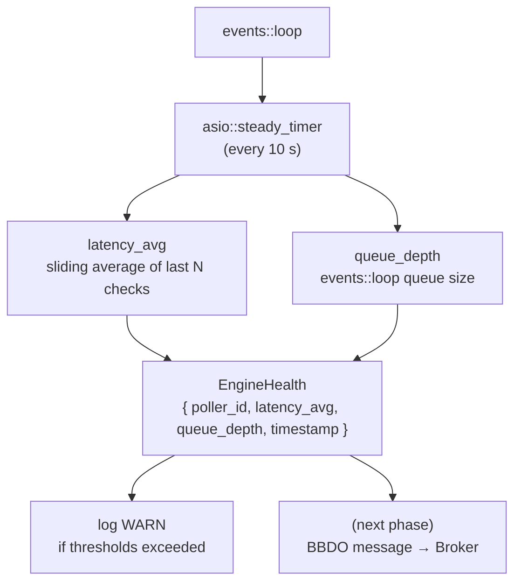
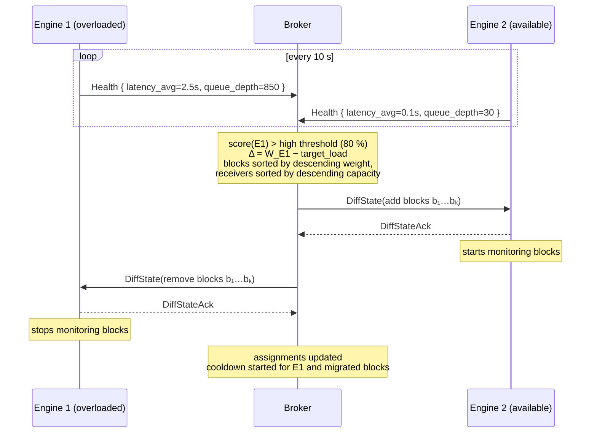

# Poller HA

[← Previous](09-ha-preparatory-work-en.md) · [Index](README-en.md) · [Next →](11-tickets-and-issues-en.md)

<!-- TOC -->
* [Poller configuration tree](#poller-configuration-tree)
* [Engine self-monitoring](#engine-self-monitoring)
  * [Implementation](#implementation)
  * [What Engine does with these indicators](#what-engine-does-with-these-indicators)
* [HA protocol architecture](#ha-protocol-architecture)
  * [Overview](#overview)
  * [The notion of zone](#the-notion-of-zone)
  * [Non-HA mode: compatibility and single-poller zone](#non-ha-mode-compatibility-and-single-poller-zone)
  * [PHP → Broker interface: centengine.cfg](#php--broker-interface-centenginecfg)
  * [Zone-to-poller configuration inheritance](#zone-to-poller-configuration-inheritance)
    * [Evolution of the `centengine.cfg` format](#evolution-of-the-centenginecfg-format)
  * [Zone activation: min_pollers](#zone-activation-min_pollers)
  * [Resource distribution across pollers](#resource-distribution-across-pollers)
    * [Co-location blocks](#co-location-blocks)
    * [Two-phase algorithm](#two-phase-algorithm)
  * [Behavior when a poller is removed from the zone](#behavior-when-a-poller-is-removed-from-the-zone)
  * [Host migration protocol](#host-migration-protocol)
  * [Runtime state preservation during migration](#runtime-state-preservation-during-migration)
  * [Centralized downtimes and acknowledgements](#centralized-downtimes-and-acknowledgements)
    * [notification_mode = engine (default)](#notification_mode--engine-default)
    * [notification_mode = broker](#notification_mode--broker)
  * [Notifications in HA mode](#notifications-in-ha-mode)
    * [notification_mode = engine (default)](#notification_mode--engine-default-1)
    * [notification_mode = broker](#notification_mode--broker-1)
  * [Threshold rebalancing](#threshold-rebalancing)
    * [Health message](#health-message)
    * [Load score and thresholds](#load-score-and-thresholds)
  * [Failure detection and failover](#failure-detection-and-failover)
  * [Return of a failed poller](#return-of-a-failed-poller)
<!-- TOC -->

> This chapter describes the **mechanism** of Poller HA (zones, self-monitoring,
> assignment table, distribution and rebalancing). For the broader **target
> architecture** it serves — why the resource becomes a *logical* identity, how
> external commands, comments and notification progressively move to the center,
> and why the center then has to become durable and highly available itself —
> see [Target architecture — toward poller HA](../ha-target-architecture-en.md).
> The downtime persistence already delivered is the first concrete brick of that
> larger story.

## Poller configuration tree
Without talking about HA, we have the following structure:
* engine:
	* 1/ poller 1 configuration
	* 1.lck file saying that broker can retrieve configuration

Here number 1 represents the poller ID.

Currently, with centralized configuration:

* creation of new-1.prot file with configuration inside
* Creation of diff-1.prot which contains the difference with previous configuration.
* Sending diff-1 to poller 1.
* On acknowledgement from poller 1, we move to next steps:
* Updating global configuration for broker cache
* updating global difference, if several configurations are received simultaneously, to be able to update the STORAGE database.

The zone concept replaces the poller as the central configuration unit. The full architecture — PHP→Broker interface files, zone-to-poller configuration inheritance, `min_pollers` activation, resource distribution, and rebalancing — is described in the [HA protocol architecture](#ha-protocol-architecture) section below.

## Engine self-monitoring

To feed the load calculation described above, Engine must monitor itself.
As a first step, two indicators are sufficient and cheap to collect:

**Global latency** — Engine already computes `latency = actual_start − scheduled_start` per host/service check. A sliding average over the last N minutes (e.g. 5 min) across all checks is enough. An average latency exceeding one step is the first sign of overload.

**`events::loop` queue depth** — Engine's internal event loop maintains a scheduled queue. If this queue grows monotonically between two samples, Engine is accumulating backlog faster than it can drain it.

### Implementation

An ASIO timer (`asio::steady_timer`) fired every N seconds (e.g. 10 s) inside the event loop thread is sufficient. No dedicated thread is needed:



### What Engine does with these indicators

In a first phase, Engine simply logs a warning whenever a threshold is crossed (e.g. `latency_avg > step` or `queue_depth > 1000`). This lets the watchdog (`cbwd`) and operators detect a degraded Engine before it fully falls behind, without modifying the BBDO protocol.

These values are sent to Broker in a `Health` message belonging to the **bbdo** namespace
(not `neb`), guaranteeing immediate delivery without going through the queue. If Engine is
overloaded, the `neb` queue is precisely what is growing — a `Health` message in `neb` would
be delayed by the very overload it is meant to report.

## HA protocol architecture

### Overview

Poller HA combines two distinct mechanisms sharing the same migration infrastructure:

- **Load balancing**: Broker rebalances hosts between the pollers of a zone according to their
  load. Threshold-triggered, not continuous.
- **Failover**: when a poller goes down, Broker redistributes its hosts to the surviving pollers
  of the zone. This is a special case of migration where the source poller is dead.

Central Broker does not control poller startup. HA is therefore entirely reactive: Broker
detects the failure and redistributes, but cannot start a new poller.

### The notion of zone

The HA model introduces a load-balancing and failover layer on top of the existing centralized
configuration mechanism. A *zone* groups several pollers that can monitor the same set of
resources. At any instant, each host is assigned to **exactly one** poller within its zone.

Broker maintains an **assignment table** `host → poller` as the source of truth. This table must
be persisted to survive Broker restarts.

### Non-HA mode: compatibility and single-poller zone

Poller HA is a **PHP module**. Broker and Engine do not know whether they are operating in
HA mode or not — they always process zones, with no conditional branch.

In the free edition, PHP generates single-poller zones. A single-poller zone is semantically
identical to the old per-poller model: no distribution, no migration, no rebalancing. The Broker
code is the same in both cases.

**`zone_id` is a stable identifier, independent of `poller_id`s.**

PHP assigns `zone_id`s in its own namespace, distinct from `poller_id`s, from the very first
deployment — even for a single-poller zone. Broker treats `zone_id`s as opaque and never assumes
`zone_id == poller_id`.

This independence guarantees that the `zone_id` remains stable throughout the zone lifecycle:

```
# free edition — single-poller zone
define zone { zone_id 1001  pollers 1 }

# HA upgrade — PHP adds pollers to the same zone
define zone { zone_id 1001  pollers 1 2 3 }

# rollback — PHP removes the added pollers
define zone { zone_id 1001  pollers 1 }
# → Broker migrates everything to poller 1 via the standard protocol
# → no ID realignment needed
```

Rollback is an ordinary zone update: PHP sends a `centengine.cfg` with one poller, Broker redistributes
resources via the migration protocol, the `zone_id` does not change.

**Backward compatibility: self-describing configuration object**

The configuration object — whether a `centengine.cfg` file on disk, a parsed in-memory
structure, or a future BBDO message — carries the mode discriminator directly in its fields.
Exactly one of `poller_id` or `zone_id` is set (a `oneof` in protobuf terms):

- **`poller_id` set** → legacy mode. The object describes a single poller. Broker treats it
  as a single-poller zone (`zone_id = poller_id` internally). `pollers.cfg` is not required.
  The existing installation continues to work without any change on the PHP side.
- **`zone_id` set** → centralized configuration mode. The object describes a full zone,
  potentially with multiple pollers.

This discrimination is intrinsic to the object: no external heuristic or filename convention
is needed to determine the mode. It applies identically at every layer — file, cache, message.

```
# legacy centengine.cfg — still supported as-is
poller_id=1
log_file=/var/log/centreon-engine/centengine.log
...
# poller_id is set → Broker treats it as a single-poller zone internally

# zone centengine.cfg
define zone {
  zone_id  1001
  pollers  1 2 3
  ...
}
# zone_id is set → Broker treats it as a full zone
```

PHP can migrate progressively, poller by poller: existing pollers keep working while new
ones are deployed in zone format. Existing Robot Framework tests, which use the `poller_id`
format, continue to run without modification.

### PHP → Broker interface: centengine.cfg

PHP sends a `centengine.cfg` file **in addition to** the existing per-poller configuration files it
already sends. The format is identical to the existing text `cfg` files — the impact on the PHP
side is minimal.

The trigger changes from `{poller_id}.lck` to `{zone_id}.lck`.

The zone directory contains:

```
42/
  centengine.cfg       ← zone_id, poller list, shared parameters
  pollers.cfg    ← per-poller identity (poller_id, poller_name)
  hosts.cfg      ← all zone hosts
  services.cfg
  commands.cfg
  contacts.cfg
  timeperiods.cfg
  hostgroups.cfg
  servicegroups.cfg
42.lck
```

`centengine.cfg` holds the Engine parameters shared across all pollers as well as the zone structure.
`pollers.cfg` contains one block per poller, reduced to identity. Resource files (`hosts.cfg`,
etc.) cover the whole zone. Hosts not covered by a pattern in `pollers.cfg` are free —
Broker distributes them automatically.

```
# centengine.cfg
define zone {
  zone_id   42
  pollers   1 3 7
  log_file  /var/log/centreon-engine/centengine.log
  ...
}

# pollers.cfg
define poller {
  poller_id    1
  poller_name  poller-paris
  hosts        paris-*
}
define poller {
  poller_id    3
  poller_name  poller-lyon
  hosts        lyon-* bordeaux-*
}
define poller {
  poller_id    7
  poller_name  poller-nice
}

# hosts.cfg — no poller_id in host definitions
define host { host_name paris-web-01 }
define host { host_name lyon-db-01   }
define host { host_name srv-generic  }   # free → no pattern matches, Broker distributes
```

When Broker detects `{zone_id}.lck`, it:

1. Reads `centengine.cfg` and `pollers.cfg`
2. Reads the resource files (`hosts.cfg`, `services.cfg`, …)
3. Computes or updates the resource → poller distribution (see next section)
4. Computes diffs for **currently connected** pollers whose configuration changed —
   disconnected pollers will receive their diff upon reconnection, computed by comparing
   their declared state against `{zone_id}.prot`
5. Stores the complete zone state in `{zone_id}.prot`
6. Sends `pb_diff_state` only to pollers whose configuration changed

### Zone-to-poller configuration inheritance

The zone acts as a **configuration template** for its pollers. All Engine behaviour parameters
can be defined at zone level and inherited by pollers.

**Precedence rule**: if a parameter is defined both in the zone and in a poller, the **poller
wins**. A poller that does not redefine a parameter inherits the zone value.

```
final_poller_config = zone_config ← overridden by poller_config
```

**What can be defined at zone level (all Engine behaviour):**
- Log levels and behaviour (`log_level_config`, `log_level_checks`, …)
- Intervals and attempts (`interval_length`, `max_check_attempts`, …)
- Check and notification timeouts
- Notification settings (`enable_notifications`, …)
- Flap detection, freshness checks, event handlers
- BBDO output configuration — all pollers in a zone connect to the same Broker

**What must remain per-poller:**
- Identity: `poller_id`, `poller_name`

In a containerized architecture (the target model), each poller runs in its own container with
an isolated filesystem. Paths such as `log_file`, `command_file`, or `lock_file` are **identical
inside each container** — they can therefore be defined at zone level.

The only case where these paths must be per-poller is a bare-metal installation with several
pollers on the same machine (legacy case).

**Practical impact for PHP**: `pollers.cfg` is reduced to pure identity. All configuration
lives in `centengine.cfg`.

```diff
# centengine.cfg — complete zone configuration
 define zone {
+  zone_id            42
+  pollers            1 3 7
   cfg_file           /etc/centreon-engine/42/hosts.cfg
   cfg_file           /etc/centreon-engine/42/services.cfg
   cfg_file           /etc/centreon-engine/42/commands.cfg
   cfg_file           /etc/centreon-engine/42/pollers.cfg
   log_file           /var/log/centreon-engine/centengine.log
   command_file       /var/run/centreon-engine/rw/centengine.cmd
   lock_file          /var/run/centreon-engine/centengine.pid
   log_level_checks   error
   interval_length    60
   max_check_attempts 3
   broker_host        central-broker.example.com
   broker_port        5669
 }

# pollers.cfg — pure identity
define poller {
  poller_id    1
  poller_name  poller-paris
}

define poller {
  poller_id    3
  poller_name  poller-lyon
}
```

#### Evolution of the `centengine.cfg` format

The current `centengine.cfg` is a flat key=value file generated by PHP for **a single poller**.
Paths and identifiers are specific to that poller (the `1` in the paths is the `poller_id`):

```
# current centengine.cfg — flat format, per-poller
cfg_file=/etc/centreon-engine/config1/hosts.cfg
cfg_file=/etc/centreon-engine/config1/services.cfg
cfg_file=/etc/centreon-engine/config1/commands.cfg
cfg_file=/etc/centreon-engine/config1/pollers.cfg
...
log_file=/var/log/centreon-engine/config1/centengine.log
command_file=/var/run/centreon-engine/config1/rw/centengine.cmd
interval_length=60
rpc_port=50002
broker_module=/usr/lib64/centreon-engine/externalcmd.so
broker_module_cfg_file=/etc/centreon-broker/central-module1.json
log_level_checks=info
...
```

The new format covers an entire zone. Here are the field-by-field changes:

**Added fields (mandatory)**

- `zone_id`: **replaces `poller_id`** in `centengine.cfg` — stable zone identifier (PHP's own namespace, distinct from `poller_id`s)
- `pollers`: space-separated list of `poller_id`s in the zone

**Added fields (optional)**

- `min_pollers`: zone activation threshold (default: 1 — see next section)
- `notification_mode`: `engine` (default) or `broker` — controls who manages notifications,
  downtimes, and acknowledgements. Forced to `broker` when Poller HA is active.

**Format**

The key=value format is kept as-is — the existing definitions are simply wrapped with
`define zone {` on one side and `}` on the other (see example above).
Only `zone_id`, `min_pollers`, `notification_mode` and `pollers` are added as new fields.

**New file: `pollers.cfg`**

PHP must create this file alongside `centengine.cfg`. It contains one `define poller { }`
block per poller listed in `pollers`. Only `poller_id` and `poller_name` are mandatory.
Any other Engine parameter in a `define poller` block overrides the zone value for that
poller only (bare-metal use case: different paths and ports per poller).

**PHP action checklist**

1. Emit **one** `centengine.cfg` per zone in `{zone_id}/` instead of one file
   per poller in `config{poller_id}/`
2. Switch from flat key=value to a `define zone { ... }` block
3. Create `{zone_id}/pollers.cfg` — new file
4. Place all resource files in the shared `{zone_id}/` directory
5. Create `{zone_id}.lck` after all files are written (triggers Broker)

### Zone activation: min_pollers

The `min_pollers` parameter in `centengine.cfg` defines the number of pollers expected for
the initial distribution. Broker pre-divides the resources into `min_pollers` shares and
sends them as pollers connect, one share per poller.

```
define zone {
  zone_id      42
  pollers      1 3 7 53 99
  min_pollers  3            # default: 1
}
```

Broker pre-divides the resources into `min_pollers` equal-weight shares **before** the first
poller connects. Each poller receives its share upon its first connection, without modifying
shares already sent.

**Startup sequence**

```
min_pollers=3, 30 resources, pollers=[1, 3, 7]

Poller 1 connects → receives 10 resources (1/3), pollers 3 and 7 unchanged
Poller 3 connects → receives 10 resources (2/3), poller 1 unchanged
Poller 7 connects → receives 10 resources (3/3), pollers 1 and 3 unchanged
```

Monitoring starts as soon as the first poller connects — on its fraction of the resources.
Full coverage is reached when all `min_pollers` pollers have received their share.

**Additional pollers**

When a poller beyond `min_pollers` connects, Broker redistributes only if the rebalancing
threshold is exceeded (see *Threshold rebalancing* section).

**Unassigned share**

Shares go to the first `min_pollers` pollers that connect, regardless of their `poller_id`.
With `min_pollers=3` and `pollers=[1, 3, 5, 7]`, any three pollers from the zone connecting
is enough for all resources to be distributed.

Shares remain unassigned only if the total number of connected pollers never reaches
`min_pollers` — this is a user configuration error.

**Failover after full initialisation**

Once all `min_pollers` pollers have received their share, the zone is fully initialised.
Any subsequent disconnection triggers the standard failover — the failed poller's resources
are redistributed to the survivors, without checking `min_pollers` again.

**Default value: 1** — all resources go to the first poller that connects. This is the
non-HA behaviour and the equivalent of the old per-poller model.

### Resource distribution across pollers

Broker is responsible for distributing resources across the pollers of a zone. Two cases:

**Assigned resource**: a host whose `host_name` matches one of the glob patterns in the
`hosts` field of a `define poller` block in `pollers.cfg` is assigned to that poller. `hosts`
accepts a space-separated list of patterns (`hosts lyon-* bordeaux-*`). If a host matches
patterns from multiple pollers, Broker raises a configuration error. If the target poller is
not in the zone, same error.

**Free resource**: a host that matches no pattern is distributed by the *sticky rebalancing*
algorithm described below.

#### Co-location blocks

Before any distribution, Broker identifies **co-location blocks**: sets of hosts that must
reside on the same poller. Blocks are computed as the transitive closure of the following
constraint:

- `hostdependencies` / `servicedependencies` **of the execution kind only**: linked hosts must
  be on the same poller

Restricting this to the execution kind is essential. `expand()` already decomposes every
dependency into two distinct objects, one `execution_dependency` and one
`notification_dependency` (`hostdependency_helper::expand`), and only the former constrains
anything:

- a **notification dependency** is evaluated by Broker from its global cache (like escalation
  rules), so it may cross pollers with no consequence;
- an **execution dependency** (`execution_failure_options`) is evaluated locally by the poller
  at scheduling time — it suppresses the *check* itself, not merely the notification. Moving it
  to the centre would mean a round trip to Broker on every check, which is nothing like
  notifications, which are rare and asynchronous. It therefore stays local, and it does impose
  co-location.

Taking dependencies without distinguishing their kind would produce needlessly large blocks,
hence a needlessly coarse distribution.

> **Current state — restricting this to the execution kind is the target, not the
> implementation.** As long as a cross-poller notification dependency is refused at validation
> time, it constrains placement too: distributing two hosts linked by such a dependency onto
> different pollers would produce a configuration our own validation rejects. For now, blocks
> must therefore be computed over **both kinds**.
>
> What is missing to reach the target is not the evaluation — `broker_cache` already resolves
> both ends of a notification dependency through its global by-name index and stores them by id
> (`_insert_host_notif_dep`), so a cross-poller one would fit as is. What is missing is a **home**
> for the object: a dependency exists today only inside the Engine configuration of one poller,
> and neither poller knows the host on the other side. Two further points would need handling in
> the cache: ingestion resolves names when a poller's state arrives and drops the dependency with
> a mere `warn` if the other poller has not been ingested yet, with no later re-resolution; and
> the per-owner purge (`_host_notif_deps.get<by_instance>().erase(poller_id)`) has no defined
> semantics for a dependency that belongs to no poller in particular.

`anomalydetection` **does not appear** in this transitive closure: Engine looks its parent
service up with the anomaly detection's own `host_id`
(`service::services_by_id.find({host_id, dependent_service_id})`), so the parent always lives on
the **same host**. Since a host and all its services are distributed together, the constraint is
automatically satisfied and never creates an edge between two hosts.

A block is the atomic unit of distribution — its members cannot be split across different
pollers. The weight of a block is the total number of services across all its hosts.

Hosts with no constraints each form their own block of size 1.

#### Two-phase algorithm

**Phase 1 — Initial assignment or after topology change**

```
For each block not yet assigned or whose poller has been removed:
  → assign to the active poller with the lowest total weight
  (first-fit decreasing: sort blocks by descending weight before assignment)
```

Existing assignments are preserved without modification.

**Phase 2 — Rebalancing if imbalance detected**

```
# quantities computed by Broker
total_weight   = sum of services across all hosts in the zone
target_load    = total_weight / nb_pollers         # ideal load if perfectly balanced

# configurable parameter
rebalance_threshold = 0.2                          # default ±20%

# derived threshold
high_threshold = target_load × (1 + rebalance_threshold)

# effective weights, updated in real time
W_eff[P] = W[P] for all pollers P

# Phase 1 — build the pool of blocks to redistribute
pool = []
for each poller S (by descending W_eff) where W_eff[S] > high_threshold:
  Δ = W_eff[S] − target_load
  sum = 0
  for each block b from S (by descending weight):
    pool.append((b, S))          # keep origin for bilateral exchange
    sum += weight(b) ; W_eff[S] −= weight(b)
    if sum >= Δ: break

# Phase 2 — redistribute the pool to the least-loaded pollers
sort pool by descending weight
for each (b, S_src) in pool:
  R = poller with minimum W_eff
  assign b to R ; W_eff[R] += weight(b)
  # Bilateral exchange: if b overloads R while S_src has dropped below target_load,
  # R gives back a light block to S_src — both converge to target_load in one cycle.
  if W_eff[R] > target_load and W_eff[S_src] < target_load:
    b' = block from R with weight ≤ min(W_eff[R] − target_load, target_load − W_eff[S_src])
    if b' found:
      assign b' to S_src ; W_eff[S_src] += weight(b') ; W_eff[R] −= weight(b')

# Phase 3 — send migrations in one round trip per poller
for each poller P with a non-zero balance (blocks received and/or given):
  send DiffState(add received blocks, remove given blocks) → P
  wait for ack
```

- **Phase 1**: each overloaded poller releases its heaviest blocks until its surplus is covered. Multiple pollers can feed the pool simultaneously.
- **Phase 2**: pool blocks are redistributed one by one to the least-loaded poller. If a block overloads its receiver R while the source poller has dropped below `target_load`, R gives back one of its lightest blocks to the source: both converge to `target_load` in a single Health cycle, even with coarse-grained blocks.
- **Phase 3**: all additions and removals for a given poller are combined into a single DiffState, regardless of batch size.
- If a poller remains above `target_load` after the pool (no exchange possible), the partial migration is applied; the next `Health` cycle will trigger a new iteration.

`rebalance_threshold` is the only parameter to configure (default: 0.2, i.e. ±20%). It
controls the trade-off between stability and balance: a high value minimises movements, a
low value enforces strict balance. Below 0.1, the risk of incessant migrations increases;
above 0.3, rebalancing becomes rare.

For dynamic rebalancing triggered by `Health` messages, phase 2 applies using runtime metrics
(`latency_avg`, `queue_depth`) instead of service counts.

### Behavior when a poller is removed from the zone

When PHP removes a poller from `pollers.cfg`, the `define poller` block disappears along with
its `hosts` field. Hosts that matched its patterns no longer have any pattern claiming them —
they become free and are automatically redistributed to the remaining pollers via the migration
protocol.

A poller added to the zone receives a share of free resources from the most-loaded pollers.

### Host migration protocol

Migration of host H from poller A to poller B follows an overlap protocol:

```
1. Broker sends DiffState(add H + runtime_state of H) → poller B  — B starts monitoring H
2. Broker waits for B's DiffStateAck
3. Broker sends DiffState(remove H) → poller A
4. Broker waits for A's DiffStateAck
5. Broker updates the assignment table: H → B
```

During the window between steps 1 and 3, both pollers monitor H simultaneously. `unified_sql`
receives duplicates and filters them by only retaining results from the assigned poller (according
to the assignment table) once step 5 is reached. The out-of-order RRD data problem being already
handled, late results from A do not affect data consistency.

**Failover case** (A is dead): steps 3 and 4 are skipped. Broker sends
`DiffState(add H + runtime_state of H) → B` directly then updates the table. No deletion
`DiffState` is sent to A.

### Runtime state preservation during migration

When host H is migrated, poller B must receive the last known state of H and its services to
avoid false alerts at the first check start.

Broker has this information: all status events (`pb_host_status`, `pb_service_status`) transit
through Broker from the pollers. Broker therefore always knows the last state of each host and
service.

The state is embedded in the optional `runtime_state` field of any `DiffState` containing added
hosts during a migration. Broker fills it from its cache for each added host/service, whether it
is the initial `DiffState(add)` to the receiver or the return `DiffState(add)` to the source in
a bilateral exchange:

```protobuf
// common/engine_conf/state.proto — as implemented on 2026-10-02.
enum RuntimeStateType { SOFT = 0; HARD = 1; }
enum RuntimeCheckType { ACTIVE = 0; PASSIVE = 1; }
enum RuntimeAckType { NONE = 0; NORMAL = 1; STICKY = 2; }

message HostRuntime {
  uint64     host_id = 1;
  bool       checked = 2;
  RuntimeCheckType  check_type = 3;
  HostStatus state = 4;
  RuntimeStateType  state_type = 5;
  int64      last_state_change = 6;
  HostStatus last_hard_state = 7;
  int64      last_hard_state_change = 8;
  int64      last_time_up = 9;
  int64      last_time_down = 10;
  int64      last_time_unreachable = 11;
  string     output = 12;      // not the long output
  string     perfdata = 13;    // filled only for the services an anomalydetection depends on
  bool       flapping = 14;
  double     percent_state_change = 15;
  double     latency = 16;
  double     execution_time = 17;
  int64      last_check = 18;
  int32      check_attempt = 19;
  // notification_mode=engine only: when Broker owns acknowledgements and
  // notifications, it replays them itself and these fields are left at
  // their defaults.
  bool       acknowledged = 20;
  RuntimeAckType    acknowledgement_type = 21;
  // The downtime depth is never carried: it is the count of the downtimes
  // in progress, which Engine rebuilds as they start. A number restored
  // without them would be counted again by the next downtime.
  int32      notification_number = 22;
  bool       no_more_notifications = 23;
  int64      last_notification = 24;
  int64      next_notification = 25;
  RuntimeOverrides  overrides = 26;  // see batch 4 above
  // Identifiers of the $HOST*ID$ macros, see doc/engine-macros-en.md, in
  // both notification modes.
  uint64     current_event_id = 27;
  uint64     last_event_id = 28;
  uint64     current_problem_id = 29;
  uint64     last_problem_id = 30;
  uint64     current_notification_id = 31;
}

message ServiceRuntime {
  // same fields, plus service_id = 2 and last_time_ok/warning/critical/unknown
  // = 10..13; numbered 1..33. Only the check output is sent, not the long
  // output, see below.
}

message RuntimeState {
  repeated HostRuntime    hosts    = 1;
  repeated ServiceRuntime services = 2;
}

message DiffState {
  // ... existing fields ...
  RuntimeState runtime_state = 148;  // full for a connecting poller, else only the resources the diff adds
  bool runtime_only = 149;           // nothing else to apply: poller up to date, Engine applies the snapshot only
}
```

The snapshot carries the check output (`output`) of each resource, but not the long output
(`long_output`), the bulky part of a check result (decided on 2026-10-16). Engine reads the restored
output only through the `$HOSTOUTPUT$` and `$SERVICEOUTPUT$` macros of a command run before the first
check of the resource: daily check, passive check, custom notification, host output in a service
notification, on-demand macro. `$LONGHOSTOUTPUT$` and `$LONGSERVICEOUTPUT$` stay empty until that
first check.

Engine initialises the internal state of each host/service from this snapshot before starting to
monitor them. It schedules the next check at `last_check + check_interval` rather than
immediately.

In a failover case, the transmitted state is the last message received from A before its
disconnection, potentially slightly old depending on the outage duration. This is always
preferable to a cold start.

### Centralized downtimes and acknowledgements

Who manages downtimes and acknowledgements is controlled by `notification_mode`.

#### notification_mode = engine (default)

Engine manages downtimes and acknowledgements as it always has: commands arrive via the
external command pipe (`centengine.cmd`), Engine creates the records internally, and emits
`pb_downtime` / `pb_acknowledgement` BBDO events that Broker stores in
`centreon_storage.downtimes` / `centreon_storage.acknowledgements`.

No change to this path. Existing deployments continue to work without modification.

On host migration, Broker reads the active downtimes and acknowledgements from
`centreon_storage` and includes them in `RuntimeState` (fields 3 and 4). The
receiving Engine recreates these records locally before its first check run.

#### notification_mode = broker

In this mode, Engine does not handle notifications (see [Notifications](#notifications-in-ha-mode))
and therefore has no use for downtimes or acknowledgements. Broker is the sole authority.
This mode is required for Poller HA and available as a standalone option for single-poller zones.

Broker exposes the following `BrokerRpc` gRPC endpoints. The caller (UI or PHP) does not
need to know which poller monitors a given host:

```protobuf
service BrokerRpc {
  rpc ScheduleHostDowntime(HostDowntimeRequest)               returns (CommandResult);
  rpc ScheduleServiceDowntime(ServiceDowntimeRequest)         returns (CommandResult);
  rpc DeleteHostDowntime(DeleteDowntimeRequest)               returns (CommandResult);
  rpc AcknowledgeHostProblem(HostAcknowledgementRequest)      returns (CommandResult);
  rpc AcknowledgeServiceProblem(ServiceAcknowledgementRequest) returns (CommandResult);
  rpc RemoveHostAcknowledgement(RemoveAcknowledgementRequest) returns (CommandResult);
  rpc RemoveServiceAcknowledgement(RemoveAcknowledgementRequest) returns (CommandResult);
}
```

Broker stores the downtime or acknowledgement directly, without any transit through Engine:

```
UI/PHP → BrokerRpc::ScheduleHostDowntime(host_id, ...)
       → Broker stores directly in centreon_storage.downtimes
       → Broker updates the in_downtime flag in its cache and in the DB
```

Nothing needs to be migrated on host failover or rebalancing: downtimes and acknowledgements
live in Broker's database and are immediately accessible regardless of which poller currently
monitors the host.

`acknowledged` and `in_downtime` in `HostRuntimeState` / `ServiceRuntimeState` are kept as
display hints for the UI but Engine makes no decisions based on them in HA mode.

`RuntimeState` fields 3 and 4 (`downtimes`, `acknowledgements`) are unused when
`notification_mode = broker`. They exist only for `notification_mode = engine` migrations.

### Notifications in HA mode

#### notification_mode = engine (default)

Each poller executes notification commands directly for the resources it monitors. All
notification infrastructure (mail relay, scripts, webhook endpoints) must be reachable from
every poller in the zone.

Notification state fields `last_notification` and `current_notification_number` in
`HostRuntimeState` and `ServiceRuntimeState` ensure continuity on migration: the receiving
poller resumes the notification chain at the exact point where the source poller left it,
avoiding both duplicate notifications and broken escalation sequences.

On host migration, Broker also reads active downtimes and acknowledgements from
`centreon_storage` and includes them in `RuntimeState` (fields 3 and 4) so that the
receiving Engine can recreate the records locally before its first check run.

#### notification_mode = broker

Broker makes the whole notification **decision** for the zone (model C). Broker's
`notification_manager` observes the state changes (`pb_host_status`/`pb_service_status`), checks
active downtimes and acknowledgements, **evaluates the resource's `notification_period`** (hence
the [T0: Broker-manageable timeperiods](09-ha-preparatory-work-en.md#prerequisite-timeperiods-must-be-broker-manageable)
prerequisite), selects the contacts and applies the escalation rules — all from Broker's cache
and database. It then dispatches only the **execution** (macro expansion + command launch) to
the poller that supervises the resource, through a `pb_notification_execute` BBDO event:

```protobuf
// io::bbdo — Broker → poller. Carries an already-decided notification: the
// contacts are the exact set Broker selected; the poller only expands macros
// and runs each contact's notification command.
message NotificationExecute {
  uint64 host_id             = 1;
  uint64 service_id          = 2;   // 0 for a host notification
  uint32 category            = 3;
  uint32 reason_type         = 4;
  uint64 notification_id     = 5;
  uint32 notification_number = 6;
  bool   escalated           = 7;
  string author              = 8;
  string message             = 9;
  uint32 options             = 10;
  repeated string contacts   = 11;
}
```

On the poller, `execute_broker_notification` resolves the contact names, expands the macros and
runs the notification commands. Engine no longer decides notifications on its own; suppression by
downtimes and acknowledgements happens on Broker, *before* dispatch. See
[Driving the notification decision on Broker](07-downtimes-acknowledgements-en.md#driving-the-notification-decision-on-broker) for
the trigger mechanism (the third treatment in `multiplexing::engine`).

Advantages:
- The notification decision is centralised (consistent history, suppression and escalations),
  which is what Poller HA needs — a decision about a *logical* resource belongs to the centre.
- No command executor or macro engine has to be reimplemented in Broker: execution stays on the
  poller, which already has the resource context.
- Escalation rules can span several pollers.

With `notification_mode = broker`, `RuntimeState` carries no notification state, no
downtimes, and no acknowledgements — Engine holds none of this information.

### Threshold rebalancing

#### Health message

Broker periodically receives a `Health` message from each Engine. `Health` belongs to the
**bbdo** namespace (like `pb_welcome`, `pb_diff_state_ack`): it is transmitted immediately,
bypassing the `neb` queue. This is essential — if Engine is overloaded, the `neb` queue is
precisely what is growing, and a message in `neb` would be delayed by the overload it is
meant to report.

The two retained metrics are **latency** and **queue_depth** — Engine-internal metrics,
directly linked to its capacity to sustain its workload, without system calls or
platform-specific code:

```protobuf
// bbdo namespace — immediate delivery, bypasses neb queue
message Health {
  uint32 poller_id    = 1;
  float  latency_avg  = 2;  // sliding average of (actual_start − scheduled_start) in seconds
  uint32 queue_depth  = 3;  // number of events waiting in the event loop queue
}
```

CPU and memory were discarded: they are indirect system metrics, sensitive to noise from other
processes on the machine and not reliably correlated with monitoring overload.

The implementation in Engine is an `asio::steady_timer` fired every N seconds (e.g. 10 s) in the
event loop thread — no dedicated thread needed.

#### Load score and thresholds

A global score is computed from the two metrics, each normalised between 0 and 1:

```
C = α · min(latency_avg / latency_max, 1.0) + β · min(queue_depth / queue_max, 1.0)
    with α + β = 1
```

Rebalancing is triggered only by threshold crossing, not continuously:

- When a poller's score exceeds the **high threshold** (e.g. 80%): Broker computes the batch of
  blocks to migrate (see the phase 2 algorithm) and distributes them to the most available pollers
  in the zone.
- A **cooldown** applies: a poller that has recently sent or received a migration cannot trigger
  a new one for N minutes.
- A recently migrated host cannot be re-migrated during the same delay (anti-ping-pong
  protection).

The high threshold, α/β weights, latency_max, queue_max, and cooldown are configurable.



### Failure detection and failover

Poller loss is detected by the **absence of BBDO messages for a configurable delay**, not by a
pure TCP disconnect which can be transient. Periodic Health messages serve as a heartbeat.

Failover sequence:

```
1. Broker receives no message from A for the configured delay
2. Broker marks A as failed
3. Broker redistributes all hosts assigned to A to other pollers in the zone
   (migration protocol — steps 1, 2, 4 only; no deletion DiffState sent)
4. Assignments are updated and persisted
```

If A reconnects before the delay expires, the reconnection is handled normally — no failover
is triggered.

### Return of a failed poller

When a dead poller reconnects, the existing centralized reconnection mechanism applies: Broker
sends it the configuration corresponding to its current assignment. If all its hosts were
redistributed during the failover, it receives an empty configuration and remains host-free
until threshold rebalancing naturally redistributes some hosts to it (if the other pollers in
the zone are overloaded).

No special mechanism is needed for a returning poller — centralized reconnection and threshold
rebalancing together cover the case.
