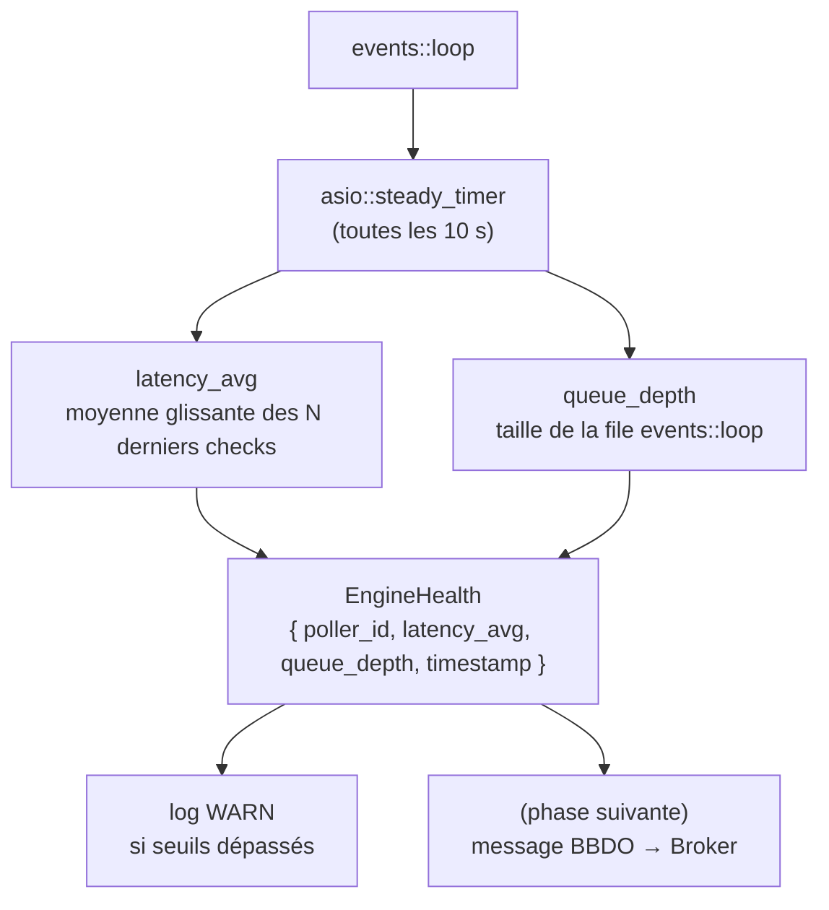
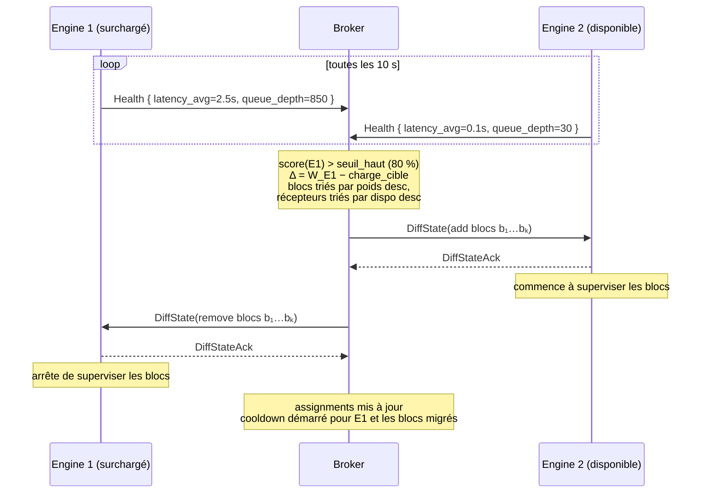

# Poller HA

[← Précédent](09-ha-preparatory-work-fr.md) · [Index](README-fr.md) · [Suivant →](11-tickets-and-issues-fr.md)

<!-- TOC -->
* [Arborescence de configuration des pollers](#arborescence-de-configuration-des-pollers)
* [Auto-surveillance d'Engine](#auto-surveillance-dengine)
  * [Mise en œuvre](#mise-en-œuvre)
  * [Ce qu'Engine fait de ces indicateurs](#ce-quengine-fait-de-ces-indicateurs)
* [Architecture du protocole HA](#architecture-du-protocole-ha)
  * [Vision générale](#vision-générale)
  * [La notion de zone](#la-notion-de-zone)
  * [Mode non-HA : compatibilité et zone à un seul poller](#mode-non-ha--compatibilité-et-zone-à-un-seul-poller)
  * [Interface PHP → Broker : le fichier centengine.cfg](#interface-php--broker--le-fichier-centenginecfg)
  * [Héritage de configuration zone → poller](#héritage-de-configuration-zone--poller)
    * [Évolution du format `centengine.cfg`](#évolution-du-format-centenginecfg)
  * [Activation de la zone : min_pollers](#activation-de-la-zone--min_pollers)
  * [Distribution des ressources sur les pollers](#distribution-des-ressources-sur-les-pollers)
    * [Blocs de co-localisation](#blocs-de-co-localisation)
    * [Algorithme en deux phases](#algorithme-en-deux-phases)
  * [Comportement lors de la suppression d'un poller de la zone](#comportement-lors-de-la-suppression-dun-poller-de-la-zone)
  * [Protocole de migration d'un host](#protocole-de-migration-dun-host)
  * [Préservation de l'état lors de la migration](#préservation-de-létat-lors-de-la-migration)
  * [Downtimes et acquittements centralisés](#downtimes-et-acquittements-centralisés)
    * [notification_mode = engine (défaut)](#notification_mode--engine-défaut)
    * [notification_mode = broker](#notification_mode--broker)
  * [Notifications en mode HA](#notifications-en-mode-ha)
    * [notification_mode = engine (défaut)](#notification_mode--engine-défaut-1)
    * [notification_mode = broker](#notification_mode--broker-1)
  * [Rebalancing par seuil](#rebalancing-par-seuil)
    * [Message Health](#message-health)
    * [Score de charge et seuils](#score-de-charge-et-seuils)
  * [Détection de panne et failover](#détection-de-panne-et-failover)
  * [Retour d'un poller défaillant](#retour-dun-poller-défaillant)
<!-- TOC -->

> Ce chapitre décrit le **mécanisme** de la HA des pollers (zones,
> auto-surveillance, table d'affectation, distribution et rééquilibrage). Pour
> l'**architecture cible** plus large qu'il sert — pourquoi la ressource devient
> une identité *logique*, comment les commandes externes, les commentaires et la
> notification migrent progressivement vers le centre, et pourquoi le centre doit
> alors devenir durable et hautement disponible lui-même — voir
> [Architecture cible — vers la HA des pollers](../ha-target-architecture-fr.md).
> La persistance des downtimes déjà livrée est la première brique concrète de
> cette histoire plus vaste.

## Arborescence de configuration des pollers

Sans parler HA, on a la structure de fichiers suivante :
* engine:
	* 1/ fichiers de configuration du poller 1
	* 1.lck : fichier disant que broker peut récupérer la configuration du poller 1.

Ici le numero 1 représente l'ID du poller.

Actuellement, avec la configuration centralisée :

* création du fichier new-1.prot avec la configuration à l'intérieur
* Création de diff-1.prot qui contient la différence avec la configuration précédente.
* Envoi de diff-1 au poller 1.
* À l'acquittement de poller 1, on passe aux étapes suivantes:
* Mise à jour de la configuration globale pour le cache de broker
* mise à jour de la différence globale, si plusieurs configurations sont reçues simultanément, pour pouvoir faire la
mise à jour de la base de données STORAGE et celle du cache.

Avec Poller HA, nous voulons davantage d'autonomie des pollers :
* un poller s'éteint, ses ressources sont redistribuées sur les autres.
* un poller ne supporte pas sa charge, certaines de ses ressources sont redistribuées sur les autres.
* plus besoin d'affecter les ressources aux pollers, on crée un groupe de pollers, on donne la liste des ressources et
les ressources s'affectent le plus intelligemment possible.

Le groupe de pollers est ce qu'on appelle une zone. La pierre angulaire de la configuration `Engine` devient la zone.
La notion de zone remplace le poller comme unité de configuration centrale. L'architecture complète — fichiers
d'interface PHP→Broker, héritage zone→poller, activation par `min_pollers`, distribution des ressources et rebalancing —
est décrite dans la section [Architecture du protocole HA](#architecture-du-protocole-ha) ci-dessous.

## Auto-surveillance d'Engine

Pour alimenter le calcul de charge décrit ci-dessus, Engine doit se surveiller lui-même.
Dans un premier temps, deux indicateurs suffisent et sont peu coûteux à collecter :

**Latence globale** — à chaque exécution de check, Engine calcule déjà `latency = actual_start − scheduled_start` par host/service. Il suffit d'en tenir une moyenne glissante (fenêtre de N minutes, par exemple 5 min) sur l'ensemble des checks. Une latence moyenne qui dépasse un step est le premier signe de surcharge.

**Profondeur de la queue d'`events::loop`** — la boucle d'événements interne d'Engine maintient une file planifiée. Si cette file grandit de manière monotone entre deux échantillons, Engine accumule du retard plus vite qu'il ne le résorbe.

### Mise en œuvre

Un timer ASIO (`asio::steady_timer`) déclenché toutes les N secondes (par exemple 10 s) dans le thread de la boucle d'événements suffit. Il n'y a pas besoin d'un thread dédié :



### Ce qu'Engine fait de ces indicateurs

Dans un premier temps, Engine se contente de journaliser un avertissement dès qu'un seuil est
franchi (par exemple `latency_avg > step` ou `queue_depth > 1000`). Cela permet au watchdog
(`cbwd`) et aux opérateurs de détecter un Engine dégradé avant qu'il ne décroche complètement,
sans modifier le protocole BBDO.

Ces valeurs sont envoyées à Broker dans un message `Health` du namespace **bbdo** (pas `neb`),
ce qui garantit une livraison immédiate sans passer par la queue. Si Engine est surchargé,
c'est précisément le moment où la queue `neb` s'allonge — un message `Health` dans `neb`
serait retardé par l'overload qu'il est censé signaler.

## Architecture du protocole HA

### Vision générale

Le Poller HA combine deux mécanismes distincts qui partagent la même infrastructure de migration :

- **Load balancing** : Broker rééquilibre les hosts entre les pollers d'une zone en fonction de leur
  charge. Déclenché par seuil, pas en continu.
- **Failover** : quand un poller tombe, Broker redistribue ses hosts aux pollers survivants de la
  zone. C'est un cas particulier de migration où le poller source est mort.

Broker central ne maîtrise pas le démarrage des pollers. Le HA est donc entièrement réactif : Broker
détecte la panne et redistribue, mais ne peut pas démarrer un nouveau poller.

### La notion de zone

Une zone est un groupe de pollers pouvant superviser les mêmes ressources. À tout instant, chaque
host est assigné à **exactement un** poller de sa zone. La zone définit les pollers éligibles à
recevoir un host, pas un partage simultané.

Broker maintient une **table d'affectation** `host → poller` qui est la source de vérité. Cette table
doit être *persistée* pour survivre aux redémarrages de Broker.

### Mode non-HA : compatibilité et zone à un seul poller

Le Poller HA est une **option côté PHP**. Broker et Engine ignorent s'ils opèrent en mode
HA ou non — ils traitent toujours des zones, sans branche conditionnelle.

En mode libre, PHP génère des zones à un seul poller. Une zone mono-poller est sémantiquement
identique à l'ancien modèle par poller : pas de distribution, pas de migration, pas de *rebalancing*.
Le code Broker est le même dans les deux cas.

**`zone_id` est un identifiant stable, indépendant des `poller_id`s.**

PHP assigne les `zone_id`s dans son propre espace de nommage, distinct des `poller_id`s, dès le
premier déploiement — même pour une zone mono-poller. Broker traite les `zone_id`s de façon opaque
et ne fait jamais l'hypothèse `zone_id == poller_id`.

Cette indépendance garantit que le `zone_id` reste stable tout au long du cycle de vie de la zone :

```
# mode libre — zone mono-poller
define zone { zone_id 1001  pollers 1 }

# upgrade HA — PHP ajoute des pollers à la même zone
define zone { zone_id 1001  pollers 1 2 3 }

# rollback — PHP retire les pollers ajoutés
define zone { zone_id 1001  pollers 1 }
# → Broker migre tout vers poller 1 via le protocole habituel
# → aucun réalignement d'ID nécessaire
```

Le rollback est un cas ordinaire de mise à jour de zone : PHP renvoie un `centengine.cfg` avec un seul
poller, Broker redistribue les ressources via le protocole de migration, le `zone_id` ne change pas.

**Rétrocompatibilité : objet de configuration auto-descriptif**

L'objet de configuration — qu'il s'agisse d'un fichier `centengine.cfg` sur disque, d'une
structure en mémoire ou d'un futur message BBDO — porte directement le discriminateur de mode
dans ses champs. Exactement l'un de `poller_id` ou `zone_id` est renseigné (un `oneof` au sens
protobuf) :

- **`poller_id` renseigné** → mode legacy. L'objet décrit un poller unique. Broker le traite
  en interne comme une zone mono-poller (`zone_id = poller_id`). `pollers.cfg` n'est pas requis.
  L'installation existante continue de fonctionner sans aucun changement côté PHP.
- **`zone_id` renseigné** → mode configuration centralisée. L'objet décrit une zone complète,
  potentiellement avec plusieurs pollers.

Cette discrimination est intrinsèque à l'objet : aucune heuristique externe ni convention de
nom de fichier n'est nécessaire pour déterminer le mode. Elle s'applique identiquement à tous
les niveaux — fichier, cache, message.

```
# ancien centengine.cfg — toujours supporté tel quel
poller_id=1
log_file=/var/log/centreon-engine/centengine.log
...
# poller_id renseigné → Broker le traite en interne comme une zone mono-poller

# centengine.cfg zone
define zone {
  zone_id  1001
  pollers  1 2 3
  ...
}
# zone_id renseigné → Broker le traite comme une zone complète
```

PHP peut migrer progressivement, poller par poller : les anciens pollers continuent de
fonctionner pendant que les nouveaux sont déployés au format zone. Les tests Robot Framework
existants, qui utilisent le format `poller_id`, continuent de tourner sans modification.

### Interface PHP → Broker : le fichier centengine.cfg

PHP envoie un fichier `centengine.cfg` **en plus** des fichiers de configuration par poller qu'il envoie
déjà. Le format est identique aux fichiers `cfg` texte existants — l'impact côté PHP est minimal.

Le déclencheur passe de `{poller_id}.lck` à `{zone_id}.lck`.

Le répertoire de zone contient :

```
42/
  centengine.cfg       ← zone_id, liste pollers, paramètres partagés
  pollers.cfg          ← identité par poller (poller_id, poller_name)
  hosts.cfg            ← tous les hosts de la zone
  services.cfg
  commands.cfg
  contacts.cfg
  timeperiods.cfg
  hostgroups.cfg
  servicegroups.cfg
42.lck
```

`centengine.cfg` contient les paramètres Engine partagés entre tous les pollers ainsi que la structure
de la zone. `pollers.cfg` contient un bloc par poller, réduit à l'identité. Les fichiers ressources
(`hosts.cfg`, etc.) couvrent l'ensemble de la zone. Les hosts non couverts par un pattern
dans `pollers.cfg` sont libres — Broker les distribue automatiquement.

```
# centengine.cfg
define zone {
  zone_id   42
  pollers   1 3 7
  log_file  /var/log/centreon-engine/centengine.log
  ...
}

# pollers.cfg
define poller {
  poller_id    1
  poller_name  poller-paris
  hosts        paris-*
}
define poller {
  poller_id    3
  poller_name  poller-lyon
  hosts        lyon-* bordeaux-*
}
define poller {
  poller_id    7
  poller_name  poller-nice
}

# hosts.cfg — pas de poller_id dans les définitions de hosts
define host { host_name paris-web-01 }
define host { host_name lyon-db-01   }
define host { host_name srv-generic  }   # libre → aucun pattern ne correspond, Broker distribue
```

Quand Broker détecte `{zone_id}.lck`, il :

1. Lit `centengine.cfg` et `pollers.cfg`
2. Lit les fichiers ressources (`hosts.cfg`, `services.cfg`, …)
3. Calcule ou met à jour la distribution ressource → poller (voir section suivante)
4. Calcule les diffs pour les pollers **actuellement connectés** dont la configuration a changé —
   les pollers non connectés recevront leur diff au moment de leur reconnexion, par comparaison
   de leur état déclaré avec `{zone_id}.prot`
5. Stocke l'état complet de la zone dans `{zone_id}.prot`
6. Envoie `pb_diff_state` uniquement aux pollers dont la configuration a changé

### Héritage de configuration zone → poller

La zone sert de **template de configuration** pour ses pollers. Tous les paramètres de comportement
Engine peuvent être définis au niveau zone et hérités par les pollers.

**Règle de précédence** : si un paramètre est défini à la fois dans la zone et dans le poller,
**le poller a la priorité**. Un poller qui ne redéfinit pas un paramètre hérite de la valeur de la
zone.

```
config_poller_final = config_zone ← écrasé par config_poller
```

**Ce qui peut être défini au niveau zone (tout le comportement Engine) :**
- Niveaux et comportement des logs (`log_level_config`, `log_level_checks`, …)
- Intervalles et tentatives (`interval_length`, `max_check_attempts`, …)
- Timeouts de checks et notifications
- Paramètres de notifications (`enable_notifications`, …)
- Flap detection, freshness checks, event handlers
- Configuration BBDO de sortie — tous les pollers d'une zone se connectent au même Broker

**Ce qui reste obligatoirement per-poller :**
- Identité : `poller_id`, `poller_name`

Dans une architecture conteneurisée (cas cible), chaque poller tourne dans son propre container
avec un filesystem isolé. Les chemins comme `log_file`, `command_file` ou `lock_file` sont
**identiques dans chaque container** — ils peuvent donc être définis au niveau zone.

Le seul cas où ces chemins doivent être per-poller est une installation bare-metal avec plusieurs
pollers sur la même machine (cas legacy).

**Impact pratique pour PHP** : `pollers.cfg` se réduit à la pure identité. Tout le paramétrage
vit dans `centengine.cfg`.

```diff
# centengine.cfg — paramétrage complet de la zone
 define zone {
+  zone_id            42
+  pollers            1 3 7
   cfg_file           /etc/centreon-engine/42/hosts.cfg
   cfg_file           /etc/centreon-engine/42/services.cfg
   cfg_file           /etc/centreon-engine/42/commands.cfg
   cfg_file           /etc/centreon-engine/42/pollers.cfg
   log_file           /var/log/centreon-engine/centengine.log
   command_file       /var/run/centreon-engine/rw/centengine.cmd
   lock_file          /var/run/centreon-engine/centengine.pid
   log_level_checks   error
   interval_length    60
   max_check_attempts 3
   broker_host        central-broker.example.com
   broker_port        5669
 }

# pollers.cfg — pure identité
define poller {
  poller_id    1
  poller_name  poller-paris
}

define poller {
  poller_id    3
  poller_name  poller-lyon
}
```

#### Évolution du format `centengine.cfg`

Le `centengine.cfg` actuel est un fichier plat clé=valeur généré par PHP pour **un seul poller**.
Les chemins et identifiants sont propres à ce poller (le `1` dans les chemins est le `poller_id`) :

```
# centengine.cfg actuel — format plat, per-poller
cfg_file=/etc/centreon-engine/config1/hosts.cfg
cfg_file=/etc/centreon-engine/config1/services.cfg
cfg_file=/etc/centreon-engine/config1/commands.cfg
cfg_file=/etc/centreon-engine/config1/pollers.cfg
...
log_file=/var/log/centreon-engine/config1/centengine.log
command_file=/var/run/centreon-engine/config1/rw/centengine.cmd
interval_length=60
rpc_port=50002
broker_module=/usr/lib64/centreon-engine/externalcmd.so
broker_module_cfg_file=/etc/centreon-broker/central-module1.json
log_level_checks=info
...
```

Le nouveau format couvre une zone entière. Voici les changements champ par champ :

**Champs ajoutés (obligatoires)**

- `zone_id` : **remplace `poller_id`** dans `centengine.cfg` — identifiant stable de la zone (espace de nommage PHP, distinct des `poller_id`)
- `pollers` : liste espace-séparé des `poller_id` de la zone

**Champs ajoutés (optionnels)**

- `min_pollers` : seuil d'activation de la zone (défaut : 1 — voir section suivante)
- `notification_mode` : `engine` (défaut) ou `broker` — contrôle qui gère les notifications,
  downtimes et acquittements. Forcé à `broker` quand le Poller HA est actif.

**Format**

Le format clé=valeur est conservé tel quel — les définitions existantes sont simplement
encadrées par `define zone {` en ouverture et `}` en fermeture (voir exemple ci-dessus).
Seuls `zone_id`, `min_pollers`, `notification_mode` et `pollers` sont ajoutés comme nouveaux
champs.

**Nouveau fichier : `pollers.cfg`**

PHP doit créer ce fichier à côté de `centengine.cfg`. Il contient un bloc `define poller { }`
par poller déclaré dans `pollers`. Seuls `poller_id` et `poller_name` sont obligatoires.
Tout autre paramètre Engine dans un bloc `define poller` surcharge la valeur zone pour ce
poller uniquement (usage bare-metal : chemins et ports différents par poller).

**Récapitulatif des actions PHP**

1. Émettre **un seul** `centengine.cfg` par zone dans `{zone_id}/` au lieu d'un fichier
   par poller dans `config{poller_id}/`
2. Passer du format clé=valeur plat au bloc `define zone { ... }`
3. Créer `{zone_id}/pollers.cfg` — nouveau fichier
4. Regrouper tous les fichiers ressources dans `{zone_id}/` partagé
5. Créer `{zone_id}.lck` après avoir écrit tous les fichiers (déclenche Broker)

### Activation de la zone : min_pollers

Le paramètre `min_pollers` dans `centengine.cfg` définit le nombre de pollers attendus pour la
distribution initiale. Broker pré-découpe les ressources en `min_pollers` parts et les envoie
au fil des connexions, une part par poller.

```
define zone {
  zone_id      42
  pollers      1 3 7 53 99
  min_pollers  3            # défaut : 1
}
```

Broker pré-découpe les ressources en `min_pollers` parts de poids égal **avant** que le
premier poller se connecte. Chaque poller reçoit sa part au moment de sa première connexion,
sans que les parts déjà envoyées soient modifiées.

**Séquence de démarrage**

```
min_pollers=3, 30 ressources, pollers=[1, 3, 7]

Poller 1 se connecte → reçoit 10 ressources (1/3), pollers 3 et 7 inchangés
Poller 3 se connecte → reçoit 10 ressources (2/3), poller 1 inchangé
Poller 7 se connecte → reçoit 10 ressources (3/3), pollers 1 et 3 inchangés
```

La supervision démarre dès le premier poller connecté — sur sa fraction des ressources.
La couverture complète est atteinte quand tous les `min_pollers` pollers ont reçu leur part.

**Pollers supplémentaires**

Quand un poller au-delà de `min_pollers` se connecte, Broker ne redistribue que si le seuil
de rebalancing est dépassé (voir section *Rebalancing par seuil*).

**Part non affectée**

Les parts vont aux premiers `min_pollers` pollers qui se connectent, quel que soit leur
`poller_id`. Avec `min_pollers=3` et `pollers=[1, 3, 5, 7]`, il suffit que trois pollers
quelconques de la zone se connectent pour que toutes les ressources soient distribuées.

Des parts restent non affectées uniquement si le nombre total de pollers connectés
n'atteint jamais `min_pollers` — c'est une erreur de configuration utilisateur.

**Failover après initialisation complète**

Une fois que tous les `min_pollers` pollers ont reçu leur part, la zone est pleinement
initialisée. Toute déconnexion ultérieure déclenche le failover standard — les ressources
du poller tombé sont redistribuées sur les survivants, sans vérification de `min_pollers`.

**Valeur par défaut : 1** — toutes les ressources vont au premier poller connecté. C'est le
comportement non-HA et l'équivalent de l'ancien modèle per-poller.

### Distribution des ressources sur les pollers

Broker est responsable de la distribution des ressources sur les pollers d'une zone. Deux cas :

**Ressource assignée** : un host dont le `host_name` correspond à l'un des patterns glob du
champ `hosts` d'un `define poller` dans `pollers.cfg` est affecté à ce poller. `hosts`
accepte une liste de patterns séparés par des espaces (`hosts lyon-* bordeaux-*`). Si un
host correspond aux patterns de plusieurs pollers, Broker lève une erreur de configuration.
Si le poller cible ne fait pas partie de la zone, même erreur.

**Ressource libre** : un host qui ne correspond à aucun pattern est distribué par l'algorithme
de *sticky rebalancing* décrit ci-dessous.

#### Blocs de co-localisation

Avant toute distribution, Broker identifie les **blocs de co-localisation** : ensembles de hosts
qui doivent obligatoirement résider sur le même poller. Ces blocs sont calculés par fermeture
transitive de la contrainte suivante :

- `hostdependencies` / `servicedependencies` **de type exécution uniquement** : les hosts liés
  doivent être sur le même poller

La restriction au type exécution est essentielle. `expand()` décompose déjà chaque dépendance
en deux objets distincts, l'un `execution_dependency` et l'autre `notification_dependency`
(`hostdependency_helper::expand`), et seul le premier impose quoi que ce soit :

- une **dépendance de notification** est évaluée par Broker depuis son cache global
  (comme les règles d'escalade), donc elle peut franchir les pollers sans conséquence ;
- une **dépendance d'exécution** (`execution_failure_options`) est évaluée localement par le
  poller au moment du scheduling — elle inhibe le *check* lui-même, pas seulement la
  notification. La déporter au centre imposerait un aller-retour vers Broker à chaque check,
  sans commune mesure avec les notifications qui sont rares et asynchrones. Elle reste donc
  locale, et impose la co-localisation.

Prendre les dépendances sans distinguer leur type produirait des blocs inutilement gros, donc
une distribution inutilement grossière.

> **État actuel — la restriction au type exécution est la cible, pas l'implémentation.** Tant
> qu'une dépendance de notification inter-pollers est refusée à la validation, elle contraint
> elle aussi le placement : distribuer deux hosts liés par une telle dépendance sur des pollers
> différents produirait une configuration que notre propre validation rejette. Les blocs doivent
> donc, pour l'instant, être calculés sur **les deux types**.
>
> Ce qui manque pour tenir la cible n'est pas l'évaluation — `broker_cache` résout déjà les deux
> extrémités d'une dépendance de notification via son index global par nom et les stocke par id
> (`_insert_host_notif_dep`), donc une dépendance inter-pollers y tiendrait telle quelle. Ce qui
> manque est un **domicile** pour l'objet : une dépendance n'existe aujourd'hui que dans la
> configuration Engine d'un poller, or aucun des deux pollers ne connaît le host d'en face.
> S'ajoutent deux points à traiter dans le cache : l'ingestion résout les noms au moment où
> l'état d'un poller arrive et abandonne la dépendance avec un simple `warn` si l'autre poller
> n'est pas encore ingéré, sans re-résolution ultérieure ; et la purge par poller propriétaire
> (`_host_notif_deps.get<by_instance>().erase(poller_id)`) n'a pas de sémantique définie pour
> une dépendance qui n'appartient à aucun poller en particulier.

L'`anomalydetection` **n'apparaît pas** dans cette fermeture transitive : Engine recherche son
service parent avec le `host_id` de l'anomaly detection elle-même
(`service::services_by_id.find({host_id, dependent_service_id})`), le parent est donc toujours
sur le **même host**. Comme un host et tous ses services sont distribués ensemble, la contrainte
est automatiquement satisfaite et ne crée jamais d'arête entre deux hosts.

Un bloc est l'unité atomique de distribution — on ne peut pas en séparer les membres sur des
pollers différents. Le poids d'un bloc est la somme des services de tous ses hosts.

Les hosts sans contrainte forment chacun leur propre bloc de taille 1.

#### Algorithme en deux phases

**Phase 1 — Affectation initiale ou après changement de topologie**

```
Pour chaque bloc non encore affecté ou dont le poller a disparu :
  → affecter au poller actif ayant le poids total le plus faible
  (first-fit decreasing : trier les blocs par poids décroissant avant affectation)
```

Les assignments existants sont conservés sans modification.

**Phase 2 — Rééquilibrage si déséquilibre**

```
# quantités calculées par Broker
poids_total   = somme des services de tous les hosts de la zone
charge_cible  = poids_total / nb_pollers          # charge idéale si parfaitement équilibré

# paramètre configurable
rebalance_threshold = 0.2                         # défaut ±20%

# seuil dérivé
seuil_haut    = charge_cible × (1 + rebalance_threshold)

# poids effectifs, mis à jour au fil du traitement
W_eff[P] = W[P] pour tout poller P

# Phase 1 — constituer le pool des blocs à redistribuer
pool = []
pour chaque poller S (par W_eff décroissant) où W_eff[S] > seuil_haut :
  Δ = W_eff[S] − charge_cible
  sum = 0
  pour chaque bloc b de S (par poids décroissant) :
    pool.append((b, S))          # conserver l'origine pour l'échange bilatéral
    sum += poids(b) ; W_eff[S] −= poids(b)
    si sum >= Δ : break

# Phase 2 — redistribuer le pool vers les pollers les moins chargés
trier pool par poids décroissant
pour chaque (b, S_src) de pool :
  R = poller avec le W_eff minimal
  affecter b à R ; W_eff[R] += poids(b)
  # Échange bilatéral : si b a fait déborder R et que S_src est désormais sous charge_cible,
  # R rend un bloc léger à S_src — les deux convergent vers charge_cible en un seul cycle.
  si W_eff[R] > charge_cible et W_eff[S_src] < charge_cible :
    b' = bloc de R dont poids ≤ min(W_eff[R] − charge_cible, charge_cible − W_eff[S_src])
    si b' existe :
      affecter b' à S_src ; W_eff[S_src] += poids(b') ; W_eff[R] −= poids(b')

# Phase 3 — envoyer les migrations en un seul aller-retour par poller
pour chaque poller P ayant un bilan non nul (blocs reçus et/ou donnés) :
  envoyer DiffState(add blocs reçus, remove blocs donnés) → P
  attendre ack
```

- **Phase 1** : chaque poller surchargé libère ses blocs les plus lourds jusqu'à couvrir son surplus. Plusieurs pollers peuvent alimenter le pool simultanément.
- **Phase 2** : les blocs du pool sont redistribués un à un vers le poller le moins chargé. Si un bloc fait déborder son récepteur R alors que le poller source est passé sous `charge_cible`, R rend un de ses blocs légers à la source : les deux convergent vers `charge_cible` en un seul cycle Health, même avec des blocs à granularité grossière.
- **Phase 3** : toutes les additions et suppressions d'un poller sont regroupées en un seul DiffState, quelle que soit la taille du lot.
- Si un poller reste au-dessus de `charge_cible` après le pool (aucun échange possible), la migration partielle est appliquée ; le prochain cycle `Health` déclenchera une nouvelle itération.

`rebalance_threshold` est le seul paramètre à configurer (défaut : 0.2, soit ±20%). Il
contrôle le compromis entre stabilité et équilibre : une valeur élevée minimise les
mouvements, une valeur faible maintient un équilibre strict. En dessous de 0.1, le risque
de migrations incessantes augmente ; au-dessus de 0.3, le rééquilibrage devient rare.

Pour le rebalancing dynamique déclenché par les messages `Health`, la phase 2 s'applique avec
les métriques runtime (`latency_avg`, `queue_depth`) à la place du comptage de services.

### Comportement lors de la suppression d'un poller de la zone

Quand PHP supprime un poller de `pollers.cfg`, le bloc `define poller` disparaît avec son
champ `hosts`. Les hosts qui correspondaient à ses patterns n'ont plus aucun pattern qui les
réclame — ils deviennent libres et sont redistribués automatiquement vers les pollers restants
via le protocole de migration.

Un poller ajouté à la zone reçoit une partie des ressources libres des pollers les plus chargés.

### Protocole de migration d'un host

La migration d'un host H du poller A vers le poller B suit le protocole overlap :

```
1. Broker envoie DiffState(add H + runtime_state de H) → poller B  — B commence à superviser H
2. Broker attend le DiffStateAck de B
3. Broker envoie DiffState(remove H) → poller A
4. Broker attend le DiffStateAck de A
5. Broker met à jour la table d'assignment : H → B
```

Pendant la fenêtre entre les étapes 1 et 3, les deux pollers supervisent H simultanément. unified_sql
reçoit des doublons qu'il filtre en ne retenant que les résultats du poller assigné (selon la table
d'assignment) une fois l'étape 5 franchie. Le problème des données RRD hors-ordre étant déjà traité,
les résultats en retard de A n'affectent pas la cohérence des données.

**Cas du failover** (A est mort) : les étapes 3 et 4 sont supprimées. Broker envoie directement
`DiffState(add H + runtime_state de H)` → B puis met à jour la table. Pas de DiffState de
suppression envoyé à A.

### Préservation de l'état lors de la migration

Quand un host H est migré, le poller B doit recevoir le dernier état connu de H et de ses services
pour éviter les fausses alertes au démarrage du premier check.

Broker dispose de cette information : tous les status events (pb_host_status, pb_service_status)
transitent par Broker depuis les pollers. Broker connaît donc en permanence le dernier état de chaque
host et service.

L'état est embarqué dans le champ `runtime_state` optionnel de tout `DiffState` contenant des
hosts ajoutés lors d'une migration. Broker y place l'état connu en cache pour chaque host/service
ajouté, qu'il s'agisse du `DiffState(add)` initial vers le récepteur ou du `DiffState(add)` de
retour vers la source dans un échange bilatéral :

```protobuf
// common/engine_conf/state.proto — tel qu'implémenté le 2026-10-02.
enum RuntimeStateType { SOFT = 0; HARD = 1; }
enum RuntimeCheckType { ACTIVE = 0; PASSIVE = 1; }
enum RuntimeAckType { NONE = 0; NORMAL = 1; STICKY = 2; }

message HostRuntime {
  uint64     host_id = 1;
  bool       checked = 2;
  RuntimeCheckType  check_type = 3;
  HostStatus state = 4;
  RuntimeStateType  state_type = 5;
  int64      last_state_change = 6;
  HostStatus last_hard_state = 7;
  int64      last_hard_state_change = 8;
  int64      last_time_up = 9;
  int64      last_time_down = 10;
  int64      last_time_unreachable = 11;
  string     output = 12;      // pas la sortie longue
  string     perfdata = 13;    // rempli seulement pour les services dont une anomalydetection dépend
  bool       flapping = 14;
  double     percent_state_change = 15;
  double     latency = 16;
  double     execution_time = 17;
  int64      last_check = 18;
  int32      check_attempt = 19;
  // notification_mode=engine seulement : quand Broker possède acquittements
  // et notifications, il les rejoue lui-même et ces champs restent à leur
  // valeur par défaut.
  bool       acknowledged = 20;
  RuntimeAckType    acknowledgement_type = 21;
  // La profondeur de downtime n'est jamais transportée : c'est le compte des
  // downtimes en cours, qu'Engine reconstruit à leur démarrage. Un nombre
  // restauré sans eux serait recompté par le downtime suivant.
  int32      notification_number = 22;
  bool       no_more_notifications = 23;
  int64      last_notification = 24;
  int64      next_notification = 25;
  RuntimeOverrides  overrides = 26;  // voir le lot 4 plus haut
  // Identifiants des macros $HOST*ID$, voir doc/engine-macros-fr.md, dans
  // les deux modes de notification.
  uint64     current_event_id = 27;
  uint64     last_event_id = 28;
  uint64     current_problem_id = 29;
  uint64     last_problem_id = 30;
  uint64     current_notification_id = 31;
}

message ServiceRuntime {
  // mêmes champs, plus service_id = 2 et last_time_ok/warning/critical/unknown
  // = 10..13 ; numérotés 1..33. Seule la sortie du check est envoyée, pas la
  // sortie longue, voir ci-dessous.
}

message RuntimeState {
  repeated HostRuntime    hosts    = 1;
  repeated ServiceRuntime services = 2;
}

message DiffState {
  // ... champs existants ...
  RuntimeState runtime_state = 148;  // présent sur tout DiffState envoyé à un poller qui se connecte
  bool runtime_only = 149;           // rien d'autre à appliquer : poller à jour, Engine n'applique que le snapshot
}
```

Le snapshot transporte la sortie du check (`output`) de chaque ressource, mais pas la sortie longue
(`long_output`), partie volumineuse d'un résultat de check (décision du 2026-10-16). Engine ne lit la
sortie restaurée que par les macros `$HOSTOUTPUT$` et `$SERVICEOUTPUT$` d'une commande lancée avant le
premier check de la ressource : check quotidien, check passif, notification personnalisée, sortie de
l'hôte dans la notification d'un service, macro à la demande. `$LONGHOSTOUTPUT$` et
`$LONGSERVICEOUTPUT$` restent vides jusqu'à ce premier check.

Engine initialise l'état interne de chaque host/service à partir de ce snapshot avant de commencer
à les superviser. Il planifie le prochain check à `last_check + check_interval` plutôt
qu'immédiatement.

En cas de failover, l'état transmis est celui du dernier message reçu de A avant sa déconnexion,
potentiellement un peu vieux selon la durée de la panne. C'est toujours préférable à un démarrage
à zéro.

### Downtimes et acquittements centralisés

C'est le paramètre `notification_mode` qui détermine qui gère les downtimes et les
acquittements.

#### notification_mode = engine (défaut)

Engine gère les downtimes et les acquittements comme il l'a toujours fait : les commandes
arrivent via le pipe de commandes externes (`centengine.cmd`), Engine crée les enregistrements
en interne et émet des événements BBDO `pb_downtime` / `pb_acknowledgement` que Broker stocke
dans `centreon_storage.downtimes` / `centreon_storage.acknowledgements`.

Ce chemin ne change pas. Les déploiements existants continuent de fonctionner sans modification.

Lors d'une migration de host, Broker lit les downtimes et acquittements actifs depuis
`centreon_storage` et les inclut dans `RuntimeState` (champs 3 et 4). Le moteur
récepteur recrée ces enregistrements localement avant son premier check.

#### notification_mode = broker

Dans ce mode, Engine ne gère pas les notifications (voir [Notifications](#notifications-en-mode-ha))
et n'a donc aucun usage des downtimes ou des acquittements. Broker est la seule autorité.
Ce mode est obligatoire pour Poller HA et disponible comme option sur les zones mono-poller.

Broker expose les endpoints gRPC `BrokerRpc` suivants. L'appelant (UI ou PHP) n'a pas besoin
de savoir quel poller supervise un host donné :

```protobuf
service BrokerRpc {
  rpc ScheduleHostDowntime(HostDowntimeRequest)               returns (CommandResult);
  rpc ScheduleServiceDowntime(ServiceDowntimeRequest)         returns (CommandResult);
  rpc DeleteHostDowntime(DeleteDowntimeRequest)               returns (CommandResult);
  rpc AcknowledgeHostProblem(HostAcknowledgementRequest)      returns (CommandResult);
  rpc AcknowledgeServiceProblem(ServiceAcknowledgementRequest) returns (CommandResult);
  rpc RemoveHostAcknowledgement(RemoveAcknowledgementRequest) returns (CommandResult);
  rpc RemoveServiceAcknowledgement(RemoveAcknowledgementRequest) returns (CommandResult);
}
```

Broker stocke le downtime ou l'acquittement directement, sans transit par Engine :

```
UI/PHP → BrokerRpc::ScheduleHostDowntime(host_id, ...)
       → Broker stocke directement dans centreon_storage.downtimes
       → Broker met à jour le flag in_downtime dans son cache et en base
```

Rien n'est à migrer lors d'un failover ou d'un rebalancing : downtimes et acquittements vivent
dans la base de Broker et sont immédiatement accessibles quel que soit le poller qui supervise
le host après la migration.

`acknowledged` et `in_downtime` dans `HostRuntimeState` / `ServiceRuntimeState` sont conservés
comme indicateurs d'affichage pour l'UI, mais Engine ne prend aucune décision sur leur base
quand notification_mode=broker.

Les champs 3 et 4 de `RuntimeState` (`downtimes`, `acknowledgements`) ne sont pas
utilisés quand notification_mode=broker. Ils n'existent que pour notification_mode=engine.

### Notifications en mode HA

#### notification_mode = engine (défaut)

Chaque poller exécute les commandes de notification directement pour les ressources qu'il
supervise. Toute l'infrastructure de notification (relai mail, scripts, webhooks) doit être
accessible depuis chaque poller de la zone.

Les champs d'état de notification `last_notification` et `current_notification_number` dans
`HostRuntimeState` et `ServiceRuntimeState` assurent la continuité lors d'une migration : le
poller récepteur reprend la chaîne de notification exactement là où le poller source l'avait
laissée, évitant à la fois les notifications en double et les ruptures de chaîne d'escalade.

Lors d'une migration de host, Broker lit également les downtimes et acquittements
actifs pour les hosts migrés depuis `centreon_storage` et les inclut dans `RuntimeState`
(champs 3 et 4) pour que le moteur récepteur puisse recréer les enregistrements localement avant
son premier check.

#### notification_mode = broker

Broker prend toute la **décision** de notification de la zone (modèle C). Le
`notification_manager` de Broker observe les changements d'état
(`pb_host_status`/`pb_service_status`), vérifie les downtimes et acquittements actifs,
**évalue la `notification_period` de la ressource** (d'où le prérequis
[T0 : timeperiods gérables par Broker](09-ha-preparatory-work-fr.md#prérequis--les-timeperiods-doivent-être-gérables-par-broker)),
sélectionne les contacts et applique les règles d'escalade — le tout depuis son cache et sa base.
Il dispatche ensuite uniquement l'**exécution** (expansion de macros + lancement de la commande)
au poller qui supervise la ressource, via un événement BBDO `pb_notification_execute` :

```protobuf
// io::bbdo — Broker → poller. Porte une notification déjà décidée : les contacts
// sont l'ensemble exact sélectionné par Broker ; le poller ne fait qu'expanser les
// macros et lancer la commande de notification de chaque contact.
message NotificationExecute {
  uint64 host_id             = 1;
  uint64 service_id          = 2;   // 0 pour une notification de host
  uint32 category            = 3;
  uint32 reason_type         = 4;
  uint64 notification_id     = 5;
  uint32 notification_number = 6;
  bool   escalated           = 7;
  string author              = 8;
  string message             = 9;
  uint32 options             = 10;
  repeated string contacts   = 11;
}
```

Sur le poller, `execute_broker_notification` résout les noms de contacts, expanse les macros et
lance les commandes de notification. Engine ne décide plus de notification de lui-même ; la
suppression par downtimes et acquittements a lieu sur Broker, *avant* le dispatch. Voir
[Pilotage de la décision de notification côté Broker](07-downtimes-acknowledgements-fr.md#pilotage-de-la-décision-de-notification-côté-broker)
pour le mécanisme de déclenchement (le troisième traitement dans `multiplexing::engine`).

Avantages :
- La décision de notification est centralisée (historique, suppression et escalades cohérents),
  ce dont le Poller HA a besoin — une décision sur une ressource *logique* appartient au centre.
- Aucun exécuteur de commandes ni moteur de macros à réimplémenter dans Broker : l'exécution
  reste sur le poller, qui a déjà le contexte de la ressource.
- Les règles d'escalade peuvent s'étendre sur plusieurs pollers.

Avec `notification_mode = broker`, `RuntimeState` ne contient ni état de notification,
ni downtimes, ni acquittements — Engine ne détient aucune de ces informations.

### Rebalancing par seuil

#### Message Health

Broker reçoit périodiquement un message `Health` de chaque Engine. `Health` appartient au
namespace **bbdo** (comme `pb_welcome`, `pb_diff_state_ack`) : il est transmis immédiatement,
sans passer par la queue `neb`. C'est essentiel — si Engine est surchargé, la queue `neb`
est précisément en train de s'allonger, et un message dans `neb` serait retardé par l'overload
qu'il est censé signaler.

Les deux métriques retenues sont **latency** et **queue_depth** — métriques internes à Engine,
directement liées à sa capacité à tenir son workload, sans appel système ni code platform-specific :

```protobuf
// namespace bbdo — livraison immédiate, hors queue neb
message Health {
  uint32 poller_id    = 1;
  float  latency_avg  = 2;  // moyenne glissante de (actual_start − scheduled_start) en secondes
  uint32 queue_depth  = 3;  // nombre d'événements en attente dans la file de l'event loop
}
```

CPU et mémoire ont été écartés : ce sont des métriques système indirectes, sensibles au bruit
d'autres processus sur la machine et non corrélées fiablement à la surcharge de supervision.

L'implémentation dans Engine est un `asio::steady_timer` déclenché toutes les N secondes (ex. 10 s)
dans le thread de l'event loop — pas de thread dédié nécessaire.

#### Score de charge et seuils

Un score global est calculé à partir des deux métriques, chacune normalisée entre 0 et 1 :

```
C = α · min(latency_avg / latency_max, 1.0) + β · min(queue_depth / queue_max, 1.0)
    avec α + β = 1
```

Le rebalancing est déclenché uniquement par franchissement de seuil, pas en continu :

- Quand le score d'un poller dépasse le **seuil haut** (ex. 80%) : Broker calcule le lot de blocs
  à migrer (voir l'algorithme de la phase 2) et les distribue aux pollers les plus disponibles de
  la zone.
- Un **cooldown** est appliqué : un poller ayant reçu ou émis une migration récente ne peut pas en
  déclencher une nouvelle avant N minutes.
- Un host récemment migré ne peut pas être remigré pendant ce même délai (protection anti-ping-pong).

Le seuil haut, les poids α/β, latency_max, queue_max et le cooldown sont configurables.



### Détection de panne et failover

La perte d'un poller est détectée par l'**absence de messages BBDO pendant un délai configurable**,
et non par la coupure TCP pure qui peut être transitoire. Les messages Health périodiques servent de
heartbeat.

Séquence de failover :

```
1. Broker ne reçoit plus de message de A pendant le délai configuré
2. Broker marque A comme défaillant
3. Broker redistribue tous les hosts assignés à A vers les autres pollers de la zone
   (protocole de migration — étapes 1, 2, 4 seulement, pas de DiffState de suppression)
4. Les assignments sont mis à jour et persistés
```

Si A se reconnecte avant la fin du délai, la reconnexion est traitée normalement — aucun failover
n'est déclenché.

### Retour d'un poller défaillant

Quand un poller mort se reconnecte, le mécanisme de reconnexion centralisé existant s'applique :
Broker lui envoie la config correspondant à son assignment courant. Si tous ses hosts ont été
redistribués pendant le failover, il reçoit une config vide et reste sans hosts jusqu'à ce que le
rebalancing par seuil en redistribue naturellement vers lui (si les autres pollers de la zone sont
surchargés).

Aucun mécanisme spécial n'est nécessaire pour le retour d'un poller — reconnexion centralisée et
rebalancing par seuil couvrent le cas ensemble.
