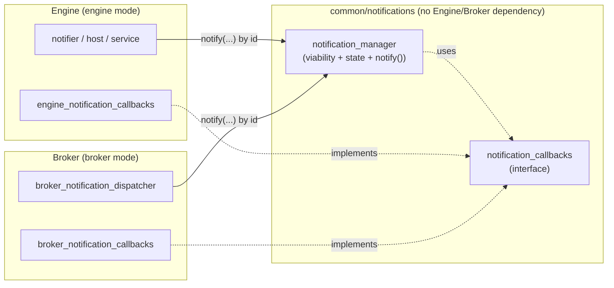
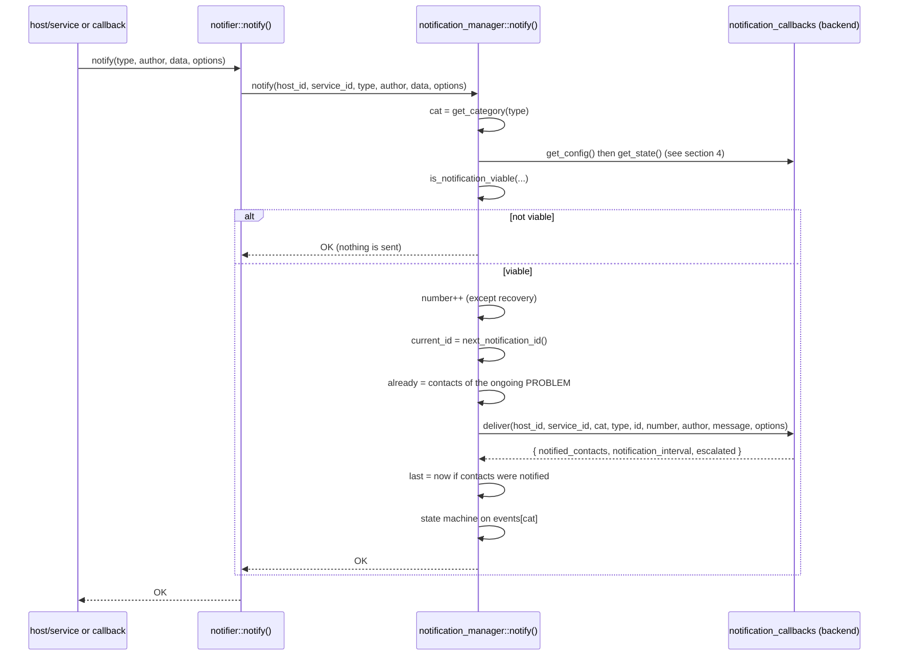
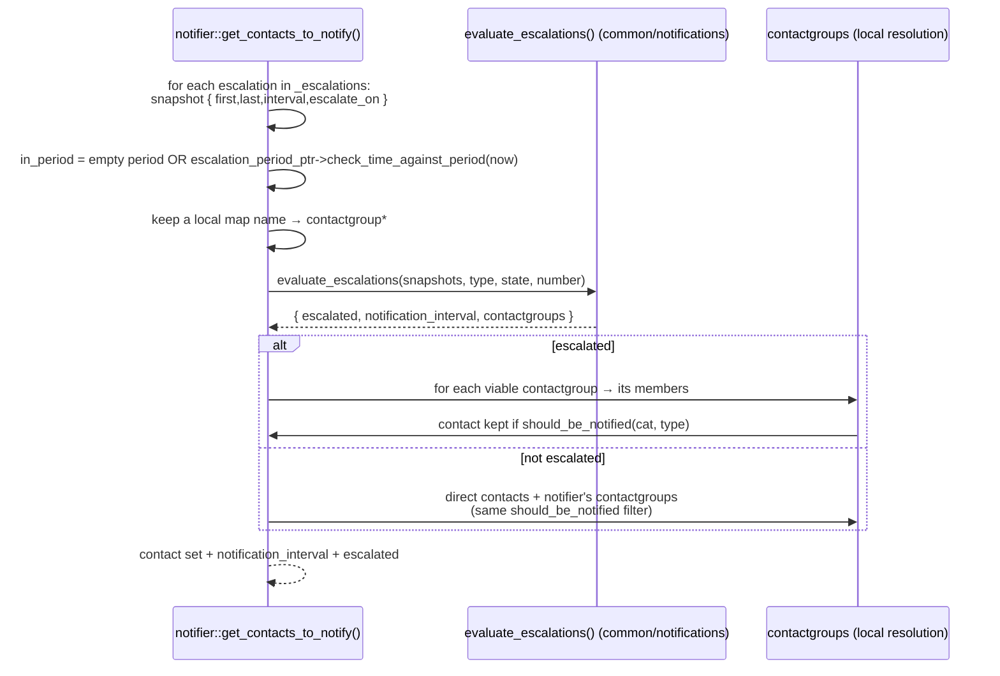
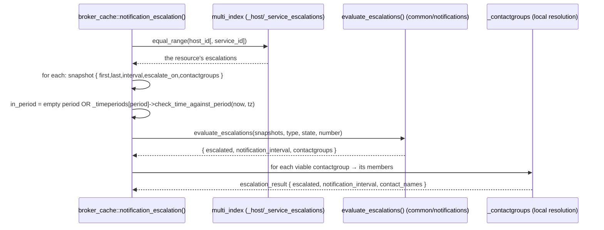
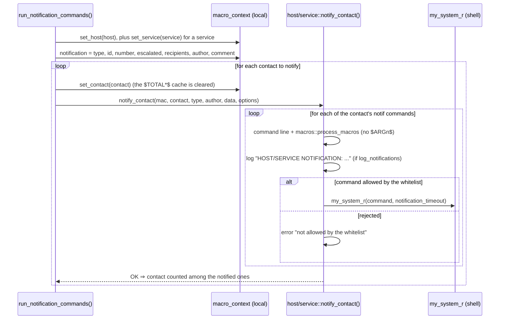

# Engine — Notifications

This document describes how notifications work, from their trigger to the
execution of the contacts' notification commands.

The **decision** (should we notify? whom?) is made by a shared library,
`common/notifications/`, which knows neither Engine nor Broker. Depending on
`notification_mode`, Engine (`engine` mode) or Broker (`broker` mode) uses
it. The **execution** (macros, notification commands) always takes place on
the poller supervising the resource, since it needs its objects.

## Table of contents

  - [1. Concepts](#1-concepts)
  - [2. Architecture](#2-architecture)
  - [3. The `notify()` pipeline](#3-the-notify-pipeline)
  - [4. Viability by type](#4-viability-by-type)
  - [5. Contact selection and escalations](#5-contact-selection-and-escalations)
  - [6. Notification command execution](#6-notification-command-execution)
  - [7. The `notification_mode = broker` mode](#7-the-notification_mode--broker-mode)
  - [8. Configuration parameters](#8-configuration-parameters)
  - [9. Files (code)](#9-files-code)

## 1. Concepts

A notification has a **type** (`reason_type`), grouped into a **category**
(`notification_category`). Both are defined in
`common/notifications/notification_types.hh`.

| `reason_type`                 | Category (`notification_category`) | `$NOTIFICATIONTYPE$` macro |
|-------------------------------|------------------------------------|----------------------------|
| `reason_normal`               | `cat_normal`                       | `PROBLEM`                  |
| `reason_recovery`             | `cat_recovery`                     | `RECOVERY`                 |
| `reason_acknowledgement`      | `cat_acknowledgement`              | `ACKNOWLEDGEMENT`          |
| `reason_flappingstart`        | `cat_flapping`                     | `FLAPPINGSTART`            |
| `reason_flappingstop`         | `cat_flapping`                     | `FLAPPINGSTOP`             |
| `reason_flappingdisabled`     | `cat_flapping`                     | `FLAPPINGDISABLED`         |
| `reason_downtimestart`        | `cat_downtime`                     | `DOWNTIMESTART`            |
| `reason_downtimeend`          | `cat_downtime`                     | `DOWNTIMEEND`              |
| `reason_downtimecancelled`    | `cat_downtime`                     | `DOWNTIMECANCELLED`        |
| `reason_custom` (= 99)        | `cat_custom`                       | `CUSTOM`                   |

The mapping is done by `notification_manager::get_category()`.

The **options** of a notification (`notification_option`) are
`notification_option_forced`, `notification_option_broadcast` and
`notification_option_increment`. Only `forced` changes the decision (see
section 4). The two others, inherited from Nagios, are carried up to the
poller but no longer read by the decision: `broadcast` is only read by
`is_valid_escalation_for_notification()`, which is always called without
option, and `increment` nowhere.

**The notification state of a resource** is kept by the
`notification_manager`, indexed by `(host_id, service_id)` (`service_id == 0`
for a host):

- `number`: the number of the ongoing problem notification;
- `current_id`: the id of the last notification (unique, drawn by
  `next_notification_id()`);
- `last`, `next`, `initial`: the timestamps of the last notification, of the
  next one and of the first one;
- `events[cat]`: the last notification of each category (`notification`, a
  plain data: type, interval, notified contacts). This array forms a small
  state machine: `events[cat_normal]` set means that a PROBLEM was sent, which
  a RECOVERY requires.

This state is persisted by the manager (`snapshot_states()` / `restore()`),
and purged by `forget(host_id, service_id)` when the resource disappears.

## 2. Architecture

The design follows the downtimes library (`common/downtimes`): the library
talks to the host application through an **injected interface**,
`notification_callbacks`, and addresses the resources by their logical
identity `(host_id, service_id)`.

| Component | Location | Role |
|---|---|---|
| `notification_manager` | `common/notifications/` | Singleton. Viability, per-resource state, orchestration of `notify()`. No dependency on Engine or Broker. |
| `notification` | `notification_types.hh` | Plain data of a sent notification (type, interval, notified contacts). |
| `notification_callbacks` | `common/notifications/` | Interface to the host application: `get_config()`, `get_state()`, `deliver()`, `on_notification_number_changed()`. |
| `should_notify_contact()` | `contact_viability.{hh,cc}` | Pure filter of a contact (enabled, period, options), shared by Engine and Broker. |
| `evaluate_escalations()` | `escalation.{hh,cc}` | Pure function: viability and aggregation of the escalations, shared by Engine and Broker. |
| `engine_notification_callbacks` | Engine (`cce_core`) | Backend of the `engine` mode: reads the state of the Engine objects and **delivers** the notification (contact selection, macros, commands). |
| `broker_notification_callbacks` | Broker (`broker/core/config/applier/`) | Backend of the `broker` mode: reads the state in `broker_cache`, selects the contacts, and sends the execution to the poller (`pb_notification_execute`). |
| `notifier` | Engine | No longer stores any notification state: it delegates to the manager by `(host_id, service_id)`. |



**Loading.** The host application injects its backend once, as for the
downtimes:

```cpp
notifications::notification_manager::load(
    std::make_unique<engine_notification_callbacks>());
```

This is done in `engine/src/main.cc` (and in the test harness
`engine/tests/helper.cc`) and, on the Broker side, in `broker_state.cc` in
`broker` mode. `notification_manager::unload()` releases the backend and
clears the state. The `notifier` destructor calls
`forget(host_id, service_id)`.

## 3. The `notify()` pipeline

`notifier::notify(type, author, data, options)` is only a delegate. In
`broker` mode, it does nothing: Broker decides. Otherwise, it calls
`notification_manager::notify(host_id, service_id, …)`.



Key points:

- A **non viable** notification is not an error: `notify()` returns `OK`
  without sending anything.
- The number is incremented **before** `deliver()`, for all types but
  RECOVERY. `deliver()` thus gets the new number.
- **The state machine**, after `deliver()`:
  - a PROBLEM replaces `events[cat_normal]`, **adding** the contacts already
    notified by the previous PROBLEM, so that they all get the RECOVERY. The
    number is **kept**;
  - a RECOVERY clears `cat_normal` and `cat_recovery`;
  - a FLAPPINGSTOP or FLAPPINGDISABLED clears `cat_flapping`; a FLAPPINGSTART
    stays recorded there;
  - a DOWNTIMEEND or DOWNTIMECANCELLED clears `cat_downtime`; a DOWNTIMESTART
    stays recorded there;
  - an ACKNOWLEDGEMENT or a CUSTOM is not recorded;
  - the number is **reset to 0** by a RECOVERY. A FLAPPING or a CUSTOM resets
    it only **outside a problem**: during a problem, it keeps it, otherwise
    the RECOVERY of this problem would not be sent (it requires a number). An
    ACKNOWLEDGEMENT or a DOWNTIME always keeps it.

## 4. Viability by type

The manager does not query the object method by method: it asks the backend
for the configuration (`get_config()`: `enabled`, which combines
`enable_notifications` and whether the notifications of the resource are
enabled, and `send_recovery_notifications_anyway`), then for a **snapshot** of
the resource (`get_state()`: `resource_state`). The decision is then a
function of these values and of the manager state (ongoing notifications,
number).

Two rules apply before the ones of each type (`is_notification_viable()`):

1. a **forced** notification (`notification_option_forced`) is always
   viable, **except a RECOVERY**, which is never forced;
2. otherwise, if the notifications are disabled (`enabled` false), nothing is
   sent.

### 4.1 PROBLEM (normal)

Triggered when a host or a service is in a non-OK state
(`notify(reason_normal)` from the check result processing).

Viable if, in this order:

- the resource is **not in downtime**;
- we are **in its notification period**;
- it is **not flapping**;
- **if the service is volatile, the notification is sent** here, without the
  next checks;
- the state is **hard**;
- the problem is **not acknowledged**;
- the current state is **not OK/UP**;
- the resource is configured to notify this state (`notify_on_current_state`;
  for a service, its host must not be down);
- for a **first** notification, the `first_notification_delay` since the last
  hard state change has elapsed;
- the notification **dependencies** allow it;
- if a PROBLEM was already sent and the state did not change since: the
  re-notification interval has elapsed (`notification_interval`, the one of
  the active escalation if any; `0` = no re-notification). After a hard
  state change, the notification is sent without waiting for the interval.

### 4.2 RECOVERY

Triggered when the resource is back to OK/UP (`notify(reason_recovery)`). A
RECOVERY is never forced.

Viable if, in this order:

- we are in the notification period, **unless**
  `send_recovery_notifications_anyway` is enabled;
- no downtime, no flapping, **hard** state, **OK/UP** state;
- the resource is configured to notify the recovery (`notify_on` contains
  `up` or `ok`);
- the `recovery_notification_delay` since the hard state change has elapsed;
- the number is not 0 **and** a PROBLEM is recorded (`events[cat_normal]`).

When a condition fails, there are two cases: either we **try again later**
(out of period, downtime, flapping, soft state, state not OK yet, delay not
elapsed), or we **give up** (resource not configured for the recovery, no
PROBLEM sent): the recorded PROBLEM is then cleared and the number reset
to 0.

Only the contacts that got the PROBLEM get the RECOVERY (see section 5).

### 4.3 ACKNOWLEDGEMENT

Triggered by an acknowledgement (`commands.cc`, `acknowledge_host` /
`acknowledge_service`, or `broker_acknowledgement_manager` in broker mode).

Viable if the resource is **in a problem** (state other than OK/UP). The
number is kept.

### 4.4 FLAPPING

Triggered by the flapping detection (`set_flap()` / `clear_flap()` of the
hosts and services): `reason_flappingstart`, `reason_flappingstop`, and
`reason_flappingdisabled` when the detection is disabled during a flapping.

Viable if:

- the resource is configured for this type (`notify_on` contains
  `flappingstart`, `flappingstop` or `flappingdisabled`);
- for a START: no flapping notification is ongoing;
- for a STOP or a DISABLED: the ongoing flapping notification is a START;
- the same notification was not already sent;
- the resource is not in downtime.

### 4.5 DOWNTIME

Triggered by the downtime callbacks (`engine_downtime_callbacks.cc`):
`reason_downtimestart`, `reason_downtimeend`, `reason_downtimecancelled`.

Viable if the resource is configured for the downtimes (`notify_on` contains
`downtime`) and is **not already** in a scheduled downtime
(`scheduled_downtime_depth == 0`). The number is kept.

### 4.6 CUSTOM

Triggered by the `SEND_CUSTOM_HOST_NOTIFICATION` /
`SEND_CUSTOM_SVC_NOTIFICATION` external command (`commands/processing.cc`),
or by the matching Broker RPC in broker mode.

Viable if the resource is not in downtime. With `notification_option_forced`,
it is always sent.

## 5. Contact selection and escalations

The backend selects the contacts in `deliver()`. On the Engine side, it is
`notifier::get_contacts_to_notify()`; on the Broker side,
`broker_notification_callbacks::deliver()` reproduces the same logic on
`broker_cache`.

1. **Escalations first.** Their viability (state covered by `escalate_on`,
   number in `[first, last]`, active period) and their aggregation
   (**escalated** mode as soon as an escalation is viable, **smallest**
   interval among the viable ones, union of their contact groups) are
   computed by `evaluate_escalations()`. The viable groups are then resolved
   into contacts.
2. **Otherwise**: the direct contacts of the resource and the ones of its
   contact groups.

Each contact is then filtered by `should_notify_contact()`:

- its host or service notifications are enabled;
- we are in **its** notification period, evaluated in its timezone;
- its options cover the notification: the current state for a PROBLEM,
  `ok`/`up` for a RECOVERY, the flapping type, `downtime`; the
  ACKNOWLEDGEMENT and the CUSTOM always pass;
- for a **RECOVERY**: it got the ongoing PROBLEM.

A contact found in several groups is notified once.

### Escalations: shared evaluation

Both Engine and Broker evaluate a resource's escalations, but from different
data sources: Engine walks the `notifier`'s `_escalations` list (pointer
objects), Broker queries its `broker_cache` (`multi_index` containers). The
**algorithm** is strictly identical, though: test each escalation's viability,
keep the smallest interval and union the contactgroups of the viable ones.

This logic now lives **once**, in `common/notifications/escalation.{hh,cc}`:

```cpp
struct escalation {                    // snapshot of one escalation
  uint32_t first_notification;         // notification-number range ...
  uint32_t last_notification;          // ... 0 = unbounded
  uint32_t notification_interval;      // raw config units
  uint32_t escalate_on;                // notification_flag bitmask
  bool in_period;                      // now ∈ period, PRECOMPUTED by the host
  std::vector<std::string> contactgroups;
};

struct escalation_evaluation {         // evaluation result
  bool escalated;
  uint32_t notification_interval;      // smallest among the viable ones
  absl::btree_set<std::string> contactgroups;   // union of the viable ones
};

escalation_evaluation evaluate_escalations(
    const std::vector<escalation>& escalations,
    notifier_type type,                // host or service → flag array
    int state, uint32_t notification_number);
```

An escalation is **viable** when `escalate_on` covers the current state, the
notification number is within `[first, last]` (`last == 0` = unbounded) and
`in_period` is true. The function depends on **no** timeperiod: the period test,
whose source (`escalation_period_ptr` on the Engine side, the `_timeperiods` map
on the Broker side) and timezone differ, is **precomputed** by each host into
`in_period`. Likewise the interval stays in raw config units: the function only
does `min` comparisons (unit-independent), each side then multiplying by its own
`interval_length`.

#### Engine side — `notifier::get_contacts_to_notify()`



#### Broker side — `broker_cache::notification_escalation()`



What **stays specific to each side**: resolving contactgroups to contacts
(Engine filters by `should_be_notified` and handles the non-escalated fallback;
Broker returns the member names, filtered later by `should_notify_contact`) and
the `in_period` computation.

## 6. Notification command execution

`run_notification_commands()` (`engine/src/notification_execution.cc`) runs
a notification whose contacts are already selected. Both modes use it: in
`engine` mode, `engine_notification_callbacks::deliver()` calls it after
selecting the contacts; in `broker` mode, `execute_broker_notification()`
calls it with what Broker decided (`NotificationExecute`):



- The macros context is local to the notification: nothing of it remains
  for the next evaluations. `$NOTIFICATIONRECIPIENTS$` holds all the contacts
  to notify, and each contact sees all of them.
- The id and the number of the notification are the ones given by the
  decision (by Broker in broker mode): the `$HOST/SERVICENOTIFICATIONID$` and
  `$HOST/SERVICENOTIFICATIONNUMBER$` macros read them from the current
  notification. See `doc/engine-macros-en.md`.
- The commands run are the **contact's**:
  `get_host_notification_commands()` or `get_service_notification_commands()`.
  They are configured by their name only, so without `$ARGn$`.
- Each command is filtered by the **whitelist**
  (`command_is_allowed_by_whitelist(..., NOTIF_TYPE)`) before being run by
  `my_system_r`, with the `notification_timeout`.
- If `log_notifications` is enabled, a `HOST NOTIFICATION:` /
  `SERVICE NOTIFICATION:` line is logged per contact and per command.
- `notify_contact` updates the contact's `last_host_notification` /
  `last_service_notification`.

## 7. The `notification_mode = broker` mode

The mode is advertised at negotiation. In `broker` mode, Engine no longer
decides (`notifier::notify()` does nothing):

1. `broker_notification_dispatcher` receives the host and service status
   events and calls `notification_manager::notify()`, as `notifier::notify()`
   would on the Engine side. Since the manager is not thread-safe, every
   access goes through the dispatcher's **strand**.
2. The manager calls `broker_notification_callbacks::deliver()`, which
   selects the contacts (section 5) and publishes the notification number for
   the database.
3. `deliver()` sends a `pb_notification_execute` (`NotificationExecute`:
   resource, type, id, number, escalated, author, message, options, contacts)
   to the poller supervising the resource.
4. The Engine event loop calls `execute_broker_notification()`, then
   `run_notification_commands()` (section 6).

### Notification switches

`broker/core/cache/notification_toggles.cc`, `broker_cache::set_notify`

In broker mode the "notifications enabled" switch of a host or service belongs to
Broker: it is what `get_config()` reads (the `notify` field of the cached object,
combined with the poller's `enable_notifications`). Engine's
`ENABLE/DISABLE_*_NOTIFICATIONS` external commands therefore have a Broker counterpart:

| Broker RPC | Engine commands covered |
|---|---|
| `SetHostNotifications(host, enabled, scope=HOST)` | `ENABLE/DISABLE_HOST_NOTIFICATIONS` |
| `… scope=HOST_AND_SERVICES` | same + `ENABLE/DISABLE_HOST_SVC_NOTIFICATIONS` |
| `… scope=HOST_AND_CHILDREN` | `ENABLE/DISABLE_HOST_AND_CHILD_NOTIFICATIONS` (hosts recursively, no service) |
| `… scope=BEYOND_HOST` | `ENABLE/DISABLE_ALL_NOTIFICATIONS_BEYOND_HOST` (descendants and their services, the host itself untouched) |
| `SetServiceNotifications(service, enabled)` | `ENABLE/DISABLE_SVC_NOTIFICATIONS` |

What `broker_cache::set_notify()` does: set `notify` on the cached object
(synchronously, the next decision sees it), record the switch in
`_notification_overrides` (persisted in `BrokerCache.notification_overrides`), and
publish the `pb_adaptive_host` / `pb_adaptive_service` Engine would have emitted, so
unified_sql updates `hosts.notify`, `services.notify` and
`resources.notifications_enabled`.

**The override.** Three paths reset `notify` to the configured value: a definition
resent by Engine (restart), `merge()` of a centralized configuration, and the
definitions written to the database. The override is re-applied when a definition is
inserted (`_restore_notify_override`, copy-on-write) and by
`reinject_pending_notification_overrides()` at the downtime/acknowledgement
re-injection points, republishing the adaptive event. Engine semantics: the toggled
value wins over the configuration as long as it exists, like a retained
`MODATTR_NOTIFICATIONS_ENABLED`; only a new toggle changes it. In broker mode the
cache ignores the `notify` of an adaptive coming from Engine: a command misrouted to
Engine cannot overwrite the override.

**Topology.** The `HOST_AND_CHILDREN` and `BEYOND_HOST` scopes rely on a parent →
children index in the cache, fed by `Host.parents` of the centralized configuration
(resolved by name at `merge`) and by `pb_host_parent` events in non-centralized
BBDO3. The propagation is recursive and visits each host once, like Engine's
`enable_and_propagate_notifications()`.

Tests: `tests/broker-engine/notification-toggles-broker.robot` (`BENOTBRK1` to `3`);
UT `BrokerNotificationDeliverTest.{NotifyOverrideSurvivesDefinition,
ReinjectNotificationOverrides, HostChildrenIndex}`.

#### Notifier settings and serialization

`broker_notification_dispatcher` owns a **strand**: the multiplexing engine posts the batches
on it (`event_sink::executor()`), and every other caller of the `notification_manager`, which
is not thread-safe, posts its work there instead of calling the manager from its own thread.
This is the case of the acknowledgement with `notify` (`broker_acknowledgement_manager`
receives the dispatcher when loaded) and of the following RPCs, which therefore return before
being applied, like the command pipe:

| Broker RPC | Engine command | Effect |
|---|---|---|
| `SetHostNotificationNumber` / `SetServiceNotificationNumber(…, number)` | `SET_*_NOTIFICATION_NUMBER` | `notification_manager::set_notification_number` → the backend publishes the `notification_number` adaptive (database), state persisted by T9 |
| `SendCustomHostNotification` / `SendCustomServiceNotification(…, author, comment, broadcast, forced, increment)` | `SEND_CUSTOM_*_NOTIFICATION` (options 1/2/4) | `notify(reason_custom, …)`; `forced` bypasses the switches, the poller executes the `CUSTOM` type |

**`DELAY_*_NOTIFICATION` has no Broker counterpart, on purpose**: neither the library nor
Engine reads `next_notification` in the viability (the interval is computed from
`last + notification_interval`); Engine only uses it for the status export. The command is a
no-op on the decision, it is not exposed.

Tests: `tests/broker-engine/notification-settings-broker.robot` (`BENOTSET1`, `BENOTSET2`).

#### Contacts, contactgroups and notification timeperiods

`broker/core/cache/notification_toggles.cc`, `broker_cache::set_contact_notifications`,
`broker_cache::set_contact_notification_period`, `broker_cache::set_notification_period`

The contact filtering (`should_notify_contact`) reads two things on the cached contact:
its `host_notifications_enabled` / `service_notifications_enabled` switches and its
`host_notification_period` / `service_notification_period` timeperiods; the resource
viability reads its `notification_period`. In broker mode these values belong to
Broker: the matching Engine external commands have a Broker counterpart, mapped one to
one on the legacy (no discriminating field, one RPC per command):

| Broker RPC | Engine commands covered |
|---|---|
| `SetContactHostNotifications(contact, enabled)` | `ENABLE/DISABLE_CONTACT_HOST_NOTIFICATIONS` |
| `SetContactServiceNotifications(contact, enabled)` | `ENABLE/DISABLE_CONTACT_SVC_NOTIFICATIONS` |
| `SetContactgroupHostNotifications(contactgroup, enabled)` | `ENABLE/DISABLE_CONTACTGROUP_HOST_NOTIFICATIONS` |
| `SetContactgroupServiceNotifications(contactgroup, enabled)` | `ENABLE/DISABLE_CONTACTGROUP_SVC_NOTIFICATIONS` |
| `SetContactHostNotificationPeriod(contact, timeperiod)` | `CHANGE_CONTACT_HOST_NOTIFICATION_TIMEPERIOD` |
| `SetContactServiceNotificationPeriod(contact, timeperiod)` | `CHANGE_CONTACT_SVC_NOTIFICATION_TIMEPERIOD` |
| `SetHostNotificationPeriod(host, timeperiod)` | `CHANGE_HOST_NOTIFICATION_TIMEPERIOD` |
| `SetServiceNotificationPeriod(service, timeperiod)` | `CHANGE_SVC_NOTIFICATION_TIMEPERIOD` |

Contacts and contactgroups have no id in the configuration: they are designated by
name (`ContactIdentifier { name }`, `ContactgroupIdentifier { name }`). A timeperiod
unknown to the Broker cache is refused (`NOT_FOUND`), as Engine refuses the command when
the timeperiod does not exist; so is an unknown contact or contactgroup.

**Extended resource override.** `_notification_overrides` now carries two optional
fields per resource, `notify` and `notification_period`
(`BrokerCache.NotificationOverride`, fields 3 and 4). Both follow the same path: value
set on the cached object, re-applied when a definition is inserted
(`_restore_notification_override`) and by `reinject_pending_notification_overrides()`,
published through the adaptive event so unified_sql updates
`hosts.notification_period` / `services.notification_period`. In broker mode the cache
ignores the `notification_period` of an adaptive coming from Engine, like `notify`.

**Contact override.** `_contact_notification_overrides` (keyed by name, persisted in
`BrokerCache.contact_notification_overrides`, field 13) carries four optional fields:
the two switches and the two timeperiods. It is applied by `_insert_contact()`, that is
each time a poller configuration (re)defines the contact (`merge`, `apply(DiffState)`),
which covers Engine and Broker restarts without a dedicated re-injection point.
Contacts are not exported to the database by unified_sql, so nothing is published. Same
`MODATTR` semantics as for resources: the set value wins over the configuration as long
as it exists.

**Contactgroups.** Like Engine, a contactgroup has no switch of its own: the RPC fans
out to its members at call time and each contact gets its own override. A contact added
to the group later is not affected, again like Engine.

Tests: `tests/broker-engine/contact-toggles-broker.robot` (`BECNTBRK1` to `3`); UT
`BrokerNotificationDeliverTest.{NotificationPeriodOverrideSurvivesDefinition,
ContactOverrideSurvivesMerge, ContactgroupToggleAndContactPeriod}`.

#### Poller-wide switch

`broker_cache::set_poller_notifications`, `cache/notification_toggles.cc`

On Engine, `ENABLE/DISABLE_NOTIFICATIONS` is a program-wide flag: it blocks every
notification of the poller whatever the state of the resources. Broker already models it
per poller in `instance_info.notifications_enabled`, read by `get_config()` and fed by
`enable_notifications` of the centralized configuration (`merge`, `DiffState`). In broker
mode the `SetPollerNotifications(PollerNotificationsRequest { PollerIdentifier poller, bool
enabled })` RPC sets this flag, with `PollerIdentifier { poller_id | poller_name }`. Unknown
poller: `NOT_FOUND`.

**Override.** `_poller_notification_overrides` (keyed by `poller_id`, persisted in
`BrokerCache.poller_notification_overrides`, field 14) is re-applied by
`_apply_poller_override()` each time the poller entry is (re)built: `merge` of a
configuration, `DiffState` changing `enable_notifications`, `pb_instance` event in
non-centralized BBDO3. Same semantics as `MODATTR_NOTIFICATIONS_ENABLED` on the Engine
program, kept in `retention.dat`.

**Meaning of "global".** The scope stays the poller, that is one Engine program, as in
legacy. For the whole platform PHP loops over its pollers. A zone-wide switch only makes
sense with the dynamic distribution of resources and is deferred to that milestone.

**Known gap.** Nothing is published: `instances.notifications` in the database keeps
reflecting Engine's flag, not the Broker override. There is no instance adaptive event, and
publishing a full instance status would overwrite the other columns. The gap will be closed
by the downward channel of prerequisite 4 (forwarding the command to Engine), which aligns
its retention, its macros and the database at once.

Tests: `tests/broker-engine/poller-toggles-broker.robot` (`BEPOLBRK1`); UT
`BrokerNotificationDeliverTest.PollerOverrideSurvivesMerge`.

## 8. Configuration parameters

- **Global** (`pb_indexed_config.state()`): `enable_notifications`,
  `interval_length`, `notification_timeout`, `log_notifications`,
  `send_recovery_notifications_anyway`.
- **Per resource**: `notifications_enabled`, `notification_period`,
  `notification_interval`, `first_notification_delay`,
  `recovery_notification_delay`, `notify_on` (mask
  `up/down/unreachable/ok/warning/critical/unknown/flapping*/downtime`),
  `is_volatile`. The intervals and delays are in `interval_length` units in
  the configuration; the backend converts them into seconds before giving
  them to the library.
- **Per contact**: host and service notifications enabled, notification
  periods, options, timezone, notification commands.
- **Escalations**: own interval, `first_notification` /
  `last_notification` range, `escalate_on`, period, contact groups.

## 9. Files (code)

Shared library (`common/notifications/`, no dependency on Engine or
Broker):

- `notification_manager.{hh,cc}`: viability, per-resource state, `notify()`,
  persistence (`snapshot_states()` / `restore()`).
- `notification_callbacks.hh`: the injected interface.
- `contact_viability.{hh,cc}`: `should_notify_contact()`.
- `escalation.{hh,cc}`: `evaluate_escalations()`.
- `notification_types.hh`: enums and value structs (`config`, `contact`,
  `resource_state`, `delivery_result`, `notification`…).

Engine:

- `engine/src/engine_notification_callbacks.{hh,cc}`: the `engine` mode
  backend.
- `engine/src/notifier.cc`: delegation to the manager by id,
  `get_contacts_to_notify()`, `~notifier` → `forget`.
- `engine/src/notification_execution.cc`: `run_notification_commands()`,
  `execute_broker_notification()`.
- `engine/src/host.cc`, `engine/src/service.cc`: `notify_contact()`
  (execution, whitelist, logs) and the PROBLEM, RECOVERY and FLAPPING
  triggers.
- `engine/src/engine_downtime_callbacks.cc`: DOWNTIME triggers.
- `engine/src/commands/commands.cc`: ACKNOWLEDGEMENT trigger.
- `engine/src/commands/processing.cc`: CUSTOM trigger.

Broker:

- `broker/core/config/applier/broker_notification_callbacks.{hh,cc}`: the
  `broker` mode backend (decision, then sending of `pb_notification_execute`).
- `broker/core/src/broker_notification_dispatcher.cc`: the trigger, from the
  statuses, and the strand serializing the access to the manager.
- `broker/core/cache/broker_cache.cc`: `notification_escalation()` (calls
  `evaluate_escalations`).
- `broker/core/cache/notification_toggles.cc`: the switches (section 7).
