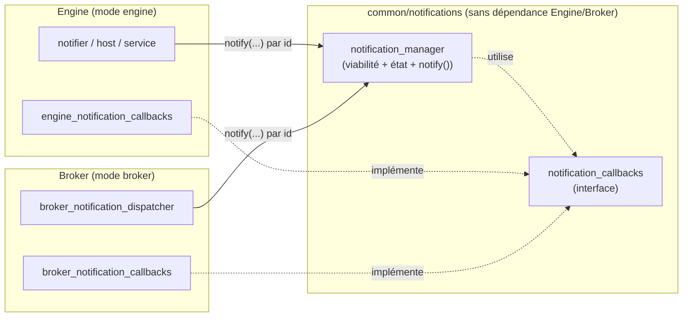
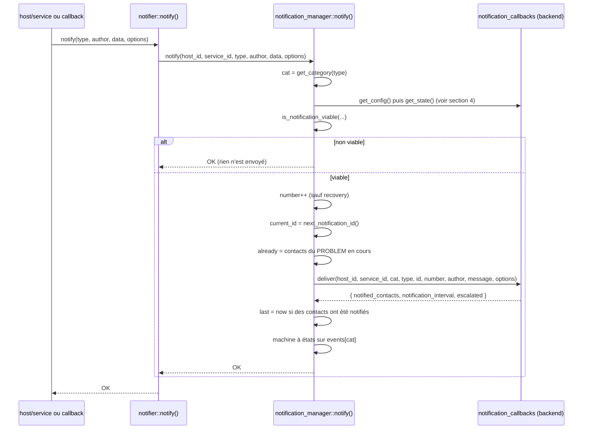
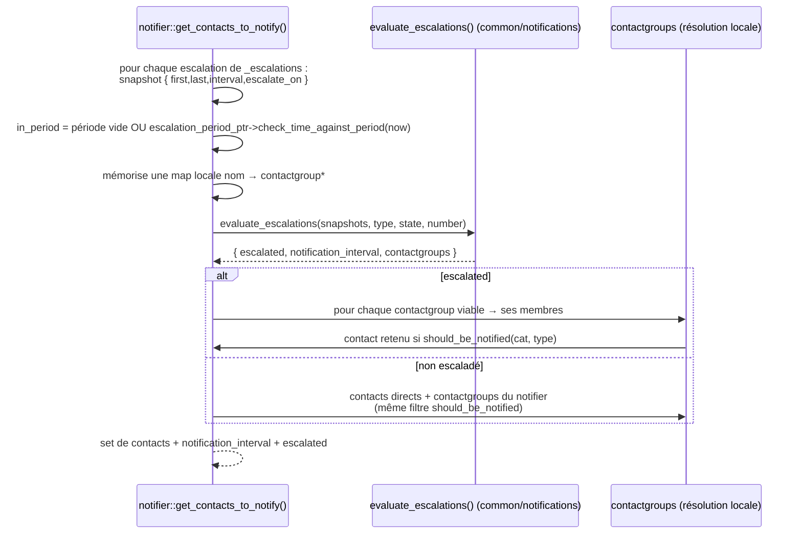
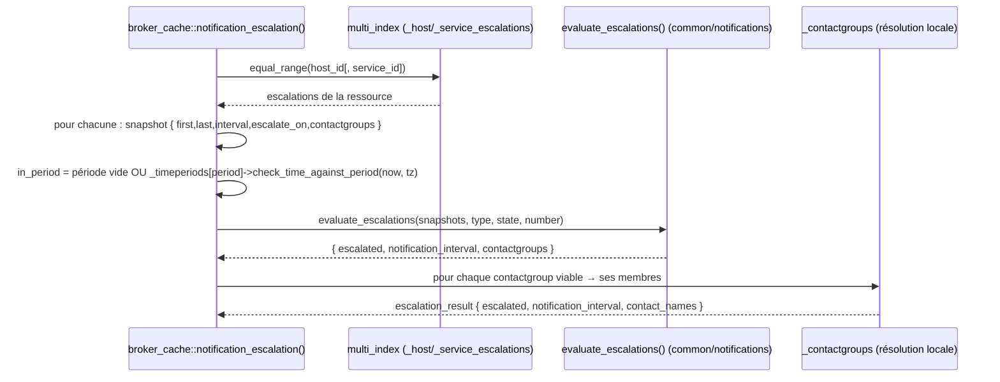
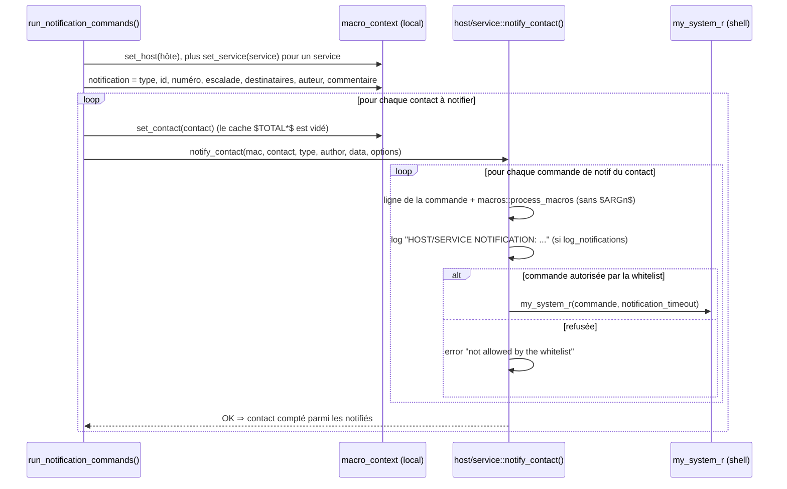

# Moteur — Notifications

Ce document décrit le fonctionnement des notifications, de leur déclenchement
jusqu'à l'exécution des commandes de notification des contacts.

La **décision** (faut-il notifier ? qui ?) est prise par une bibliothèque
partagée, `common/notifications/`, qui ne connaît ni Engine ni Broker. Selon
`notification_mode`, c'est Engine (mode `engine`) ou Broker (mode `broker`)
qui l'utilise. L'**exécution** (macros, commandes de notification) a toujours
lieu sur le poller qui supervise la ressource, car elle a besoin de ses objets.

## Sommaire

  - [1. Concepts](#1-concepts)
  - [2. Architecture](#2-architecture)
  - [3. Le pipeline `notify()`](#3-le-pipeline-notify)
  - [4. Viabilité par type](#4-viabilité-par-type)
  - [5. Choix des contacts et escalades](#5-choix-des-contacts-et-escalades)
  - [6. Exécution des commandes de notification](#6-exécution-des-commandes-de-notification)
  - [7. Le mode `notification_mode = broker`](#7-le-mode-notification_mode--broker)
  - [8. Paramètres de configuration](#8-paramètres-de-configuration)
  - [9. Fichiers (code)](#9-fichiers-code)

## 1. Concepts

Une notification a un **type** (`reason_type`), regroupé en **catégorie**
(`notification_category`). Les deux sont définis dans
`common/notifications/notification_types.hh`.

| `reason_type`                 | Catégorie (`notification_category`) | Macro `$NOTIFICATIONTYPE$` |
|-------------------------------|-------------------------------------|----------------------------|
| `reason_normal`               | `cat_normal`                        | `PROBLEM`                  |
| `reason_recovery`             | `cat_recovery`                      | `RECOVERY`                 |
| `reason_acknowledgement`      | `cat_acknowledgement`               | `ACKNOWLEDGEMENT`          |
| `reason_flappingstart`        | `cat_flapping`                      | `FLAPPINGSTART`            |
| `reason_flappingstop`         | `cat_flapping`                      | `FLAPPINGSTOP`             |
| `reason_flappingdisabled`     | `cat_flapping`                      | `FLAPPINGDISABLED`         |
| `reason_downtimestart`        | `cat_downtime`                      | `DOWNTIMESTART`            |
| `reason_downtimeend`          | `cat_downtime`                      | `DOWNTIMEEND`              |
| `reason_downtimecancelled`    | `cat_downtime`                      | `DOWNTIMECANCELLED`        |
| `reason_custom` (= 99)        | `cat_custom`                        | `CUSTOM`                   |

La correspondance est faite par `notification_manager::get_category()`.

Les **options** d'une notification (`notification_option`) sont
`notification_option_forced`, `notification_option_broadcast` et
`notification_option_increment`. Seule `forced` change la décision (voir la
section 4). Les deux autres, héritées de Nagios, sont transmises jusqu'au
poller mais ne sont plus lues par la décision : `broadcast` ne l'est que par
`is_valid_escalation_for_notification()`, qu'on appelle toujours sans option,
et `increment` nulle part.

**L'état de notification d'une ressource** est gardé par le
`notification_manager`, indexé par `(host_id, service_id)` (`service_id == 0`
pour un hôte) :

- `number` : le numéro de la notification de problème en cours ;
- `current_id` : l'identifiant de la dernière notification (unique, tiré par
  `next_notification_id()`) ;
- `last`, `next`, `initial` : les horodatages de la dernière notification, de
  la prochaine et de la première ;
- `events[cat]` : la dernière notification de chaque catégorie (`notification`,
  une donnée pure : type, intervalle, contacts notifiés). Ce tableau forme une
  petite machine à états : `events[cat_normal]` présent veut dire qu'un
  PROBLEM a été envoyé, ce qu'exige un RECOVERY.

Cet état est persisté par le manager (`snapshot_states()` / `restore()`), et
purgé par `forget(host_id, service_id)` quand la ressource disparaît.

## 2. Architecture

Le modèle suit celui de la bibliothèque de downtimes (`common/downtimes`) : la
bibliothèque dialogue avec l'application hôte au travers d'une **interface
injectée**, `notification_callbacks`, et adresse les ressources par leur
identité logique `(host_id, service_id)`.

| Composant | Emplacement | Rôle |
|---|---|---|
| `notification_manager` | `common/notifications/` | Singleton. Viabilité, état par ressource, orchestration de `notify()`. Aucune dépendance vers Engine ou Broker. |
| `notification` | `notification_types.hh` | Donnée pure d'une notification émise (type, intervalle, contacts notifiés). |
| `notification_callbacks` | `common/notifications/` | Interface vers l'application hôte : `get_config()`, `get_state()`, `deliver()`, `on_notification_number_changed()`. |
| `should_notify_contact()` | `contact_viability.{hh,cc}` | Filtre pur d'un contact (activation, période, options), partagé par Engine et Broker. |
| `evaluate_escalations()` | `escalation.{hh,cc}` | Fonction pure : viabilité et agrégation des escalades, partagée par Engine et Broker. |
| `engine_notification_callbacks` | Engine (`cce_core`) | Backend du mode `engine` : lit l'état des objets d'Engine et **livre** la notification (choix des contacts, macros, commandes). |
| `broker_notification_callbacks` | Broker (`broker/core/config/applier/`) | Backend du mode `broker` : lit l'état dans `broker_cache`, choisit les contacts, et envoie l'exécution au poller (`pb_notification_execute`). |
| `notifier` | Engine | Ne stocke plus d'état de notification : il délègue au manager par `(host_id, service_id)`. |



**Chargement.** L'application hôte injecte son backend une fois, comme pour les
downtimes :

```cpp
notifications::notification_manager::load(
    std::make_unique<engine_notification_callbacks>());
```

C'est fait dans `engine/src/main.cc` (et dans le harnais de tests
`engine/tests/helper.cc`) et, côté Broker, dans `broker_state.cc` en mode
`broker`. `notification_manager::unload()` relâche le backend et vide
l'état. Le destructeur de `notifier` appelle `forget(host_id, service_id)`.

## 3. Le pipeline `notify()`

`notifier::notify(type, author, data, options)` n'est qu'un délégateur. En
mode `broker`, il ne fait rien : c'est Broker qui décide. Sinon, il appelle
`notification_manager::notify(host_id, service_id, …)`.



Points clés :

- Une notification **non viable** n'est pas une erreur : `notify()` renvoie
  `OK` sans rien envoyer.
- Le numéro est incrémenté **avant** `deliver()`, pour tous les types sauf
  RECOVERY. `deliver()` reçoit donc le nouveau numéro.
- **La machine à états**, après `deliver()` :
  - un PROBLEM remplace `events[cat_normal]`, en y **ajoutant** les contacts
    déjà notifiés par le PROBLEM précédent, pour qu'ils reçoivent tous le
    RECOVERY. Le numéro est **conservé** ;
  - un RECOVERY efface `cat_normal` et `cat_recovery` ;
  - un FLAPPINGSTOP ou FLAPPINGDISABLED efface `cat_flapping` ; un FLAPPINGSTART
    y reste mémorisé ;
  - un DOWNTIMEEND ou DOWNTIMECANCELLED efface `cat_downtime` ; un
    DOWNTIMESTART y reste mémorisé ;
  - un ACKNOWLEDGEMENT ou un CUSTOM n'est pas mémorisé ;
  - le numéro est **remis à 0** par un RECOVERY. Un FLAPPING ou un CUSTOM le
    remet à 0 seulement **en dehors d'un problème** : pendant un problème, il
    le garde, sinon le RECOVERY de ce problème ne partirait pas (il exige un
    numéro). Un ACKNOWLEDGEMENT ou un DOWNTIME le garde toujours.

## 4. Viabilité par type

Le manager ne questionne pas l'objet méthode par méthode : il demande au
backend la configuration (`get_config()` : `enabled`, qui combine
`enable_notifications` et l'activation des notifications de la ressource, et
`send_recovery_notifications_anyway`), puis un **instantané** de la ressource
(`get_state()` : `resource_state`). La décision est ensuite une fonction de ces
valeurs et de l'état du manager (notifications en cours, numéro).

Deux règles s'appliquent avant celles de chaque type
(`is_notification_viable()`) :

1. une notification **forcée** (`notification_option_forced`) est toujours
   viable, **sauf un RECOVERY**, qu'on ne force jamais ;
2. sinon, si les notifications sont désactivées (`enabled` faux), rien ne
   part.

### 4.1 PROBLEM (normal)

Déclenché quand un hôte ou un service est en état non-OK (`notify(reason_normal)`
depuis le traitement des résultats de check).

Viable si, dans cet ordre :

- la ressource n'est **pas en downtime** ;
- on est **dans sa période de notification** ;
- elle **ne flappe pas** ;
- **si le service est volatile, la notification part** ici, sans les
  vérifications suivantes ;
- l'état est **hard** ;
- le problème n'est **pas acquitté** ;
- l'état courant n'est **pas OK/UP** ;
- la ressource est configurée pour notifier cet état
  (`notify_on_current_state` ; pour un service, son hôte ne doit pas être
  en panne) ;
- pour une **première** notification, le délai `first_notification_delay`
  depuis le dernier changement d'état hard est écoulé ;
- les **dépendances** de notification l'autorisent ;
- si un PROBLEM a déjà été envoyé et que l'état n'a pas changé depuis :
  l'intervalle de re-notification est écoulé (`notification_interval`, celui
  de l'escalade active s'il y en a une ; `0` = pas de re-notification). Après
  un changement d'état hard, on notifie sans attendre l'intervalle.

### 4.2 RECOVERY

Déclenché quand la ressource revient en OK/UP (`notify(reason_recovery)`). On ne
force jamais un RECOVERY.

Viable si, dans cet ordre :

- on est dans la période de notification, **sauf si**
  `send_recovery_notifications_anyway` est activé ;
- pas de downtime, pas de flapping, état **hard**, état **OK/UP** ;
- la ressource est configurée pour notifier le retour (`notify_on` contient
  `up` ou `ok`) ;
- le délai `recovery_notification_delay` depuis le changement d'état hard est
  écoulé ;
- le numéro est différent de 0 **et** un PROBLEM est mémorisé
  (`events[cat_normal]`).

Quand une condition échoue, deux cas : soit on **réessaiera plus tard**
(hors période, downtime, flapping, état soft, état pas encore OK, délai pas
écoulé) ; soit on **abandonne** (ressource non configurée pour le retour, pas
de PROBLEM envoyé) : le PROBLEM mémorisé est alors effacé et le numéro remis
à 0.

Seuls les contacts qui ont reçu le PROBLEM reçoivent le RECOVERY (voir
section 5).

### 4.3 ACKNOWLEDGEMENT

Déclenché par un acquittement (`commands.cc`, `acknowledge_host` /
`acknowledge_service`, ou `broker_acknowledgement_manager` en mode broker).

Viable si la ressource est **en problème** (état différent d'OK/UP). Le numéro
est conservé.

### 4.4 FLAPPING

Déclenché par la détection de flapping (`set_flap()` / `clear_flap()` des
hôtes et des services) : `reason_flappingstart`, `reason_flappingstop`, et
`reason_flappingdisabled` quand la détection est désactivée pendant un
flapping.

Viable si :

- la ressource est configurée pour ce type (`notify_on` contient
  `flappingstart`, `flappingstop` ou `flappingdisabled`) ;
- pour un START : aucune notification de flapping n'est en cours ;
- pour un STOP ou un DISABLED : la notification de flapping en cours est un
  START ;
- la même notification n'a pas déjà été envoyée ;
- la ressource n'est pas en downtime.

### 4.5 DOWNTIME

Déclenché par les callbacks de downtime (`engine_downtime_callbacks.cc`) :
`reason_downtimestart`, `reason_downtimeend`, `reason_downtimecancelled`.

Viable si la ressource est configurée pour les downtimes (`notify_on`
contient `downtime`) et qu'elle n'est **pas déjà** dans un downtime planifié
(`scheduled_downtime_depth == 0`). Le numéro est conservé.

### 4.6 CUSTOM

Déclenché par la commande externe `SEND_CUSTOM_HOST_NOTIFICATION` /
`SEND_CUSTOM_SVC_NOTIFICATION` (`commands/processing.cc`), ou par la RPC
Broker correspondante en mode broker.

Viable si la ressource n'est pas en downtime. Avec
`notification_option_forced`, elle part toujours.

## 5. Choix des contacts et escalades

Le backend choisit les contacts dans `deliver()`. Côté Engine, c'est
`notifier::get_contacts_to_notify()` ; côté Broker,
`broker_notification_callbacks::deliver()` reproduit la même logique sur
`broker_cache`.

1. **Les escalades d'abord.** Leur viabilité (état couvert par `escalate_on`,
   numéro dans `[first, last]`, période active) et leur agrégation (mode
   **escaladé** dès qu'une escalade est viable, **plus petit** intervalle
   parmi les viables, union de leurs groupes de contacts) sont calculées par
   `evaluate_escalations()`. Les groupes viables sont ensuite résolus en
   contacts.
2. **Sinon** : les contacts directs de la ressource et ceux de ses groupes de
   contacts.

Chaque contact est ensuite filtré par `should_notify_contact()` :

- ses notifications d'hôte ou de service sont activées ;
- on est dans **sa** période de notification, évaluée dans son fuseau ;
- ses options couvrent la notification : l'état courant pour un PROBLEM,
  `ok`/`up` pour un RECOVERY, le type de flapping, `downtime` ;
  l'ACKNOWLEDGEMENT et le CUSTOM passent toujours ;
- pour un **RECOVERY** : il a reçu le PROBLEM en cours.

Un contact présent dans plusieurs groupes n'est notifié qu'une fois.

### Escalades : évaluation mutualisée

Engine et Broker évaluent tous deux les escalades d'une ressource, mais à partir
de sources de données différentes : Engine parcourt la liste `_escalations` du
`notifier` (objets à pointeurs), Broker interroge son `broker_cache`
(conteneurs `multi_index`). L'**algorithme**, lui, est strictement identique :
tester la viabilité de chaque escalation, retenir le plus petit intervalle et
unir les contactgroups des escalades viables.

Cette logique vit désormais **une seule fois**, dans
`common/notifications/escalation.{hh,cc}` :

```cpp
struct escalation {                    // snapshot d'une escalation
  uint32_t first_notification;         // plage du numéro de notif ...
  uint32_t last_notification;          // ... 0 = illimité
  uint32_t notification_interval;      // unités de config brutes
  uint32_t escalate_on;                // bitmask notification_flag
  bool in_period;                      // now ∈ période, PRÉCALCULÉ par l'hôte
  std::vector<std::string> contactgroups;
};

struct escalation_evaluation {         // résultat de l'évaluation
  bool escalated;
  uint32_t notification_interval;      // plus petit parmi les viables
  absl::btree_set<std::string> contactgroups;   // union des viables
};

escalation_evaluation evaluate_escalations(
    const std::vector<escalation>& escalations,
    notifier_type type,                // host ou service → array de flags
    int state, uint32_t notification_number);
```

Une escalation est **viable** quand `escalate_on` couvre l'état courant, que le
numéro de notification est dans `[first, last]` (`last == 0` = illimité) et que
`in_period` est vrai. La fonction ne dépend **d'aucune** timeperiod : le test de
période, dont la source (`escalation_period_ptr` côté Engine, map
`_timeperiods` côté Broker) et le fuseau diffèrent, est **précalculé** par
chaque hôte dans `in_period`. De même l'intervalle reste en unités de config
brutes : la fonction ne fait que des `min` (indépendants de l'unité), chaque
côté multipliant ensuite par son propre `interval_length`.

#### Côté Engine — `notifier::get_contacts_to_notify()`



#### Côté Broker — `broker_cache::notification_escalation()`



Ce qui **reste propre à chaque côté** : la résolution des contactgroups en
contacts (Engine filtre par `should_be_notified` et gère le fallback
non-escaladé ; Broker retourne les noms des membres, filtrés plus loin par
`should_notify_contact`) et le calcul de `in_period`.

## 6. Exécution des commandes de notification

`run_notification_commands()` (`engine/src/notification_execution.cc`)
exécute une notification dont les contacts sont déjà choisis. Elle sert aux
deux modes : en mode `engine`, `engine_notification_callbacks::deliver()`
l'appelle après avoir choisi les contacts ; en mode `broker`,
`execute_broker_notification()` l'appelle avec ce que Broker a décidé
(`NotificationExecute`) :



- Le contexte des macros est local à la notification : rien n'en reste pour
  les évaluations suivantes. `$NOTIFICATIONRECIPIENTS$` contient tous les
  contacts à notifier, et chaque contact le voit en entier.
- L'identifiant et le numéro de la notification sont ceux reçus de la
  décision (de Broker en mode broker) : les macros
  `$HOST/SERVICENOTIFICATIONID$` et `$HOST/SERVICENOTIFICATIONNUMBER$` les
  lisent dans la notification en cours. Voir `doc/engine-macros-fr.md`.
- Les commandes exécutées sont celles du **contact** :
  `get_host_notification_commands()` ou `get_service_notification_commands()`.
  Elles sont configurées par leur seul nom, donc sans `$ARGn$`.
- Chaque commande est filtrée par la **whitelist**
  (`command_is_allowed_by_whitelist(..., NOTIF_TYPE)`) avant d'être exécutée
  par `my_system_r`, avec le timeout `notification_timeout`.
- Si `log_notifications` est activé, une ligne `HOST NOTIFICATION:` /
  `SERVICE NOTIFICATION:` est journalisée par contact et par commande.
- `notify_contact` met à jour `last_host_notification` /
  `last_service_notification` du contact.

## 7. Le mode `notification_mode = broker`

Le mode est annoncé à la négociation. En mode `broker`, Engine ne décide plus
(`notifier::notify()` ne fait rien) :

1. `broker_notification_dispatcher` reçoit les événements de statut des hôtes
   et des services et appelle `notification_manager::notify()`, comme
   `notifier::notify()` le ferait côté Engine. Le manager n'étant pas
   thread-safe, tout accès passe par le **strand** du dispatcher.
2. Le manager appelle `broker_notification_callbacks::deliver()`, qui choisit
   les contacts (section 5) et publie le numéro de notification pour la base.
3. `deliver()` envoie un `pb_notification_execute` (`NotificationExecute` :
   ressource, type, identifiant, numéro, escalade, auteur, message, options,
   contacts) au poller qui supervise la ressource.
4. La boucle d'événements d'Engine appelle `execute_broker_notification()`,
   puis `run_notification_commands()` (section 6).

### Bascules de notification

`broker/core/cache/notification_toggles.cc`, `broker_cache::set_notify`

En mode broker, l'interrupteur « notifications activées » d'un hôte ou d'un service
appartient à Broker : c'est lui que `get_config()` lit (champ `notify` de l'objet en
cache, combiné à `enable_notifications` du poller). Les commandes externes Engine
`ENABLE/DISABLE_*_NOTIFICATIONS` ont donc leur pendant Broker :

| RPC Broker | Commandes Engine couvertes |
|---|---|
| `SetHostNotifications(host, enabled, scope=HOST)` | `ENABLE/DISABLE_HOST_NOTIFICATIONS` |
| `… scope=HOST_AND_SERVICES` | idem + `ENABLE/DISABLE_HOST_SVC_NOTIFICATIONS` |
| `… scope=HOST_AND_CHILDREN` | `ENABLE/DISABLE_HOST_AND_CHILD_NOTIFICATIONS` (hôtes récursivement, sans les services) |
| `… scope=BEYOND_HOST` | `ENABLE/DISABLE_ALL_NOTIFICATIONS_BEYOND_HOST` (descendants et leurs services, l'hôte lui-même intact) |
| `SetServiceNotifications(service, enabled)` | `ENABLE/DISABLE_SVC_NOTIFICATIONS` |

Ce que fait `broker_cache::set_notify()` : positionner `notify` sur l'objet en cache
(synchrone, la décision suivante le voit), mémoriser l'interrupteur dans
`_notification_overrides` (persisté dans `BrokerCache.notification_overrides`), et
publier le `pb_adaptive_host` / `pb_adaptive_service` qu'Engine aurait émis, pour que
unified_sql mette à jour `hosts.notify`, `services.notify` et
`resources.notifications_enabled`.

**La surcouche.** Trois chemins remettent `notify` à la valeur configurée : une
définition renvoyée par Engine (redémarrage), `merge()` d'une configuration
centralisée, et les définitions écrites en base. La surcouche est réappliquée à
l'insertion d'une définition (`_restore_notify_override`, copie-sur-écriture) et par
`reinject_pending_notification_overrides()` aux points de réinjection des downtimes
et des acquittements, avec republication de l'adaptatif. Sémantique Engine : la
valeur basculée l'emporte sur la configuration tant qu'elle existe, comme
`MODATTR_NOTIFICATIONS_ENABLED` en rétention ; elle ne change que par une nouvelle
bascule. En mode broker, le `notify` d'un adaptatif venant d'Engine est ignoré par le
cache : une commande mal routée vers Engine ne peut pas écraser la surcouche.

**Topologie.** Les scopes `HOST_AND_CHILDREN` et `BEYOND_HOST` s'appuient sur un
index parent → enfants du cache, alimenté par `Host.parents` de la configuration
centralisée (résolu par nom au `merge`) et par les événements `pb_host_parent` en
BBDO3 non centralisé. La propagation est récursive et visite chaque hôte une fois,
comme `enable_and_propagate_notifications()` côté Engine.

Tests : `tests/broker-engine/notification-toggles-broker.robot` (`BENOTBRK1` à `3`) ;
UT `BrokerNotificationDeliverTest.{NotifyOverrideSurvivesDefinition,
ReinjectNotificationOverrides, HostChildrenIndex}`.

#### Réglages du notifier et sérialisation

`broker_notification_dispatcher` possède un **strand** : le multiplexeur y poste les lots
(`event_sink::executor()`), et tout autre appelant du `notification_manager`, qui n'est pas
thread-safe, y poste son travail au lieu d'appeler le manager depuis son thread. C'est le cas
de l'acquittement avec `notify` (`broker_acknowledgement_manager` reçoit le dispatcher à son
chargement) et des RPC suivantes, qui répondent donc avant d'être appliquées, comme le tube
de commandes :

| RPC Broker | Commande Engine | Effet |
|---|---|---|
| `SetHostNotificationNumber` / `SetServiceNotificationNumber(…, number)` | `SET_*_NOTIFICATION_NUMBER` | `notification_manager::set_notification_number` → le backend publie l'adaptive `notification_number` (base), état persisté par T9 |
| `SendCustomHostNotification` / `SendCustomServiceNotification(…, author, comment, broadcast, forced, increment)` | `SEND_CUSTOM_*_NOTIFICATION` (options 1/2/4) | `notify(reason_custom, …)` ; `forced` court-circuite les interrupteurs, le poller exécute le type `CUSTOM` |

**`DELAY_*_NOTIFICATION` n'a pas de pendant Broker, volontairement** : ni la viabilité de la
lib ni celle d'Engine ne lisent `next_notification` (l'intervalle se calcule depuis
`last + notification_interval`) ; Engine ne s'en sert que pour l'export de statut. La commande
est un no-op sur la décision, on ne l'expose pas.

Tests : `tests/broker-engine/notification-settings-broker.robot` (`BENOTSET1`, `BENOTSET2`).

#### Contacts, contactgroups et timeperiods de notification

`broker/core/cache/notification_toggles.cc`, `broker_cache::set_contact_notifications`,
`broker_cache::set_contact_notification_period`, `broker_cache::set_notification_period`

Le filtrage des contacts (`should_notify_contact`) lit deux choses sur le contact en
cache : ses interrupteurs `host_notifications_enabled` /
`service_notifications_enabled` et ses timeperiods `host_notification_period` /
`service_notification_period` ; la viabilité de la ressource lit sa
`notification_period`. En mode broker, ces valeurs appartiennent à Broker : les
commandes externes Engine correspondantes ont leur pendant Broker, calqué un pour un
sur le legacy (pas de champ discriminant, une RPC par commande) :

| RPC Broker | Commandes Engine couvertes |
|---|---|
| `SetContactHostNotifications(contact, enabled)` | `ENABLE/DISABLE_CONTACT_HOST_NOTIFICATIONS` |
| `SetContactServiceNotifications(contact, enabled)` | `ENABLE/DISABLE_CONTACT_SVC_NOTIFICATIONS` |
| `SetContactgroupHostNotifications(contactgroup, enabled)` | `ENABLE/DISABLE_CONTACTGROUP_HOST_NOTIFICATIONS` |
| `SetContactgroupServiceNotifications(contactgroup, enabled)` | `ENABLE/DISABLE_CONTACTGROUP_SVC_NOTIFICATIONS` |
| `SetContactHostNotificationPeriod(contact, timeperiod)` | `CHANGE_CONTACT_HOST_NOTIFICATION_TIMEPERIOD` |
| `SetContactServiceNotificationPeriod(contact, timeperiod)` | `CHANGE_CONTACT_SVC_NOTIFICATION_TIMEPERIOD` |
| `SetHostNotificationPeriod(host, timeperiod)` | `CHANGE_HOST_NOTIFICATION_TIMEPERIOD` |
| `SetServiceNotificationPeriod(service, timeperiod)` | `CHANGE_SVC_NOTIFICATION_TIMEPERIOD` |

Les contacts et contactgroups n'ont pas d'identifiant dans la configuration : ils sont
désignés par nom (`ContactIdentifier { name }`, `ContactgroupIdentifier { name }`). Une
timeperiod inconnue du cache Broker est refusée (`NOT_FOUND`), comme Engine refuse la
commande quand la timeperiod n'existe pas ; un contact ou contactgroup inconnu aussi.

**Surcouche des ressources étendue.** `_notification_overrides` porte maintenant deux
champs optionnels par ressource, `notify` et `notification_period`
(`BrokerCache.NotificationOverride`, champs 3 et 4). Les deux suivent le même chemin :
valeur posée sur l'objet en cache, réappliquée à l'insertion d'une définition
(`_restore_notification_override`) et par `reinject_pending_notification_overrides()`,
publiée par l'adaptatif pour que unified_sql mette à jour
`hosts.notification_period` / `services.notification_period`. En mode broker, la
`notification_period` d'un adaptatif venant d'Engine est ignorée par le cache, comme
`notify`.

**Surcouche des contacts.** `_contact_notification_overrides` (clé = nom, persistée dans
`BrokerCache.contact_notification_overrides`, champ 13) porte quatre champs optionnels :
les deux interrupteurs et les deux timeperiods. Elle est appliquée par
`_insert_contact()`, c'est-à-dire à chaque fois qu'une configuration de poller (re)définit
le contact (`merge`, `apply(DiffState)`), ce qui couvre les redémarrages d'Engine et de
Broker sans point de réinjection dédié. Les contacts n'étant pas exportés en base par
unified_sql, rien n'est publié. Même sémantique `MODATTR` que pour les ressources : la
valeur posée l'emporte sur la configuration tant qu'elle existe.

**Contactgroups.** Comme Engine, un contactgroup n'a pas d'interrupteur propre : la RPC
éclate sur ses membres au moment de l'appel et chaque contact reçoit sa surcouche. Un
contact ajouté au groupe plus tard n'est pas concerné, là encore comme Engine.

Tests : `tests/broker-engine/contact-toggles-broker.robot` (`BECNTBRK1` à `3`) ; UT
`BrokerNotificationDeliverTest.{NotificationPeriodOverrideSurvivesDefinition,
ContactOverrideSurvivesMerge, ContactgroupToggleAndContactPeriod}`.

#### Interrupteur global d'un poller

`broker_cache::set_poller_notifications`, `cache/notification_toggles.cc`

`ENABLE/DISABLE_NOTIFICATIONS` est, chez Engine, un drapeau de programme : il coupe toute
notification du poller, quel que soit l'état des ressources. Broker le modélise déjà par
poller dans `instance_info.notifications_enabled`, lu par `get_config()` et alimenté par
`enable_notifications` de la configuration centralisée (`merge`, `DiffState`). En mode broker,
la RPC `SetPollerNotifications(PollerNotificationsRequest { PollerIdentifier poller, bool
enabled })` pose ce drapeau, avec `PollerIdentifier { poller_id | poller_name }`. Poller
inconnu : `NOT_FOUND`.

**Surcouche.** `_poller_notification_overrides` (clé = `poller_id`, persistée dans
`BrokerCache.poller_notification_overrides`, champ 14) est réappliquée par
`_apply_poller_override()` à chaque fois que l'entrée du poller est (re)construite : `merge`
d'une configuration, `DiffState` changeant `enable_notifications`, événement `pb_instance`
en BBDO3 non centralisé. Même sémantique que `MODATTR_NOTIFICATIONS_ENABLED` sur le
programme Engine, retenu dans `retention.dat`.

**Sens de « global ».** Le périmètre reste le poller, c'est-à-dire un programme Engine, comme
en legacy. Pour toute la plateforme, PHP boucle sur ses pollers. Une bascule à l'échelle
d'une zone n'a de sens qu'avec la distribution dynamique des ressources et est différée à ce
jalon.

## 8. Paramètres de configuration

- **Globaux** (`pb_indexed_config.state()`) : `enable_notifications`,
  `interval_length`, `notification_timeout`, `log_notifications`,
  `send_recovery_notifications_anyway`.
- **Par ressource** : `notifications_enabled`, `notification_period`,
  `notification_interval`, `first_notification_delay`,
  `recovery_notification_delay`, `notify_on` (masque
  `up/down/unreachable/ok/warning/critical/unknown/flapping*/downtime`),
  `is_volatile`. Les intervalles et délais sont en unités de
  `interval_length` dans la configuration ; le backend les convertit en
  secondes avant de les donner à la bibliothèque.
- **Par contact** : activation des notifications d'hôte et de service,
  périodes de notification, options, fuseau, commandes de notification.
- **Escalades** : intervalle propre, plage `first_notification` /
  `last_notification`, `escalate_on`, période, groupes de contacts.

## 9. Fichiers (code)

Bibliothèque partagée (`common/notifications/`, sans dépendance vers Engine
ou Broker) :

- `notification_manager.{hh,cc}` : viabilité, état par ressource, `notify()`,
  persistance (`snapshot_states()` / `restore()`).
- `notification_callbacks.hh` : l'interface injectée.
- `contact_viability.{hh,cc}` : `should_notify_contact()`.
- `escalation.{hh,cc}` : `evaluate_escalations()`.
- `notification_types.hh` : enums et structures valeur (`config`, `contact`,
  `resource_state`, `delivery_result`, `notification`…).

Engine :

- `engine/src/engine_notification_callbacks.{hh,cc}` : le backend du mode
  `engine`.
- `engine/src/notifier.cc` : délégation au manager par id,
  `get_contacts_to_notify()`, `~notifier` → `forget`.
- `engine/src/notification_execution.cc` : `run_notification_commands()`,
  `execute_broker_notification()`.
- `engine/src/host.cc`, `engine/src/service.cc` : `notify_contact()`
  (exécution, whitelist, logs) et les déclencheurs PROBLEM, RECOVERY et
  FLAPPING.
- `engine/src/engine_downtime_callbacks.cc` : déclencheurs DOWNTIME.
- `engine/src/commands/commands.cc` : déclencheur ACKNOWLEDGEMENT.
- `engine/src/commands/processing.cc` : déclencheur CUSTOM.

Broker :

- `broker/core/config/applier/broker_notification_callbacks.{hh,cc}` : le
  backend du mode `broker` (décision, puis envoi de `pb_notification_execute`).
- `broker/core/src/broker_notification_dispatcher.cc` : le déclencheur, à
  partir des statuts, et le strand qui sérialise l'accès au manager.
- `broker/core/cache/broker_cache.cc` : `notification_escalation()` (appelle
  `evaluate_escalations`).
- `broker/core/cache/notification_toggles.cc` : les bascules (section 7).
