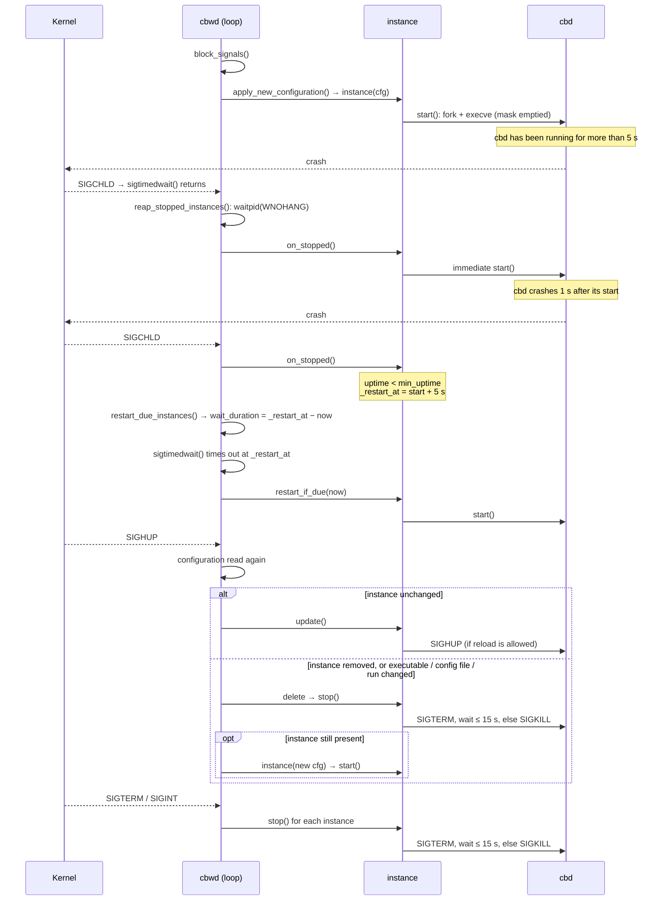

# Broker watchdog (`cbwd`) — supervising the cbd processes

<!-- TOC -->
* [Broker watchdog (`cbwd`) — supervising the cbd processes](#broker-watchdog-cbwd--supervising-the-cbd-processes)
  * [1. Receiving signals](#1-receiving-signals)
  * [2. The main loop](#2-the-main-loop)
  * [3. Two 5 s delays not to be confused](#3-two-5-s-delays-not-to-be-confused)
  * [4. Sequence diagram](#4-sequence-diagram)
  * [5. Stopping an instance](#5-stopping-an-instance)
<!-- TOC -->

This document describes how the Broker watchdog (`cbwd`, `broker/watchdog/`)
works: it starts the `cbd` processes described in its configuration, restarts
them when they stop, reloads them on `SIGHUP` and stops them along with itself.

## 1. Receiving signals

The watchdog installs no signal handler. At startup, `block_signals()`
(`main.cc`) blocks `SIGCHLD`, `SIGHUP`, `SIGINT` and `SIGTERM`, and the main
loop receives them synchronously with `sigtimedwait()`. A signal arriving while
the loop is busy stays pending: it is never lost.

The signal mask is inherited through `execve()`. The child process therefore
empties its mask just before launching `cbd` (`exec_process()`,
`instance.cc`), otherwise `cbd` could not be stopped by a `SIGTERM`.

## 2. The main loop

Each iteration runs:

1. `reap_stopped_instances()` — reaps every terminated `cbd` with
   `waitpid(0, …, WNOHANG)` (non-blocking) and calls `instance::on_stopped()`
   on each of them;
2. if a `SIGHUP` was received, reads the configuration again and applies it
   (`apply_new_configuration()`);
3. `restart_due_instances()` — restarts the instances whose delayed restart is
   due, and computes how long to wait until the next one;
4. `sigtimedwait()` — waits for a signal, at most that long.

## 3. Two 5 s delays not to be confused

- **`instance::min_uptime` (5 s)** — protection against a crash loop. A `cbd`
  stopping less than 5 s after its start is not restarted at once:
  `on_stopped()` sets `_restart_at = start + 5 s`, and
  `restart_due_instances()` restarts it at that time. A `cbd` that lived longer
  is restarted immediately.
- **`max_wait` (5 s, in `restart_due_instances()`)** — the longest wait in
  `sigtimedwait()` when no restart is scheduled. It is only a safety net: the
  death of a `cbd` is notified by `SIGCHLD`. When a restart is scheduled, the
  wait ends exactly when it is due.

## 4. Sequence diagram

## 5. Stopping an instance

`instance::stop()` sends `SIGTERM`, then checks every 100 ms with
`waitpid(_pid, WNOHANG)` whether the process has terminated. After 15 s, it
sends `SIGKILL`. This wait blocks the main loop: during a reload or the
watchdog shutdown, the death of another `cbd` is only handled afterwards. The
matching `SIGCHLD` stays pending and is not lost.
