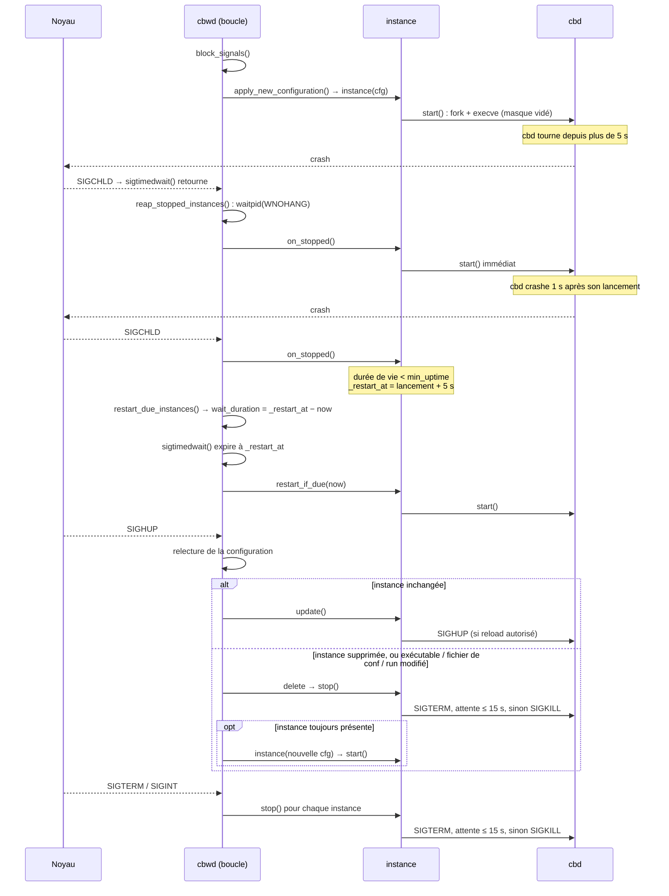

# Watchdog Broker (`cbwd`) — supervision des processus cbd

<!-- TOC -->
* [Watchdog Broker (`cbwd`) — supervision des processus cbd](#watchdog-broker-cbwd--supervision-des-processus-cbd)
  * [1. Réception des signaux](#1-réception-des-signaux)
  * [2. La boucle principale](#2-la-boucle-principale)
  * [3. Deux délais de 5 s à ne pas confondre](#3-deux-délais-de-5-s-à-ne-pas-confondre)
  * [4. Diagramme de séquence](#4-diagramme-de-séquence)
  * [5. Arrêt d'une instance](#5-arrêt-dune-instance)
<!-- TOC -->

Ce document décrit le fonctionnement du watchdog de Broker (`cbwd`,
`broker/watchdog/`) : il lance les processus `cbd` décrits dans sa
configuration, les relance quand ils s'arrêtent, les recharge sur `SIGHUP` et
les arrête avec lui.

## 1. Réception des signaux

Le watchdog n'installe aucun gestionnaire de signal. Au démarrage,
`block_signals()` (`main.cc`) bloque `SIGCHLD`, `SIGHUP`, `SIGINT` et `SIGTERM`,
et la boucle principale les reçoit de façon synchrone avec `sigtimedwait()`.
Un signal arrivé pendant que la boucle travaille reste en attente : il n'est
jamais perdu.

Le masque de signaux est hérité à travers `execve()`. Le processus fils vide
donc son masque juste avant de lancer `cbd` (`exec_process()`, `instance.cc`),
sinon `cbd` ne pourrait pas être arrêté par un `SIGTERM`.

## 2. La boucle principale

Chaque tour de boucle enchaîne :

1. `reap_stopped_instances()` — récupère par `waitpid(0, …, WNOHANG)` tous les
   `cbd` terminés (non bloquant) et appelle `instance::on_stopped()` sur chacun ;
2. si un `SIGHUP` a été reçu, relit la configuration et l'applique
   (`apply_new_configuration()`) ;
3. `restart_due_instances()` — relance les instances dont le redémarrage
   différé est échu, et calcule la durée d'attente jusqu'au prochain ;
4. `sigtimedwait()` — attend un signal, au plus cette durée.

## 3. Deux délais de 5 s à ne pas confondre

- **`instance::min_uptime` (5 s)** — protection contre la boucle de crash. Un
  `cbd` qui s'arrête moins de 5 s après son lancement n'est pas relancé tout de
  suite : `on_stopped()` positionne `_restart_at = lancement + 5 s`, et c'est
  `restart_due_instances()` qui le relance à cette échéance. Un `cbd` qui a vécu
  plus longtemps est relancé immédiatement.
- **`max_wait` (5 s, dans `restart_due_instances()`)** — durée maximale d'une
  attente dans `sigtimedwait()` quand aucun redémarrage n'est programmé. Ce
  n'est qu'un filet de sécurité : la mort d'un `cbd` est signalée par
  `SIGCHLD`. Quand un redémarrage est programmé, l'attente s'arrête exactement
  à son échéance.

## 4. Diagramme de séquence

## 5. Arrêt d'une instance

`instance::stop()` envoie `SIGTERM`, puis vérifie toutes les 100 ms avec
`waitpid(_pid, WNOHANG)` que le processus est terminé. Après 15 s, il envoie
`SIGKILL`. Cette attente bloque la boucle principale : pendant un
rechargement ou l'arrêt du watchdog, la mort d'un autre `cbd` n'est traitée
qu'après. Le `SIGCHLD` correspondant reste en attente et n'est pas perdu.
