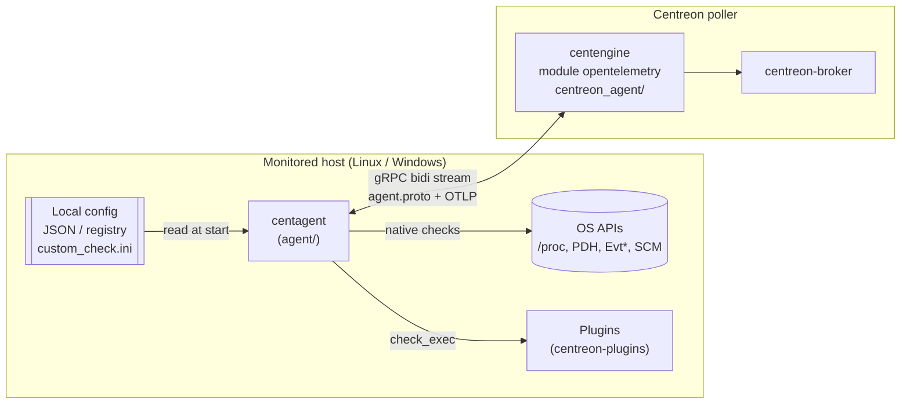
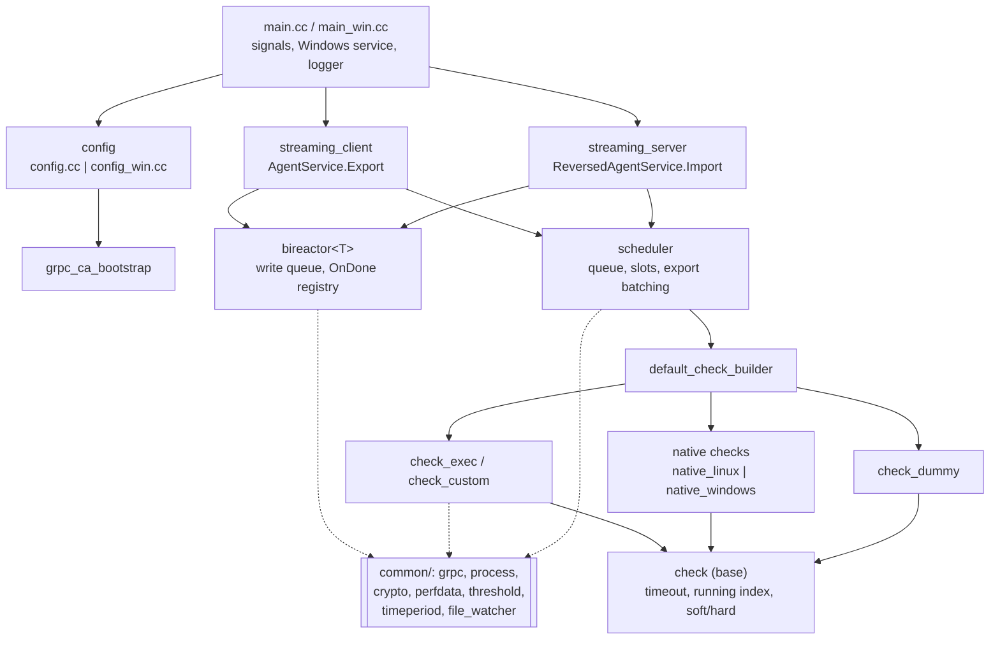
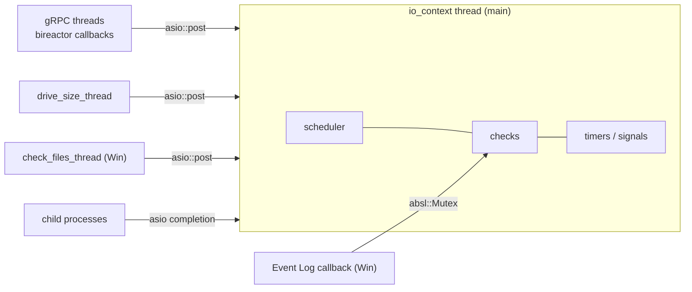
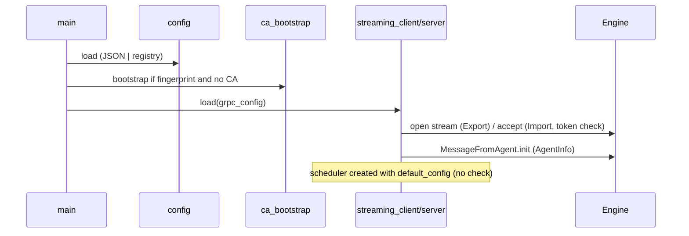
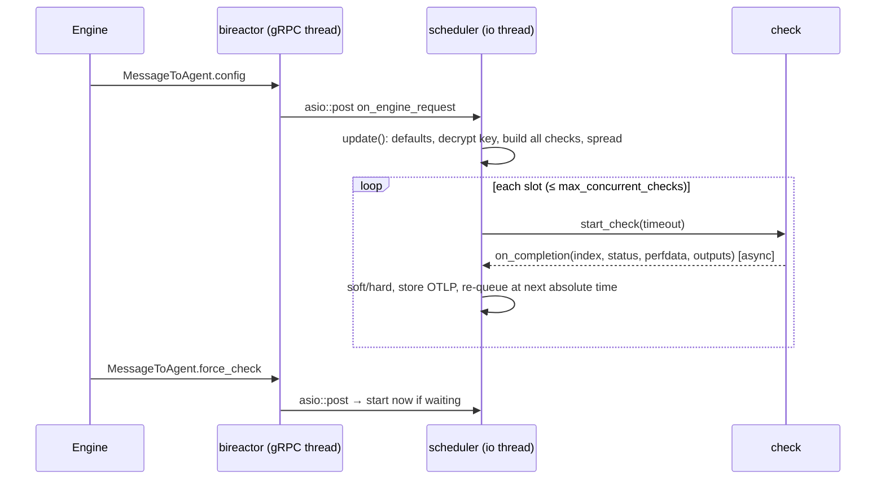
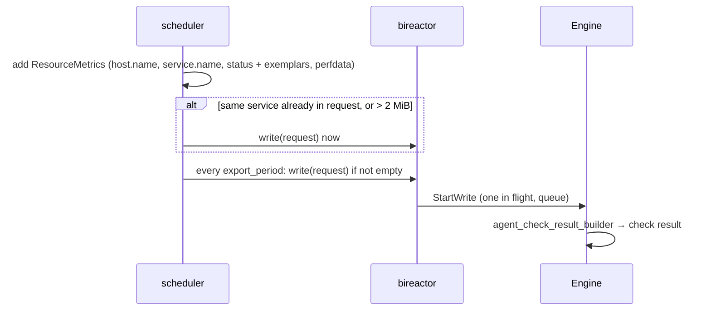

# Centreon Monitoring Agent — architecture map

Entry point to the CMA ADRs. Each block of the architecture names the ADR that governs it. Rules live in the ADRs; this page only places them.

## 1. Context: where the agent sits

| Boundary | Contract | ADR |
| --- | --- | --- |
| Agent ↔ Engine, messages | `agent/proto/agent.proto`: `AgentInfo`, `AgentConfiguration`, `ForceCheck` | [CMA-0004](0004-engine-agent-protocol-contract.md) |
| Agent → Engine, check results | OTLP metrics: `status`, `host.name` / `service.name`, exemplars | [CMA-0005](0005-otlp-metrics-export-contract.md) |
| Agent ↔ Engine, transport | direct (`Export`) or reversed (`Import`), TLS, tokens | [CMA-0003](0003-grpc-streaming-and-connection-modes.md), [CMA-0009](0009-security.md) |
| Host admin → agent | JSON file (Linux), registry (Windows), installers, custom checks | [CMA-0010](0010-local-configuration.md) |
| Agent → packs (CTOR) | native check arguments and perfdata names | [CMA-0008](0008-native-check-conventions.md) |

## 2. Components

| Component | Files | Role | ADR |
| --- | --- | --- | --- |
| Entry points | `src/main.cc`, `src/main_win.cc` | start-up, signals, Windows service, plain-text expiry | [0002](0002-single-threaded-asio-model.md), [0009](0009-security.md), [0011](0011-logging.md) |
| Local configuration | `src/config.cc`, `src/config_win.cc`, `inc/.../config.hh` | singleton read once; custom checks hot reload | [0010](0010-local-configuration.md) |
| CA bootstrap | `src/grpc_ca_bootstrap.cc` | fetch and pin the CA by fingerprint | [0009](0009-security.md) |
| Transport | `bireactor`, `streaming_client`, `streaming_server` | one bidi stream, reconnect, token check | [0003](0003-grpc-streaming-and-connection-modes.md) |
| Scheduler | `src/scheduler.cc` | rebuild on config, spread, slots, concurrency, timeperiods, OTLP batching | [0006](0006-scheduler.md), [0005](0005-otlp-metrics-export-contract.md) |
| Check builder | `scheduler::default_check_builder` | decrypt, JSON → native, else exec, errors → dummy | [0007](0007-check-abstraction-and-lifecycle.md) |
| Check base | `check.hh`, `src/check.cc` | lifecycle, timeout, running index, HARD/SOFT | [0007](0007-check-abstraction-and-lifecycle.md), [0006](0006-scheduler.md) |
| Plugin execution | `src/check_exec.cc` | process spawn, output/perfdata parsing, in-memory credential encryption | [0007](0007-check-abstraction-and-lifecycle.md), [0009](0009-security.md) |
| Native checks | `native_linux/`, `native_windows/`, `src/native_check_*`, `src/drive_size.cc`, `src/check_health.cc` | OS measures, thresholds, perfdata | [0008](0008-native-check-conventions.md) |
| Filters | `src/filter.cc`, `src/filter_rules.cc` | NSClient++-like expressions (boost::parser) | [0008](0008-native-check-conventions.md) |
| Shared libraries | `common/**` | also used by Engine and Broker | [0001](0001-module-layout-and-build.md) |

## 3. Threads

Rule set: [CMA-0002](0002-single-threaded-asio-model.md). Mutexes only on the arrows above.

## 4. Runtime flows

### 4.1 Start-up and connection

ADRs: [0010](0010-local-configuration.md), [0009](0009-security.md), [0003](0003-grpc-streaming-and-connection-modes.md), [0004](0004-engine-agent-protocol-contract.md).

### 4.2 Configuration and check execution

ADRs: [0006](0006-scheduler.md), [0007](0007-check-abstraction-and-lifecycle.md), [0002](0002-single-threaded-asio-model.md).

### 4.3 Result export

ADRs: [0005](0005-otlp-metrics-export-contract.md), [0003](0003-grpc-streaming-and-connection-modes.md).

## 5. Cross-cutting rules

| Topic | Applies to | ADR |
| --- | --- | --- |
| Layout, CMake, C++17 vs C++20, `common/` impact | every file | [CMA-0001](0001-module-layout-and-build.md) |
| Security (TLS, secrets, tokens, commands) | config, transport, exec, logs | [CMA-0009](0009-security.md) |
| Logging levels and macros | every log line | [CMA-0011](0011-logging.md) |
| C++ style | every `.cc` / `.hh` | [CMA-0012](0012-code-style.md) |
| Tests and definition of done | every PR | [CMA-0013](0013-testing-and-definition-of-done.md) |

## 6. Which ADR for which change

| Change | Read |
| --- | --- |
| New native check | 0008 → 0007 → 0002 → 0013 |
| New field sent by Engine | 0004 → 0006 → Engine side |
| New data in check results | 0005 → 0004 |
| New local option | 0010 → 0009 if security-related |
| Connection / reconnection behaviour | 0003 → 0002 → 0009 |
| Scheduling, retries, timeperiods | 0006 → 0013 |
| Build, new file, new dependency | 0001 |

Area guidance for Claude sessions: [`agent/CLAUDE.md`](../../../agent/CLAUDE.md). Design notes (scheduler worked examples, filter grammar tips): [`agent/doc/agent-doc.md`](../../../agent/doc/agent-doc.md).
